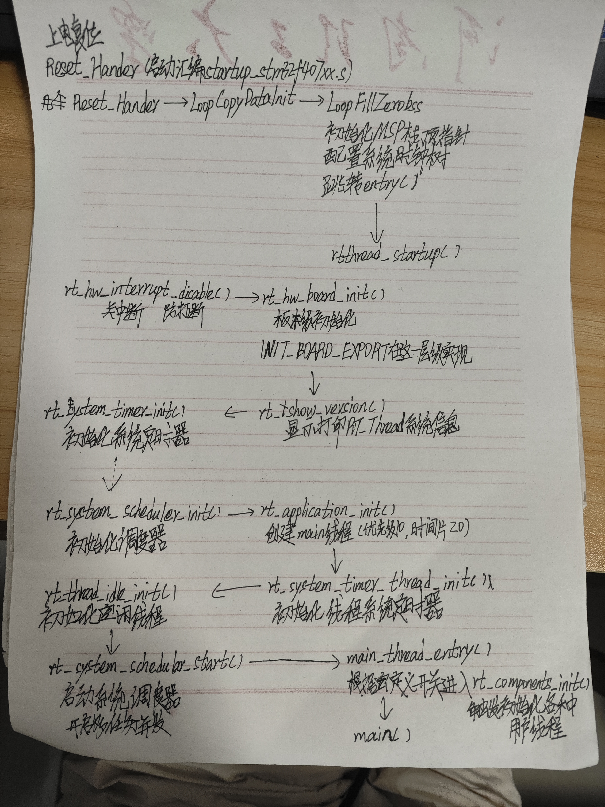
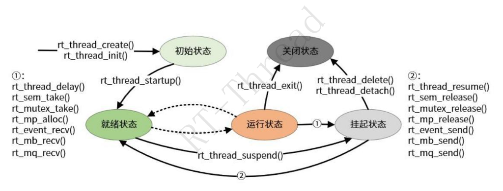

# 【DAY2】RT-Thread 启动流程、内核基础与多线程编程

> **提交人**：冷梦奇（第1组）  
> **日期**：2026-08-20  
> **目标平台**：STM32F407 星火1号（`stm32f407-rtspark`）  
> **工程项目**：`01_hello_rtt`  
> **提交物**：理论总结与实验报告（`README.md`）+ 多线程实战源码（`thread_study.c`）

---

## Part 1：理论知识梳理文档

### 1. STM32F407 启动流程与 RT-Thread 引导机制

#### 1.1 裸机前后台系统 vs RTOS 核心优势

裸机系统通常采用“中断（前台）+ 主循环 `while(1)`（后台）”的轮询架构，存在四大根本缺陷：
- **并发性差**：多任务只能串行执行，无法真正并发推进。
- **实时性低**：主循环中前序任务的隐式延时会阻塞后续任务，关键事件响应不及时。
- **可维护性差**：所有业务逻辑糅杂在一个大循环中，牵一发而动全身。
- **可重用性差**：软件与底层硬件时序强耦合，模块化程度低。

RT-Thread 采用 **“分而治之”** 的思想，将复杂系统拆分为多个相互独立的**线程（Thread）**，由内核调度器根据优先级和时间片在微观上快速切换执行，使宏观上呈现出多任务并发推进的效果。

---

#### 1.2 完整启动路径与调用链

##### 📷 手写启动流程图原件


##### 📝 详细调用链与执行逻辑梳理

```text
上电复位 (Hardware Reset)
  │
  ▼
Reset_Handler (启动汇编 startup_stm32f407xx.s)
  ├── 1. Reset_Handler -> LoopCopyDataInit -> LoopFillZerobss (复制数据段/清零BSS段)
  ├── 2. 初始化 MSP 栈顶指针
  ├── 3. 配置系统时钟树 (SystemInit)
  └── 4. 跳转 entry() (GCC / RT-Thread Studio 引导入口)
           │
           ▼
rtthread_startup() (位于 components.c)
  ├── rt_hw_interrupt_disable()    // 1. 关中断（防打断）
  ├── rt_hw_board_init()           // 2. 板级硬件初始化
  │      └── INIT_BOARD_EXPORT     //    (在这一层级实现板级硬件/串口控制台导出初始化)
  ├── rt_show_version()            // 3. 显示打印 RT-Thread 系统版本信息
  ├── rt_system_timer_init()       // 4. 初始化系统定时器链表
  ├── rt_system_scheduler_init()   // 5. 初始化调度器（优先级就绪队列）
  ├── rt_application_init()        // 6. 创建 main 线程（优先级 10，时间片 20，入口 main_thread_entry）
  ├── rt_system_timer_thread_init()// 7. 初始化线程系统定时器
  ├── rt_thread_idle_init()        // 8. 初始化空闲线程（优先级 31 最低，永远就绪）
  └── rt_system_scheduler_start()  // 9. 启动系统调度器（开启多任务并发执行，从此不返回）
           │
           ▼
main_thread_entry() (main 线程入口函数)
  ├── rt_components_init()         // 根据宏定义开关进入，自动加载初始化各种用户应用线程 (INIT_APP_EXPORT)
  └── main()                       // 跳转执行用户的 main(void) 函数
```

#### 1.3 启动核心机制深度剖析

1. **调度器启动后是如何跳转到 `main_thread_entry` 的？**
   - **伪造栈帧（`rt_hw_stack_init`）**：在创建 `main` 线程时，内核在其私有栈空间中预先模拟了 ARM Cortex-M 异常堆栈帧（填入 `xPSR`、`R0`、`LR` 等），其中 **`PC` 寄存器的初始值被直接赋予了 `main_thread_entry` 的函数入口地址**。
   - **出栈跳转（`rt_hw_context_switch_to`）**：`rt_system_scheduler_start()` 调用底层汇编函数，将 CPU 栈指针 PSP 指向 `main` 线程栈顶并执行 `POP` 出栈操作。当弹出到 `PC` 时，硬件自动将执行流载入 `main_thread_entry()`。
2. **为什么 `main` 线程（优先级 10）会最先执行？**
   - 调度器启动瞬间，业务线程（如 `th_led1`、`th_monitor`）均写在 `INIT_APP_EXPORT` 中，**此时根本尚未被创建**；
   - 系统就绪队列中仅有 `main` 线程（优先级 10）与 `idle` 空闲线程（优先级 31），优先级 10 属于全系统最高就绪态，因此必然被首先调度执行。

#### 1.4 自动初始化机制底层原理

RT-Thread 实现了高效的**自动初始化机制**（Runtime Initialization Export），无需在 `main()` 中显式调用外设与应用初始化：

- **核心段机制**：利用编译器段属性（`__attribute__((used, section(".rti_fn.*")))`），将初始化函数的函数指针在编译链接期按名称排序收集到只读数据段中。
- **段级别分布**：
  ```text
  .rti_fn.1  -> INIT_BOARD_EXPORT (板级硬件初始化，在调度器启动前的 rt_hw_board_init 中执行)
  .rti_fn.2  -> INIT_PREV_EXPORT
  .rti_fn.3  -> INIT_DEVICE_EXPORT (驱动设备注册)
  .rti_fn.4  -> INIT_COMPONENT_EXPORT (组件初始化)
  .rti_fn.5  -> INIT_ENV_EXPORT
  .rti_fn.6  -> INIT_APP_EXPORT (用户应用/线程自动创建，如 thread_study_init)
  ```
- **执行阶段对比**：
  - `INIT_BOARD_EXPORT`：在 `rt_components_board_init()` 中执行，处于**调度器启动前**。此时无内存堆、无多任务调度，**严禁使用 IPC 与延时阻塞**。
  - `INIT_APP_EXPORT`：在 `main_thread_entry()` 中的 `rt_components_init()` 中以 `for` 循环指针遍历执行，处于**调度器启动后**。内存堆与调度环境完备，**可安全创建线程与 IPC**。

---

### 2. 内核基础与对象模型

#### 2.1 对象容器与面向对象继承体系

RT-Thread 采用纯 C 语言实现了精炼的面向对象架构：
- **对象基类 `struct rt_object`**：内核中所有核心实体均内嵌该基类，包含对象名称（`name`）、类型（`type`）、标志（`flag`）与双向链表节点（`list`），由全局对象容器表 `rt_object_container` 统一索引管理。
- **内核对象继承关系图**：

```text
                     ┌───────────────────┐
                     │  struct rt_object │ (基类: name, type, flag, list)
                     └─────────┬─────────┘
                               │
         ┌─────────────┬───────┴───────┬────────────┬─────────────┐
         ▼             ▼               ▼            ▼             ▼
   rt_thread      rt_mempool     rt_ipc_object   rt_timer      rt_device
  (线程控制块)    (内存池管理)    (IPC 同步基类)   (定时器对象)  (I/O 设备基类)
                                       │
                    ┌──────────┬───────┴───┬──────────┬──────────┐
                    ▼          ▼           ▼          ▼          ▼
                 rt_sem     rt_mutex    rt_event    rt_mb      rt_mq
                (信号量)    (互斥量)     (事件集)   (邮箱)    (消息队列)
```

#### 2.2 线程控制块（TCB）与线程栈模型

**线程控制块（`struct rt_thread`）核心成员解析**：
| 成员名 | 类型 | 核心作用说明 |
| :--- | :--- | :--- |
| `parent` | `struct rt_object` | 继承内核对象基类，支持容器链表索引与名称管理。 |
| `sp` | `void *` | 线程栈顶指针。上下文切换时用于保存/恢复 CPU 寄存器现场。 |
| `entry` | `void *` | 线程入口函数指针（`void (*entry)(void *parameter)`）。 |
| `parameter` | `void *` | 传递给入口函数的入口参数。 |
| `stack_addr` | `void *` | 线程栈空间的起始物理基地址。 |
| `stack_size` | `rt_uint32_t` | 线程栈分配的总字节大小（需按 `RT_ALIGN_SIZE` 对齐）。 |
| `error` | `rt_err_t` | 线程最近一次执行的错误代码（如 `RT_EOK`, `-RT_ETIMEOUT`）。 |
| `stat` | `rt_uint8_t` | 线程当前运行状态（`INIT`, `READY`, `SUSPEND`, `RUNNING`, `CLOSE`）。 |
| `current_priority` | `rt_uint8_t` | 线程当前优先级。发生互斥量优先级继承时会动态提升，防止优先级反转。 |
| `init_priority` | `rt_uint8_t` | 线程初始配置的固定优先级。 |
| `init_tick` | `rt_ubase_t` | 线程被分配的单次调度初始时间片（OS Tick）。 |
| `remaining_tick` | `rt_ubase_t` | 线程在当前轮次中剩余的时间片大小，每个 SysTick 递减。 |
| `thread_timer` | `struct rt_timer` | 线程内置的系统定时器，用于实现超时等待与 `mdelay` 延时唤醒。 |
| `cleanup` | `void (*)(struct rt_thread *)` | 线程退出时的资源清理回调函数。 |

**ARM Cortex-M 线程栈帧初始化结构（高地址 $\rightarrow$ 低地址向下生长）**：
```text
栈底 (高物理地址)
  ├── xPSR  = 0x01000000        (Cortex-M Thumb 状态位)
  ├── PC    = thread_entry      (线程入口函数地址)
  ├── LR    = rt_thread_exit    (线程退出清除函数)
  ├── R12   = 0
  ├── R3~R1 = 0
  ├── R0    = parameter         (入口参数)
  ├── R11~R4= 0                 (软件保存的通用寄存器)
栈顶 (低物理地址) <-- TCB 中的 sp 指向此处
```

#### 2.3 静态对象与动态对象的深度对比

| 比较维度 | 静态对象（Static Object） | 动态对象（Dynamic Object） |
| :--- | :--- | :--- |
| **内存分配位置** | 编译期分配在全局/静态数据区（`.data` / `.bss` 段） | 运行期由内核从系统动态内存堆（Heap）中申请 |
| **初始化 API** | `rt_thread_init()`, `rt_sem_init()` 等 | `rt_thread_create()`, `rt_sem_create()` 等 |
| **生命周期** | 伴随系统整个运行周期，由程序静态管理 | 动态创建与动态销毁，生命周期灵活可变 |
| **资源释放机制** | `rt_thread_detach()` 脱离对象容器，内存不释放 | `rt_thread_delete()` 标记关闭，空闲线程回收堆内存 |
| **确定性与可靠性**| **极高**（编译期确定内存地址与大小，零失败率） | 受堆剩余空间与碎片化影响，存在分配失败风险 |

**为什么某些高可靠场景（航空航天/汽车电子/医疗）强制使用静态线程？**
1. **彻底消除堆内存碎片风险**：系统长期运行中频繁动态申请与释放易导致内存碎片化，最终引起申请失败。
2. **执行时间与空间高度确定性**：静态分配在编译链接时完全固定，不会因堆管理算法搜索空闲块引入非确定性延迟。
3. **符合严苛安全规范**：DO-178C、ISO 26262、MISRA C 等标准严格限制运行期动态内存分配。

#### 2.4 系统两大内置线程的分工

| 线程名 | 优先级 | 核心职责说明 |
| :--- | :--- | :--- |
| **`main` 主线程** | 默认 `10` | 负责系统组件与应用的自动初始化（`rt_components_init`），随后调用用户 `main()`。 |
| **`idle` 空闲线程** | `31` (最低) | ① 状态永远为就绪态，死循环运行，永远不能被挂起；<br>② **资源回收**：扫描 `rt_thread_defunct` 僵尸队列，释放已关闭线程的 TCB 和栈空间；<br>③ **钩子函数调用**：支持用户挂接低功耗休眠（PM）、看门狗喂狗等操作。 |

---

### 3. 线程状态机与调度算法

#### 3.1 五态模型与全 API 状态转换矩阵

RT-Thread 线程具有 5 种生命周期状态：
1. **初始态（`RT_THREAD_INIT`）**：线程刚完成初始化/创建，尚未加入就绪队列。
2. **就绪态（`RT_THREAD_READY`）**：按优先级在就绪队列中排队，等待 CPU 调度。
3. **运行态（`RT_THREAD_RUNNING`）**：获得 CPU 执行权正在运行（单核系统中仅 `rt_thread_self()` 处于此状态）。
4. **挂起态（`RT_THREAD_SUSPEND`）**：因延时、等待 IPC 资源或主动挂起而让出 CPU。
5. **关闭态（`RT_THREAD_CLOSE`）**：线程运行结束或被删除，进入僵尸队列等待回收。

##### 📷 线程五态转换机制图


##### 📝 典型 API 触发状态转换关系说明
- **创建/初始化 $\rightarrow$ 初始态**：`rt_thread_create()` / `rt_thread_init()`
- **初始态 $\rightarrow$ 就绪态**：`rt_thread_startup()`
- **就绪态 $\leftrightarrow$ 运行态**：调度器调度 / 时间片轮转 / 高优先级抢占
- **运行态 $\rightarrow$ 挂起态（阻塞）**：
  - 延时让出：`rt_thread_delay()` / `rt_thread_mdelay()`
  - IPC 阻塞等待：`rt_sem_take()` / `rt_mutex_take()` / `rt_event_recv()` / `rt_mb_recv()` / `rt_mq_recv()` / `rt_mp_alloc()`
  - 显式挂起：`rt_thread_suspend()`
- **挂起态 $\rightarrow$ 就绪态（唤醒）**：
  - 延时到期 / IPC 资源就绪：`rt_sem_release()` / `rt_mutex_release()` / `rt_event_send()` / `rt_mb_send()` / `rt_mq_send()` / `rt_mp_release()`
  - 显式恢复：`rt_thread_resume()`
- **运行态 / 挂起态 $\rightarrow$ 关闭态**：
  - 线程执行完毕自动退出：`rt_thread_exit()`
  - 动态删除 / 静态脱离：`rt_thread_delete()` / `rt_thread_detach()`

#### 3.2 调度机制剖析

1. **全抢占式基于优先级调度（Preemptive Priority Scheduling）**：
   - 系统支持 32 / 256 级优先级（0 为最高，31 / 255 为最低）。
   - 内核维护优先级就绪位图，基于 Cortex-M 硬件 `CLZ` 指令在 $O(1)$ 常数时间内定位当前最高优先级就绪线程。
   - 一旦高优先级线程就绪（如中断唤醒、延时到期），内核立即触发 `PendSV` 异常进行上下文切换，抢占 CPU。
2. **时间片轮转调度（Time-Slice Round-Robin Scheduling）**：
   - 仅对**同优先级**就绪线程有效；每个 SysTick 递减运行线程的 `remaining_tick`，归零后重新装载满时间片并排到队列末尾，让下一个同优先级线程运行。

#### 3.3 中断与线程交互设计规范
- **中断服务函数（ISR）禁忌**：中断拥有最高执行特权且无法被挂起，**严禁在中断回调函数中调用 `rt_thread_mdelay()` 等阻塞函数**。
- **中断消抖最佳实践**：采用非阻塞时间戳差值法（`rt_tick_get() - last_tick < 200ms`）过滤机械抖动。
- **函数作用域规范**：内部私有函数与全局变量使用 `static` 修饰，避免跨模块同名符号冲突。

---

## Part 2：多线程实战编程（C 语言实现）

### 1. 源码设计说明（`thread_study.c`）

在 `applications/thread_study.c` 中实现了各项基础任务要求：
1. **动态工作线程 `th_led1`**：
   - 优先级：16，时间片：5 ticks，栈大小：1024 字节。
   - 循环翻转板载红灯（`PIN_LED_R`，引脚 `PF12`），每次打印计数与当前系统 tick（`rt_tick_get()`）。
2. **静态工作线程 `th_led2`**：
   - 优先级：16，时间片：5 ticks，全局静态栈数组 `th_led2_stack[1024]` 与控制块 `struct rt_thread th_led2`。
   - 循环翻转板载蓝灯（`PIN_LED_B`，引脚 `PF11`），每次打印计数值。
3. **监控与控制线程 `th_monitor`**：
   - 优先级：10（高于工作线程），周期延时 `rt_thread_mdelay(2000)`。
   - 周期性唤醒后打印 `th_led1` 和 `th_led2` 的运行状态与剩余栈空间大小。
   - 结合板载按键 `KEY_LEFT`（`PIN_KEY`，引脚 `PC0`）中断：单次按下调用 `rt_thread_suspend()` 挂起 `th_led1`；再次按下调用 `rt_thread_resume()` 恢复。
4. **系统集成与命令导出**：
   - 使用 `INIT_APP_EXPORT(thread_study_init)` 自动加载测试模块，无需修改 `main.c`。
   - 使用 `MSH_CMD_EXPORT(thread_dump, ...)` 导出自定义查看命令，方便在控制台查看线程信息。

---

### 2. 硬件引脚分配与对应关系

| 设备名称 | 芯片物理引脚 | 对应 RT-Thread PIN 编号定义 | 工作模式 |
| :--- | :--- | :--- | :--- |
| **LED_R（红灯）** | `PF12` | `GET_PIN(F, 12)` | 输出模式，低电平点亮 / 高电平熄灭 |
| **LED_B（蓝灯）** | `PF11` | `GET_PIN(F, 11)` | 输出模式，低电平点亮 / 高电平熄灭 |
| **KEY_LEFT（按键）** | `PC0` | `GET_PIN(C, 0)` | 下降沿中断模式，上拉输入 |

---

### 3. 串口运行与交互日志

系统上电启动并在 FinSH 控制台交互的运行输出：

```text
 \ | /
- RT -     Thread Operating System
 / | \     4.1.1 build Aug 20 2026 20:20:00
 2006 - 2022 Copyright by RT-Thread team

hello RSOC2026!
msh />
[th_led1] count: 0, tick: 10
[th_led2] count: 0
[th_led1] count: 1, tick: 510
[th_led2] count: 1
[th_led1] count: 2, tick: 1010
[th_led2] count: 2
[th_led1] count: 3, tick: 1510
[th_led2] count: 3

--- Monitor Report ---
th_led1: stat=0x02, free stack=848 B
th_led2: stat=0x02, free stack=848 B
-----------------------

[th_led1] count: 4, tick: 2010
[th_led2] count: 4

>>> [Key] th_led1 suspended! <<<

[th_led2] count: 5
[th_led2] count: 6
[th_led2] count: 7

--- Monitor Report ---
th_led1: stat=0x02, free stack=848 B
th_led2: stat=0x02, free stack=848 B
-----------------------

>>> [Key] th_led1 resumed! <<<

[th_led1] count: 5, tick: 4215
[th_led2] count: 8
[th_led1] count: 6, tick: 4715

msh />thread_dump
=== Custom Thread Dump ===
th_led1: prio=16, stat=0x02
th_led2: prio=16, stat=0x02
```

---

## Part 3：Gitee PR 提交与规范

### 1. 提交目录结构
```
2026/第1组/冷梦奇/作业/第二天作业
├── figures/
│   ├── startup_flowchart.jpg     # 手写启动流程图
│   └── thread_state_machine.png  # 线程五态转换机制图
├── README.md                     # Part 1 理论整理 + Part 2 实验结果分析与串口日志
└── thread_study.c                # 作业源码（含动/静态线程、自动初始化、MSH导出）
```

### 2. Git 操作与 PR 提交流程

```bash
# 1. 进入作业仓库本地路径
cd "d:\嵌入式\rtt-study\rsoc-rtt"

# 2. 从当前状态基于 master 创建并切换到 day2 个人特性分支
git checkout master
git pull origin master
git checkout -b day2-lengmengqi

# 3. 添加提交文件并提交
git add 2026/第1组/冷梦奇/作业/第二天作业/
git commit -m "feat(day2): 完成内核基础与多线程编程作业及理论文档 - 冷梦奇"

# 4. 推送到个人 Gitee 远程仓库
git push -u origin day2-lengmengqi
```

### 3. Pull Request 提交信息
- **主仓库**：`https://gitee.com/rtthread/rsoc-rtt`
- **PR 标题**：`[作业提交] 内核与多线程培训 - 冷梦奇`
- **PR 内容模板**：
  ```markdown
  ### 提交说明
  - **学员姓名**：冷梦奇
  - **小组归属**：第1组
  - **完成任务**：
    1. 理论总结：STM32F407 启动流程、INIT 自动初始化段原理、TCB 内核对象模型、动态/静态内存分配对比、五态模型与抢占式/时间片轮转调度分析。
    2. 多线程实战：动态创建 `th_led1` 翻转红灯、静态初始化 `th_led2` 翻转蓝灯、高优先级监控线程 `th_monitor` 输出状态与栈剩余率、按键中断挂起与恢复控制。
    3. 系统集成：`INIT_APP_EXPORT` 自动加载、`MSH_CMD_EXPORT` 导出 `thread_dump` 自定义诊断命令。
    4. 硬件验证：星火1号板载 LED、按键中断与串口终端测试全部通过。
  ```
