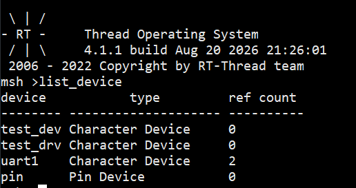
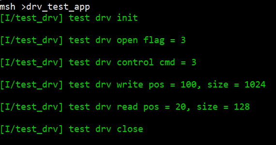

# 第四天作业：虚拟设备驱动框架（test_dev）

## 作业内容

在 RT-Thread 上设计一个**虚拟字符设备驱动框架**，实现标准 OPS 接口（init / open / close / read / write / control），验证"统一 I/O 框架 + 驱动 OPS 挂接"的对接机制。

## 文件说明

| 文件 | 说明 |
| --- | --- |
| `test_dev.c` | 虚拟设备驱动：6 个 OPS 实现 + 注册函数 `rt_drv_test_init` + MSH 验证命令 |
| `test_dev.h` | 头文件（`rt_drv_test_init` 声明） |

- 设备名：`test_drv`（`RT_Device_Class_Char` 字符设备，`RT_DEVICE_FLAG_RDWR`）
- 自动初始化：`INIT_BOARD_EXPORT(rt_drv_test_init)`，上电自动创建 + 挂接 OPS + 注册

## 验证结果（串口日志）

### `list_device` —— 设备注册成功

###  `drv_test_app` —— OPS 接口调用成功

