# RTT启动流程

## RTT启动流程分析

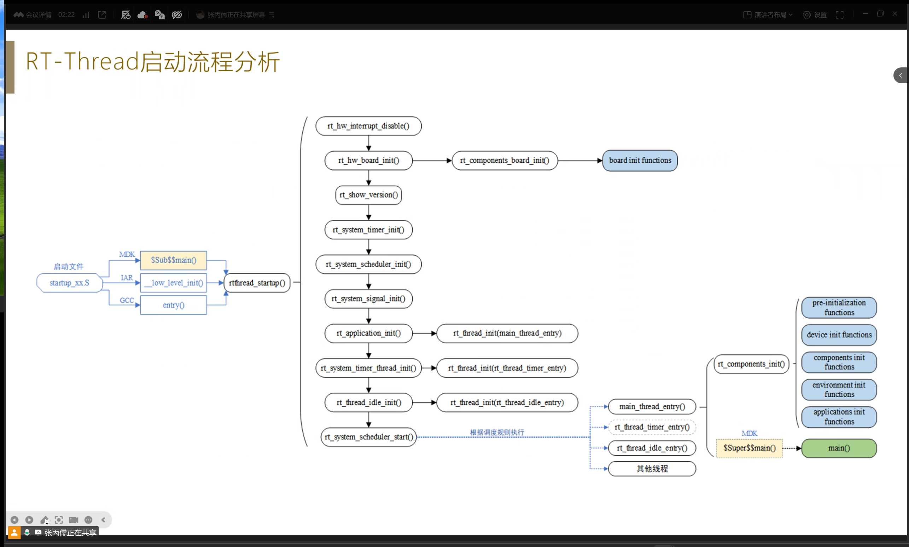

RT-Thread 从启动文件到调度开始的完整初始化流程。

1. **启动文件入口**（`startup_xx.S`）按编译器不同有三个入口：
   - MDK：`$Sub$$main()` 先于 main 执行
   - IAR：`_low_level_init()`
   - GCC：`entry()`
2. 三者最终都进入 **`rtthread_startup()`**，按顺序执行：
   - `rt_hw_interrupt_disable()` 关闭中断
   - `rt_hw_board_init()` 硬件初始化（时钟/串口等）
   - `rt_components_board_init()` 板级组件初始化
   - `rt_show_version()` 打印版本信息
   - `rt_system_timer_init()` / `rt_system_scheduler_init()` / `rt_system_signal_init()` 系统三大初始化
   - `rt_application_init()` 应用初始化：创建 `main_thread_entry`（主线程）
   - `rt_system_timer_thread_init()` 创建 `rt_thread_timer_entry`（定时器线程）
   - `rt_thread_idle_init()` 创建 `rt_thread_idle_entry`（空闲线程）
3. **`rt_system_scheduler_start()`** 启动调度器，按调度规则运行各线程。
4. `rt_components_init()` 中按段执行各类初始化函数（pre-initialization / device / components / environment / applications）。
5. MDK 下最终通过 `$Super$$main()` 跳入用户 `main()`。

## 线程控制模块定义

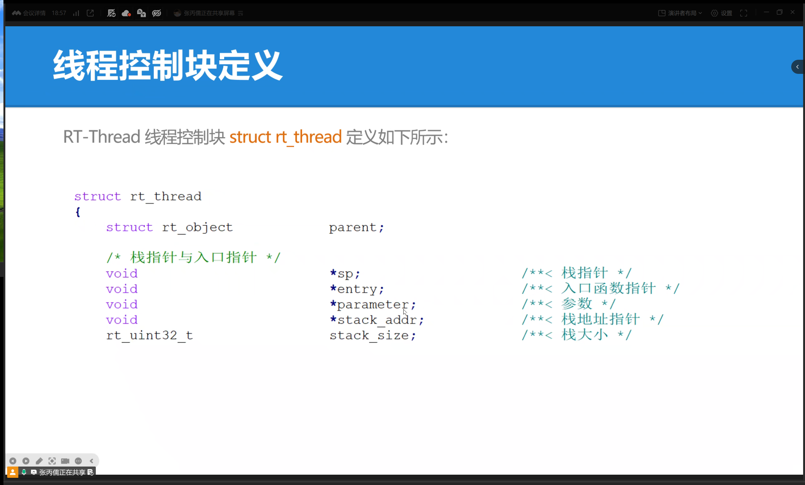

线程控制块 `struct rt_thread` 的定义：

```c
struct rt_thread
{
    struct rt_object     parent;      /* 内核对象基类 */

    /* 栈指针与入口指针 */
    void                *sp;          /* 栈指针 */
    void                *entry;       /* 入口函数指针 */
    void                *parameter;   /* 参数 */
    void                *stack_addr;  /* 栈地址指针 */
    rt_uint32_t          stack_size;  /* 栈大小 */
};
```

线程控制块的继承关系：

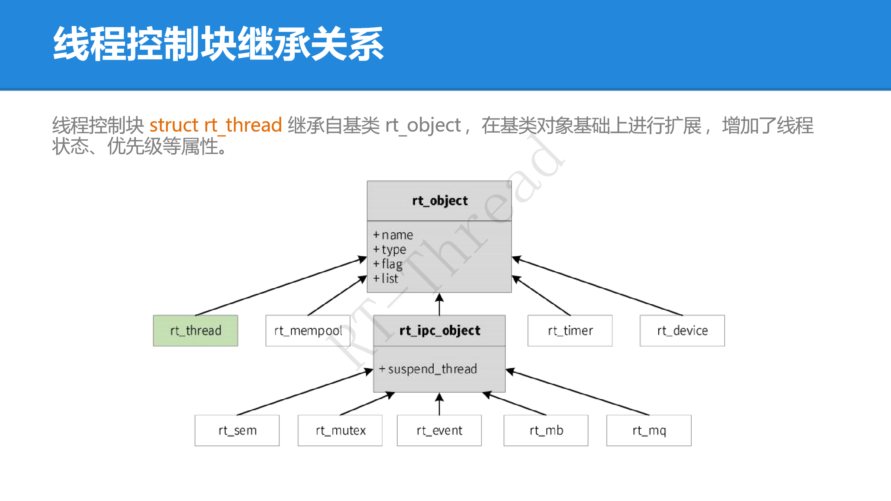

线程控制块 `struct rt_thread` **继承自基类 `rt_object`**（含 name/type/flag/list 四个成员），在基类基础上扩展了线程状态、优先级等属性。`rt_ipc_object` 同样继承自 `rt_object`，其下派生出 `rt_sem`、`rt_mutex`、`rt_event`、`rt_mb`、`rt_mq` 等 IPC 对象；`rt_thread` 与 `rt_timer`、`rt_device`、`rt_mempool` 平级。

```c
/* 错误代码 */
rt_err_t    error;               /* 线程错误代码 */
rt_uint8_t  stat;                /* 线程状态 */

/* 优先级 */
rt_uint8_t  current_priority;    /* 当前优先级 */
rt_uint8_t  init_priority;       /* 初始优先级 */
rt_uint32_t number_mask;

/* 时间片 */
rt_ubase_t  init_tick;           /* 线程初始化计数值 */
rt_ubase_t  remaining_tick;      /* 线程剩余计数值 */

struct rt_timer thread_timer;    /* 内置线程定时器 */

void (*cleanup)(struct rt_thread *tid);  /* 线程退出清除函数 */
rt_uint32_t user_data;           /* 用户数据 */
```

线程控制块是操作系统管理线程的数据结构，存放优先级、线程名称、线程状态、链表结构、等待事件集合等信息；由 `struct rt_thread` 定义形成线程内核对象，再链接到内核对象容器中统一管理。

## 时间片

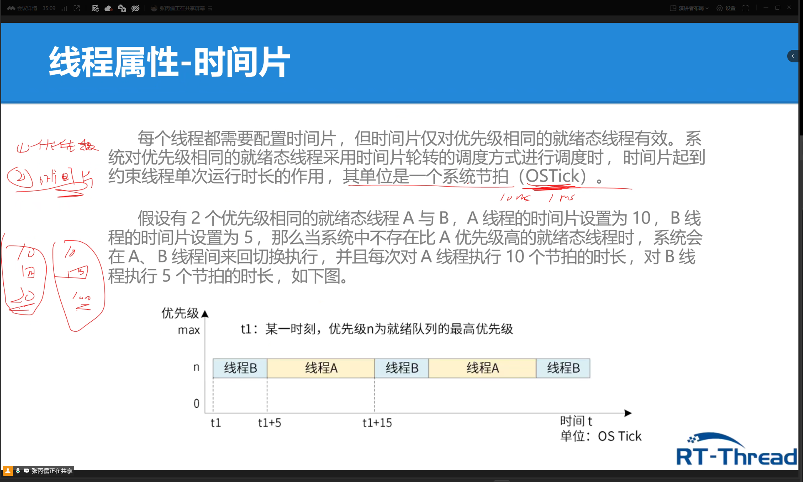

- 每个线程都需要配置时间片，但**时间片仅对优先级相同的就绪态线程有效**。
- 系统对同优先级就绪线程采用**时间片轮转**调度，时间片约束线程单次运行时长，单位为 1 个系统节拍（OS Tick）。
- **示例**：同优先级的线程 A 时间片=10、线程 B 时间片=5，则系统在 A/B 间来回切换，每次 A 运行 10 节拍、B 运行 5 节拍。
- 时序示意：`t1` 时 A 开始 → `t1+5` 切到 B → `t1+15` 切回 A……（优先级 n 为就绪队列最高优先级）。

线程时间片参数在 `rt_thread_init()` / `rt_thread_create()` 的最后一个 `tick` 参数中指定，是线程属性之一（另两个属性是优先级、入口函数）。

## 系统线程

### 空闲线程

idle线程->空闲线程

0-31个线程，空闲线程（idle）排位在31

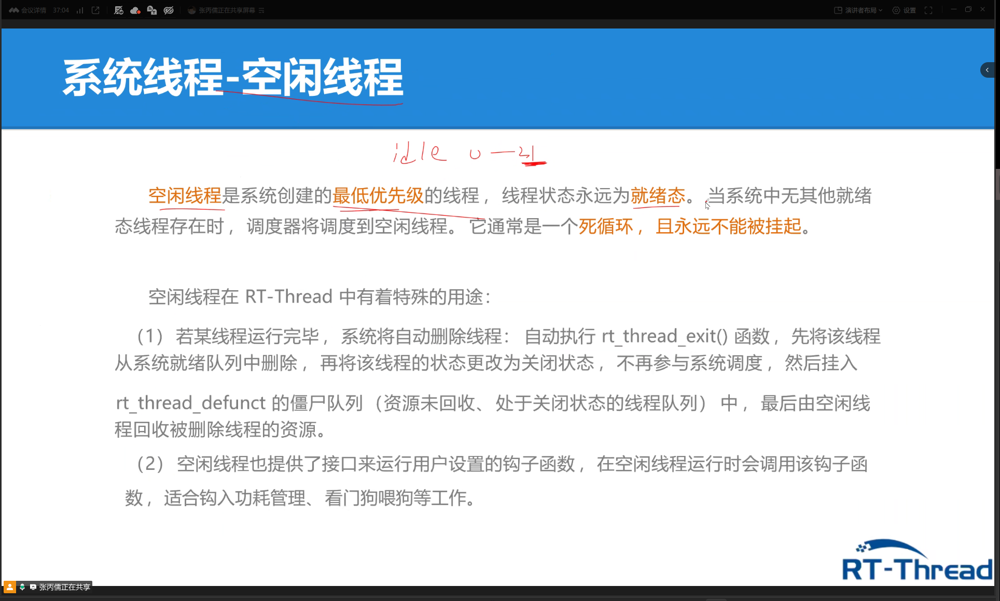

- **定义**：空闲线程是系统创建的最低优先级线程，状态永远为就绪态；当无其他就绪线程时调度器运行它；通常是死循环，**永远不能被挂起**。
- **特殊用途（1）**：线程运行完毕后自动删除——执行 `rt_thread_exit()`，先将线程从就绪队列删除、状态改为关闭，再挂入 `rt_thread_defunct` 僵尸队列，**由空闲线程回收资源**。
- **特殊用途（2）**：提供钩子函数接口，空闲线程运行时调用用户钩子，适合**功耗管理、看门狗喂狗**等工作。

### 线程初始化（静态创建）

静态创建

有确定性

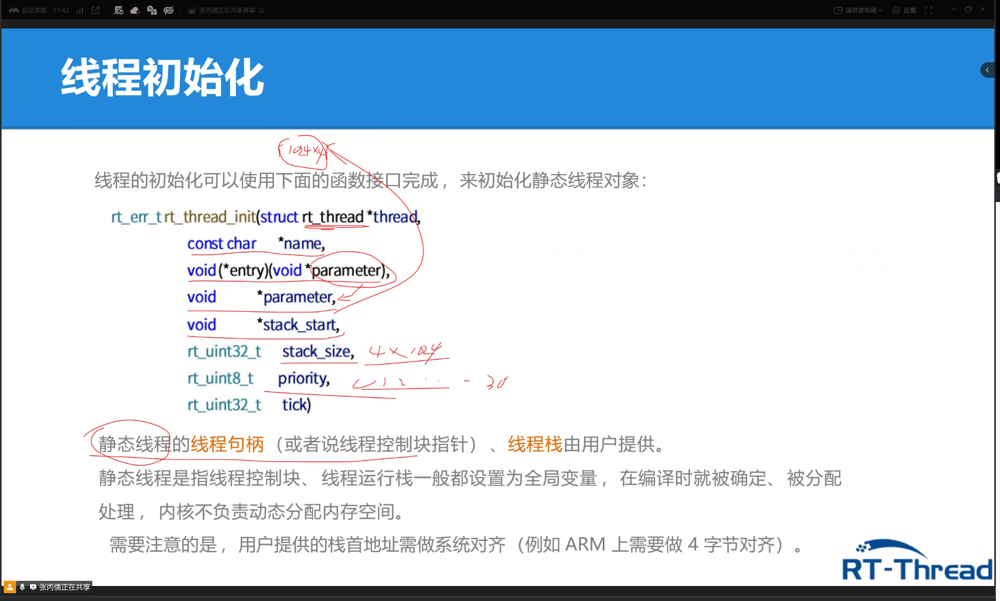

静态线程初始化接口。

```c
rt_err_t rt_thread_init(struct rt_thread *thread,
                        const char *name,
                        void(*entry)(void *parameter),
                        void *parameter,
                        void *stack_start,
                        rt_uint32_t stack_size,
                        rt_uint8_t priority,
                        rt_uint32_t tick);
```

- **静态线程**：线程句柄（控制块指针）、线程栈由**用户提供**，通常设为全局变量，编译时即确定分配，内核不负责动态分配内存。
- 用户提供的**栈首地址需做系统对齐**（ARM 上需 4 字节对齐）。

`rt_thread_init` 参数表：

| 参数 | 描述 |
|---|---|
| `thread` | 线程句柄，由用户提供，指向线程控制块内存地址 |
| `name` | 线程名称；最大长度由 `rtconfig.h` 的 `RT_NAME_MAX` 宏指定，多余部分被截掉 |
| `entry` | 线程入口函数 |
| `parameter` | 线程入口函数参数 |
| `stack_start` | 线程栈起始地址 |
| `stack_size` | 线程栈大小（字节），需做地址对齐（ARM 4 字节对齐） |
| `priority` | 优先级，范围由 `RT_THREAD_PRIORITY_MAX` 决定（256 级时 0~255），数值越小优先级越高，0 最高 |
| `tick` | 时间片大小，单位为系统时钟节拍；同优先级线程存在时决定单次调度最大运行时间 |

返回：`RT_EOK` 成功 / `-RT_ERROR` 失败。

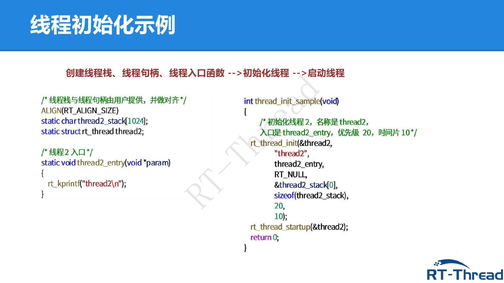

```c
/* 线程栈与线程句柄由用户提供，并做对齐 */
ALIGN(RT_ALIGN_SIZE)
static char thread2_stack[1024];
static struct rt_thread thread2;

/* 线程2 入口 */
static void thread2_entry(void *param)
{
    rt_kprintf("thread2\n");
}

int thread_init_sample(void)
{
    /* 初始化线程2：名称 thread2，入口 thread2_entry，优先级 20，时间片 10 */
    rt_thread_init(&thread2,
        "thread2",
        thread2_entry,
        RT_NULL,
        &thread2_stack[0],
        sizeof(thread2_stack),
        20,
        10);
    rt_thread_startup(&thread2);
    return 0;
}
```

### 线程创建（动态创建）

动态创建

相比于静态创建少了

```
void *stack_start
```

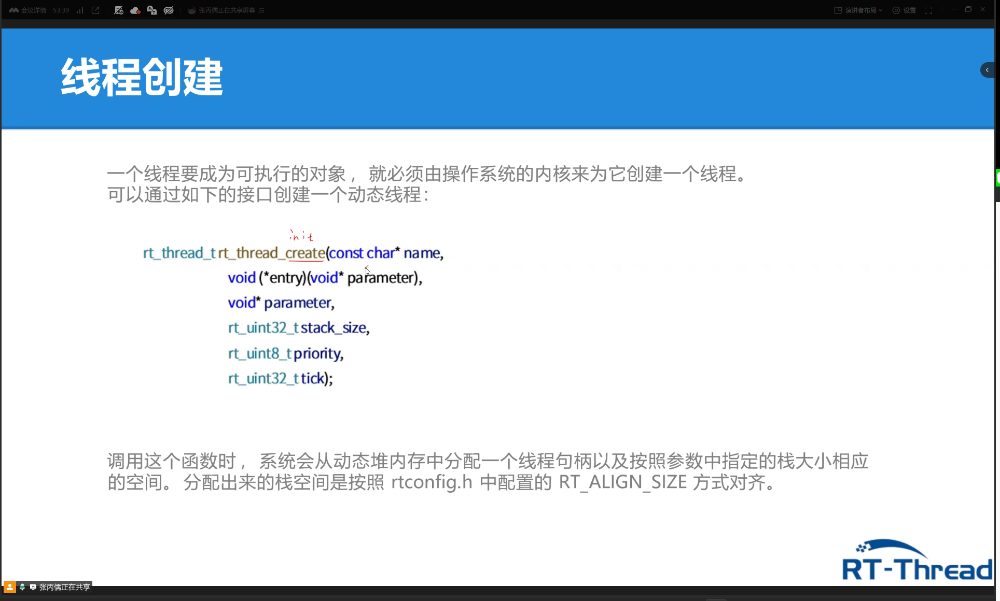

动态线程创建接口：

```c
rt_thread_t rt_thread_create(const char* name,
                             void (*entry)(void* parameter),
                             void* parameter,
                             rt_uint32_t stack_size,
                             rt_uint8_t priority,
                             rt_uint32_t tick);
```

- 调用时系统**从动态堆内存分配**线程句柄 + 指定大小的栈空间。
- 栈空间按 `rtconfig.h` 中配置的 `RT_ALIGN_SIZE` 方式对齐。
- **与静态创建的区别**：少了 `stack_start` 参数（栈由内核动态分配，用户不用提供）；返回值是 `rt_thread_t` 句柄而非错误码。

### 线程状态与转化

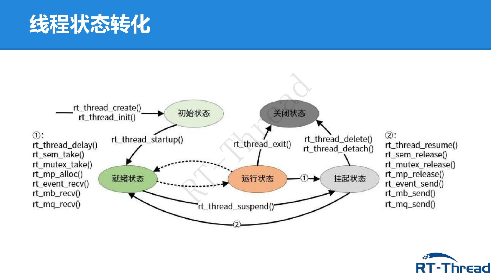

**5 种线程状态**：

| 状态 | 宏定义 | 描述 |
|---|---|---|
| 初始状态 | `RT_THREAD_INIT` | 线程刚创建未运行，**不参与调度** |
| 就绪状态 | `RT_THREAD_READY` | 按优先级排队等待执行；当前线程让出 CPU 后，系统找最高优先级就绪线程运行 |
| 运行状态 | `RT_THREAD_RUNNING` | 线程正在运行；单核系统中仅 `rt_thread_self()` 返回的线程处于运行态 |
| 挂起状态 | `RT_THREAD_SUSPEND` | 也称阻塞态；因资源不可用或主动延时而挂起，**不参与调度** |
| 关闭状态 | `RT_THREAD_CLOSE` | 线程运行结束进入关闭状态，不参与调度 |

**状态转化关键 API**：
- 创建/初始化：`rt_thread_create()` / `rt_thread_init()` → 初始态
- 启动：`rt_thread_startup()` → 就绪态
- 挂起（①）：`rt_thread_delay()` / `rt_sem_take()` / `rt_mutex_take()` / `rt_mp_alloc()` / `rt_event_recv()` / `rt_mb_recv()` / `rt_mq_recv()` → 挂起态
- 恢复（②）：`rt_thread_resume()` / `rt_sem_release()` / `rt_mutex_release()` / `rt_mp_release()` / `rt_event_send()` / `rt_mb_send()` / `rt_mq_send()` → 就绪态
- 结束：`rt_thread_exit()` / `rt_thread_delete()` / `rt_thread_detach()` → 关闭态

### 线程属性

**优先级**：
- 表示线程被调度的优先程度，越重要优先级越高。
- RT-Thread 最大支持 **256 级优先级（0~255）**，数值越小优先级越高，**0 为最高**。
- 资源紧张时可配置只支持 8 或 32 个优先级（`rtconfig.h`）。
- **最低优先级默认分配给空闲线程**，用户一般不使用。
- 有比当前线程更高优先级线程就绪时，当前线程**立刻被换出**（抢占式）。

**线程栈**：

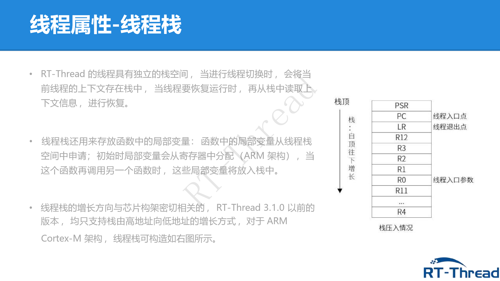

- 线程有独立栈空间，切换时把上下文（寄存器等）存入栈，恢复时读回。
- 栈也存放函数局部变量（先分配在寄存器，调用更深函数时入栈）。
- 栈增长方向与芯片架构相关；ARM Cortex-M 架构**栈从高地址向低地址增长**，压入顺序为 PSR、PC、LR、R12、R3~R0、R11…R4。

**入口函数**：
- 线程功能由入口函数实现，格式 `void (*entry)(void* parameter)`。
- **函数要求必须有让出 CPU 的动作**（如 `rt_thread_mdelay()`），否则会独占 CPU。
- 示例：`thread1_entry` 中循环 `rt_kprintf("thread1 count: %d\n", count++)` + `rt_thread_mdelay(500)`。

### 线程延时与挂起

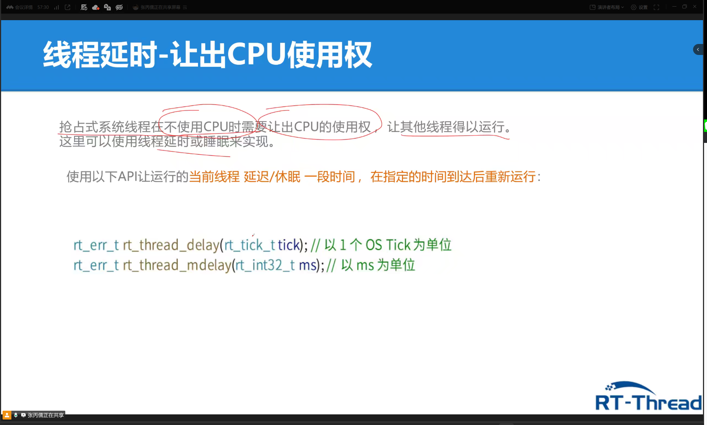

抢占式系统中，线程不使用 CPU 时必须**让出 CPU 使用权**，让其他线程运行，可用延时/睡眠实现：

- `rt_err_t rt_thread_delay(rt_tick_t tick);` 以 1 个 OS Tick 为单位
- `rt_err_t rt_thread_mdelay(rt_int32_t ms);` 以 ms 为单位

### 线程启动

创建/初始化后的线程处于**初始状态**，未进入就绪队列，需要调用启动接口进入就绪态：

```c
rt_err_t rt_thread_startup(rt_thread_t thread);
```

调用后线程状态变为**就绪**，放入对应优先级队列等待调度；若新线程优先级比当前线程高，**立即切换**到新线程。

### 主线程

- RT-Thread 中的 `main()` 函数本身是一个线程，称为**主线程**。
- 系统启动时创建 main 线程，入口函数为 `main_thread_entry()`，用户的 `main()` 从这里真正开始。
- 流程：`$Sub$main()` → `rtthread_startup()` → `rt_application_init()` → `main_thread_entry()` → `main()`。
- 可在 `main()` 中添加应用初始化代码，例：

```c
int main(void)
{
    rt_kprintf("hello world!");
    return 0;
}
```

## 关于Scons

rtt的vscode扩展

### SCons 实操学习记录（Day2）

SCons 是一套由 Python 语言编写的开源构建系统（类似 GNU Make），RT-Thread 用它替代 Makefile 来组织源码、编译工程。核心文件：
- `SConstruct`：SCons 的入口脚本（一个 BSP 只有一个），初始化构建环境
- `SConscript`：分散在各级源码目录下的子脚本（组织源码的主力军）
- `rtconfig.py`：编译器配置（CROSS_TOOL、EXEC_PATH、CFLAGS/LFLAGS 等）

#### 1. 环境准备（使用 RT-Thread Studio 自带工具链，无需额外安装）

```cmd
cd /d D:\app\RT-ThreadStudio\workspace\02-thread_sample
set RTT_EXEC_PATH=D:\app\RT-ThreadStudio\platform\env_released\env\tools\gnu_gcc\arm_gcc\mingw\bin
set PATH=%RTT_EXEC_PATH%;D:\app\RT-ThreadStudio\platform\env_released\env\tools\Python27;D:\app\RT-ThreadStudio\platform\env_released\env\tools\Python27\Scripts;%PATH%

scons --version
```

```
SCons by Steven Knight et al.:
        script: v3.1.2.bee7caf9defd6e108fc2998a2520ddb36a967691, 2019-12-17 02:07:09
        engine: v3.1.2.bee7caf9defd6e108fc2998a2520ddb36a967691, 2019-12-17 02:07:09
```

#### 2. 干跑预览：`scons -n`（只显示将要执行的命令，不真正编译）

```cmd
scons -n
```

```
scons: Reading SConscript files ...
Newlib version:4.1.0
scons: done reading SConscript files.
scons: Building targets ...
scons: building associated VariantDir targets: build
CC build\applications\main.o
CC build\drivers\board.o
...（共 56 个 CC + 2 个 AS）
LINK rt-thread.elf
scons: done building targets.
```

数出本工程参与构建的 C 源文件数量：

```cmd
scons -n | find /c "CC "
```

```
56
```

56 = 所有 SConscript 通过 `Return('group')` 汇总上来的 C 文件数（applications 1 + drivers 5 + kernel 38 + libraries 12）。`AS` 行是汇编文件（context_gcc.S、startup_stm32f407xx.S），不是 C 编译。

#### 3. 正式编译：`scons -j4`（4 线程并行，对应文档 3.4 节）

```cmd
scons -j4
dir rt-thread.elf
```

```
2026/08/18  16:05           168,488 rt-thread.elf
```

编译成功，产出 `rt-thread.elf`（168,488 字节）。

#### 4. 增量编译（对应文档 3.1 节）

不修改任何文件，再次执行 `scons -j4`：

```cmd
scons -j4
```

```
scons: Reading SConscript files ...
scons: done reading SConscript files.
scons: Building targets ...
scons: building associated VariantDir targets: build
LINK rt-thread.elf
scons: done building targets.
```

第二次 0 个 CC，只重新 LINK——即"仅编译修改过的源文件并链接"。但为何每次都 LINK？

用 `--debug=explain` 让 scons 解释原因：

```cmd
scons --debug=explain
```

```
scons: rebuilding `rt-thread.elf' because:
           the dependency order changed:
           ->Sources
           Old:build\applications\main.o        New:build\applications\main.o
           Old:build\kernel\src\object.o        New:build\kernel\src\idle.o
           ...
```

原因是 "the dependency order changed"（依赖顺序变化）——顶层 `SConscript` 用 `os.listdir(cwd)` 枚举子目录，Windows 上返回顺序不稳定，导致收集源码的顺序每次不同，SCons 认为链接输入变了 → 每次都 LINK（但 .o 本身不重编）。修复方法：`list = sorted(os.listdir(cwd))`。

#### 5. 清理编译产物：`scons -c`（对应文档 3.2 节）

```cmd
scons -c
```

```
scons: Cleaning targets ...
Removed build\applications\main.o
Removed build\drivers\board.o
...（所有 .o 全部删除）
Removed rt-thread.elf
Removed cconfig.h
Removed .sconsign.dblite
scons: done cleaning targets.
```

`scons -c` 不仅删 .o 和 elf，还删 `.sconsign.dblite`（SCons 的签名数据库，增量编译靠它记忆）——所以清理后下次编译会全量重编。

#### 6. 查看完整编译命令：`scons --verbose`（对应文档 3.7 节）

清理后干跑 + verbose，看到 CC 的完整命令：

```cmd
scons -c
scons -n --verbose
```

```
arm-none-eabi-gcc -o build\applications\main.o -c -mcpu=cortex-m4 -mthumb \
  -ffunction-sections -fdata-sections \
  -DHAVE_CCONFIG_H -DSOC_FAMILY_STM32 -DSOC_SERIES_STM32F4 -DSTM32F407xx \
  -DUSE_HAL_DRIVER -D__RTTHREAD__ -DRT_USING_NEWLIB -DRT_USING_LIBC \
  -D_POSIX_C_SOURCE=1 \
  -I. -Iapplications -Idrivers -Idrivers\include -Idrivers\include\config \
  -Ilibraries\CMSIS\Include -Ilibraries\CMSIS\Device\ST\STM32F4xx\Include \
  -Ilibraries\STM32F4xx_HAL_Driver\Inc -Irt-thread\include \
  -Irt-thread\libcpu\arm\common -Irt-thread\libcpu\arm\cortex-m4 \
  -Irt-thread\components\drivers\include -Irt-thread\components\finsh \
  ... \
  applications\main.c
```

verbose 输出 = scons 把 SConscript 配置翻译成真实 gcc 命令。`-D` 宏来自 rtconfig.h 解析 + SConscript 的 `CPPDEFINES`；`-I` 路径来自 SConscript 的 `CPPPATH`；`-mcpu=cortex-m4` 来自 rtconfig.py 的 `DEVICE`。

#### 7. 生成其他工程：`scons --target=XXX`（对应文档 3.3 节）

生成 CMake 工程（成功）：

```cmd
scons --target=cmake
```

```
Update setting files for CMakeLists.txt...
Done!
```

生成了 `CMakeLists.txt`，内含 `PROJECT_SOURCES`（源码清单）、`INCLUDE_DIRECTORIES`（头文件路径）、`ADD_DEFINITIONS`（宏定义）。

生成 MDK 工程（第一次失败，缺模板）：

```cmd
scons --target=mdk5
```

```
Warning: The template project file [template.uvprojx] not found!
```

对应文档 3.3 节 Note——"要生成 MDK 或者 IAR 的工程文件，前提条件是 BSP 目录存在一个工程模版文件"。scons 只认 BSP 目录下固定名字 `template.uvprojx`。

从 Studio 板卡支持包拷贝模板后重新生成：

```cmd
copy D:\app\RT-ThreadStudio\repo\Extract\Board_Support_Packages\RealThread\STM32F407-RT-SPARK\1.2.0\projects\01_kernel\template.uvprojx D:\app\RT-ThreadStudio\workspace\02-thread_sample\

scons --target=mdk5
```

```
KeyError: 'LIBPATH':
  File "D:\app\RT-ThreadStudio\workspace\02-thread_sample\SConstruct", line 36:
    DoBuilding(TARGET, objs)
  File "...\building.py", line 783:
    EndBuilding(target, program)
  File "...\building.py", line 886:
    GenTargetProject(program)
  File "...\building.py", line 812:
    MDK5Project('project.uvprojx', Projects)
  File "...\keil.py", line 311:
    MDK45Project(template_tree, target, script)
  File "...\keil.py", line 257:
    for path_item in group['LIBPATH']:
```

生成 mdk5 工程报 `KeyError: 'LIBPATH'`——根因是内核 `newlib/SConscript` 的 `DefineGroup` 传了 `LIBS=['c','m']` 但没传 `LIBPATH`，而 `keil.py` 第 257 行用 `group['LIBPATH']` 硬访问。修复：改成 `group.get('LIBPATH', [])`（容错写法）。修复后 `project.uvprojx` 从 57 字节（空壳）变为 29KB（正常），内含 Applications/Compiler/CPU/DeviceDrivers/Drivers 等 8 个分组及 main.c 等全部源码。

#### 8. 本次实操总结

| 命令 | 作用 | 文档章节 |
|---|---|---|
| `scons` | 编译（增量编译） | 3.1 |
| `scons -jN` | 多线程并行编译 | 3.4 |
| `scons -n` | 干跑，只预览不执行 | - |
| `scons -c` | 清理编译产物（含 .sconsign.dblite） | 3.2 |
| `scons --verbose` | 显示完整编译/链接命令 | 3.7 |
| `scons --target=cmake/mdk5/iar` | 生成对应工程文件（mdk5 需 template.uvprojx） | 3.3 |
| `scons --debug=explain` | 查看 scons 判定"为什么要重建"的原因 | - |

**核心认知**：SConscript 决定"编译什么"（缺 SConscript 的目录源码不参与构建）；`CPPPATH`→`-I`、`CPPDEFINES`→`-D`、`src`→编译文件列表；增量编译依赖 `.sconsign.dblite` 签名数据库。

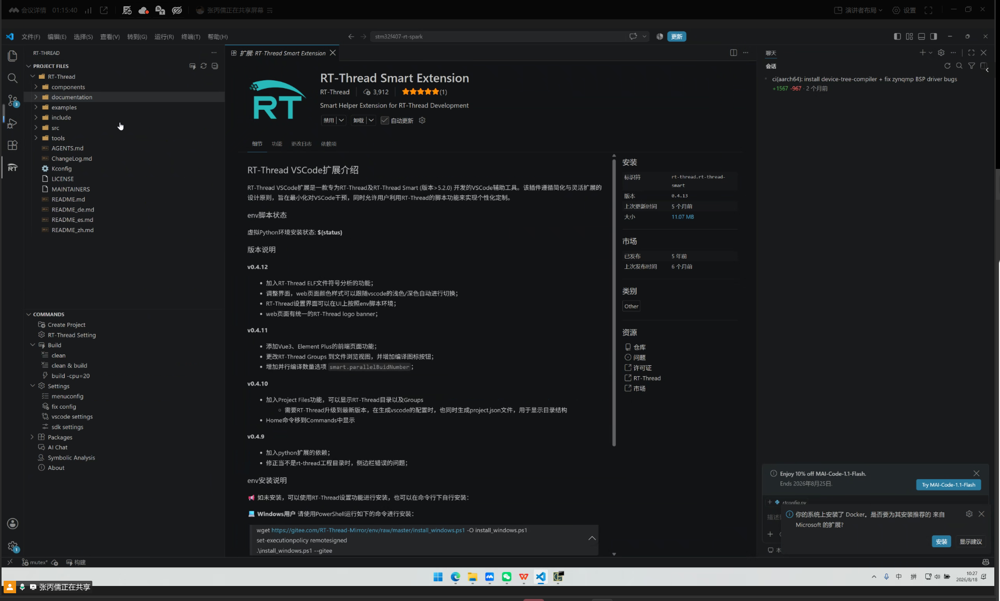
