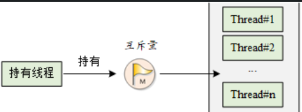
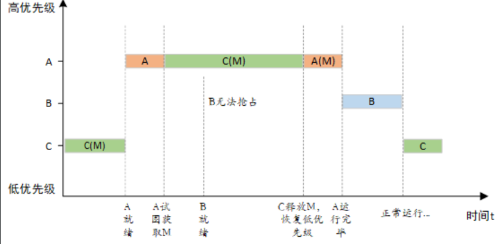
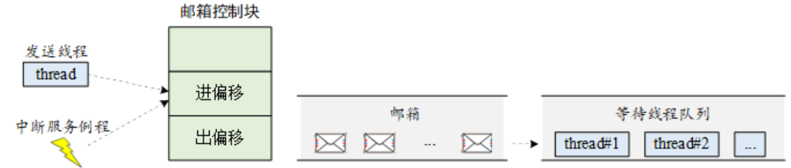
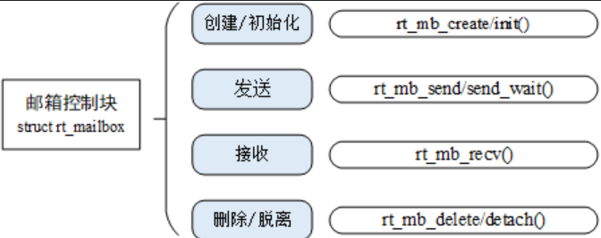
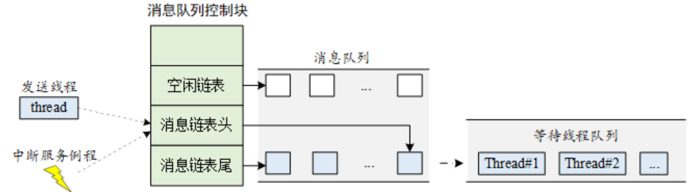
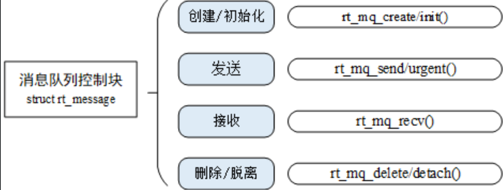

# RTT-学习日志-Day3

## 线程间同步 —— 信号量（Semaphore）

> 参考：[RT-Thread 编程手册 · 线程间同步 · 信号量](https://www.rt-thread.org/document/site/#/rt-thread-version/rt-thread-standard/programming-manual/ipc1/ipc1?id=%e4%bf%a1%e5%8f%b7%e9%87%8f)

### 1. 为什么需要同步

- 多线程共享一块内存（临界区）时，若同时访问会造成数据错乱，必须**互斥**访问。
- **临界区**：多个线程都要访问的共享代码/数据区域，任何时刻最多一个线程使用。
- 同步方式：信号量、互斥量、事件集。核心思想：**访问临界区时只允许一个（或一类）线程运行**。

### 2. 信号量概念（停车场类比）

| 现实 | 内核 |
|---|---|
| 停车场管理员 | 信号量 |
| 管理员手中的空车位个数 | 信号量的值 value（非负、动态变化） |
| 停车位（公共资源） | 临界区资源 |
| 车辆 | 线程 |
| 车进场/离场 | 获取/释放信号量 |

### 3. 工作机制

- 每个信号量对象有 **信号量值 value** 和 **线程等待队列**。
- value = 5 表示有 5 个资源实例可用。
- **获取（take）**：value > 0 → value-- 继续执行；value == 0 → 线程挂起到等待队列。
- **释放（release）**：有线程等待 → 唤醒队列第一个线程；无等待 → value++。

### 4. 信号量控制块

```c
struct rt_semaphore
{
   struct rt_ipc_object parent;  /* 继承自 ipc_object 类 */
   rt_uint16_t value;            /* 信号量的值 */
   rt_uint16_t max_value;        /* 信号量的最大值（65535） */
   struct rt_spinlock spinlock;  /* 自旋锁 */
};
typedef struct rt_semaphore* rt_sem_t;   /* 句柄 = 指向控制块的指针 */
```

### 5. API 一览

| 操作 | 静态（init/detach） | 动态（create/delete） |
|---|---|---|
| 建立 | `rt_sem_init(&sem, name, value, flag)` | `rt_sem_create(name, value, flag)` 返回指针 |
| 获取 | `rt_sem_take(&sem, timeout)` | `rt_sem_take(sem, timeout)` |
| 无等待获取 | `rt_sem_trytake(&sem)` | `rt_sem_trytake(sem)` |
| 释放 | `rt_sem_release(&sem)` | `rt_sem_release(sem)` |
| 销毁 | `rt_sem_detach(&sem)` 不释放内存 | `rt_sem_delete(sem)` 释放堆内存 |

- **timeout**：`RT_WAITING_FOREVER` 永久等待 / `RT_WAITING_NO` 不等 / 正整数 = 等待 N 个 OS Tick，超时返回 `-RT_ETIMEOUT`。
- **flag**：`RT_IPC_FLAG_FIFO`（先进先出，非实时，不建议）/ `RT_IPC_FLAG_PRIO`（按优先级排队，推荐）。
- 内存来源：静态 = 编译器编译期分配（全局变量）；动态 = 堆分配，需开 `RT_USING_HEAP`，create 后**必须判空**。
- 铁律：**init 的只能 detach，create 的只能 delete，不能混用**（delete 会 free 静态内存导致崩溃）。
- 静态写法处处带 `&`（对象是自己的变量），动态写法不带 `&`（对象是内核返回的指针）。

### 6. 典型用法（互斥锁保护共享数据）

```c
static struct rt_semaphore sem_lock;   /* 静态声明 */

void init(void)
{
    rt_sem_init(&sem_lock, "lock", 1, RT_IPC_FLAG_PRIO);  /* 初始值 1 = 二值信号量当锁 */
}

/* 线程 A：写 */
rt_sem_take(&sem_lock, RT_WAITING_FOREVER);
g_adc_value = v;                 /* 临界区 */
rt_sem_release(&sem_lock);

/* 线程 B：读 */
rt_sem_take(&sem_lock, RT_WAITING_FOREVER);
v = g_adc_value;                 /* 临界区 */
rt_sem_release(&sem_lock);
```

- 信号量还常用于**事件同步**：初始值 0，中断里 `rt_sem_release` 通知，线程 `rt_sem_take` 等待被唤醒（中断里只允许 release，禁止 take）。
- 生产者-消费者经典模型：`lock`（互斥）+ `empty`（空位数）+ `full`（满位数）三个信号量配合。

### 7. 避坑清单

1. 静态对象只能 `detach`，动态对象只能 `delete`，不能混用。
2. `create` 后必须判空（堆可能不足）。
3. 静态版本 take/release 别忘 `&`。
4. 中断上下文禁止 `take`/`create`/`delete`，只允许 `release`。
5. 纯互斥场景优先考虑**互斥量**（有优先级继承，防优先级翻转），信号量擅长计数与事件同步。

---

## 线程间同步 —— 互斥量（Mutex）

> 参考：[RT-Thread 编程手册 · 线程间同步 · 互斥量](https://www.rt-thread.org/document/site/#/rt-thread-version/rt-thread-standard/programming-manual/ipc1/ipc1?id=%e4%ba%92%e6%96%a5%e9%87%8f)

### 1. 概念（单车位停车场类比）

互斥量是特殊的**二值信号量**：只有一个车位。车进场 → 大门锁住，其他车在外等候；车出来 → 开门放行下一辆。



### 2. 工作机制（与信号量的三大不同）

1. **所有权**：互斥量有"主人"，只有持有它的线程能释放，其他线程释放返回错误；信号量任何线程/中断都能 release。

2. **递归持有**：同一线程可多次 take 同一互斥量（hold 计数 +1），必须释放同样次数才真正解锁；二值信号量递归 take 会自我挂死（死锁）。

3. **优先级继承**：解决优先级翻转问题。

    

### 3. 优先级翻转与优先级继承

- **优先级翻转**：T1(高) 等 T3(低) 手里的锁 → 被挂起；T2(中) 此时就绪抢占 CPU 运行完，T3 才得以释放锁 → T1 被中等优先级线程"饿死"，实时性无法保证。
- **优先级继承**（Sha, 1990）：T1 挂起等待期间，**T3 的优先级被临时提升到 T1 的级别**，防止被 T2 抢占；T3 释放锁后恢复原优先级。
- 提升目标 = **所有等待者中优先级最高者**的优先级；锁一释放立刻恢复。
- 注意：持有互斥量期间**不得更改线程优先级**，否则可能引入无界优先级反转。
- ` | `rt_mutex_create(name, flag)` 返回指针 |
| 获取 | `rt_mutex_take(&mutex, timeout)` | `rt_mutex_take(mutex, timeout)` |
| 释放 | `rt_mutex_release(&mutex)` | `rt_mutex_release(mutex)` |
| 销毁 | `rt_mutex_detach(&mutex)` | `rt_mutex_delete(mutex)` |

- 互斥量**没有** `trytake`（无等待获取可用 `rt_mutex_take(m, RT_WAITING_NO)`）。
- flag 参数**已作废**：无论传 FIFO 还是 PRIO，内核一律按 `RT_IPC_FLAG_PRIO` 处理（优先级继承需要按优先级排队）。
- 只能在线程上下文使用（中断里禁止 take/release）。
- 静态/动态用法与信号量完全对应：静态带 `&`、动态判空、init 的只能 detach、create 的只能 delete。

### 6. 互斥量 vs 信号量 对比

| 维度 | 互斥量 | 信号量 |
|---|---|---|
| 本质 | 互斥锁（锁资源） | 同步 + 计数（发信号/数资源） |
| 值 | 只有 0/1（二值） | 任意非负数（0~65535） |
| 谁可以释放 | 仅持有它的线程 | 任何线程 / 中断 |
| 优先级继承 | ✅ 有（防优先级翻转） | ❌ 没有（有翻转风险） |
| 递归持有 | ✅ 支持（hold 计数） | ❌ 递归 take 会死锁 |
| 中断里使用 | ❌ 全部禁止 | release 可以，take 禁止 |
| flag 参数 | 已作废，强制 PRIO | FIFO / PRIO 可选 |
| 典型场景 | 保护共享变量/外设 | 生产者-消费者、中断通知、任务同步 |

### 7. 避坑清单

1. 互斥量**必须由持有者释放**，别的线程 release 会返回错误。
2. 递归 take 了几次就要 release 几次，少一次锁不释放，多一次会误解锁。
3. 持有互斥量期间不要改线程优先级、不要长时间占用（尽快释放）。
4. 中断里禁止一切互斥量操作。
5. 只想"发通知/数资源"用信号量，想"锁临界区"用互斥量——用错对象会付出性能/正确性代价。

---

## 线程间同步 —— 事件集（Event）

> 参考：[RT-Thread 编程手册 · 线程间同步 · 事件集](https://www.rt-thread.org/document/site/#/rt-thread-version/rt-thread-standard/programming-manual/ipc1/ipc1?id=%e4%ba%8b%e4%bb%b6%e9%9b%86)

### 1. 概念（等公交类比）

- ①只有一路车能到，等到它就走 —— 特定事件唤醒线程；
- ②多路车都能到，**任意一路**来就走 —— 逻辑或（独立型同步）；
- ③约了同伴 P2，"P2 到了"且"公交到了"都满足才走 —— 逻辑与（关联型同步）。

事件集支持**一对多、多对多**的线程同步，这是信号量做不到的。

### 2. 工作机制

- 用 32 位无符号整型表示事件集，**每一位代表一个事件**。
- 三个特点：
  1. 事件只与线程相关，事件间相互独立，每个线程可拥有 32 个事件标志；
  2. 事件**仅用于同步，不提供数据传输**功能；
  3. 事件**无排队性**：多次发送同一事件（线程没读走）效果等同只发一次，**不累计**。
- 接收选项 opt：
  - `RT_EVENT_FLAG_OR`：等待的事件任一发生即唤醒；
  - `RT_EVENT_FLAG_AND`：等待的事件全部发生才唤醒；
  - `RT_EVENT_FLAG_CLEAR`：唤醒后主动清除事件标志位，不加则标志一直保留。

### 3. 事件集控制块

```c
struct rt_event
{
    struct rt_ipc_object parent;    /* 继承自 ipc_object 类 */
    rt_uint32_t set;                /* 事件集合，每一 bit 表示 1 个事件 */
    struct rt_spinlock spinlock;
};
typedef struct rt_event* rt_event_t;
```

### 4. API 一览

| 操作 | 静态（init/detach） | 动态（create/delete） |
|---|---|---|
| 建立 | `rt_event_init(&ev, name, flag)` | `rt_event_create(name, flag)` 返回指针 |
| 发送事件 | `rt_event_send(&ev, set)` | `rt_event_send(ev, set)` |
| 接收事件 | `rt_event_recv(&ev, set, opt, timeout, &recved)` | `rt_event_recv(ev, set, opt, timeout, &recved)` |
| 销毁 | `rt_event_detach(&ev)` | `rt_event_delete(ev)` |

- `rt_event_send` 一次可发送多个事件：`rt_event_send(&ev, FLAG3 | FLAG5)`；**线程和中断里都能调用**。
- `rt_event_recv` 的 `recved` 返回实际收到的事件位图；timeout 用法同信号量。

```c
/* 等 事件3 或 事件5 任一发生，唤醒后清标志 */
rt_event_recv(&event, EVENT_FLAG3 | EVENT_FLAG5,
              RT_EVENT_FLAG_OR | RT_EVENT_FLAG_CLEAR, RT_WAITING_FOREVER, &e);
/* 等 事件3 和 事件5 都发生，唤醒后清标志 */
rt_event_recv(&event, EVENT_FLAG3 | EVENT_FLAG5,
              RT_EVENT_FLAG_AND | RT_EVENT_FLAG_CLEAR, RT_WAITING_FOREVER, &e);
```

### 5. 示例要点（event_sample）

- 线程1 第一次用 OR 等"事件3 或 事件5"，第二次用 AND 等"事件3 且 事件5"；
- 运行输出：OR 收到 `0x8`（只有事件3），AND 收到 `0x28`（事件3+事件5）；
- 因为带了 CLEAR，第一次唤醒后事件3被清掉，第二次必须等线程2**重新**发送事件3才能满足 AND。

### 6. 事件集 vs 信号量

| 事件集 | 信号量 |
|---|---|
| 一个对象含 32 个事件（位图） | 只有一个计数 |
| 支持 AND/OR 组合等待 | 只能等同一个信号 |
| 事件**不累计**（发 10 次 = 1 次） | value 会累计 |
| 只同步，不传数据 | 只同步，不传数据 |

### 7. 使用场合

多个事件汇聚才动作（门关好+水放满）、多源事件等待（按键/传感器/通信帧）、一个事件集被多个线程以不同逻辑（AND/OR）分别等待，实现一对多、多对多同步。

---

## 线程间通信 —— 邮箱（Mailbox）

> 参考：[RT-Thread 编程手册 · 线程间通信 · 邮箱](https://www.rt-thread.org/document/site/#/rt-thread-version/rt-thread-standard/programming-manual/ipc2/ipc2?id=%e9%82%ae%e7%ae%b1)

### 1. 概念

线程间通信的第一种方式。例：线程1 检测按键状态发邮件，线程2 收邮件据此改 LED。**每封邮件固定 4 字节**（32 位系统上恰好放一个指针）。

### 2. 工作机制

- 发送：邮箱没满 → 复制邮件进邮箱；满了 → 返回 `-RT_EFULL`，或改用 `rt_mb_send_wait` 挂起等待；

- 接收：有邮件 → 复制 4 字节到接收缓存；空邮箱 → 挂起等待或超时返回 `-RT_ETIMEOUT`；

- 非阻塞发送可安全用于中断服务（中断、定时器给线程发消息的常用手段）；接收只能由线程做；

- `rt_mb_urgent` 发紧急邮件，直接**插队到队首**，接收者优先处理。

    

### 3. 邮箱控制块

```c
struct rt_mailbox
{
    struct rt_ipc_object parent;

    rt_uint32_t* msg_pool;                /* 邮箱缓冲区的开始地址 */
    rt_uint16_t size;                     /* 邮箱缓冲区的大小     */
    rt_uint16_t entry;                    /* 邮箱中邮件的数目     */
    rt_uint16_t in_offset, out_offset;    /* 邮箱缓冲的进出指针   */
    rt_list_t suspend_sender_thread;      /* 发送线程的挂起等待队列 */
    struct rt_spinlock spinlock;
};
typedef struct rt_mailbox* rt_mailbox_t;
```



### 4. API 一览

| 操作 | 静态（init/detach） | 动态（create/delete） |
|---|---|---|
| 建立 | `rt_mb_init(&mb, name, msgpool, size, flag)` | `rt_mb_create(name, size, flag)` |
| 发送 | `rt_mb_send(&mb, value)` | `rt_mb_send(mb, value)` |
| 等待发送 | `rt_mb_send_wait(&mb, value, timeout)` | 同左 |
| 紧急发送 | `rt_mb_urgent(&mb, value)` | 同左 |
| 接收 | `rt_mb_recv(&mb, &value, timeout)` | 同左 |
| 销毁 | `rt_mb_detach(&mb)` | `rt_mb_delete(mb)` |

- `rt_mb_init` 的 size 是**邮件个数** = 缓冲区字节数 / 4；
- 邮件内容 `value` 是 `rt_ubase_t`（32 位整数），可以是整型值或指针。

### 5. 传大数据的用法（发指针）

4 字节放不下大块数据，就把**指向缓冲区的指针**当邮件发出去：

```c
struct msg { rt_uint8_t *data_ptr; rt_uint32_t data_size; };

struct msg* msg_ptr = (struct msg*)rt_malloc(sizeof(struct msg));
msg_ptr->data_ptr = ...;
msg_ptr->data_size = len;
rt_mb_send(mb, (rt_ubase_t)msg_ptr);

/* 接收线程处理完后，必须 rt_free(msg_ptr) 释放内存 */
```

### 6. 使用场合

开销低、效率高，适合不超过 4 字节的小消息（按键状态、ADC 采样值等）；传指针可实现大数据传递（注意内存的申请/释放要配对）。

---

## 线程间通信 —— 消息队列（Message Queue）

> 参考：[RT-Thread 编程手册 · 线程间通信 · 消息队列](https://www.rt-thread.org/document/site/#/rt-thread-version/rt-thread-standard/programming-manual/ipc2/ipc2?id=%e6%b6%88%e6%81%af%e9%98%9f%e5%88%97)

### 1. 概念

消息队列是**邮箱的扩展**：消息长度不固定（不限 4 字节）。应用：线程间消息交换、串口接收不定长数据等。

### 2. 工作机制

- 线程或中断发送的消息会被**复制**到消息队列自己的内存空间（异步通信）；

- 队列空时接收线程挂起，有新消息到达则唤醒；

- 遵循**先进先出（FIFO）**原则；

- 创建时分配多个消息框（消息头 + 消息内容），空闲消息框组成空闲链表，收/发就是消息块在"消息链表"和"空闲链表"之间转移；

- `rt_mq_urgent` 紧急消息插到队首；

- 若所有消息最大长度设为 4 字节，消息队列就**退化成邮箱**。

    

### 3. 消息队列控制块

```c
struct rt_messagequeue
{
    struct rt_ipc_object parent;

    void* msg_pool;                     /* 指向存放消息的缓冲区的指针 */
    rt_uint16_t msg_size;               /* 每个消息的长度 */
    rt_uint16_t max_msgs;               /* 最大能够容纳的消息数 */
    rt_uint16_t entry;                  /* 队列中已有的消息数 */
    void* msg_queue_head;               /* 消息链表头 */
    void* msg_queue_tail;               /* 消息链表尾 */
    void* msg_queue_free;               /* 空闲消息链表 */
    rt_list_t suspend_sender_thread;    /* 发送线程的挂起等待队列 */
    struct rt_spinlock spinlock;
};
typedef struct rt_messagequeue* rt_mq_t;
```



### 4. API 一览

| 操作 | 静态（init/detach） | 动态（create/delete） |
|---|---|---|
| 建立 | `rt_mq_init(&mq, name, msgpool, msg_size, pool_size, flag)` | `rt_mq_create(name, msg_size, max_msgs, flag)` |
| 发送 | `rt_mq_send(&mq, buffer, size)` | 同左 |
| 等待发送 | `rt_mq_send_wait(&mq, buffer, size, timeout)` | 同左 |
| 紧急发送 | `rt_mq_urgent(&mq, buffer, size)` | 同左 |
| 接收 | `rt_mq_recv(&mq, buffer, size, timeout)` | 同左 |
| 销毁 | `rt_mq_detach(&mq)` | `rt_mq_delete(mq)` |

- `rt_mq_recv` 返回 **>0** 表示收到消息长度；发送时队列满返回 `-RT_EFULL`；消息太长返回 `-RT_ERROR`；
- 动态创建时内存大小 =（msg_size + 消息头大小）× max_msgs。

### 5. 与邮箱传数据的区别

- 邮箱只能传 4 字节（或指针），消息队列**直接复制任意长度内容**；
- 消息队列收发用**局部变量**即可，数据被复制过去，不用担心指针失效或内存被提前释放，免去动态内存分配的烦恼：

```c
struct msg { rt_uint8_t *data_ptr; rt_uint32_t data_size; };

/* 发送：局部变量直接发内容 */
struct msg msg_ptr;
msg_ptr.data_ptr = data;
msg_ptr.data_size = length;
rt_mq_send(mq, (void*)&msg_ptr, sizeof(struct msg));

/* 接收：同样用局部变量接收 */
struct msg msg_ptr;
rt_mq_recv(mq, (void*)&msg_ptr, sizeof(struct msg), RT_WAITING_FOREVER);
```

### 6. 使用场合

- 不定长消息传递（串口接收不定长数据）；
- 中断给线程发消息（**中断只能发，不能收**）；
- 同步消息：用「消息队列 + 信号量/邮箱」实现确认机制——消息结构体里带一个 `ack`（邮箱或信号量），接收方处理后回确认，发送方据此知道消息已被处理。

### 7. 三种通信对象小结

| 对象 | 是否传数据 | 特点 |
|---|---|---|
| 信号量 | 不传 | 计数 + 同步，发通知 |
| 邮箱 | 4 字节 / 指针 | 开销低、效率高，适合小消息 |
| 消息队列 | 任意长度 | 内容复制、灵活，适合不定长消息 |
