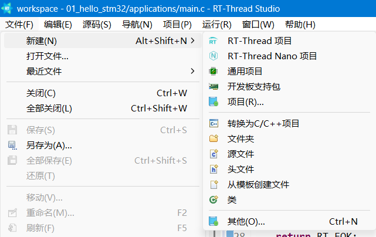
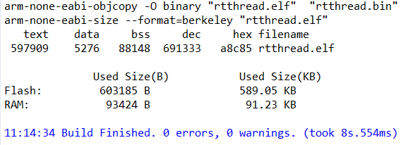
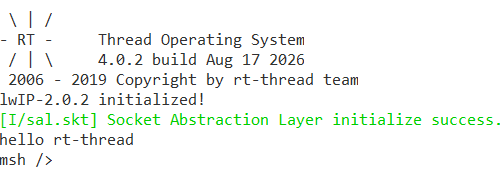
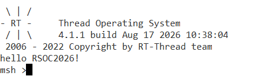
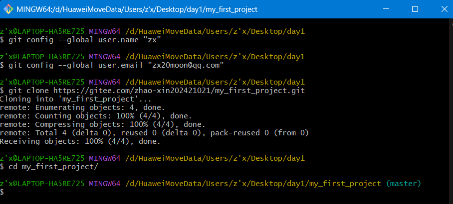
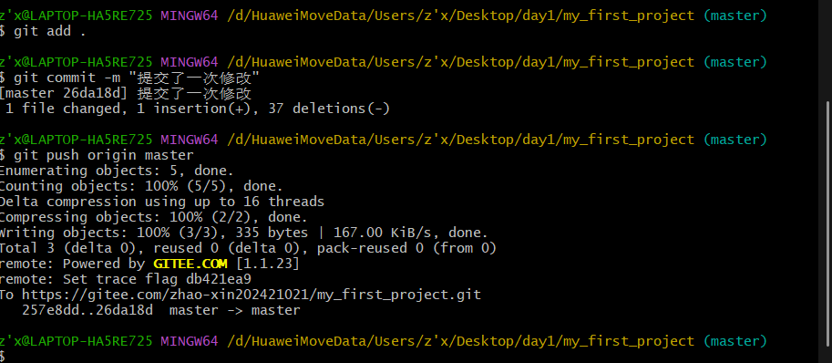
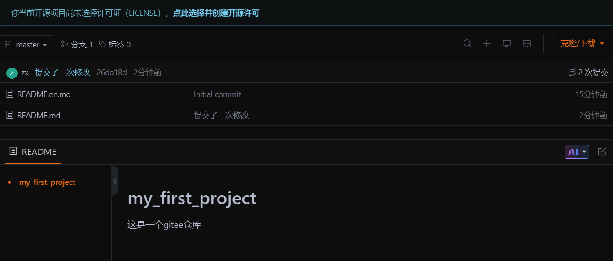
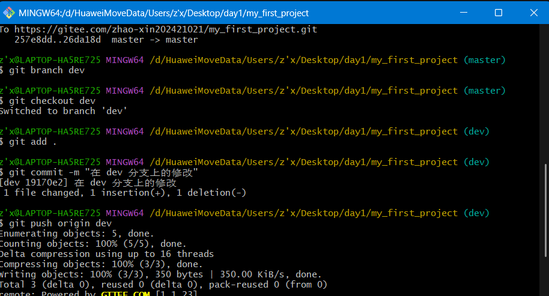

### 任务1：新建 QEMU-VExpress-A9 工程并运行 RT-Thread

1. 新建项目：`文件 → 新建 → RT-Thread 项目`



2. 项目配置：选择**基于开发板**创建，开发板选 **QEMU-VExpress-A9**，调试器选 **QEMU**，命名后创建模板工程。

3. 编译：点击编译按钮，调用 gcc 工具链，生成 `rtthread.elf` 与 `rtthread.bin`。



4. 烧录运行：点击烧录后自动打开终端，打印 RT-Thread logo 并启动示例程序。



### 任务2：Markdown 语法学习

| 语法   | 写法                                | 说明                   |
| ------ | ----------------------------------- | ---------------------- |
| 标题   | `#` ～ `######`                     | 一级到六级标题         |
| 代码块 | ` ```c ... ``` `                    | 反引号围栏，标注语言名 |
| 表格   | `\| a \| b \|` + `\| --- \| --- \|` | 第二行为对齐分隔行     |
| 加粗   | `**文字**`                          | 强调                   |
| 图片   | ``                     | 建议用相对路径         |

> 图片统一保存至 `./figures` 目录并以相对路径引用，避免项目迁移后资源丢失。

### 任务3：基于RT-Thread 4.1.1版本新建stm32f407zg芯片工程

1. 基于芯片创建工程，选择 **STM32F407ZG**，内核选 **标准版**，RT-Thread版本号为**4.1.1**，串口默认为uart1。

   

2. 修改代码并编译工程，生成 `.elf` 与 `.bin` 文件。

   ```c
   int main(void)
   {
       int count = 1;
   
       rt_kprintf("hello RSOC2026!\n");
       while (count++)
       {
           //LOG_D("Hello RT-Thread!");
           rt_thread_mdelay(1000);
       }
   
       return RT_EOK;
   }
   ```

3. 通过 **ST-Link** 下载至开发板。

4. 打开终端查看启动日志，验证程序正常运行；可使用断点调试定位问题。



### 任务4：Git 使用

#### 注册gitee并创建一个仓库


#### 配置身份并生成公钥（公钥填入 Gitee）：

```bash
git config --global user.name "***"
git config --global user.email ***@**.com
ssh-keygen -t rsa -b 4096 -C "your.email@example.com"
```
#### 拉取仓库到本地


基本工作流：

```bash
git init                     # 初始化本地仓库
git add <file>               # 将文件加入暂存区
git commit -m "message"      # 提交，附提交说明
git push origin master       # 推送：本地 → 远端
git pull origin master       # 拉取：远端 → 本地
```

#### 修改本地文件,并推送到远端:


仓库文件被修改:


#### 分支管理操作
```bash
1. 创建并切换到功能分支
git checkout -b feature-login

2. 在 feature-login 分支上修改代码，然后提交
git add .
git commit -m "添加登录功能"

3. 推送功能分支到远程（首次）
git push -u origin feature-login

4. 切回主分支准备合并
git checkout main

5. 拉取远程最新代码（防止别人有更新）
git pull

6. 合并功能分支到主分支
git merge feature-login

7. 推送更新后的主分支到远程
git push

8. 删除本地功能分支（已合并，安全删除）
git branch -d feature-login

9. 删除远程功能分支
git push origin --delete feature-login
```
创建分支,修改并推送:


gitee仓库对应修改:
