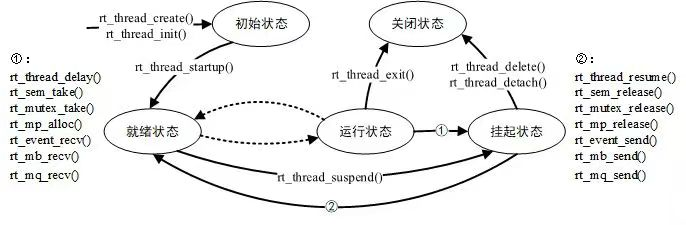

# RT-Thread 启动流程、内核基础与多线程编程

- **目标平台**：STM32F407 星火号（`stm32f407-rtspark`）
- **软件环境**：RT-Thread 4.1.1（sdk-bsp-stm32f407-spark，GCC 工具链），`RT_TICK_PER_SECOND = 1000`（1 tick = 1 ms），`RT_THREAD_PRIORITY_MAX = 32`

---

## Part 1：理论知识总结

### 1. STM32F407 启动流程与 RT-Thread 引导机制

#### 1.1 从上电复位到 `main()` 的完整调用链

以 GCC 工具链为例，启动路径如下：

```
上电复位
  │
  ▼
Reset_Handler                          // startup_stm32f407xx.s，取向量表 0 号中断入口
  ├── SystemInit()                     // 系统时钟/向量表设置（汇编入口调用）
  │
  ▼
__main                                 // 编译器启动代码：分散加载（RW/ZI 段拷贝清零）、
  │                                    // 建立 C 运行环境
  ▼
entry()                                // rt-thread/src/components.c，GCC 分支；
  │                                    // 链接器通过 "-e entry" 将程序入口指向此处
  │                                    // （RT-Thread 接管了 main，而不是 main 调用它）
  ▼
rtthread_startup()                     // components.c，内核引导总入口
  ├── rt_hw_interrupt_disable()        // 引导期间关闭中断
  ├── rt_hw_board_init()               // libraries/HAL_Drivers/drv_common.c
  │     ├── HAL_Init()                 // ST 库初始化
  │     ├── SystemClock_Config()       // 配置 168MHz（HSE + PLL）
  │     ├── rt_system_heap_init()      // 系统堆初始化（动态内存起点）
  │     ├── rt_hw_pin_init()           // GPIO 设备驱动
  │     ├── rt_hw_usart_init()         // 串口驱动
  │     ├── rt_console_set_device()    // 控制台设备（日志输出）
  │     └── rt_components_board_init() // 执行 .rti_fn.0 ~ .1 段：板级自动初始化
  │                                      （INIT_BOARD_EXPORT 等，见 1.2 节）
  ├── rt_show_version()                // 打印 RT-Thread 版本信息
  ├── rt_system_timer_init()           // 系统节拍定时器（SysTick 中断，1ms）
  ├── rt_application_init()            // 创建 main 线程（动态，优先级 10、时间片 20）
  ├── rt_thread_idle_init()            // 创建 idle 线程（最低优先级 31）
  └── rt_system_scheduler_start()      // 启动调度器，不再返回（引导流程到此结束）

调度器接管后：
  main 线程入口 main_thread_entry()
    ├── rt_components_init()           // 执行 .rti_fn.2 ~ .6 段：组件/应用自动初始化
    │                                    （INIT_PREV/DEVICE/COMPONENT/ENV/APP）
    └── main()                         // 用户 main 函数
```

#### 1.2 自动初始化原理（`INIT_BOARD_EXPORT` / `INIT_APP_EXPORT`）

自动初始化的底层是**编译器段（section）机制 + 链接脚本排序 + 符号边界遍历**，三步缺一不可：

**① 宏展开：把函数指针放进指定段**

```c
#define INIT_EXPORT(fn, level) \
    RT_USED const init_fn_t __rt_init_##fn RT_SECTION(".rti_fn." level) = fn

#define INIT_BOARD_EXPORT(fn)     INIT_EXPORT(fn, "1")
#define INIT_APP_EXPORT(fn)       INIT_EXPORT(fn, "6")
```

`INIT_BOARD_EXPORT(my_fn)` 等价于定义了一个放在 `.rti_fn.1` 段中的常量函数指针
`__rt_init_my_fn = my_fn`。`RT_USED` 防止编译器"未使用"优化将其丢弃。

**② 链接脚本排序：各初始化级别按顺序排列**

链接脚本对 `.rti_fn.*` 段做 `SORT_BY_NAME` 排序，并定义边界符号：

```
.rti_fn.0       ← __rt_init_rti_board_start（rti_start）
.rti_fn.0.end   （rti_board_start）
.rti_fn.1       ← ★ INIT_BOARD_EXPORT 的入口在这里
.rti_fn.1.end   （rti_board_end = __rt_init_rti_board_end）
.rti_fn.2       ← INIT_PREV_EXPORT
.rti_fn.3       ← INIT_DEVICE_EXPORT
.rti_fn.4       ← INIT_COMPONENT_EXPORT
.rti_fn.5       ← INIT_ENV_EXPORT
.rti_fn.6       ← ★ INIT_APP_EXPORT 的入口在这里（.rti_fn.6.end = __rt_init_rti_end）
```

由于 `'0' < '0.end' < '1' < ... < '6' < '6.end'` 的字典序关系，**级别数字越小的函数指针在内存中地址越靠前**，遍历时的先后顺序由此天然保证。

**③ 遍历执行**

```c
// 板级初始化：rt_hw_board_init() 末尾调用，覆盖级别 0~1
for (fn_ptr = &__rt_init_rti_board_start;
     fn_ptr <  &__rt_init_rti_board_end; fn_ptr++)
    (*fn_ptr)();

// 组件初始化：main 线程入口调用，覆盖级别 2~6
for (fn_ptr = &__rt_init_rti_board_end;
     fn_ptr <  &__rt_init_rti_end; fn_ptr++)
    (*fn_ptr)();
```

**级别划分的意义**：

| 宏 | 级别 | 执行时机 | 典型用途 |
| --- | --- | --- | --- |
| `INIT_BOARD_EXPORT` | 1 | main 线程创建前 | 板级外设（LED/按键/屏）引脚初始化 |
| `INIT_PREV_EXPORT` | 2 | main 线程上下文 | 纯软件预初始化 |
| `INIT_DEVICE_EXPORT` | 3 | main 线程上下文 | 设备驱动注册 |
| `INIT_COMPONENT_EXPORT` | 4 | main 线程上下文 | 组件初始化（DFS/LWIP 等） |
| `INIT_ENV_EXPORT` | 5 | main 线程上下文 | 文件系统挂载等环境初始化 |
| `INIT_APP_EXPORT` | 6 | main 线程上下文 | 用户应用初始化（本作业线程创建） |

**本作业的用法**：`thread_study.c` 用 `INIT_APP_EXPORT(thread_study_init)` 注册线程创建函数，因此**无需修改 main.c**，启动时自动创建三个线程。

### 2. 内核基础与对象模型

#### 2.1 面向对象设计：内核对象与对象容器

RT-Thread 用 C 语言模拟面向对象设计：**所有内核对象（线程、信号量、互斥量、事件、消息队列、定时器…）都继承自基类 `struct rt_object`**——基类作为结构体**第一个成员**，派生结构体可以直接把首地址强转成 `rt_object_t` 使用：

```c
struct rt_object          // 基类：所有内核对象共用
{
    char      name[RT_NAME_MAX];   // 对象名
    rt_uint8_t type;               // 对象类型（+静态/动态标志位）
    rt_uint8_t flag;
    rt_list_t  list;               // 挂到对象容器链表的节点
};

struct rt_thread          // 派生：线程对象
{
    struct rt_object parent;       // ★ 基类必须是第一个成员
    ...
};
```

**对象容器**：内核维护一张按类型分组的对象信息表 `_object_container[]`，每类对象一条链表。`rt_object_init()` 将对象挂入对应链表，`rt_object_find()` 按名字查找对象。`thread_dump` 命令正是遍历线程容器打印全部线程信息的。

**动态与静态对象的容器挂载**：动态创建（`rt_thread_create`）与静态初始化（`rt_thread_init`）都会把线程对象注册进容器，因此两种线程都能被 `ps` / `thread_dump` 查看到。

#### 2.2 线程控制块 `struct rt_thread` 关键成员

| 成员 | 作用 |
| --- | --- |
| `stat` | 线程状态（低 3 位为五态，高 5 位为信号/标志位），实验中被 monitor 读取用于判断是否已挂起 |
| `current_priority` / `init_priority` | 当前优先级 / 初始优先级。优先级继承等场景会临时改变当前优先级 |
| `init_tick` | 时间片初值。运行时每个 SysTick 递减，减到 0 由调度器重新排队（时间片轮转） |
| `sp` | 栈指针。**上下文保存位置**：切换线程时把寄存器组压栈并记录 SP，恢复时由 SP 弹栈 |
| `stack_addr` / `stack_size` | 栈底地址与大小。剩余栈 = `stack_size + stack_addr - sp`（与 `ps` 命令同算法） |
| `entry` / `parameter` | 线程入口函数与参数 |
| `tlist` | 链表节点。就绪时挂在就绪队列，挂起时挂在挂起（延时/IPC）队列 |
| `number` / `number_mask` / `high_mask` | 优先级位图索引（调度算法用，见 3.2 节） |

#### 2.3 内存分配方式：静态对象 vs 动态对象

| 对比项 | 静态对象（`rt_thread_init`） | 动态对象（`rt_thread_create`） |
| --- | --- | --- |
| 分配位置 | 编译期确定，TCB 与栈是全局变量，位于 `.bss` 段 | 运行期从系统堆（`rt_malloc`）分配 |
| 分配时机 | 链接时已占位，无额外开销 | 运行时申请，需先初始化堆 |
| 生命周期 | 程序运行期间一直存在 | 由代码显式控制 |
| 释放机制 | `rt_thread_detach()`（脱离，回归 INIT 态） | `rt_thread_delete()`（销毁并释放堆内存） |
| 分配失败风险 | **无**（内存编译期已预留） | 堆耗尽时创建失败（返回 `RT_NULL`） |
| 内存管理开销 | 无 | 堆管理有内部碎片与链表开销 |
| 可用性 | 不依赖堆，可在堆未初始化前使用 | 必须 `RT_USING_HEAP` 且堆已初始化 |

**为什么高可靠场景强制使用静态线程**：

1. **确定性**：内存占用编译期可审计，链接地图（map 文件）直接可见，不存在"运行时突然分配失败"；
2. **无碎片**：长期运行的系统堆会碎片化，动态线程反复创建/删除可能导致堆耗尽或地址碎片，静态线程完全规避；
3. **无 OOM**：静态分配没有"堆耗尽"路径，配合看门狗可保证线程必然存在；
4. **安全审计**：航空/车载/工控等认证场景要求内存布局可静态分析，动态分配（尤其是多线程竞争 malloc）难以通过安全认证。

本作业刻意同时实现了两种方式：`th_led1`（动态）与 `th_led2`（静态），便于对照。

### 3. 线程状态机与调度算法

#### 3.1 五态模型

RT-Thread 线程有五种状态（`thread->stat` 低 3 位，`RT_THREAD_STAT_MASK = 0x07`）：



| 状态 | 含义 | 进入途径（典型 API） |
| --- | --- | --- |
| `INIT` (0x00) | 已创建/初始化，未启动 | `rt_thread_init()` / `rt_thread_create()` |
| `READY` (0x01) | 就绪，等待调度 | `rt_thread_startup()`、`rt_thread_resume()`、延时超时、IPC 等待被释放 |
| `RUNNING` (0x03) | 运行中（就绪队列中最高优先级被选中的线程） | 调度器切换 |
| `SUSPEND` (0x02) | 挂起：主动挂起、延时、等待 IPC | `rt_thread_suspend()`、`rt_thread_mdelay/delay()`、`rt_sem_take()`、`rt_mutex_take()`、`rt_mq_recv()` |
| `CLOSE` (0x04) | 关闭，等待删除 | `rt_thread_delete()` / `rt_thread_detach()` |

#### 3.2 调度机制

**① 抢占式调度（优先级驱动）**

RT-Thread 采用**固定优先级抢占**：就绪队列按 32 级优先级（`RT_THREAD_PRIORITY_MAX=32`）分组，内核用**优先级位图**（`rt_thread_ready_priority_group` + `number_mask`）实现 **O(1)** 查找——不论多少线程，找最高优先级就绪线程只需常数时间；
**任何时刻，只有就绪队列中优先级最高的线程在运行**。更高优先级线程一旦就绪（如 monitor 从 `mdelay` 醒来、IPC 释放唤醒等待者），立刻抢占低优先级线程；


**② 时间片轮转（同优先级）**

当多个线程优先级相同时，通过**时间片**公平轮转：每个 SysTick（1ms）递减当前线程的 `init_tick`，减到 0 时调度器将该线程移到就绪队列尾部并切换下一个同优先级线程，即"每个线程每次最多连续运行 5ms"（`TH_TIMESLICE = 5`）；

---

## Part 2：多线程实战编程实验

### 2.1 线程设计总览

| 线程名 | 创建方式 | 优先级 | 时间片 | 栈大小 | 职责 |
| --- | --- | --- | --- | --- | --- |
| `th_led1` | 动态 `rt_thread_create` | 16 | 5 ticks | 1024 B | 翻转 LED_R(PF12)，打印计数 + `rt_tick_get()` |
| `th_led2` | 静态 `rt_thread_init`（全局 TCB + 栈） | 16 | 5 ticks | 1024 B | 翻转 LED_B(PF11)，打印计数 |
| `monitor` | 动态 `rt_thread_create` | 10 | 5 ticks | 1024 B | 每 2s 报告线程状态与剩余栈；KEY0 单击挂起/恢复 `th_led1` |

**引脚**：LED_R = PF12、LED_B = PF11（**低电平点亮**）；KEY0 = PC0（内部上拉，按下为低电平）。

**工程集成**：将 `thread_study.c` 放入工程的 `applications/` 目录并加入构建（RT-Thread Studio 自动收集，或手动加入 scons 的 SConscript）。**不修改 main.c**——三个线程全部由 `INIT_APP_EXPORT(thread_study_init)` 在系统启动时自动创建，验证了自动初始化机制。

### 2.2 关键设计决策

1. **挂起/恢复的实现（重要）**：本 SDK 定制内核中 `rt_thread_suspend()` 带有
   `RT_ASSERT(thread == rt_thread_self())`，**只允许挂起当前线程**，且挂起后**不会主动触发调度**。
   因此"按键挂起 `th_led1`"不能由 monitor 直接调用 `rt_thread_suspend(th_led1)`（会触发断言）。
   故采用**请求标志 + 线程自挂**方案：
   - monitor 按键后置位 `led1_suspend_req` 标志；
   - `th_led1` 循环顶部自检标志，置位则执行 `rt_thread_suspend(rt_thread_self())` 后调用 `rt_schedule()` 让出 CPU；
   - 恢复直接使用 `rt_thread_resume(th_led1)`（该接口无"只能恢复自己"限制，成功返回 `RT_EOK`）。
2. **`th_led1` 用忙等待代替 `rt_thread_mdelay()`**：`rt_thread_suspend` 要求线程处于 READY/RUNNING 态，而 `mdelay` 期间线程本身已是 SUSPEND 态（无法再次挂起）。忙等待使 `th_led1` 保持 READY 态，挂起操作确定可执行；同时同优先级下忙等待能让时间片轮转现象清晰可见。`th_led2` 保留 `rt_thread_mdelay()` 阻塞延时，两种延时方式对照。
3. **剩余栈空间计算**：本内核无 `RT_THREAD_CTRL_GET_STACK` 命令，采用与 FinSH `ps` 命令相同的公式
   `剩余栈 = stack_size + stack_addr - sp`，直接读取 TCB 成员计算。
4. **按键响应**：monitor 以 10ms 周期轮询 KEY0 并做 50ms 去抖 + 等待释放处理，保证快速单击不漏检；2s 周期状态报告用 tick 计数实现（若用阻塞式 `rt_thread_mdelay(2000)`，按键最大响应延迟将达 2s）。
5. **`thread_dump` 命令**：遍历线程对象容器（`rt_object_get_information(RT_Object_Class_Thread)`），打印所有线程的名字、状态、优先级、剩余栈与栈大小，由 `MSH_CMD_EXPORT` 导出。

### 2.3 运行现象与串口日志

上电后两个 LED 交替闪烁，串口打印（节选）：

```
  \ | /
- RT -     Thread Operating System
 / | \     4.1.1 build Aug 19 2026 09:27:59
 2006 - 2022 Copyright by RT-Thread team
[th_led2] count=0, tick=2
[th_led1] count=0, tick=4
[th_led1] count=1, tick=507
[th_led2] count=1, tick=514
[th_led1] count=2, tick=1009
[th_led2] count=2, tick=1021
[th_led1] count=3, tick=1511
[th_led2] count=3, tick=1533
---------- thread status @tick=2002 ----------
[th_led1 ] stat=READY    remain_stack= 104/1024
[th_led2 ] stat=SUSPEND  remain_stack= 176/1024
[monitor ] stat=RUNNING  remain_stack= 176/1024

```

按下 KEY0：

```
[monitor] KEY0: suspend request -> th_led1
[th_led1] suspend self, tick=3025
msh >[th_led2] count=6, tick=3052
[th_led2] count=7, tick=3554
---------- thread status @tick=4004 ----------
[th_led1 ] stat=SUSPEND  remain_stack= 128/1024
[th_led2 ] stat=SUSPEND  remain_stack= 176/1024
[monitor ] stat=RUNNING  remain_stack= 176/1024
[th_led2] count=8, tick=4056
[th_led2] count=9, tick=4558
[th_led2] count=10, tick=5060
[th_led2] count=11, tick=5562

```

LED_R 停止翻转（LED_B 继续闪烁）。再次按下 KEY0：

```
[monitor] KEY0: resume th_led1
[th_led1] resumed, continue, tick=6733
[th_led1] count=6, tick=6736
[th_led2] count=14, tick=7071
[th_led1] count=7, tick=7239
[th_led2] count=15, tick=7578
[th_led1] count=8, tick=7741
---------- thread status @tick=8013 ----------
[th_led1 ] stat=READY    remain_stack=  96/1024
[th_led2 ] stat=SUSPEND  remain_stack= 176/1024
[monitor ] stat=RUNNING  remain_stack= 176/1024

```

LED_R 恢复翻转。


### 2.4 实验结果分析

1. **自动初始化生效**：未修改 `main.c`，三个线程在系统启动后自动运行，证明 `INIT_APP_EXPORT` 的段遍历机制正确。

2. **抢占式调度验证**：monitor 优先级 10 高于工作线程 16，其报告输出总是准时出现在整 2s 边界，期间随时打断 `th_led1` 的忙等待——高优先级线程就绪立即抢占。

3. **时间片轮转验证**：`th_led1`（忙等待）与 `th_led2`（阻塞延时）同为优先级 16，日志中两条计数流交错推进。`th_led2` 每次醒来只能运行一个时间片（5ms）即被换下，而 `th_led1` 因忙等待占据大部分 CPU 时间，体现同优先级下"按时间片轮流执行"而非"谁就绪谁独享"。

4. **挂起/恢复验证**：KEY0 单击后 `th_led1` 由 RUNNING 变为 SUSPEND（`thread_dump` 可见），LED_R 停止闪烁、计数停止；再单击恢复，计数从断点继续。挂起期间 `th_led2` 不受影响，验证了线程间相互独立、互不阻塞。
