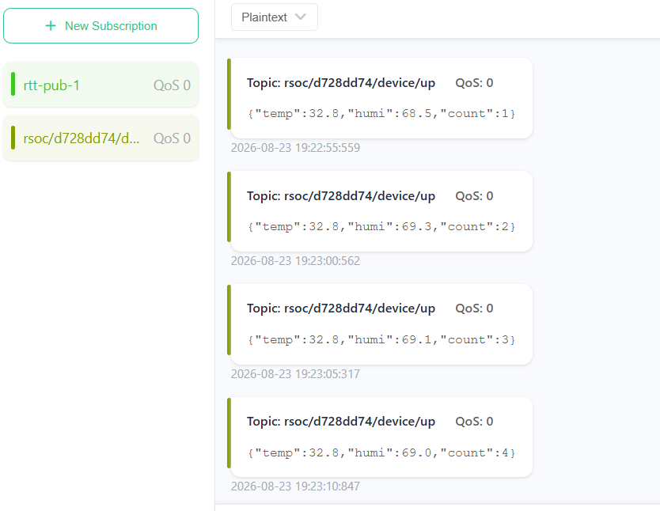
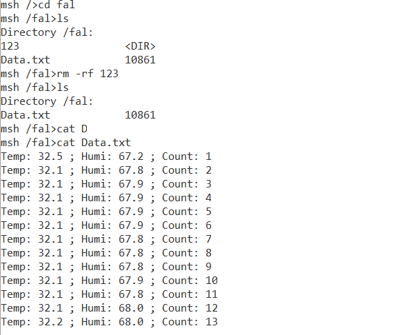
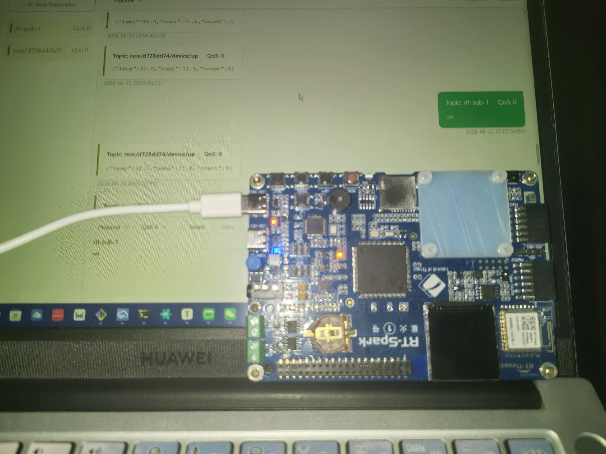
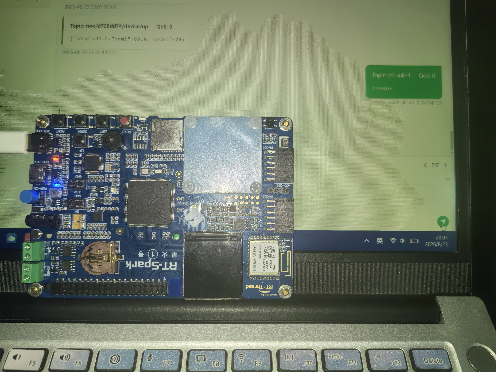

## 任务 1：AHT10 采集温湿度并上传

### 1.1 配置流程

**Step 1 — AHT10 软件包**（RT-Thread Settings → 软件包 → 传感器驱动 → aht10）：

- 开启 `aht10` 软件包（v2.1.0），启用软件平均滤波（10 次）
- 配置 I2C 总线名：`i2c3`
- 对应 rtconfig.h：`PKG_USING_AHT10`、`PKG_AHT10_I2C_BUS_NAME "i2c3"`

**Step 2 — I2C 总线**（硬件 → I2C）：

- 开启软件 I2C（`RT_USING_I2C_BITOPS`），SCL = PE0（管脚号 64）、SDA = PE1（65）

**Step 3 — kawaii-mqtt 软件包**：

- 开启 `kawaii-mqtt`，启用 test 例程（`PKG_USING_KAWAII_MQTT_TEST`）
- 配置 Broker：`broker.emqx.io:1883`、Client ID：`d728dd74`（公共 broker 需唯一）

**Step 4 — RW007 WiFi 模组**：

- SPI2 总线、CS = PI2（90）、BOOT0 = PD13（29）、RST = PD15（111）

### 1.2 主要代码

**AHT10 注册进 sensor 框架**（`applications/main.c`，官方 README 写法）：

```c
#include "sensor_asair_aht10.h"

static int rt_hw_aht10_port(void)
{
    struct rt_sensor_config cfg;
    cfg.intf.dev_name = PKG_AHT10_I2C_BUS_NAME;    /* "i2c3" */
    cfg.intf.user_data = RT_NULL;
    rt_hw_aht10_init("aht10", &cfg);   /* 产生 temp_aht10 / humi_aht10 两个设备 */
    return RT_EOK;
}
INIT_ENV_EXPORT(rt_hw_aht10_port);
```

**温湿度读取**（sensor 框架标准读法）：

```c
static int read_temp_humi(int *temp_x10, int *humi_x10)
{
    rt_device_t temp_dev = rt_device_find("temp_aht10");
    rt_device_t humi_dev = rt_device_find("humi_aht10");
    struct rt_sensor_data data;

    rt_device_open(temp_dev, RT_DEVICE_FLAG_RDONLY);       /* 自动设为 POLLING 模式 */
    rt_device_read(temp_dev, 0, &data, 1);
    *temp_x10 = data.data.temp;                            /* 0.1℃（285 = 28.5℃） */
    rt_device_close(temp_dev);

    rt_device_open(humi_dev, RT_DEVICE_FLAG_RDONLY);
    rt_device_read(humi_dev, 0, &data, 1);
    *humi_x10 = data.data.humi;                            /* 千分比（除10为百分比） */
    rt_device_close(humi_dev);

    return RT_EOK;
}
```

**WiFi 连接 + 等待 IP 就绪**（关键：CONNECT 事件时 DHCP 可能未完成）：

```c
if (!rt_wlan_is_connected())
    rt_wlan_connect(WIFI_SSID, WIFI_PASSWORD);

for (i = 0; i < 30; i++) {
    if (netdev_get_first_by_flags(NETDEV_FLAG_INTERNET_UP) != RT_NULL)
        break;
    rt_thread_mdelay(1000);
}
```

**MQTT 连接 + 发布 JSON**：

```c
client = mqtt_lease();
mqtt_set_host(client, KAWAII_MQTT_HOST);            /* broker.emqx.io */
mqtt_set_port(client, KAWAII_MQTT_PORT);            /* 1883 */
mqtt_set_client_id(client, MQTT_CLIENT_ID);         /* d728dd74 */
mqtt_set_clean_session(client, 1);
mqtt_connect(client);                               /* 同步阻塞：等 TCP+CONNACK */

/* 发布：rt_vsnprintf 不支持 %f，小数用整数拆分 */
fmt_x10(temp_x10, temp_s, sizeof(temp_s));          /* 305 -> "30.5" */
rt_snprintf(payload, sizeof(payload),
            "{\"temp\":%s,\"humi\":%s,\"count\":%d}", temp_s, humi_s, count);
msg.qos = QOS0;
msg.payload = payload;
msg.payloadlen = rt_strlen(payload);
mqtt_publish(client, TOPIC_UP, &msg);               /* rsoc/d728dd74/device/up */
```

### 1.3 验证结果



MQTTX 订阅 `rsoc/d728dd74/device/up` 每 5s 收到一条 JSON。

---

## 任务 2：文件系统启动流程 + font 分区挂载 + Data.txt

### 2.1 文件系统启动流程

1. **DFS 组件初始化**：初始化注册表、文件描述符表和相关锁
2. **注册文件系统类型**：elm-fat、romfs 等注册到 DFS
3. **挂载根文件系统**：romfs 挂到 `/`（`drv_filesystem.c` 中 `dfs_mount(RT_NULL, "/", "rom", ...)`），根目录树预置挂载点 `/fal`、`/font`（romfs 只读，挂载点必须预置）

4. **FAL 初始化**：注册 flash 设备（片上 128K + W25Q64）与分区表

```
[I/FAL] | name       | flash_dev         |   offset   |    length  |
[I/FAL] | app        | onchip_flash_128k | 0x00000000 | 0x00060000 |
[I/FAL] | filesystem | W25Q64            | 0x00500000 | 0x00300000 |
```

5. **filesystem 分区自动挂载**：开机 `filesystem_mount()` → FAL 分区 → 块设备 → elm FAT 挂到 `/fal`（`Filesystem initialized!`）
6. **font 分区按需挂载**：`mount_font` 命令 → 块设备 → 首次 mkfs 格式化 → 挂到 `/font`

### 2.2 主要代码

**font 分区挂载**（`mount_font` 命令）：

```c
static int mount_font(void)
{
    struct rt_device *blk;

    /* 1. FAL 分区 -> 块设备 */
    blk = fal_blk_device_create("font");
    if (blk == RT_NULL) return -1;

    /* 2. 挂载点 /font 由根文件系统 romfs 预置（drv_filesystem.c 的 _romfs_root） */
    /* 3. 尝试挂载，失败则格式化后重挂 */
    ret = dfs_mount(blk->parent.name, "/font", "elm", 0, 0);
    if (ret != 0) {
        dfs_mkfs("elm", blk->parent.name);        /* 首次：格式化为 FAT */
        ret = dfs_mount(blk->parent.name, "/font", "elm", 0, 0);
    }
    return ret;
}
MSH_CMD_EXPORT(mount_font, ...);
```

**Data.txt 追加写入**（随采集循环执行，作业指定格式）：

```c
fd = open("/fal/Data.txt", O_RDWR | O_CREAT | O_APPEND, 0666);
write(fd, line, len);      /* "Temp: 31.2 ; Humi: 75.0 ; Count: 12\n" */
close(fd);
```

### 2.3 验证结果



---

## 任务 3：云端指令翻转小灯

### 3.1 设计

- 板卡订阅主题 `rtt-sub-1`（`KAWAII_MQTT_SUBTOPIC`）
- 指令协议：`on`（点亮）/ `off`（熄灭）/ `toggle`（翻转）
- 引脚：LED_R = PF12、LED_B = PF11（**低电平点亮**）

### 3.2 主要代码

```c
static void led_init(void)
{
    /* 复位后默认模拟输入，必须显式配置为输出 */
    rt_pin_mode(PIN_LED_B, PIN_MODE_OUTPUT);
    rt_pin_mode(PIN_LED_R, PIN_MODE_OUTPUT);
    rt_pin_write(PIN_LED_B, PIN_HIGH);      /* 初始熄灭 */
    rt_pin_write(PIN_LED_R, PIN_HIGH);
}

static void rsoc_msg_handler(void *client, message_data_t *msg)
{
    /* MQTT payload 可能无 NUL 结尾，先拷贝成 C 字符串 */
    char cmd_buf[32];
    rt_memcpy(cmd_buf, msg->message->payload, copy_len);
    cmd_buf[copy_len] = '\0';

    if (rt_strcmp(cmd_buf, "toggle") == 0) {
        rt_pin_write(PIN_LED_B, !rt_pin_read(PIN_LED_B));
        rt_pin_write(PIN_LED_R, !rt_pin_read(PIN_LED_R));
    } else if (rt_strcmp(cmd_buf, "on") == 0) {
        rt_pin_write(PIN_LED_B, PIN_LOW);
        rt_pin_write(PIN_LED_R, PIN_LOW);
    } else if (rt_strcmp(cmd_buf, "off") == 0) {
        rt_pin_write(PIN_LED_B, PIN_HIGH);
        rt_pin_write(PIN_LED_R, PIN_HIGH);
    }
}
```

### 3.3 验证结果

MQTTX 向 `rtt-sub-1` 发布 on/toggle：




