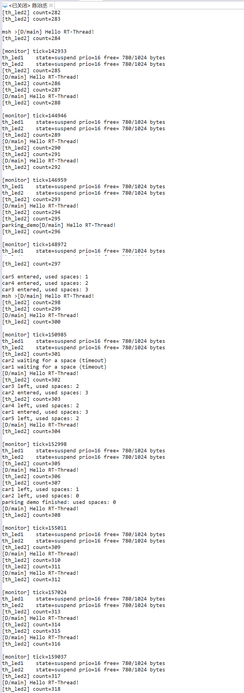
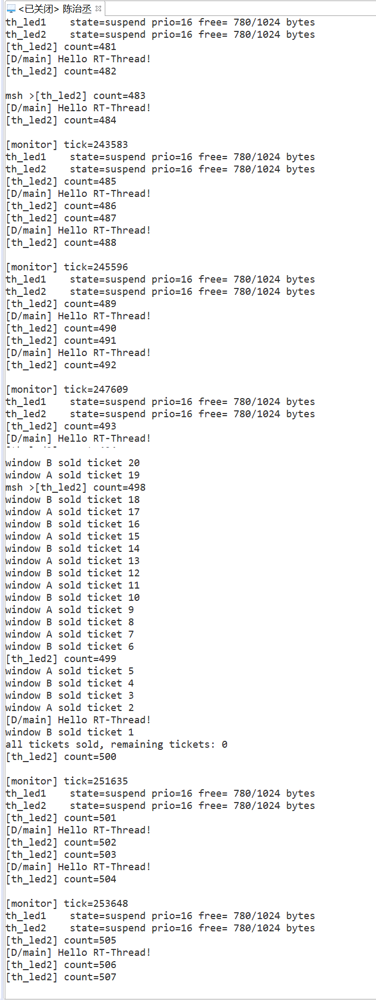
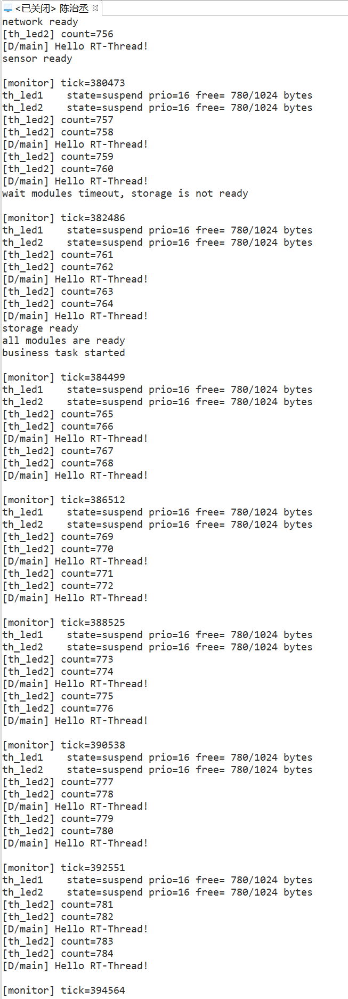
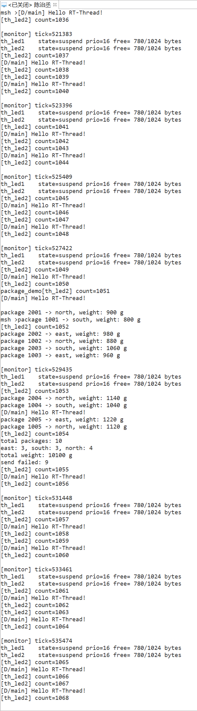

# 【DAY3】RT-Thread 线程间同步与通信

- 姓名：陈治丞
- 组别：第 1 组
- 开发板：STM32F407 星火一号（`stm32f407-rtspark`）

## 一、实现说明

源码见 [ipc_day3.c](./ipc_day3.c)。程序不在启动时自动创建业务线程，而是通过 FinSH/MSH 命令按需启动；每个练习都有控制线程等待所有工作线程结束，然后删除动态 IPC 对象。因此，同一个命令在任务结束后可以再次运行，任务执行中重复输入命令会提示忙碌。

| 命令 | IPC 对象 | 线程 | 验证目标 |
| --- | --- | --- | --- |
| `parking_demo` | 计数信号量、互斥量 | 5 个车辆线程 | 同时进入的车辆最多 3 个；超时后继续等待 |
| `ticket_demo` | 互斥量 | 窗口 A、窗口 B | 20 张票只售一次，余票不小于 0 |
| `ticket_demo unsafe` | 无互斥量 | 窗口 A、窗口 B | 在读写之间延时，观察竞争条件 |
| `startup_demo` | 事件集、信号量 | 3 个初始化线程、业务线程 | AND 模式等待三个模块全部就绪 |
| `package_demo` | 消息队列、信号量 | 2 个发件线程、分拣线程 | 分拣 10 个快递并输出分类统计 |

## 二、练习一：为什么使用计数信号量

车位是数量为 3 的同类资源，每辆车进入时消耗一个，离开时归还一个。计数信号量的值正好表达“剩余资源数”，可以允许最多 3 个线程同时获得资源。互斥量只表达单一临界区的所有权，不能表示 3 个可并行使用的车位。

## 三、练习二：售票临界区

售票的“检查余票、取得票号、余票减一、记录结果”是一个完整事务，必须由同一把互斥量保护。只锁住 `ticket_count--` 仍不安全：两个窗口可能都在锁外读到相同余票，然后先后进入临界区，导致重复票号或错误判断。`ticket_demo unsafe` 特意在读取与修改之间延时，用于对比竞争现象。

## 四、练习三：事件集与三个信号量的区别

事件集把多个状态位放在同一个对象中，业务线程一次 `rt_event_recv()` 就能以 AND 条件等待所有模块就绪，并能保存已经到达的状态。三个独立信号量也能实现，但需要逐个等待、维护更多对象；如果有多个等待者或需要组合条件，状态管理会更复杂。实验先等待 3 秒，因存储模块延时 5 秒而超时，再等待全部事件到达。

## 五、练习四：消息队列

消息队列将完整的 `package_msg` 按消息边界传递给分拣线程，两个发件线程不会直接修改统计数据。队列容量为 5；队列满时，发送线程记录一次失败并短暂延时后重试，确保最终仍能处理 10 条不重复快递。两个发件线程结束后，控制线程投递 `id=0` 的结束消息，分拣线程收到后输出总数、区域数量、总重量和失败次数。

## 六、运行方法

1. 将 `ipc_day3.c` 放到工程的 `applications` 目录，重新构建并下载。
2. 打开串口终端，在 `msh >` 后逐条输入命令。
3. 等待当前练习打印结束统计后，再执行下一条命令。

```text
msh >parking_demo
msh >ticket_demo
msh >ticket_demo unsafe
msh >startup_demo
msh >package_demo
```

## 七、实验检查要点

- 停车场日志中的 `used spaces` 始终不超过 3。
- 加锁后的售票结果为 `remaining tickets: 0`，票号不重复。
- 启动检查先打印存储未就绪的超时提示，随后打印 `all modules are ready`。
- 快递分拣最终为 `total packages: 10`，并给出三个区域与重量统计。

## 八、实测结果

### 1. 停车场计数信号量

前三辆车进入后车位满，其他车辆等待超时后重试；最终所有车辆离开，车位占用回到 0。



### 2. 多窗口售票互斥量

两个窗口从票号 20 依次售到 1，最终余票为 0。



### 3. 系统启动事件集

网络和传感器先就绪，主业务线程在等待存储模块时超时；存储模块完成后，三个事件位满足 AND 条件，业务启动。



### 4. 快递消息队列

两个发件线程共产生 10 个不重复的快递消息。队列满时记录失败次数并重试，最终完成全部分类和重量统计。


