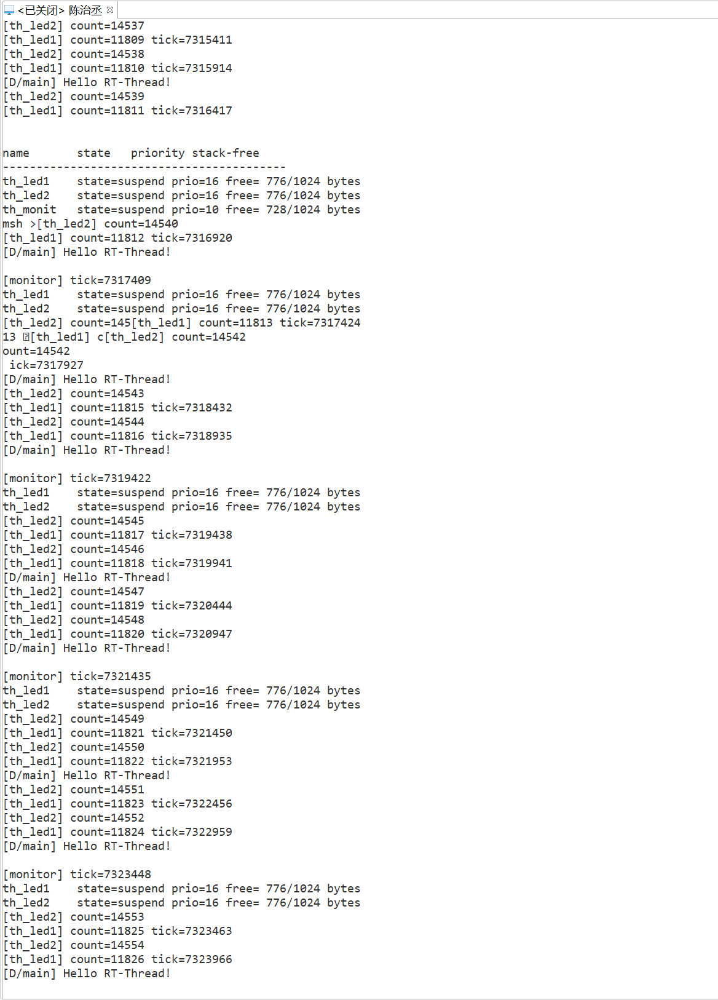
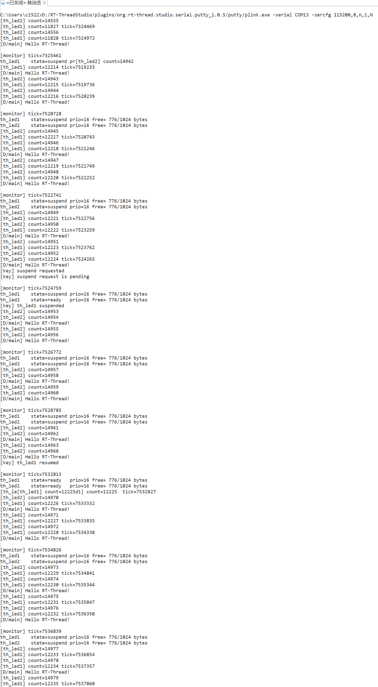

# 【DAY2】RT-Thread 启动流程、内核基础与多线程编程

- 姓名：陈治丞
- 组别：第 1 组
- 开发板：STM32F407 星火一号（`stm32f407-rt-spark`）

## 一、STM32F407 与 RT-Thread 启动流程

### 1. 从复位到 `main()` 的调用链

以 RT-Thread GCC 工程为例，启动过程可以概括为：

```text
上电/复位
  -> 从中断向量表取得 MSP 初值和 Reset_Handler 地址
  -> Reset_Handler
  -> SystemInit()：配置 FPU、时钟等芯片基础环境
  -> C 运行库初始化：复制 .data、清零 .bss、执行初始化数组
  -> entry()
  -> rtthread_startup()
       -> 关闭本地中断
       -> rt_hw_board_init()
            -> HAL_Init()、SystemClock_Config()
            -> SysTick、串口、堆等板级初始化
            -> rt_components_board_init()
       -> rt_system_timer_init()
       -> rt_system_scheduler_init()
       -> rt_application_init()：创建 main 线程
       -> rt_system_timer_thread_init()
       -> rt_thread_idle_init()
       -> rt_system_scheduler_start()
  -> main_thread_entry()
       -> rt_components_init()
       -> main()
```

这里的用户 `main()` 已经运行在线程环境中。调度器启动前创建的线程只是进入就绪队列，真正执行要等 `rt_system_scheduler_start()` 选择第一个就绪线程。

### 2. 自动初始化机制

`INIT_BOARD_EXPORT(fn)` 和 `INIT_APP_EXPORT(fn)` 都建立在 `INIT_EXPORT(fn, level)` 上。宏不会立即调用函数，而是利用编译器的 `used` 与 `section` 属性，把函数指针（调试模式下还包含函数名）放进 `.rti_fn.<level>` 段。链接脚本把这些段按级别排列，并提供起止符号，系统运行时遍历函数指针并依次调用。

主要级别如下：

| 宏 | 级别 | 调用位置 | 适用内容 |
| --- | --- | --- | --- |
| `INIT_BOARD_EXPORT` | `1` | `rt_hw_board_init()` 阶段 | 时钟、引脚、板级基础驱动 |
| `INIT_DEVICE_EXPORT` | `3` | main 线程的组件初始化阶段 | 设备驱动 |
| `INIT_COMPONENT_EXPORT` | `4` | main 线程的组件初始化阶段 | 文件系统、网络等组件 |
| `INIT_APP_EXPORT` | `6` | main 线程调用 `rt_components_init()` 时 | 应用模块 |

本实验使用 `INIT_APP_EXPORT(thread_study_init)`，因此不需要在 `main.c` 中手动调用初始化函数。它比用户 `main()` 先执行，但此时调度器已经工作，可以创建并启动线程。

## 二、内核对象与线程控制块

RT-Thread 用统一对象模型管理线程、信号量、互斥量、定时器等内核对象。具体控制块的开头包含公共的 `struct rt_object`，其中保存对象名称、类型和对象链表节点。内核可以据此把同类对象组织到对象容器中，FinSH 的 `list_thread` 等命令也能统一遍历对象。

`struct rt_thread` 中本实验关注的成员如下：

| 成员 | 作用 |
| --- | --- |
| `stat` | 保存线程当前状态，读取时通常与 `RT_THREAD_STAT_MASK` 相与 |
| `current_priority` | 当前有效优先级，数值越小优先级越高 |
| `init_tick` | 初始化时间片，用于同优先级线程轮转 |
| `remaining_tick` | 当前时间片的剩余 tick 数 |
| `sp` | 线程切换时保存的栈指针，恢复上下文时使用 |
| `stack_addr`、`stack_size` | 线程栈起始地址和总大小 |
| `tlist` | 线程挂接到就绪表或等待队列时使用的链表节点 |
| `thread_timer` | 实现线程延时和带超时阻塞的内置定时器 |

### 静态对象与动态对象

| 对比项 | 静态线程 | 动态线程 |
| --- | --- | --- |
| 创建接口 | `rt_thread_init()` | `rt_thread_create()` |
| TCB 与栈 | 由用户定义全局/静态内存 | 由系统从堆中分配 |
| 生命周期 | 由变量的存储期决定 | 创建后存在，删除时释放堆内存 |
| 退出后的处理 | 使用 `rt_thread_detach()` 脱离对象管理 | 使用 `rt_thread_delete()`，由系统回收 |
| 优点 | 内存确定、无堆碎片、启动结果可预测 | 使用方便、可按需创建和删除 |

高可靠系统常强制使用静态线程，因为线程数量和内存占用可以在编译期确定，不依赖运行时堆状态，也不会因堆耗尽或碎片化导致关键线程创建失败。代价是资源不能灵活回收，设计时需要提前确定最大需求。

## 三、线程状态与调度

### 1. 五态模型

```text
                     rt_thread_startup()
      初始态 --------------------------------> 就绪态
        ^                                        |
        |                                        | 调度器选中
        | rt_thread_init/create                  v
      创建前                                  运行态
                                                 |
                    +----------------------------+-------------------+
                    | delay / 等待 IPC / suspend                     | 入口函数返回
                    v                                                v
                  挂起态 ------------------------------->          关闭态
                    |    resume / 超时 / IPC 到达
                    +---------------------------> 就绪态
```

- 初始态：`rt_thread_init()` 或 `rt_thread_create()` 完成，但尚未启动。
- 就绪态：调用 `rt_thread_startup()`、`rt_thread_resume()`，或者等待超时、IPC 到达后进入就绪队列。
- 运行态：调度器从最高优先级就绪队列中选中线程。
- 挂起态：调用 `rt_thread_delay()`、`rt_thread_mdelay()`、等待信号量/互斥量，或调用 `rt_thread_suspend()`。
- 关闭态：线程入口函数返回，或执行删除、脱离操作后不再参与调度。

### 2. 抢占与时间片轮转

RT-Thread 采用基于优先级的抢占式调度，优先级数值越小越高。高优先级线程一旦变为就绪态，可以抢占低优先级线程。本实验中 `th_monitor` 的优先级为 10，两个工作线程为 16，因此监控线程每次被唤醒后会先执行状态检查与按键处理。

当多个就绪线程优先级相同时，调度器使用时间片轮转。`th_led1` 和 `th_led2` 的优先级同为 16、时间片同为 5 ticks；如果二者持续处于就绪态，每个线程最多运行一个时间片后让同优先级线程获得 CPU。实验线程还会主动调用 `rt_thread_mdelay()`，因此多数切换由线程进入挂起态触发。

## 四、多线程实验设计

源码见 [thread_study.c](./thread_study.c)。模块包含：

| 线程 | 创建方式 | 优先级 | 时间片 | 栈 | 功能 |
| --- | --- | ---: | ---: | ---: | --- |
| `th_led1` | 动态创建 | 16 | 5 ticks | 1024 B | 翻转红灯 PF12，打印计数和 tick |
| `th_led2` | 静态初始化 | 16 | 5 ticks | 1024 B | 翻转蓝灯 PF11，打印计数 |
| `th_monitor` | 动态创建 | 10 | 5 ticks | 1024 B | 每 2 秒打印工作线程状态和剩余栈 |

板载 `KEY_UP` 对应 PC5，采用下降沿中断和 50 ms 软件消抖。第一次有效按键由监控线程提出挂起请求，`th_led1` 检测请求后调用 `rt_thread_suspend(rt_thread_self())` 自行挂起；再次按键由监控线程调用 `rt_thread_resume(th_led1)` 恢复。这样处理是因为本机 RT-Thread 4.x 的 `rt_thread_suspend()` 会断言目标必须是当前线程。新版本虽然允许直接挂起其他线程，也明确提示这样做可能造成死锁或资源饥饿。本例中 `th_led1` 不持有互斥量等共享资源，因此演示挂起较为安全。

剩余栈统计利用 RT-Thread 在线程初始化时用字符 `'#'` 填充栈空间的特性，从栈起始位置统计尚未被覆盖的连续字节。该结果反映运行以来的大致最小剩余栈，比直接使用某一时刻的 `sp` 更适合观察栈余量。

## 五、集成与验证

1. 确认工程启用了 PIN、FinSH/MSH 和组件自动初始化。
2. 把 `thread_study.c` 放入 RT-Thread Studio 工程的 `applications` 目录并重新构建。
3. 原有 `main.c` 不要再控制 PF11/PF12，否则会与本实验争用 LED；也不要在 `main()` 中调用 `thread_study_init()`。
4. 下载到星火一号，打开 FinSH 串口终端观察日志。
5. 按一次 `KEY_UP`，确认红灯停止翻转且日志出现 `th_led1 suspended`；再按一次确认恢复。
6. 在 FinSH 输入 `thread_dump`，检查三个线程的状态、优先级和栈余量。

预期日志格式如下（数值以实际运行结果为准）：

```text
Day2 thread study initialized
[th_led1] count=1 tick=...
[th_led2] count=1

[monitor] tick=...
th_led1    state=suspend prio=16 free=.../1024 bytes
th_led2    state=suspend prio=16 free=.../1024 bytes
[key] th_led1 suspended
[key] th_led1 resumed

msh >thread_dump
name       state   priority stack-free
------------------------------------------
th_led1    state=...     prio=16 free=.../1024 bytes
th_led2    state=...     prio=16 free=.../1024 bytes
th_monitor state=suspend prio=10 free=.../1024 bytes
```

### 实测结果

在 FinSH 中执行 `thread_dump` 后，能够读取三个实验线程的状态、优先级和剩余栈空间。其中 `th_led1`、`th_led2` 的优先级为 16，`th_monitor` 的优先级为 10。



按下板载 `KEY_UP` 后，日志显示 `th_led1 suspended`，此时 `th_led1` 停止计数而 `th_led2` 继续运行；再次按键后出现 `th_led1 resumed`，`th_led1` 恢复计数。



## 六、实验总结

本实验分别使用动态创建和静态初始化完成两个同优先级工作线程，并通过高优先级监控线程观察和控制它们。实验说明了三点：高优先级线程就绪后会抢占低优先级线程；相同优先级线程可以通过时间片共享 CPU；线程延时、挂起和恢复会改变线程在就绪队列中的位置。自动初始化宏则把模块接入系统启动流程，使应用代码与 `main.c` 保持解耦。
