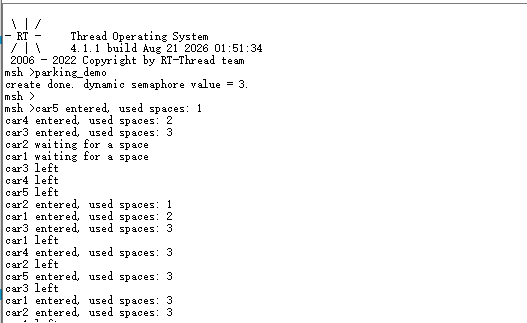
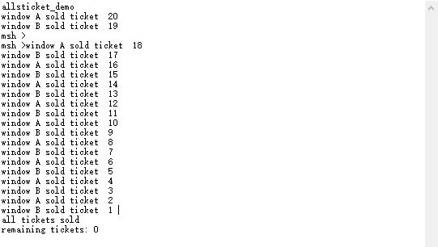
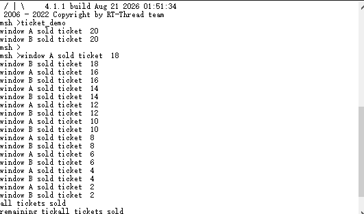
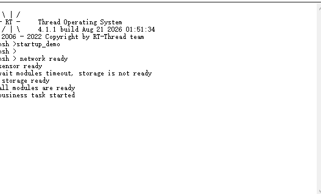
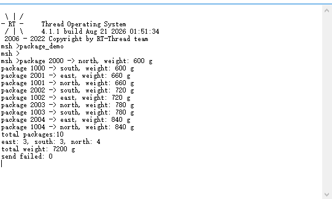

# RT-Thread 夏令营第三天作业

## 作业主题

本次作业围绕 RT-Thread 线程间同步与通信（IPC）展开，覆盖计数信号量、互斥量、事件集和消息队列四类内核对象。实验工程为 `RSOC2026IPC`，通过 MSH 命令分别启动四个练习。

## 一、课程背景与基础概念

### 1.1 从线程调度到 IPC

前两天学习了 RT-Thread 的启动流程、线程创建、线程状态和优先级调度。多个线程并发运行后，会出现两个新的问题：

1. 线程需要等待某个条件发生，例如等待资源可用或等待模块初始化完成；
2. 多个线程访问同一个资源时，需要避免数据被交错修改。

IPC（Inter-Process Communication）在 RT-Thread 中也用于线程间同步和通信，主要解决“什么时候运行”和“传递什么数据”两个问题。

### 1.2 临界区、阻塞、非阻塞与挂起

| 概念 | 含义 |
| --- | --- |
| 临界区 | 访问共享数据或硬件资源的一段代码，同一时间只允许一个线程进入 |
| 阻塞 | 当前条件不满足时，线程主动等待资源或事件，并让出 CPU |
| 非阻塞 | 接口立即返回，不等待资源；调用者需要自行处理失败或稍后重试 |
| 挂起 | 线程因延时、等待 IPC 或显式控制而暂时离开就绪队列 |
| 超时 | 在限定 Tick 内没有获得资源或事件，接口返回超时错误 |

阻塞并不等于错误。合理阻塞可以避免线程空转，提高 CPU 利用率；但阻塞时间必须符合实时性要求，并且要设置合适的超时时间。

## 二、IPC 机制理论整理

### 2.1 信号量（Semaphore）

信号量是一个非负计数器，适合表示资源数量或同步许可。

| 类型 | 典型初值 | 主要用途 |
| --- | ---: | --- |
| 二值信号量 | 0 或 1 | 线程同步、通知某件事情已经发生 |
| 计数信号量 | 可用资源数量 | 管理多个相同资源实例 |

常用 API：

```c
rt_sem_create(name, value, flag);      /* 动态创建 */
rt_sem_init(&sem, name, value, flag);  /* 静态初始化 */
rt_sem_take(sem, timeout);              /* 获取一个许可 */
rt_sem_release(sem);                   /* 释放一个许可 */
rt_sem_delete(sem);                    /* 删除动态信号量 */
rt_sem_detach(&sem);                   /* 脱离静态信号量 */
```

`flag` 决定等待队列规则。`RT_IPC_FLAG_PRIO` 按线程优先级唤醒等待者，实时系统中通常比 FIFO 更符合高优先级任务优先响应的要求。

#### 停车场模型

停车场有 3 个车位，使用初始值为 3 的计数信号量表示剩余车位。5 个车辆线程调用 `rt_sem_take()`：

```text
可用车位 = 3
车辆进入 -> take -> 可用车位减 1
车辆离开 -> release -> 可用车位加 1
```

当计数降为 0 时，后续车辆在 2 秒内无法获取车位，打印等待信息并稍后重试。计数信号量适合此场景，因为资源有 3 个实例；互斥量只能表达“一个线程拥有一把锁”，不能直接表示 3 个可用车位。

### 2.2 互斥量（Mutex）

互斥量用于保护临界区，和信号量相比具有明确的所有权：成功获取互斥量的线程才允许释放它。RT-Thread 互斥量还支持递归获取，适合同一线程在嵌套函数中重复进入受保护区域。

常用 API：

```c
rt_mutex_create(name, flag);             /* 动态创建 */
rt_mutex_init(&mutex, name, flag);       /* 静态初始化 */
rt_mutex_take(mutex, timeout);           /* 获取所有权 */
rt_mutex_release(mutex);                 /* 持有者释放 */
rt_mutex_delete(mutex);                  /* 删除动态互斥量 */
```

#### 优先级反转

当低优先级线程持有锁、高优先级线程等待锁，而中优先级线程持续运行时，高优先级线程会间接被中优先级线程阻塞，这就是优先级反转。互斥量的优先级继承机制会临时提升锁持有者的优先级，使其尽快执行完临界区并释放锁。

#### 售票模型

两个售票窗口共享 `tickets`。检查余票、记录票号、递减余票和打印结果必须作为一个完整临界区保护：

```text
take mutex
  -> 检查 tickets
  -> 读取并记录当前票号
  -> tickets--
  -> 打印结果
release mutex
```

只给 `tickets--` 加锁不够安全，因为“检查是否有票”和“递减”之间仍可能被另一个窗口插入，导致重复票号或负数。当前工程 `mutex_sample.c` 中窗口 A 的 `rt_mutex_take()` 行被注释，且仍调用了 `rt_mutex_release()`；这需要在提交前修正，否则截图只能作为运行现象，不能作为严格互斥保护已完成的证据。

### 2.3 事件集（Event）

事件集用一个 32 位无符号整数的位表示多个条件，适合一对多或多对多同步。每一位代表一个独立事件：

```c
#define EVENT_NET_READY      (1U << 0)
#define EVENT_SENSOR_READY   (1U << 1)
#define EVENT_STORAGE_READY  (1U << 2)
```

常用 API：

```c
rt_event_init(&event, name, flag);
rt_event_send(&event, set);                /* 设置事件位 */
rt_event_recv(&event, set, option, timeout, &recved);
rt_event_detach(&event);
```

`rt_event_recv()` 的选项：

- `RT_EVENT_FLAG_AND`：等待请求的所有事件位同时到达；
- `RT_EVENT_FLAG_OR`：任意一个请求事件位到达即可返回；
- `RT_EVENT_FLAG_CLEAR`：成功接收后清除对应事件位。

启动条件练习中，网络、传感器和存储线程分别发送就绪事件，业务线程使用 AND 模式等待三个位全部置位。存储线程延时 5 秒，而业务线程单次等待 3 秒，因此第一次会超时并报告存储未就绪，下一轮等待在存储事件到达后成功。

### 2.4 消息邮箱（Mailbox）

消息邮箱适合传递固定大小的单字长消息。在 32 位系统中，一封邮箱消息通常是 4 字节，常用于传递整数、状态码或指针：

```c
rt_mb_init(&mb, name, pool, size, flag);
rt_mb_send(&mb, value);
rt_mb_recv(&mb, &value, timeout);
rt_mb_urgent(&mb, value);
```

发送通常可以采用非阻塞方式，适合中断或生产者快速投递；接收线程可以阻塞等待，并设置超时。发送字符串时实际传递的是字符串缓冲区指针，必须保证接收期间指针指向的内存仍然有效。

### 2.5 消息队列（Message Queue）

消息队列是邮箱的扩展，支持固定最大长度的结构化消息，适合传递多个字段：

```c
struct package_msg
{
    rt_uint32_t id;
    rt_uint8_t  region;
    rt_uint16_t weight;
};
```

常用 API：

```c
rt_mq_create(name, msg_size, max_msgs, flag);
rt_mq_send(mq, buffer, size);
rt_mq_recv(mq, buffer, size, timeout);
rt_mq_urgent(mq, buffer, size);
rt_mq_delete(mq);
```

`rt_mq_urgent()` 将消息插入队头，可以让紧急消息优先于普通消息被处理。消息队列容量和消息大小需要在创建时确定，队列满时发送返回错误，调用者必须统计并处理发送失败。

## 三、实验工程与 MSH 命令

### 3.1 工程信息

| 项目 | 内容 |
| --- | --- |
| 工程 | `RSOC2026IPC` |
| 芯片 | 以当前 BSP 配置为准，工程为 STM32F4 系列 |
| RT-Thread | 4.1.1（串口 Logo 显示） |
| 系统 Tick | `RT_TICK_PER_SECOND=1000` |
| 配置 | 已启用 Semaphore、Mutex、Event、Mailbox、Message Queue 和 FinSH |

当前工程源码位置：

```text
packages/kernel_samples-latest/zh/semaphore_sample.c  parking_demo
packages/kernel_samples-latest/zh/mutex_sample.c      ticket_demo
packages/kernel_samples-latest/zh/event_sample.c      startup_demo
packages/kernel_samples-latest/zh/msgq_sample.c       package_demo
```

本次作业目录中的源码文件按功能重新命名：

| 作业源码 | 对应 MSH 命令 | 原工程文件 |
| --- | --- | --- |
| `parking_demo.c` | `parking_demo` | `semaphore_sample.c` |
| `ticket_demo.c` | `ticket_demo` | `mutex_sample.c` |
| `startup_demo.c` | `startup_demo` | `event_sample.c` |
| `package_demo.c` | `package_demo` | `msgq_sample.c` |

文件重命名不会改变函数内部的实现，也不会改变 MSH 命令名；命令仍由源码中的 `MSH_CMD_EXPORT_ALIAS()` 注册。

### 3.2 MSH 启动方式

每个练习都通过 MSH 命令启动，不在 `main.c` 中硬编码调用：

```text
parking_demo   # 停车场计数信号量
ticket_demo    # 多窗口售票互斥量
startup_demo   # 模块就绪事件集
package_demo   # 快递分拣消息队列
```

导出形式为：

```c
MSH_CMD_EXPORT_ALIAS(semaphore_sample, parking_demo, ...);
MSH_CMD_EXPORT_ALIAS(mutex_sample, ticket_demo, ...);
MSH_CMD_EXPORT_ALIAS(event_sample, startup_demo, ...);
MSH_CMD_EXPORT_ALIAS(msgq_sample, package_demo, ...);
```

### 3.3 重复执行注意事项

作业要求重复执行命令不能因同名线程或 IPC 对象残留而异常。当前工程样例使用固定线程控制块和固定对象名，部分示例在任务结束时没有完整删除或脱离资源，因此重复输入命令前建议重启开发板验证，或在代码中增加：

1. 运行状态标志，检测任务是否已启动；
2. 动态对象删除、静态对象脱离；
3. 线程退出后的控制块复位；
4. 所有创建、初始化、启动和发送/接收接口的返回值检查。

## 四、实验结果与截图分析

### 4.1 停车场：计数信号量



截图显示动态信号量初值为 3，车辆线程依次进入并在离开后释放车位；当车位被占满时，其他车辆打印等待信息。实验现象证明信号量计数会随 `take/release` 变化，且同时占用数不应超过 3。

### 4.2 售票窗口：互斥量





两张截图均显示窗口 A、B 交替售票并最终输出 `all tickets sold`、`remaining tickets: 0`。实验报告需要进一步核对票号是否唯一，并在代码中确保两个窗口都在同一把互斥量保护下完成“检查-记录-递减-打印”完整过程。

### 4.3 启动条件：事件集 AND + 超时



网络和存储模块先后输出就绪信息，业务线程在所有模块就绪后输出：

```text
all modules are ready
business task started
```

作业要求的超时现象应为存储延迟 5 秒时，业务线程 3 秒超时并报告 `storage is not ready`，随后再次等待并在存储事件到达后继续。当前截图主要展示了模块就绪和业务启动结果，若要证明超时分支，还需补充包含 `wait modules timeout` 的串口截图。

### 4.4 快递分拣：消息队列



截图显示 `package_demo` 处理 10 条消息，并统计 east、south、north 三个区域的数量、总重量和发送失败次数。两个生产线程各发送 5 条消息，分拣线程收到两个结束消息后退出。报告中应核对总数量是否为 10、区域计数之和是否为 10，以及 `send failed` 是否符合实际队列满载情况。

## 五、实验结论与待完善项

### 已观察到的现象

- [x] 计数信号量限制停车场并发资源数量；
- [x] 两个售票线程完成共享票数更新；
- [x] 事件集等待多个模块就绪；
- [x] 消息队列传输结构化快递信息并完成统计；
- [x] 四个练习均可通过 MSH 命令启动。

## 六、思考题

### 1. 停车场为什么使用计数信号量而不是互斥量？

因为停车场有 3 个相同资源实例，需要用计数值表示剩余车位。互斥量只表示一项资源的独占所有权，不能直接表示 3 个并行可用车位。

### 2. 为什么只给 `ticket_count--` 加锁仍不安全？

因为检查余票、读取票号和修改票数是一个不可分割的逻辑事务。只保护递减语句，另一个线程仍可能在检查和递减之间读取相同票号。

### 3. 三个信号量和事件集实现启动条件有什么区别？

三个信号量需要分别等待和记录三个条件，业务线程还要自行维护完成计数；事件集把多个条件压缩为位图，可用 AND 一次等待全部条件，也可用 OR 等待任意条件，表达更直接。

### 4. 邮箱和消息队列如何选择？

只需要传递一个指针或整数时使用邮箱更轻量；需要传递多个字段、变长或结构化数据时使用消息队列。紧急消息插队是消息队列/邮箱提供的优先投递能力，使用时要明确队列容量和所有权。
