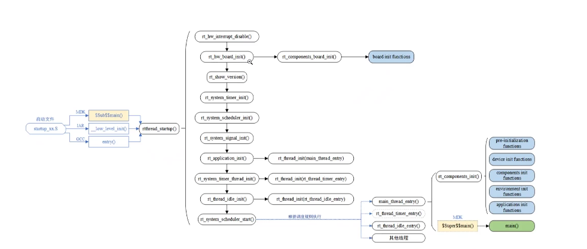
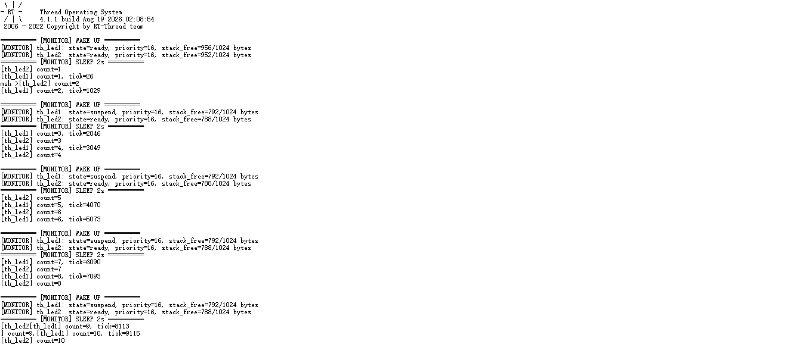
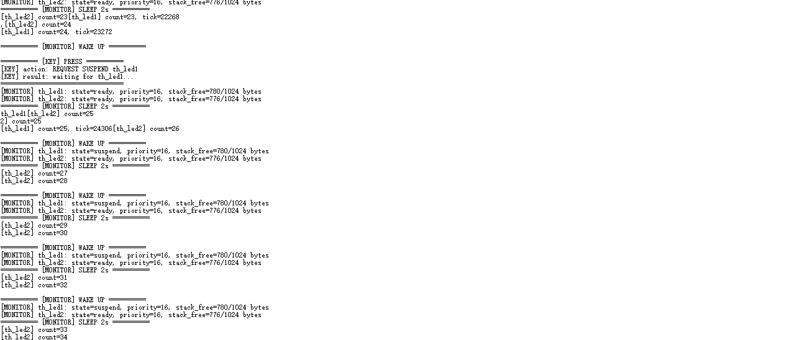
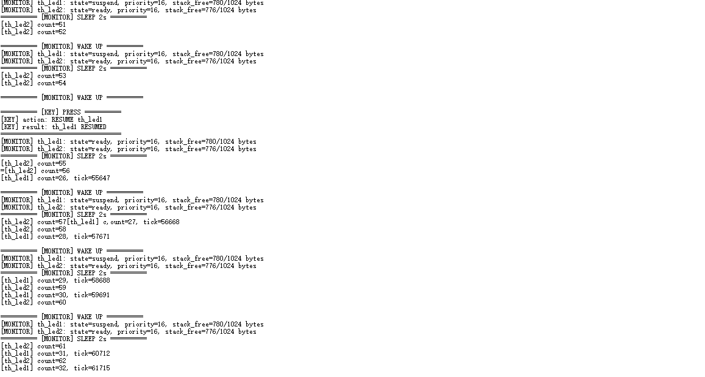
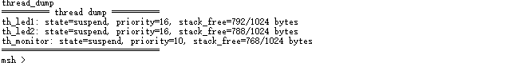

# RT-Thread 夏令营第二天作业

## 作业内容

本次作业围绕 **STM32F407 启动流程、RT-Thread 自动初始化机制、内核对象模型、线程调度和多线程编程** 展开。实验在星火一号 STM32F407 开发板上完成，源码见本目录下的 [`thread_study.c`](./thread_study.c)。

## Part 1：理论知识梳理

### 1. STM32F407 启动流程与 RT-Thread 引导机制

#### 1.1 从上电复位到 `main()` 的启动路径



STM32F407 上电或复位后，处理器根据中断向量表取得主栈指针和复位入口地址，随后进入启动文件中的 `Reset_Handler`。整体调用关系可概括为：

```text
上电/复位
  -> 从向量表装载 MSP 和 Reset_Handler 地址
  -> Reset_Handler
  -> SystemInit()：初始化系统时钟等底层环境
  -> C/C++ 运行库初始化：复制 .data、清零 .bss
  -> 工具链入口
  -> rtthread_startup()
       -> rt_hw_interrupt_disable()       关闭中断
       -> rt_hw_board_init()              板级硬件初始化
            -> rt_components_board_init() 执行板级自动初始化函数
       -> rt_show_version()               打印 RT-Thread 版本信息
       -> rt_system_timer_init()          初始化系统定时器
       -> rt_system_scheduler_init()      初始化调度器
       -> rt_system_signal_init()         初始化信号机制（按配置启用）
       -> rt_application_init()           创建系统 main 线程
       -> rt_system_timer_thread_init()   创建软件定时器线程（按配置启用）
       -> rt_thread_idle_init()           创建空闲线程
       -> rt_system_scheduler_start()     启动调度器
  -> main_thread_entry()
       -> rt_components_init()            执行组件/应用自动初始化函数
       -> main()                          进入 applications/main.c
```

不同编译工具链在进入 RT-Thread 统一启动流程前，入口形式可能不同：

| 工具链 | 常见入口形式 | 作用 |
| --- | --- | --- |
| MDK/ARMCC | `__main`、`$Sub$$main` | 完成运行库初始化，并通过入口封装接入 RT-Thread |
| IAR | `__low_level_init` 等 | 在进入应用前执行底层初始化 |
| GCC | `_start`、`entry` 或 BSP 启动入口 | 由启动文件和链接脚本衔接到 RT-Thread |

具体函数名受 RT-Thread 版本、BSP 和工具链影响，应以当前工程的启动文件、`components.c`、`board.c` 和链接脚本为准。

#### 1.2 `INIT_BOARD_EXPORT` 与 `INIT_APP_EXPORT` 的实现原理

两者都是 RT-Thread 自动初始化框架对 `INIT_EXPORT(fn, level)` 的封装。当前工程源码中的定义为：

```c
#define INIT_BOARD_EXPORT(fn) INIT_EXPORT(fn, "1")
#define INIT_APP_EXPORT(fn)   INIT_EXPORT(fn, "6")
```

宏的作用不是在当前位置调用函数，而是将函数指针放入具有特定名称和等级的链接段。系统启动时，初始化框架遍历段边界之间的函数指针，并按等级依次调用：

```text
初始化函数
  -> INIT_xxx_EXPORT(fn)
  -> INIT_EXPORT(fn, level)
  -> 函数指针进入指定链接段
  -> 链接器按段组织这些函数指针
  -> rt_components_board_init()/rt_components_init() 遍历并调用
```

- `INIT_BOARD_EXPORT()` 属于等级 1，通常用于板级硬件和底层驱动初始化，由 `rt_components_board_init()` 执行。
- `INIT_APP_EXPORT()` 属于等级 6，通常用于应用模块初始化，由 main 线程中的 `rt_components_init()` 执行。
- 本实验使用 `INIT_APP_EXPORT(thread_study_init)`，因此不需要在 `main.c` 中手动调用 `thread_study_init()`。

### 2. 内核基础与对象模型

#### 2.1 对象容器与线程控制块

RT-Thread 使用面向对象的设计思想统一管理线程、信号量、互斥量、事件、邮箱和设备等内核实体。公共对象部分保存对象名称、类型、标志和链表节点等信息，具体对象控制块在此基础上扩展自己的属性和行为。

线程由 `struct rt_thread` 描述，其中常用成员如下：

| 成员 | 作用 |
| --- | --- |
| `stat` | 保存线程状态；读取时通常与 `RT_THREAD_STAT_MASK` 进行按位与操作 |
| `current_priority` | 当前调度优先级；本工程中数值越小，优先级越高 |
| `init_tick` | 线程初始化时设置的时间片长度 |
| `remaining_tick` | 当前时间片的剩余 Tick 数 |
| `sp` | 当前线程栈指针，在线程上下文保存和恢复时使用 |
| `stack_addr` | 线程栈空间起始地址 |
| `stack_size` | 线程栈空间总大小 |
| `tlist` | 用于把线程挂接到就绪表、等待队列等内核链表 |

上下文切换时，CPU 寄存器现场会保存到当前线程栈中，`sp` 记录保存后的位置；调度器再恢复目标线程栈中的现场，使目标线程从上次停止的位置继续执行。

#### 2.2 静态对象与动态对象

| 对比项 | 静态线程 | 动态线程 |
| --- | --- | --- |
| 创建接口 | `rt_thread_init()` | `rt_thread_create()` |
| TCB 与栈 | 由应用预先定义并传入 | 由系统从堆中动态分配 |
| 内存位置 | 全局/静态存储区或固定内存区 | 系统堆 |
| 生命周期 | 由应用管理，结束时执行脱离操作 | 不再使用时由删除与回收机制释放 |
| 优点 | 内存占用确定、无运行期分配失败、便于安全分析 | 创建灵活，适合数量和生命周期动态变化的任务 |
| 风险 | 固定占用内存，配置过大可能浪费 RAM | 可能出现堆不足、内存碎片或分配失败 |

高可靠、长时间运行或资源必须可预测的场景通常优先使用静态线程，因为其 TCB 和栈在启动前就已确定，不依赖运行过程中的堆分配。但静态线程仍需要通过栈使用量分析验证栈大小是否合理。

### 3. 线程状态机与调度算法

#### 3.1 五态模型

| 状态 | 含义 | 典型进入方式 |
| --- | --- | --- |
| 初始态 `INIT` | TCB 已建立，但尚未参与调度 | `rt_thread_init()` 或 `rt_thread_create()` 后尚未启动 |
| 就绪态 `READY` | 已满足运行条件，正在等待 CPU | `rt_thread_startup()`、`rt_thread_resume()`、等待结束 |
| 运行态 `RUNNING` | 当前占用 CPU 执行 | 被调度器选中 |
| 挂起态 `SUSPEND` | 暂时不能运行，等待时间、事件或资源 | 延时、等待 IPC、自挂起 |
| 关闭态 `CLOSE` | 线程已经退出或被删除 | 入口函数返回、删除或脱离线程 |

典型状态转换为：

```text
INIT --rt_thread_startup()--> READY
READY --调度器选中----------> RUNNING
RUNNING --被抢占/时间片耗尽--> READY
RUNNING --延时/等待/挂起-----> SUSPEND
SUSPEND --超时/事件/恢复-----> READY
RUNNING --退出/删除----------> CLOSE
```

需要注意：`rt_thread_mdelay()` 和等待 IPC 也会使线程进入 `SUSPEND`。因此在监控输出中看到 `state=suspend`，并不一定表示线程被按键手动挂起，还要结合计数是否继续变化判断。

#### 3.2 抢占式调度

RT-Thread 调度器始终优先选择就绪队列中优先级最高的线程。本工程配置 `RT_THREAD_PRIORITY_MAX=32`，优先级数值越小表示优先级越高。因此优先级为 10 的 `th_monitor` 唤醒后，可以抢占优先级为 16 的两个 LED 工作线程；监控处理完成并延时后，工作线程继续运行。

#### 3.3 时间片轮转

当多个就绪线程的优先级相同时，调度器使用时间片轮转保证它们轮流获得 CPU。本实验中 `th_led1` 和 `th_led2` 都是优先级 16、时间片 5 ticks。当它们同时处于就绪态时，可以在同一优先级队列内轮转运行。

时间片轮转只解决同优先级线程之间的公平性，不能阻止更高优先级线程抢占。

## Part 2：多线程实战编程

### 1. 实验环境

| 项目 | 配置 |
| --- | --- |
| 开发板 | 星火一号 STM32F407 开发板 |
| MCU | STM32F407ZG |
| 工程 | `DAY2RT-ThreadDXC` |
| RT-Thread | 4.1.1 |
| 系统 Tick | `RT_TICK_PER_SECOND=1000`，即 1 tick = 1 ms |
| 开发工具 | RT-Thread Studio |
| 下载调试 | ST-Link |
| 交互方式 | 串口终端与 MSH |

### 2. 硬件资源与线程设计

#### 2.1 GPIO 分配

| 功能 | 引脚 | 配置 |
| --- | --- | --- |
| 红色 LED `LED_R` | PF12 | 推挽输出，由 `th_led1` 周期翻转 |
| 蓝色 LED `LED_B` | PF11 | 推挽输出，由 `th_led2` 周期翻转 |
| 用户按键 | PC5 | 上拉输入、下降沿中断 |

以上引脚来自本工程已完成的板级实验配置；移植到其他开发板时必须重新核对原理图和 BSP 引脚定义。

#### 2.2 线程参数

| 线程 | 创建方式 | 优先级 | 时间片 | 栈大小 | 主要功能 |
| --- | --- | ---: | ---: | ---: | --- |
| `th_led1` | `rt_thread_create()` 动态创建 | 16 | 5 ticks | 1024 Bytes | 翻转红色 LED，打印计数和系统 Tick |
| `th_led2` | `rt_thread_init()` 静态初始化 | 16 | 5 ticks | 1024 Bytes | 翻转蓝色 LED并打印计数 |
| `th_monitor` | `rt_thread_create()` 动态创建 | 10 | 5 ticks | 1024 Bytes | 每 2 秒打印线程信息并处理按键请求 |

### 3. 关键实现说明

#### 3.1 动态线程与静态线程

`th_led1` 和 `th_monitor` 使用 `rt_thread_create()` 从系统堆中动态分配线程控制块和栈；`th_led2` 的 `struct rt_thread` 控制块及 1024 字节栈数组在全局静态区定义，再通过 `rt_thread_init()` 初始化。三个线程创建或初始化后，都调用 `rt_thread_startup()` 进入就绪态。

#### 3.2 监控与剩余栈空间

`th_monitor` 每次唤醒时读取两个工作线程的状态、当前优先级和栈信息。RT-Thread 初始化线程栈时会填充 `'#'`，实验代码从栈起始位置统计仍保持为 `'#'` 的连续字节数，以估算剩余栈空间：

```text
stack_free = 第一个非 '#' 字节地址 - stack_addr
```

这是用于学习和调试的估算方法。实际项目还应结合 RT-Thread 自带的线程查看命令、最小栈余量和长期压力测试判断栈大小。

#### 3.3 按键挂起与恢复设计

当前工程所用 RT-Thread 版本在 `rt_thread_suspend()` 中检查：

```c
RT_ASSERT(thread == rt_thread_self());
```

因此监控线程不能直接调用该接口挂起 `th_led1`。本实验采用“请求 + 线程自挂起”的方式：

```text
第一次按键中断
  -> key_event = 1
  -> th_monitor 处理事件
  -> led1_suspend_request = 1
  -> th_led1 检测请求
  -> rt_thread_suspend(rt_thread_self())

第二次按键中断
  -> key_event = 1
  -> th_monitor 处理事件
  -> rt_thread_resume(th_led1)
  -> th_led1 回到就绪态并继续原计数
```

中断回调只记录事件并进行简单软件消抖，实际的线程控制和串口打印放在监控线程上下文中执行，避免在中断服务函数中执行复杂操作。

#### 3.4 自动初始化与 MSH 命令导出

应用模块使用：

```c
INIT_APP_EXPORT(thread_study_init);
```

系统会在应用初始化阶段自动创建三个线程，无需修改 `main.c`。

自定义查看函数使用：

```c
MSH_CMD_EXPORT(thread_dump, dump thread state and remaining stack);
```

注册为 MSH 命令。系统运行后，在串口命令行输入：

```text
thread_dump
```

即可主动查看三个线程的状态、优先级和剩余栈空间。

### 4. 实验结果与分析

#### 4.1 线程运行与周期监控



串口中可以观察到：

- `th_led1` 和 `th_led2` 的计数持续增加，说明两个工作线程都在周期运行；
- `th_led1` 同时输出 `rt_tick_get()`，相邻计数的 Tick 间隔约为 1000，符合 1 秒延时设置；
- `th_monitor` 约每 2 秒输出一次两个工作线程的状态和剩余栈空间；
- 两个工作线程处于 `rt_thread_mdelay()` 时可能显示为 `suspend`，这是延时等待状态，不等同于按键手动挂起；
- 偶尔出现两条输出连接在同一行，是多个线程并发调用 `rt_kprintf()` 造成的串口输出交错，不影响调度逻辑。

#### 4.2 按键挂起 `th_led1`



第一次按键后，串口显示：

```text
[KEY] action: REQUEST SUSPEND th_led1
[KEY] result: waiting for th_led1...
```

随后 `th_led1` 在自己的线程上下文中执行挂起。截图中 `th_led1` 的计数停在 25，而 `th_led2` 继续从 26 增长到 34，证明红灯线程已经被实际挂起，系统和蓝灯线程仍然正常运行。

#### 4.3 按键恢复 `th_led1`



再次按键后，串口显示：

```text
[KEY] action: RESUME th_led1
[KEY] result: th_led1 RESUMED
```

恢复后 `th_led1` 的计数从 26 继续增加，而不是重新从 1 开始，说明恢复操作保留了线程原有执行上下文。`th_led2` 在整个过程中一直持续运行。

#### 4.4 MSH `thread_dump` 命令



在 `msh />` 提示符输入 `thread_dump` 后，系统成功打印：

- `th_led1`：状态、优先级 16、剩余栈空间；
- `th_led2`：状态、优先级 16、剩余栈空间；
- `th_monitor`：状态、优先级 10、剩余栈空间。

截图证明 `MSH_CMD_EXPORT()` 已将函数正确注册到 MSH 命令表。截图时三个线程都处于延时或等待阶段，因此状态均显示为 `suspend`，这是正常现象。

### 5. 实验结论

- [x] 动态创建 `th_led1`，按要求配置优先级、时间片和栈大小
- [x] 静态初始化 `th_led2`，使用全局 TCB 和栈空间
- [x] LED1和2 由两个工作线程分别周期翻转
- [x] 动态创建高优先级 `th_monitor`，每 2 秒监控线程
- [x] 打印工作线程状态、优先级和剩余栈空间
- [x] 通过按键实现 `th_led1` 挂起与恢复
- [x] 使用 `INIT_APP_EXPORT()` 自动加载模块
- [x] 使用 `MSH_CMD_EXPORT()` 导出 `thread_dump` 命令
- [x] 完成运行、挂起、恢复和 MSH 命令的串口验证

本实验验证了 RT-Thread 静态/动态线程创建、优先级抢占、同优先级时间片轮转、线程状态观察、自动初始化及 MSH 命令导出机制。
