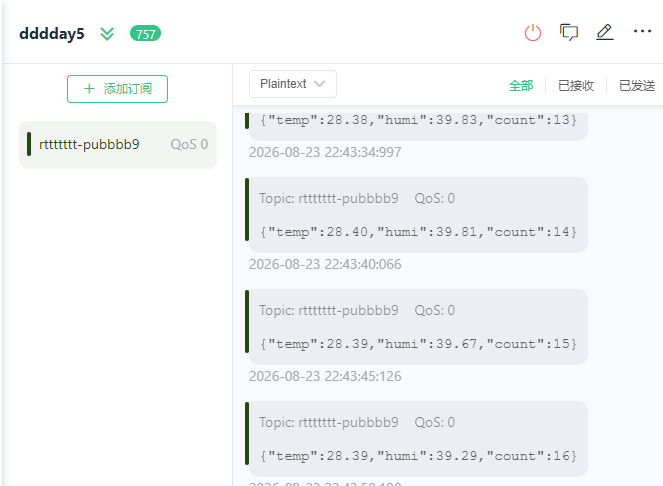
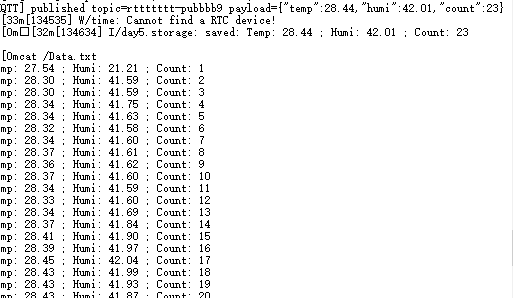
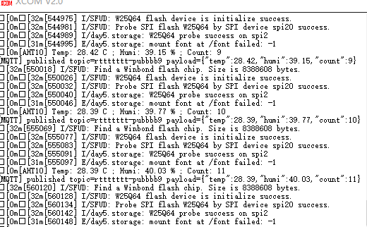

# RT-Thread 夏令营第五天作业

## 作业目标

本次作业在 STM32F407 开发板和 RT-Thread 4.1.1 上完成以下三个任务：

1. 使用 AHT10 软件包采集温湿度，每 5 秒上传到 EMQX MQTT 服务器；
2. 将 W25Q64 的 `font` 分区挂载为文件系统，把温湿度同步追加到 `Data.txt`；
3. 通过 MQTT 云端指令控制板载红色 LED 翻转。

## 一、系统方案

### 1.1 数据流

```text
                    +--> MQTT publish --> EMQX --> MQTT 客户端
                    |
AHT10 --I2C3--> day5_iot 线程
                    |
                    +--> POSIX append --> Elm-FatFS --> font --> W25Q64

MQTT 客户端 --toggle--> EMQX --> MQTT subscribe --> PF12 LED
```

综合应用由 MSH 命令 `ka_mqtt` 启动。线程完成 AHT10 初始化、文件系统初始化、MQTT 连接和订阅，随后进入 5 秒周期采集循环。

### 1.2 硬件资源

| 功能 | 资源 | 说明 |
| --- | --- | --- |
| AHT10 | `i2c3` | 软件 I2C |
| AHT10 SCL | `PE0` | 本板实测引脚 |
| AHT10 SDA | `PE1` | 本板实测引脚 |
| W25Q64 | `spi2` / `spi20` | SFUD 探测设备 |
| W25Q64 CS | `PB12` | 高电平释放 |
| 板载红灯 | `PF12` | 低电平点亮 |
| WiFi | RW007 / `wlan0` | 2.4 GHz |

不能直接照搬其他 STM32F407 板卡的 PA8/PC9 I2C3 引脚。本开发板 AHT10 实际使用 PE0/PE1。

### 1.3 软件组件

- RT-Thread 4.1.1；
- AHT10 软件包；
- RW007 软件包；
- Kawaii MQTT 软件包；
- `rt_vsnprintf_full`；
- DFS + POSIX；
- Elm-FatFS；
- FAL；
- SFUD。

## 二、AHT10 采集与 MQTT 上传

### 2.1 初始化与采集

```c
aht10 = aht10_init("i2c3");

while (1)
{
    float temp = aht10_read_temperature(aht10);
    float humi = aht10_read_humidity(aht10);
    /* 校验、上传、写文件 */
    mqtt_sleep_ms(5000);
}
```

采集结果先检查是否位于 AHT10 合理量程内：

```c
temp >= -40.0f && temp <= 85.0f &&
humi >= 0.0f && humi <= 100.0f
```

无效数据不上传、不写文件，也不增加 `Count`。

### 2.2 MQTT 配置

| 项目 | 配置 |
| --- | --- |
| Broker | `broker.emqx.io` |
| Port | `1883` |
| Publish Topic | `rttttttt-pubbbb9` |
| Subscribe Topic | `rttttttsubbb9` |
| QoS | `0` |
| Payload | JSON / Plaintext |

用户名、密码和 Client ID 在工程配置中填写。PC 端 MQTT 客户端必须使用不同的 Client ID，避免两个客户端互相挤下线。

每次上传的数据格式为：

```json
{"temp":28.38,"humi":39.83,"count":13}
```

### 2.3 上传验证

在 MQTT 客户端订阅：

```text
rttttttt-pubbbb9
```

实测每 5 秒收到一条温湿度 JSON：



该结果证明 AHT10 采集、WiFi 网络、MQTT 连接和发布链路均正常。

## 三、font 分区与 Data.txt

### 3.1 FAL 分区

W25Q64 总容量为 8 MiB。本次使用末尾 3 MiB 作为 `font` 分区：

```c
#define FAL_PART_TABLE                                                     \
{                                                                          \
    {FAL_PART_MAGIC_WORD, "font", "W25Q64", 5 * 1024 * 1024,              \
     3 * 1024 * 1024, 0},                                                  \
}
```

分区范围：

```text
0 MiB                         5 MiB                         8 MiB
|-----------------------------|-----------------------------|
         其他区域                       font: 3 MiB
```

### 3.2 初始化与挂载流程

```text
rt_hw_spi_device_attach("spi2", "spi20", PB12)
  -> rt_sfud_flash_probe("W25Q64", "spi20")
  -> fal_init()
  -> fal_blk_device_create("font")
  -> dfs_mount("font", "/", "elm", ...)
  -> 首次空白分区挂载失败时 dfs_mkfs()
  -> 再次挂载到 /
```

系统原先没有根文件系统，直接挂载到不存在的 `/font` 会失败。因此最终将 `font` 直接挂载到根目录 `/`，文件路径为：

```text
/Data.txt
```

首次格式化只尝试一次，避免发生临时错误时周期性重复格式化。后续重新上电直接挂载已有 FAT 文件系统，历史内容保留。

### 3.3 文件写入

```c
fd = open("/Data.txt", O_WRONLY | O_CREAT | O_APPEND, 0);
write(fd, line, len);
close(fd);
```

每条记录格式：

```text
Temp: 28.30 ; Humi: 41.59 ; Count: 1
Temp: 28.30 ; Humi: 41.59 ; Count: 2
Temp: 28.34 ; Humi: 41.75 ; Count: 3
```

`Count` 表示自本次上电以来成功采集的次数；每次上电从 1 开始，文件内容使用追加模式，不主动删除以前的数据。

### 3.4 Shell 验证

启动程序并看到 `saved:` 日志后，逐条执行：

```text
mount
ls /
cat /Data.txt
df /
```

`cat /Data.txt` 实测结果：



`df /` 显示约 2.9 MiB 可用空间：


该结果证明 W25Q64 探测、FAL 分区、Elm-FatFS 挂载和 POSIX 追加写入均已生效。

## 四、MQTT 控制 LED

### 4.1 控制协议

向订阅主题发送纯文本：

```text
Topic: rttttttsubbb9
Payload: toggle
QoS: 0
Retain: off
```

不要把控制消息发到温湿度发布主题 `rttttttt-pubbbb9`。

订阅回调只接受长度为 6 的 `toggle`：

```c
if (payload_len == 6 && memcmp(payload, "toggle", 6) == 0)
{
    led_on = !led_on;
    rt_pin_write(GET_PIN(F, 12),
                 led_on ? PIN_LOW : PIN_HIGH);
}
```

### 4.2 点亮验证

MQTT 客户端第一次发送：


串口回调和 LED 状态：


```text
[MQTT] command topic=rttttttsubbb9 payload=toggle
[MQTT] LED_R toggled -> ON
```

### 4.3 熄灭验证

MQTT 客户端第二次发送：


串口回调和 LED 状态：


```text
[MQTT] command topic=rttttttsubbb9 payload=toggle
[MQTT] LED_R toggled -> OFF
```

两次指令均进入开发板订阅回调，PF12 红色 LED 完成一次亮灭翻转。

## 五、启动与验收步骤

### 5.1 编译结果

工程使用 ARM GCC 完整编译链接通过：

```text
text    341264
data      1884
bss      62836
total   405984
```

生成 `rtthread.elf` 和 `rtthread.bin`。

### 5.2 板端操作

1. 编译、烧录并复位开发板；
2. 等待 RW007 初始化；
3. 使用 `ifconfig` 确认 `wlan0` 已获取 IP；
4. 未联网时先执行 `wifi scan` 和 `wifi join <SSID> <password>`；
5. 执行一次 `ka_mqtt`；
6. 首次格式化期间不要断电；
7. 等待串口出现 MQTT 连接和 `saved:`；
8. 使用文件系统命令读回数据；
9. 在 MQTT 客户端订阅温湿度主题；
10. 向控制主题连续发送两次 `toggle`。

综合启动命令：

```text
ka_mqtt
```

不要同时执行 `aht10_thread_init`，否则两个线程会竞争访问 AHT10。

### 5.3 验收表

| 作业要求 | 验证方法 | 结果 |
| --- | --- | --- |
| AHT10 采集 | 串口连续输出有效温湿度 | 通过 |
| MQTT 上传 | 客户端每 5 秒收到 JSON | 通过 |
| font 分区挂载 | `mount` 显示 `font -> /` | 通过 |
| Data.txt 写入 | `cat /Data.txt` 显示连续记录 | 通过 |
| 分区容量 | `df /` 显示约 3 MiB | 通过 |
| 云端控制 LED | 两次 `toggle` 分别输出 ON/OFF | 通过 |

## 六、故障排查记录

### 6.1 修复前的挂载失败

旧实现尝试将 `font` 挂载到 `/font`，但系统没有可创建该目录的根文件系统，因此持续失败：



```text
W25Q64 probe success on spi2
mount font at /font failed: -1
```

W25Q64 已被 SFUD 正确识别，问题发生在文件系统挂载点，不是 SPI Flash 硬件故障。

修复内容：

- 挂载点从 `/font` 改为 `/`；
- 文件路径从 `/font/Data.txt` 改为 `/Data.txt`；
- 第一次挂载失败后格式化一次并重新挂载；
- 记录格式化尝试状态，防止循环格式化。

### 6.2 MQTT 指令发错主题

温湿度主题只用于开发板发布。LED 指令必须发送到开发板订阅主题：

```text
错误：rttttttt-pubbbb9
正确：rttttttsubbb9
```

### 6.3 判断设备对象与硬件状态

- `i2c3` 出现在 `list_device`：只证明 I2C 总线已注册；
- `wlan0` 出现：只证明网络设备对象已注册；
- `W25Q64 probe success`：证明 SPI Flash 已正确响应；
- 获得合理温湿度：证明 AHT10 引脚和通信正确；
- MQTT 客户端收到数据：证明网络和协议链路正确；
- `cat /Data.txt` 能读回：证明文件系统和写入链路正确。

## 七、归档文件

```text
第五天作业/
├── README.md
├── code/
│   ├── AHT10_APP.c       W25Q64、FAL、DFS 和 Data.txt
│   ├── day5_storage.h    存储接口
│   ├── mqtt_app.c        AHT10、MQTT、LED 综合线程
│   └── fal_cfg.h         W25Q64 的 font 分区表
└── images/
    ├── mqtt-temperature-upload.png
    ├── mqtt-led-toggle-command-1.png
    ├── mqtt-led-toggle-command-2.png
    ├── serial-led-on.png
    ├── serial-led-off.png
    ├── serial-data-file-content.png
    ├── serial-filesystem-capacity.png
    └── serial-font-mount-failure-before-fix.png
```

归档源码来自已完成编译和目标板实测的 `day5AHT10` 工程。完整工程还依赖 RT-Thread 内核、BSP、AHT10、RW007、Kawaii MQTT、FAL、SFUD 和 Elm-FatFS 等组件。
