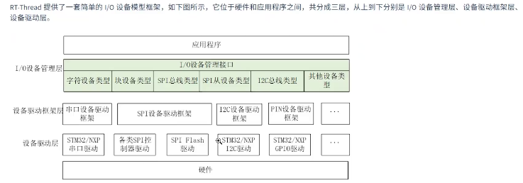
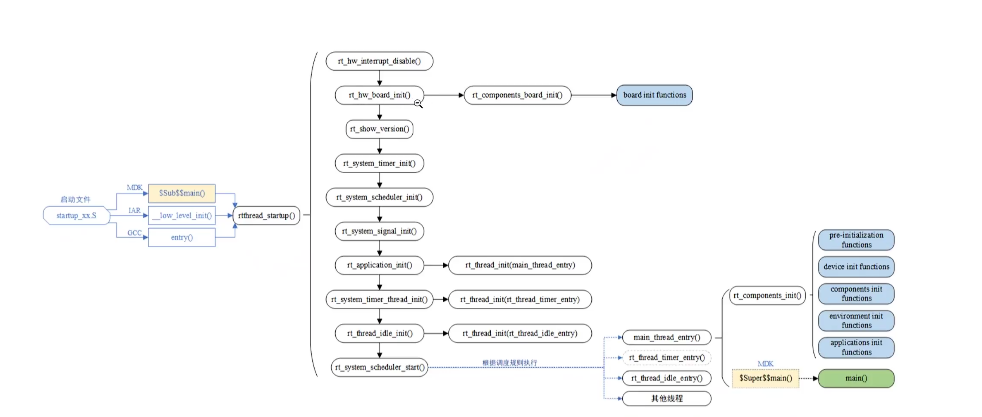
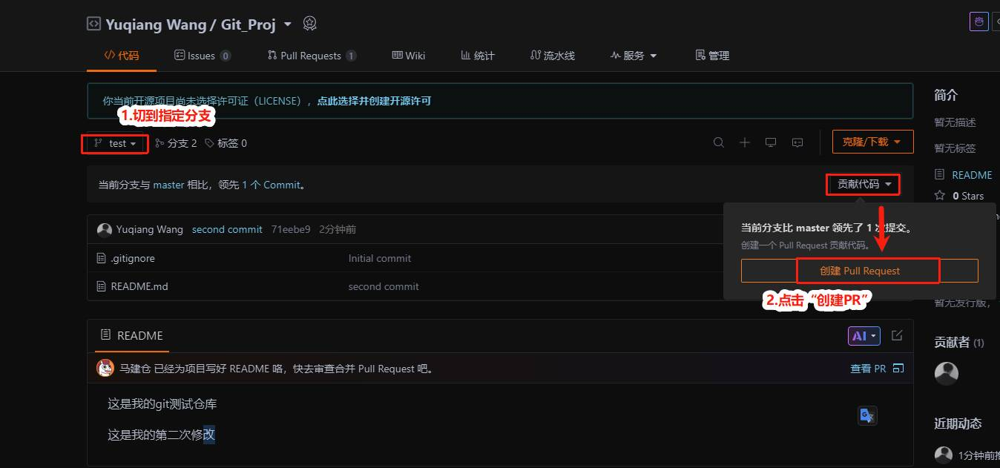
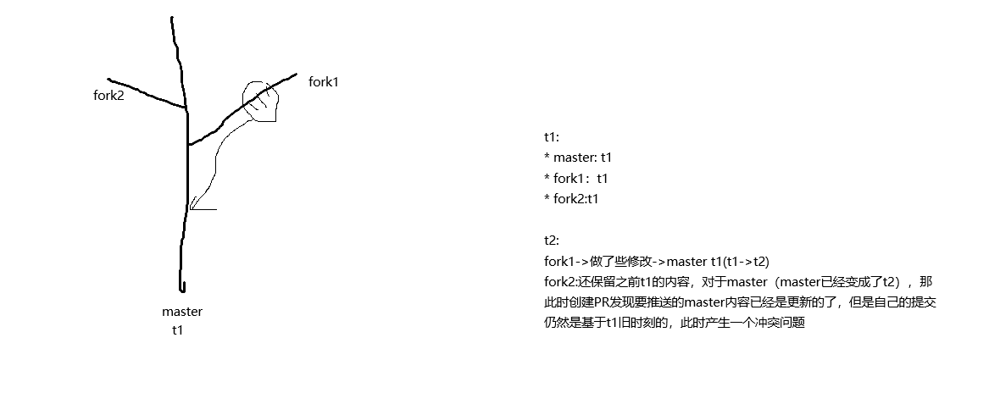

# RT-Thread 夏令营第一天学习笔记

## 本日学习目标

本日实践目标可以归纳为：

1. 理解 RT-Thread Nano、标准版和 Smart 版的定位与适用场景；
2. 完成 RT-Thread Studio 基础开发环境检查；
3. 通过示例工程熟悉 RT-Thread 的目录结构、启动流程、构建过程和 MSH；
4. 使用 Git 或 TortoiseGit 完成 `clone`、`status`、`add`、`commit`、`pull` 和 `push`；
5. 初始化个人 Gitee 仓库，完成提交、推送和拉取；
6. Fork `rsoc-rtt`，创建个人目录，提交第一天学习内容并发起 Pull Request；
7. 理解最小 `SConscript` 与 Kconfig 配置方法，使功能或 MSH 命令受配置项控制。

RT-Thread 三种形态的定位如下：

| 形态 | 主要特点 | 典型场景 |
| --- | --- | --- |
| RT-Thread Nano | 以轻量级内核为主，资源占用较小 | 资源受限的 MCU |
| RT-Thread 标准版 | 内核、设备模型和丰富组件结合 | 常规 MCU、物联网终端 |
| RT-Thread Smart | 支持用户态进程、MMU 和更完整的 POSIX 能力 | Cortex-A 等高性能处理器 |

## 上午：Markdown 基础与 RT-Thread 工程结构

### 1. Markdown 基础语法

Markdown 是一种轻量级标记语言，适合编写课程笔记、项目文档和 README 文件。源文件通常使用 `.md` 扩展名。

#### 1.1 多级标题

Markdown 使用 `#` 表示标题层级，`#` 的数量越多，标题层级越低：

```markdown
# 一级标题
## 二级标题
### 三级标题
#### 四级标题
```

编写笔记时，应保持标题层级连续，避免从一级标题直接跳到四级标题。

#### 1.2 字体加粗

使用两个星号包围文字可以得到粗体效果：

```markdown
**需要强调的内容**
```

显示效果：**需要强调的内容**。

#### 1.3 代码段

行内代码使用反引号包围，例如 `rtthread.elf`。多行代码使用三个反引号，并可指定语言以启用语法高亮：

````markdown
```c
int main(void)
{
    return 0;
}
```
````

#### 1.4 表格

Markdown 表格由竖线和分隔线组成：

```markdown
| 项目 | 说明 |
| --- | --- |
| `applications` | 应用程序目录 |
| `drivers` | 板级驱动目录 |
```

### 2. 熟悉 RT-Thread Studio 示例工程

本次课程创建的工程位于：

```text
E:\Qqqqqrs\RT-ThreadStudio\RT-ThreadStudio\workspace\HHHello
```

`HHHello` 示例工程在本阶段主要用于熟悉 RT-Thread 的工程目录、启动流程和底层源码。后续板级实践将使用星火 STM32F407 开发板工程：

```text
E:\Qqqqqrs\RT-ThreadStudio\RT-ThreadStudio\workspace\day01helloSTM32F407
```

工程的关键目录和文件如下：

| 路径 | 作用 |
| --- | --- |
| `applications/main.c` | 应用程序入口，包含 `main()` 主函数 |
| `drivers/` | BSP 相关的底层驱动与硬件适配代码 |
| `rt-thread/` | RT-Thread 组件、CPU 移植层和内核源码 |
| `rtconfig.h` | RT-Thread 功能配置结果 |
| `SConstruct`、`SConscript` | SCons 构建脚本 |
| `Debug/` | 当前工程的编译输出目录 |

> 工程中的目录名称是 `applications`，不是 `application`。

当前 `applications/main.c` 的主要内容如下：

```c
#include <stdint.h>
#include <stdio.h>
#include <stdlib.h>

int main(void)
{
    printf("hello rt-thread\n");

    return 0;
}
```

程序进入 `main()` 后，通过标准输出接口打印 `hello rt-thread`。标准输出最终如何连接到串口或控制台，取决于 BSP 和控制台设备的配置。

### 3. RT-Thread 源码目录

`rt-thread/` 目录主要包含以下部分：

| 目录 | 主要职责 |
| --- | --- |
| `components/` | 文件系统、命令行、设备框架、网络、C/C++ 支持等可选组件 |
| `include/` | RT-Thread 公共头文件 |
| `libcpu/` | 与 CPU 架构相关的移植代码 |
| `src/` | RT-Thread 内核核心源码 |
| `tools/` | 构建和配置辅助工具 |

#### 3.1 `components` 组件目录

当前工程包含的主要组件如下：

| 组件 | 作用 |
| --- | --- |
| `cplusplus` | C++ 运行环境与相关支持 |
| `dfs` | DFS（Device Virtual File System，设备虚拟文件系统） |
| `drivers` | RT-Thread 通用设备驱动框架 |
| `finsh` | FinSH/MSH 命令行终端，可提供类似 Shell 的交互环境 |
| `libc` | C 标准库适配及 POSIX 相关接口 |
| `lwp` | 轻量级进程相关支持 |
| `net` | 网络协议栈与网络接口相关组件 |
| `utilities` | 通用辅助功能 |
| `vbus`、`vmm` | 虚拟总线与虚拟化相关功能 |

`libc` 目录针对不同编译环境提供适配层。当前源码中可以看到 `armlibc`、`dlib`、`minilibc` 和 `newlib` 等适配实现，同时还包括 `pthreads`、`signal`、`termios`、`time` 等接口。具体功能是否启用，由工程配置决定。

#### 3.2 `libcpu` CPU 移植层

`libcpu` 用于隔离不同 CPU 架构之间的差异，通常包含：

- 线程上下文切换；
- 中断开启、关闭及中断入口处理；
- 线程栈初始化；
- 与体系结构相关的汇编代码；
- 异常处理和底层 CPU 操作。

当前 `HHHello` 工程包含 `libcpu/arm`，其中可见 Cortex-M0、Cortex-M23、Cortex-M3、Cortex-M33、Cortex-M4、Cortex-M7、Cortex-A 和 Cortex-R 等 ARM 系列移植目录。RT-Thread 上游还支持 RISC-V、龙芯等其他处理器架构，但是否出现在具体工程中取决于所选 BSP 和源码裁剪范围。

#### 3.3 `src` 内核源码

`src` 是 RT-Thread 内核的核心实现目录。当前工程中的关键文件如下：

| 文件 | 主要职责 |
| --- | --- |
| `clock.c` | 系统时钟节拍管理 |
| `device.c` | 设备对象与设备管理接口 |
| `idle.c` | 空闲线程管理 |
| `ipc.c` | 线程间同步与通信机制 |
| `irq.c` | 中断管理 |
| `mem.c`、`memheap.c`、`mempool.c`、`slab.c` | 动态内存、堆、内存池及 Slab 管理 |
| `object.c` | 内核对象管理 |
| `scheduler.c` | 线程调度器 |
| `signal.c` | 信号机制 |
| `thread.c` | 线程创建、控制和生命周期管理 |
| `timer.c` | 软件定时器管理 |

RT-Thread 内核采用面向对象的设计思想，但主要使用 C 语言实现。线程、设备、信号量、互斥量和定时器等实体都建立在统一的内核对象模型之上，便于进行类型管理和生命周期管理。

### 4. RT-Thread I/O 设备模型



RT-Thread 在硬件与应用程序之间提供统一的 I/O 设备模型。整体上可理解为应用层之下的三层结构：

| 层级 | 作用 | 示例 |
| --- | --- | --- |
| I/O 设备管理层 | 向应用提供统一的设备对象与访问接口 | 字符设备、块设备、SPI 总线/设备、I2C 总线/设备 |
| 设备驱动框架层 | 抽象同类外设的共同能力，屏蔽不同芯片的实现差异 | 串口、SPI、I2C、PIN、音频、USB 等驱动框架 |
| 设备驱动层 | 面向具体 MCU、控制器或外设实现底层操作 | STM32/NXP 串口驱动、SPI 控制器驱动、SPI Flash 驱动、GPIO 驱动 |

应用程序不应直接依赖每一种硬件的寄存器实现，而应优先通过统一设备接口访问底层设备。例如，应用可以按设备名称查找串口、SPI 或 I2C 设备，再使用统一的打开、关闭、读写和控制接口完成操作。

LCD、键盘、鼠标、串口和音频设备属于不同类型的外设或设备类；`stdio` 则表示 C 标准输入输出接口。它们可能通过 RT-Thread 的设备框架、控制台或具体驱动进行衔接，不能简单地全部归为“上层应用”。

### 5. 程序构建与运行流程

嵌入式程序从源代码到在目标板运行，通常经历以下阶段：

1. **编辑**：编写 `.c`、`.h` 和汇编源文件。
2. **预处理**：展开头文件、宏定义和条件编译指令。
3. **编译**：将 C/C++ 源代码转换为汇编代码或目标代码。
4. **汇编**：将汇编代码转换为目标文件 `.o`。
5. **链接**：按照链接脚本组合目标文件和库，生成可执行映像 `.elf`。
6. **格式转换**：从 ELF 映像中提取适合烧录的 `.bin` 等文件。
7. **下载与运行**：把程序烧录或加载到目标环境中，观察终端输出并验证功能。

RT-Thread Studio 工程使用 SCons 组织构建流程，底层再调用 GCC 等工具链完成编译、汇编和链接。当前 `HHHello/Debug` 目录中已经生成：

| 文件 | 作用 |
| --- | --- |
| `rtthread.elf` | 带有程序段、符号及调试信息的 ELF 映像 |
| `rtthread.bin` | 适合下载或烧录的纯二进制映像 |
| `rtthread.map` | 链接映射文件，用于分析符号地址和内存占用 |

编译过程中生成的是 `.o` 目标文件，而不是口述记录中的“.L 文件”；最终可执行文件扩展名是 `.elf`。如果 IDE 工程模板或构建脚本版本不一致，应先同步或刷新 SCons 工程配置，再重新构建并根据控制台日志定位问题。

### 6. RT-Thread 启动流程源码分析



启动流程图同时展示了不同工具链的入口形式：MDK/ARMCC 可以通过 `$Sub$$main()` 进入系统启动流程，IAR 使用 `__low_level_init()`，GCC 工程则使用 `entry()`。当前 `HHHello` 是 GCC 工程，因此实际入口位于 `rt-thread/src/components.c`：

```c
#if defined(__GNUC__)
int entry(void)
{
    rtthread_startup();
    return 0;
}
#endif
```

`entry()` 随后调用 `rtthread_startup()`。根据当前工程源码，其关键执行顺序如下：

```text
entry()
└─ rtthread_startup()
   ├─ rt_hw_interrupt_disable()       关闭中断，保护初始化过程
   ├─ rt_hw_board_init()              板级硬件、堆、板级组件和控制台初始化
   ├─ rt_show_version()               输出 RT-Thread 版本信息
   ├─ rt_system_timer_init()          初始化系统定时器
   ├─ rt_system_scheduler_init()      初始化调度器
   ├─ rt_system_signal_init()         初始化信号机制（启用时）
   ├─ rt_application_init()           创建并启动 main 线程
   ├─ rt_system_timer_thread_init()   创建定时器线程
   ├─ rt_thread_idle_init()           创建空闲线程
   └─ rt_system_scheduler_start()     启动调度器，不再返回
```

核心源码可以概括为：

```c
int rtthread_startup(void)
{
    rt_hw_interrupt_disable();
    rt_hw_board_init();
    rt_show_version();
    rt_system_timer_init();
    rt_system_scheduler_init();
    rt_application_init();
    rt_system_timer_thread_init();
    rt_thread_idle_init();
    rt_system_scheduler_start();
    return 0;
}
```

#### 6.1 板级初始化

`drivers/board.c` 中的 `rt_hw_board_init()` 负责与当前 BSP 相关的初始化：

```c
void rt_hw_board_init(void)
{
    rt_hw_interrupt_init();
    rt_system_heap_init(HEAP_BEGIN, HEAP_END);
    rt_components_board_init();
    rt_console_set_device(RT_CONSOLE_DEVICE_NAME);
    rt_thread_idle_sethook(idle_wfi);
}
```

当前 `rtconfig.h` 将控制台设备配置为 `uart0`。`rt_components_board_init()` 会执行通过 `INIT_BOARD_EXPORT()` 注册的板级初始化函数，这些工作发生在调度器启动之前。

#### 6.2 main 线程的创建与执行

`rt_application_init()` 创建名为 `main` 的线程，入口函数是 `main_thread_entry()`：

```c
void rt_application_init(void)
{
    rt_thread_t tid;

    tid = rt_thread_create("main", main_thread_entry, RT_NULL,
                           RT_MAIN_THREAD_STACK_SIZE,
                           RT_MAIN_THREAD_PRIORITY, 20);
    RT_ASSERT(tid != RT_NULL);
    rt_thread_startup(tid);
}
```

调度器启动后，`main_thread_entry()` 先调用 `rt_components_init()`，按初始化级别执行组件函数，然后才进入 `applications/main.c` 中的用户 `main()`：

```c
void main_thread_entry(void *parameter)
{
    extern int main(void);

    rt_components_init();
    main();
}
```

#### 6.3 自动初始化机制

RT-Thread 使用宏把初始化函数指针放入指定的链接段，再由 `rt_components_board_init()` 或 `rt_components_init()` 按顺序遍历执行。主要初始化级别如下：

| 宏 | 级别 | 典型用途 |
| --- | ---: | --- |
| `INIT_BOARD_EXPORT(fn)` | 1 | 板级硬件初始化 |
| `INIT_PREV_EXPORT(fn)` | 2 | 纯软件预初始化 |
| `INIT_DEVICE_EXPORT(fn)` | 3 | 设备初始化 |
| `INIT_COMPONENT_EXPORT(fn)` | 4 | DFS、网络等组件初始化 |
| `INIT_ENV_EXPORT(fn)` | 5 | 文件系统挂载等环境初始化 |
| `INIT_APP_EXPORT(fn)` | 6 | 应用级服务和线程初始化 |

例如 `INIT_APP_EXPORT(fn)` 最终展开为：

```c
#define INIT_APP_EXPORT(fn) INIT_EXPORT(fn, "6")
```

该宏不是在当前位置直接调用函数，而是完成**注册**；实际调用发生在 `rt_components_init()` 遍历初始化表时。

### 7. MSH 启动过程

MSH 是 RT-Thread 的命令行 Shell，基于 FinSH 组件实现。当前工程在 `rtconfig.h` 中启用了 `RT_USING_FINSH`、`FINSH_USING_MSH` 和 `FINSH_USING_MSH_DEFAULT`。

MSH 的初始化函数位于 `rt-thread/components/finsh/shell.c`：

```c
int finsh_system_init(void)
{
    rt_err_t result = RT_EOK;
    rt_thread_t tid;

    shell = (struct finsh_shell *)rt_calloc(1, sizeof(struct finsh_shell));
    tid = rt_thread_create(FINSH_THREAD_NAME,
                           finsh_thread_entry, RT_NULL,
                           FINSH_THREAD_STACK_SIZE,
                           FINSH_THREAD_PRIORITY, 10);

    rt_sem_init(&(shell->rx_sem), "shrx", 0, 0);
    finsh_set_prompt_mode(1);

    if (tid != RT_NULL && result == RT_EOK)
        rt_thread_startup(tid);
    return 0;
}
INIT_APP_EXPORT(finsh_system_init);
```

这段代码完成以下工作：

1. 初始化 FinSH/MSH 命令符号表；
2. 分配并初始化 Shell 控制块；
3. 创建以 `finsh_thread_entry()` 为入口的 Shell 线程；
4. 初始化接收信号量 `rx_sem`；
5. 启动 Shell 线程；
6. 使用 `INIT_APP_EXPORT(finsh_system_init)` 将函数注册到应用初始化阶段。

由于 `finsh_system_init()` 属于级别 6，它会在 main 线程执行 `rt_components_init()` 时被调用。Shell 线程启动后，`finsh_thread_entry()` 会在未单独指定 Shell 设备时取得系统控制台设备；当前工程的控制台是 `uart0`。随后打印 `msh />` 提示符，并循环读取字符、解析命令和执行已导出的命令。

```text
main_thread_entry()
└─ rt_components_init()
   └─ finsh_system_init()              INIT_APP_EXPORT，级别 6
      ├─ 初始化命令符号表
      ├─ 创建 FinSH/MSH 线程
      ├─ 初始化接收信号量
      └─ rt_thread_startup(tid)
         └─ finsh_thread_entry()
            ├─ 绑定控制台设备 uart0
            ├─ 输出 msh /> 提示符
            └─ 循环接收并执行命令
```

应用程序可以通过 `MSH_CMD_EXPORT()` 导出自定义命令。例如：

```c
#include <rtthread.h>

static int hello_cmd(int argc, char **argv)
{
    rt_kprintf("hello msh\n");
    return 0;
}
MSH_CMD_EXPORT(hello_cmd, print hello message);
```

### 8. 上午学习小结

上午首先学习了 Markdown 的标题、粗体、代码段和表格语法，随后创建并查看了 RT-Thread Studio 的 `HHHello` 工程。通过分析 `applications`、`drivers` 和 `rt-thread` 等目录，理解了应用程序、BSP 驱动、通用设备框架、CPU 移植层与内核源码之间的职责边界；同时梳理了三层 I/O 设备模型及编译、链接和运行流程。最后结合 `components.c`、`board.c`、`rtdef.h` 和 `shell.c`，从源码层面分析了 RT-Thread 启动顺序、自动初始化机制以及 MSH Shell 线程的创建过程。

## 下午：Git 与 Gitee 协作

### 1. Git 基础概念与常用命令

Git 的三个关键区域是工作区、暂存区和本地仓库：

```text
编辑文件             git add              git commit
工作区 ─────────────────> 暂存区 ─────────────────> 本地仓库
                                                    │
                                                    │ git push
                                                    ▼
                                                  远程仓库
```

| 命令 | 作用 | 注意事项 |
| --- | --- | --- |
| `git init` | 把普通目录初始化为 Git 仓库 | 已经 `clone` 的仓库不需要再次执行 |
| `git clone <url>` | 克隆远程仓库 | 自动创建本地仓库并配置 `origin` |
| `git status` | 查看当前分支和文件状态 | 提交前后都应检查 |
| `git add <path>` | 将指定修改加入暂存区 | 推荐指定路径，不轻易使用 `git add .` |
| `git commit -m "说明"` | 创建本地提交 | `-m` 后填写清晰的提交说明 |
| `git fetch <remote>` | 获取远程提交和分支信息 | 不自动修改当前工作分支 |
| `git pull <remote> <branch>` | 获取并整合远程分支 | 相当于 fetch 后再 merge/rebase |
| `git push <remote> <branch>` | 把本地分支推送到远程 | `origin` 通常是自己的仓库 |
| `git remote -v` | 查看远程仓库地址 | 同时显示 fetch 和 push 地址 |
| `git remote set-url origin <url>` | 修改 `origin` 地址 | 应确认没有误指向别人的仓库 |
| `git switch -c <branch>` | 创建并切换到新分支 | 推荐一个任务或一个 PR 使用一个分支 |

### 2. 分支、提交与 Pull Request



分支用于隔离不同任务。例如：

```bash
git switch -c day1-content
git add -- "2026/第1组/张三/笔记/第一天笔记.md"
git commit -m "提交第一天学习笔记"
git push -u origin day1-content
```

推送后，可以从自己的分支向官方仓库发起 Pull Request：

```text
源仓库：个人 Fork / day1-content
目标仓库：rtthread/rsoc-rtt / master
```

PR 是“请求维护者把我的分支修改合并到目标分支”，它不是直接修改官方仓库。使用独立分支还可以避免在 PR 审核期间，后续推送意外进入当前 PR。

### 3. Fork 仓库与同步上游

Fork 会在个人账号下生成官方仓库的副本。推荐使用两个远程名称：

```text
origin   = 自己的 Fork，例如 tuwasama111/rsoc-rtt
upstream = 官方仓库，例如 rtthread/rsoc-rtt
```

首次配置上游仓库：

```bash
git remote -v
git remote add upstream https://gitee.com/rtthread/rsoc-rtt.git
git fetch upstream
```

同步官方 `master` 到个人 Fork：

```bash
git switch master
git fetch upstream
git merge upstream/master
git push origin master
```

`git fetch upstream` 只更新远程跟踪信息；`git merge upstream/master` 才会把官方最新提交合并到当前分支。开始新任务前先同步上游，可以显著减少后续冲突。

### 4. Git 冲突产生的原因



设 `master`、`fork1` 和 `fork2` 最初都位于提交 `t1`。随后 `fork1` 的修改先合并到 `master`，使官方分支前进到 `t2`；而 `fork2` 仍然基于 `t1` 开发。如果 `fork2` 与 `t2` 修改了同一文件的相同或相邻区域，合并或变基时 Git 无法自动判断最终内容，就会产生冲突。

冲突并不等于代码损坏，而是 Git 要求开发者明确决定最终结果。不能只按照“旧内容”或“新内容”机械选择，而应结合功能需求决定保留当前分支、上游分支或双方内容。

冲突文件中通常会出现以下结构。为避免 Git 把本文档中的教学示例误判为真实冲突，下面三行标记前各保留了一个空格；实际冲突文件中的标记通常从行首开始：

```text
 <<<<<<< HEAD
当前分支的内容
 =======
上游分支的内容
 >>>>>>> upstream/master
```

解决时需要编辑为最终正确内容，并删除 `<<<<<<<`、`=======` 和 `>>>>>>>` 标记。

### 5. 使用 merge 解决冲突

先同步远端，再切换到发生冲突的功能分支：

```bash
git fetch upstream
git switch day1-content
git merge upstream/master
```

如果出现冲突：

```bash
git status
```

按照以下步骤处理：

1. 打开冲突文件，理解双方修改目的；
2. 保留当前修改、上游修改或将两者正确组合；
3. 删除冲突标记并保存；
4. 重新编译、运行测试或预览文档；
5. 将已解决文件加入暂存区；
6. 创建合并提交并推送。

```bash
git add -- <已解决的文件>
git commit -m "解决与 upstream/master 的合并冲突"
git push origin day1-content
```

若判断本次合并方向错误，可以在尚未提交前执行：

```bash
git merge --abort
```

### 6. 使用 rebase 解决冲突

`rebase` 会把当前分支的提交重新放到最新上游提交之后，使历史更线性：

```bash
git fetch upstream
git switch day1-content
git rebase upstream/master
```

解决每一个冲突后执行：

```bash
git add -- <已解决的文件>
git rebase --continue
```

如果需要放弃本次变基：

```bash
git rebase --abort
```

变基会改写当前分支的提交哈希。如果该分支已经推送到自己的远程仓库，完成变基后通常需要：

```bash
git push --force-with-lease origin day1-content
```

应使用 `--force-with-lease`，不要直接使用 `--force`。同时不要对多人共享分支随意变基；个人 PR 分支更适合使用 rebase。

| 对比项 | merge | rebase |
| --- | --- | --- |
| 历史形式 | 保留分叉并增加合并提交 | 历史较线性 |
| 是否改写已有提交 | 否 | 是 |
| 推送后处理 | 普通 push | 可能需要 `--force-with-lease` |
| 适用场景 | 共享分支、希望保留合并关系 | 个人功能分支、希望整理提交历史 |

### 7. 使用 TortoiseGit 处理冲突

TortoiseGit 与命令行使用的是同一套 Git 数据，基本步骤相同：

1. 在仓库目录执行 **TortoiseGit → Fetch**，获取上游更新；
2. 切换到产生冲突的分支；
3. 执行 **Merge**，选择 `upstream/master`；
4. 在冲突文件上选择 **Edit conflicts**，通过 TortoiseGitMerge 比较 `Mine`、`Theirs` 和最终结果；
5. 保存后执行 **Resolved**；
6. 提交合并结果并推送个人分支。

无论使用图形界面还是命令行，解决冲突后都必须检查最终文件并进行必要验证，不能仅以“冲突标记消失”作为完成标准。

### 8. Git 协作实践原则

1. 开始任务前先同步 `upstream/master`；
2. 一个任务或一个 PR 使用一个独立分支；
3. 使用 `git status` 和 `git diff --cached` 检查提交范围；
4. 尽量只 `git add` 自己修改的明确路径；
5. 提交说明应说明“谁做了什么”，避免使用 `update` 等模糊描述；
6. PR 审核期间不要向同一源分支推送无关内容；
7. 解决冲突后必须重新编译、测试或预览；
8. 不直接向官方仓库推送，而是推送个人 Fork 后发起 PR。

### 9. 下午学习小结

下午完成了 Git 工作区、暂存区、本地仓库和远程仓库之间关系的学习，并实践了仓库初始化、克隆、状态检查、暂存、提交、拉取和推送。通过 Fork 与 Pull Request 流程，理解了个人仓库和官方上游仓库之间的协作关系；同时掌握了分支隔离、上游同步以及使用 merge 或 rebase 处理冲突的基本方法。冲突解决的核心不是简单选择“旧版本”或“新版本”，而是在理解双方修改目的后形成正确的最终内容，并完成验证后再提交。
