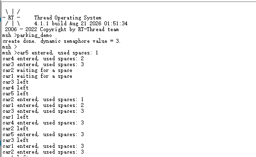
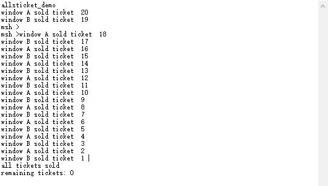
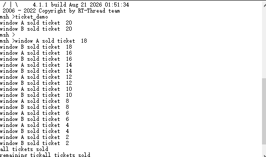
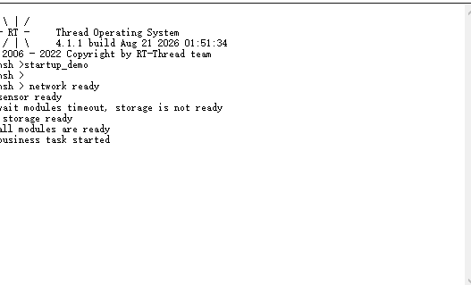
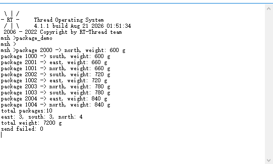

# RT-Thread 夏令营第三天学习笔记

## 1. 本日学习目标

1. 理解多线程环境中的资源竞争、临界区和阻塞等待；
2. 掌握信号量、互斥量、事件集三种同步机制；
3. 掌握邮箱和消息队列两种线程间数据传递机制；
4. 学会根据资源数量、所有权、事件组合和消息结构选择 IPC；
5. 使用 MSH 命令启动并观察停车场、售票、启动条件和快递分拣实验；
6. 能够识别超时、队列满、优先级反转、重复启动和资源回收问题。

## 2. 课程衔接

前两天学习了 RT-Thread 的工程创建、启动流程、线程生命周期和调度算法。线程独立运行后，系统还需要解决两个问题：

- 多个线程访问同一份数据时，如何保证数据一致性；
- 一个线程产生的条件或数据，如何可靠地通知或传递给另一个线程。

这就是线程间同步与通信 IPC 的核心内容。同步机制主要协调执行顺序，通信机制主要传输数据，实际项目中二者通常组合使用。

## 3. 基础概念

### 3.1 临界区

临界区是访问共享变量、共享缓冲区或共享外设的一段代码。多个线程同时进入临界区，可能造成“读取-修改-写回”过程交错，产生丢失更新、重复数据或状态不一致。

保护临界区的基本原则：

1. 先获取同步对象；
2. 在锁保护下完成完整逻辑事务；
3. 尽快释放同步对象；
4. 不在持锁期间执行长时间延时或不可控阻塞。

### 3.2 阻塞与非阻塞

阻塞接口在资源不可用时将当前线程置为挂起态，等待资源、事件或超时后再恢复。非阻塞接口立即返回，适用于中断服务程序或不能长时间等待的实时路径。

超时参数通常使用 `RT_WAITING_FOREVER` 或 `rt_tick_from_millisecond()` 转换出的 Tick 数。无限等待要确认不会形成死锁；有限等待要处理 `-RT_ETIMEOUT` 等错误码。

### 3.3 线程挂起

线程在延时、等待信号量、等待互斥量、等待事件或等待消息时都会暂时离开就绪队列。MSH 输出中出现 `suspend` 需要结合具体等待原因判断，不应直接视为异常。

## 4. 信号量

### 4.1 计数信号量

计数信号量的值表示可用资源数量。停车场有 3 个车位，因此信号量初值设置为 3：

```text
take：成功占用一个资源，计数减 1
release：归还一个资源，计数加 1
计数为 0：没有空闲资源，调用者阻塞或超时
```

`parking_demo` 创建动态信号量并启动 5 个车辆线程。车辆最多同时占用 3 个车位，未在 2 秒内获得车位的线程输出等待信息，之后再次申请。

### 4.2 二值信号量

二值信号量只有 0/1 两种状态，更适合“事件已经发生”的通知。生产者线程释放信号量，消费者线程等待并处理一次事件。二值信号量没有互斥量的所有权属性，不能用来表达递归持有或优先级继承。

### 4.3 动态与静态创建

```c
rt_sem_create("sem", 3, RT_IPC_FLAG_PRIO);
rt_sem_init(&sem, "sem", 3, RT_IPC_FLAG_PRIO);
```

动态对象由堆分配，结束后要删除；静态对象由调用者提供控制块，结束后要脱离。所有创建和初始化接口都应检查返回值。

## 5. 互斥量

### 5.1 所有权和递归访问

互斥量成功获取后记录持有者，只有持有者可以释放。递归互斥允许同一线程重复获取同一把锁，并用相同次数的释放恢复到未持有状态。

### 5.2 售票实验

售票窗口 A 和 B 共享 20 张票。安全的临界区应覆盖：检查余票、取出当前票号、递减票数、记录并打印售票结果。最终应满足：

- 售出 20 张票；
- 每个票号只出现一次；
- 余票不小于 0；
- 两个线程完成后退出。

截图中两个窗口交替打印票号并输出 `remaining tickets: 0`。但当前工程中窗口 A 的 `rt_mutex_take()` 被注释，说明代码需要修正后才能作为严格的互斥量实验提交。这个问题也说明“看到结果正确”不等于“同步设计已经正确”。

### 5.3 优先级反转与优先级继承

当低优先级线程持有互斥量，高优先级线程等待该锁，而中优先级线程不断抢占低优先级线程时，会出现高优先级任务反而迟迟无法执行的优先级反转。RT-Thread 互斥量通过优先级继承临时提升锁持有者优先级，使其尽快释放资源。

## 6. 事件集

事件集使用位图保存多个独立条件：

```c
#define EVENT_NET_READY      (1U << 0)
#define EVENT_SENSOR_READY   (1U << 1)
#define EVENT_STORAGE_READY  (1U << 2)
```

三个初始化线程分别发送对应事件，业务线程使用：

```c
rt_event_recv(&event,
              EVENT_NET_READY | EVENT_SENSOR_READY | EVENT_STORAGE_READY,
              RT_EVENT_FLAG_AND | RT_EVENT_FLAG_CLEAR,
              timeout,
              &received);
```

其中 `AND` 要求所有事件位同时满足，`OR` 只需要任意一位满足，`CLEAR` 表示成功接收后清除已接收标记。

启动实验中，网络和传感器较早完成，存储延迟 5 秒。业务线程单次只等待 3 秒，因此应先输出超时信息，之后重新等待；三个事件全部到达后才输出 `all modules are ready` 和 `business task started`。

## 7. 邮箱

邮箱消息大小固定为一个机器字长。在 32 位 Cortex-M 系统中通常是 4 字节，适合发送：

- 整数和状态码；
- 指向缓冲区的指针；
- 小型句柄或事件标识。

发送端必须保证传递的指针在接收端使用期间仍然有效。中断服务程序中通常采用非阻塞发送，线程接收端可以设置超时。

## 8. 消息队列

消息队列支持固定最大长度的结构化消息。快递实验定义 `id`、`region`、`weight` 三个字段，两个生产线程各发送 5 条，分拣线程接收后分类统计。

队列容量为 5 条，发送失败时增加 `send_fail_cnt`，不能让发送线程崩溃。两个生产者都发送结束消息，分拣线程收到两条结束消息后打印统计并退出。

`rt_mq_urgent()` 会把紧急消息插入队头，适合需要优先处理的控制消息；但不能滥用，否则普通消息可能长期得不到处理。

## 9. MSH 命令与运行记录

本日实验使用以下命令：

```text
parking_demo
ticket_demo
startup_demo
package_demo
```

### 9.1 停车场截图



动态信号量初值为 3，车辆进入后计数减少，离开后释放。该实验验证了有限资源计数和超时等待。

### 9.2 售票截图





两个窗口完成 20 张票的售卖并输出余票为 0。提交前还要确认互斥量覆盖了完整售票事务。

### 9.3 启动条件截图



所有模块就绪后，业务线程开始运行。

### 9.4 消息队列截图



10 条快递消息被接收、分类并统计，输出各区域数量、总重量和发送失败次数。

## 10. 学习总结

本日的关键不是记住每个 API 名称，而是根据问题性质选择机制：

| 问题 | 推荐机制 |
| --- | --- |
| 管理 N 个相同资源 | 计数信号量 |
| 保护共享数据的独占访问 | 互斥量 |
| 等待多个条件组合 | 事件集 |
| 传递一个指针或整数 | 邮箱 |
| 传递结构化消息 | 消息队列 |

后续实现中还要把错误检查、超时处理、生命周期管理和重复启动保护纳入设计，而不能只验证一次串口输出。
