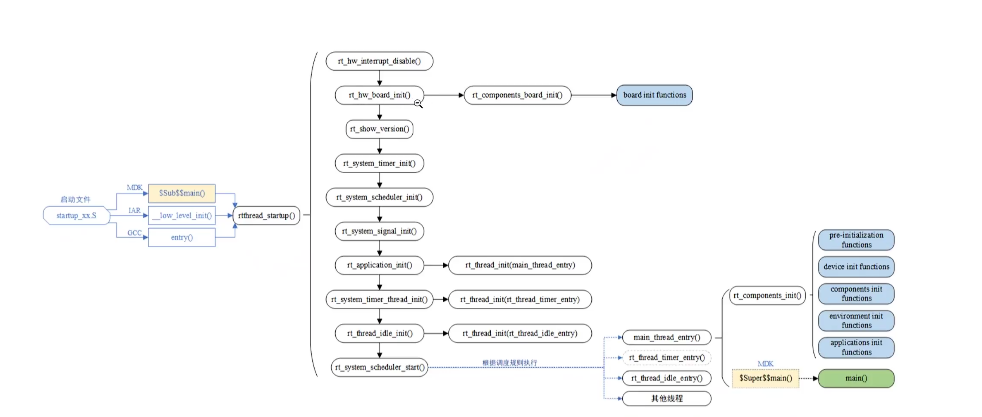
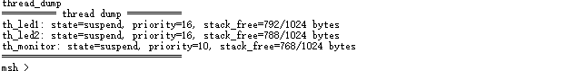
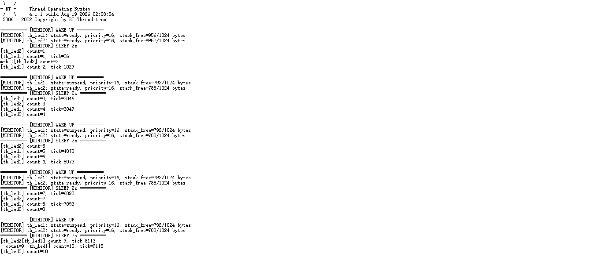
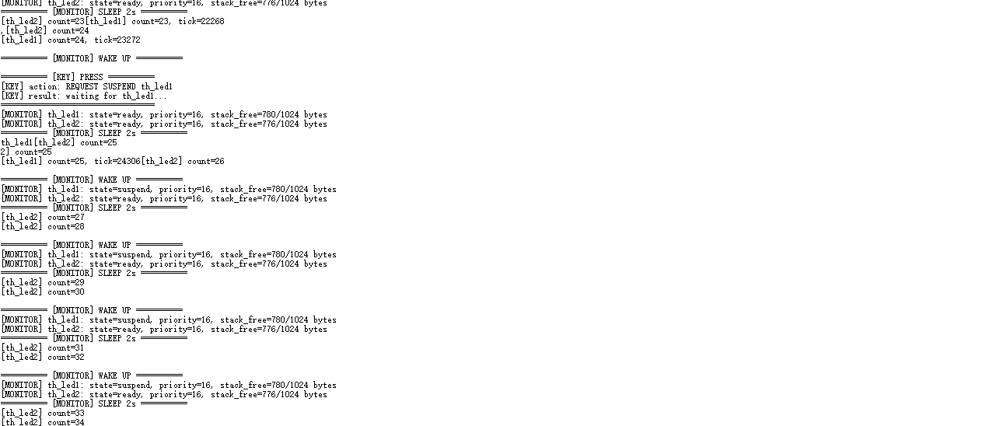
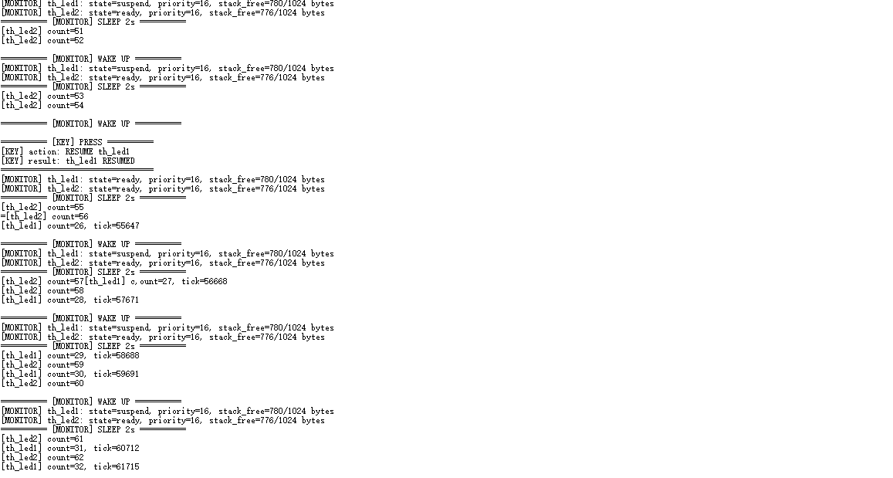

# RT-Thread 夏令营第二天学习笔记

## 1. 本日学习目标

1. 理解裸机前后台系统的局限，以及引入 RTOS 的原因；
2. 掌握 STM32F407 从复位入口到 RT-Thread `main()` 的启动流程；
3. 理解线程控制块、线程五态、优先级抢占和时间片轮转；
4. 区分静态线程与动态线程的内存分配和生命周期；
5. 掌握 SCons、`SConscript` 和 Kconfig 的基本配置方法；
6. 使用 RT-Thread Studio 创建、编译、下载和调试 STM32F407 工程；
7. 通过 LED、按键、监控线程和 MSH 命令完成多线程综合实验。

## 2. 从裸机开发到 RTOS

### 2.1 裸机前后台系统的局限

常见裸机程序会在 `while (1)` 中依次执行多个任务。当其中一个任务使用阻塞等待，例如持续等待标志位、外设数据或长延时，后续任务便无法及时执行。例如等待通信数据时，LCD 刷新也可能被迫停止。

裸机系统的主要问题包括：

| 问题 | 表现 |
| --- | --- |
| 并发效率低 | 多个任务按固定顺序串行执行，CPU 难以合理调度 |
| 实时性差 | 一个任务阻塞会影响其他任务的响应时间 |
| 可维护性差 | 任务之间耦合较强，修改局部逻辑可能影响整体时序 |
| 模块化不足 | 功能边界不清晰，代码复用和扩展比较困难 |

RTOS 将不同功能划分为线程，由内核统一进行状态管理和调度。任务等待时可以让出 CPU，使其他就绪线程继续运行，从而提高系统并发性、实时性和模块化程度。

## 3. RT-Thread 内核启动流程

### 3.1 工具链入口差异

STM32 上电后首先执行启动文件中的 `Reset_Handler`。启动文件完成栈、时钟和 C 运行环境准备，再进入 C 代码。MDK、IAR 和 GCC 的运行库入口与链接规则不同，因此接入 RT-Thread 的入口形式也有所不同。

| 工具链 | 常见入口 | 说明 |
| --- | --- | --- |
| MDK/ARMCC | `__main`、`$Sub$$main` | 可通过运行库入口封装进入 RT-Thread |
| IAR | `__low_level_init` 等 | 在应用入口前完成底层初始化 |
| GCC | `_start`、`entry` 或 BSP 入口 | 由启动汇编与链接脚本衔接 |

具体工程必须结合启动文件和链接脚本分析，不能只凭工具链名称推断唯一函数名。

### 3.2 启动调用链



启动过程可以分为四个阶段：

1. **处理器与运行库准备**：从向量表进入 `Reset_Handler`，初始化系统时钟，复制 `.data` 段并清零 `.bss` 段；
2. **内核基础初始化**：关闭中断，完成板级硬件、系统定时器和调度器初始化；
3. **系统线程创建**：创建 main 线程、软件定时器线程和 Idle 线程；
4. **启动调度**：调度器选择最高优先级的就绪线程，main 线程执行组件初始化，最终进入应用 `main()`。

核心调用关系为：

```text
Reset_Handler
  -> 运行库/工具链入口
  -> rtthread_startup()
       -> rt_hw_board_init()
       -> rt_components_board_init()
       -> rt_system_timer_init()
       -> rt_system_scheduler_init()
       -> rt_application_init()
       -> rt_system_timer_thread_init()
       -> rt_thread_idle_init()
       -> rt_system_scheduler_start()
  -> main_thread_entry()
       -> rt_components_init()
       -> main()
```

### 3.3 启动阶段的重要步骤

- **关闭中断**：防止内核关键数据结构尚未准备完成时进入中断处理；
- **板级初始化**：配置系统时钟、系统 Tick、串口控制台等基础硬件；
- **打印版本信息**：串口输出 RT-Thread Logo、版本和构建时间；
- **初始化系统定时器**：为线程延时、超时和软件定时器提供基础；
- **初始化调度器**：建立优先级就绪表和调度相关数据结构；
- **创建 main 线程**：在正常线程上下文中完成组件初始化并进入应用；
- **创建 Idle 线程**：保证系统没有其他就绪线程时仍有线程可运行；
- **启动调度器**：选择最高优先级就绪线程并完成首次上下文切换。

## 4. 自动初始化机制

### 4.1 初始化宏

`INIT_BOARD_EXPORT()` 和 `INIT_APP_EXPORT()` 都基于 `INIT_EXPORT()` 实现：

```c
#define INIT_BOARD_EXPORT(fn) INIT_EXPORT(fn, "1")
#define INIT_APP_EXPORT(fn)   INIT_EXPORT(fn, "6")
```

编译器把初始化函数指针放入指定链接段，链接器按初始化等级组织这些段。启动时，RT-Thread 遍历对应段中的函数指针并依次调用。

```text
INIT_xxx_EXPORT(fn)
  -> 函数指针写入指定链接段
  -> 链接器汇总并排序
  -> 初始化框架遍历段边界
  -> 自动调用 fn()
```

`INIT_BOARD_EXPORT()` 主要用于板级资源和底层驱动，在 `rt_components_board_init()` 中执行；`INIT_APP_EXPORT()` 用于应用模块，在 `rt_components_init()` 中执行。

本次实验使用：

```c
INIT_APP_EXPORT(thread_study_init);
```

因此三个实验线程会被自动创建，无需在 `main.c` 中硬编码调用。

## 5. 线程机制与生命周期

### 5.1 线程控制块

每个线程都由 `struct rt_thread` 控制块描述。控制块保存线程状态、优先级、时间片、栈地址和当前栈指针等调度所需信息。

| 成员 | 含义 |
| --- | --- |
| `stat` | 当前线程状态 |
| `current_priority` | 当前调度优先级 |
| `init_tick` | 初始化时间片 |
| `remaining_tick` | 剩余时间片 |
| `sp` | 上下文切换时保存的栈指针 |
| `stack_addr` | 栈起始地址 |
| `stack_size` | 栈总容量 |

### 5.2 线程五态

RT-Thread 线程的生命周期包括初始态、就绪态、运行态、挂起态和关闭态：

```text
初始态 --startup--> 就绪态 --调度--> 运行态
                    ^   |            |
                    |   | 被抢占      | 延时/等待/挂起
                    |   v            v
                    +--就绪态       挂起态
                         ^            |
                         +--超时/恢复-+

运行态 --退出/删除--> 关闭态
```

- 创建或初始化线程后，必须调用 `rt_thread_startup()` 才能进入就绪态；
- 运行线程调用延时或等待 IPC 后会进入挂起态；
- 等待条件满足、超时或被恢复后，线程回到就绪态；
- 线程入口返回或线程被删除后进入关闭态。

### 5.3 上下文切换

线程切换时，内核先把当前线程的 CPU 寄存器现场压入其线程栈，并保存栈指针；随后装载目标线程保存的栈指针，再从目标栈恢复寄存器现场。这样目标线程就能从上次停止的位置继续运行。

### 5.4 调度算法

RT-Thread 使用抢占式优先级调度：优先级更高的就绪线程可以抢占当前线程。本工程优先级范围为 0～31，数值越小优先级越高。

当多个线程优先级相同时，使用时间片轮转。本次实验中 `th_led1` 与 `th_led2` 的优先级均为 16、时间片均为 5 ticks，因此它们可以在同一优先级队列中轮流运行。优先级为 10 的 `th_monitor` 唤醒时会优先运行。

### 5.5 Idle 线程的职责

Idle 线程的优先级最低，只有在没有其他就绪线程时才运行。它的常见职责包括：

- 回收动态线程退出后等待释放的资源；
- 执行空闲钩子函数；
- 配合芯片进入低功耗模式；
- 在特定系统设计中完成看门狗维护等空闲任务。

耗时或可能阻塞的业务逻辑不应放入 Idle 钩子，否则会影响资源回收和系统空闲行为。

## 6. 静态线程与动态线程

### 6.1 静态线程

静态线程使用 `rt_thread_init()`，由应用预先提供 TCB 和栈空间：

```c
static struct rt_thread th_led2;
static rt_uint8_t th_led2_stack[1024];
```

优点是内存占用确定、运行期间不依赖堆分配，适合安全性和确定性要求较高的场景。缺点是内存固定占用，配置过大可能浪费 RAM。

### 6.2 动态线程

动态线程使用 `rt_thread_create()`，TCB 和栈由系统堆分配。它适合线程数量或生命周期需要动态变化的应用，但必须考虑内存不足、内存碎片和分配失败。

本次实验中：

- `th_led1`：动态创建，控制红色 LED；
- `th_led2`：静态初始化，控制蓝色 LED；
- `th_monitor`：动态创建，监控状态并处理按键事件。

## 7. SCons 构建系统

### 7.1 `SConscript` 的作用

RT-Thread 使用 SCons 管理工程构建。各源码目录中的 `SConscript` 描述当前目录哪些源文件参与编译、头文件路径在哪里，以及源码依赖哪些配置项。

常见写法如下：

```python
from building import *

cwd = GetCurrentDir()
src = Glob('*.c')
CPPPATH = [cwd]

group = DefineGroup('Applications', src,
                    depend=['RT_USING_FINSH'],
                    CPPPATH=CPPPATH)

Return('group')
```

关键概念：

| 配置 | 作用 |
| --- | --- |
| `src` / `Glob()` | 指定参与构建的源文件 |
| `CPPPATH` | 添加头文件搜索路径 |
| `DefineGroup()` | 定义一个源码分组 |
| `depend` / `DEPENDS` | 只有依赖的配置宏启用时，源码才加入构建 |

### 7.2 常用构建命令

```text
scons                         编译当前工程
scons -c                      清理构建产物
scons --target=mdk5           生成 MDK5 工程
scons --target=iar            生成 IAR 工程
scons --target=vsc            生成 VS Code 工程配置
scons --dist                  打包当前 BSP 为独立工程
```

`--target` 支持的名称取决于当前 RT-Thread 版本。执行前可查看工程文档或 SCons 帮助信息。

### 7.3 Kconfig 与图形化配置

Kconfig 用于描述功能选项、依赖关系和菜单结构。通过 Env 的 `menuconfig` 或 RT-Thread Studio 图形化配置界面选择功能后，配置结果会写入 `.config` 和 `rtconfig.h`。`SConscript` 再根据这些宏决定哪些源码参与编译。

```text
Kconfig 菜单定义
  -> menuconfig/Studio 选择功能
  -> 生成 .config 和 rtconfig.h
  -> SConscript 检查依赖宏
  -> 选择性编译源码
```

RT-Thread 软件包也通过这一机制配置和集成，例如 LVGL、内核示例和其他组件。

## 8. RT-Thread Studio 实操

本次基于 STM32F407ZG 创建工程，主要过程为：

1. 在 RT-Thread Studio 中按芯片创建 STM32F407 工程；
2. 检查芯片型号、时钟、调试器和串口配置；
3. 使用 ST-Link 下载和单步调试；
4. 在启动入口、`rtthread_startup()` 和线程创建位置设置断点；
5. 观察硬件初始化、调度器初始化和系统线程创建顺序；
6. 使用串口 MSH 查看线程列表和运行状态。

课程中的 kernel samples 示例演示了不同优先级线程的调度：高优先级线程先获得 CPU；线程退出后，其动态资源由系统回收。可以使用 `list_thread` 观察线程名称、优先级、状态、栈使用和错误码等信息。

## 9. MSH 命令行与自定义命令

MSH 是 RT-Thread FinSH 组件提供的命令行接口。通过串口终端可以执行系统命令，查看内核对象和调用自定义调试功能。常用操作包括：

```text
help          查看可用命令
list_thread   查看系统线程列表
thread_dump   执行本次实验导出的自定义命令
```

本实验通过：

```c
MSH_CMD_EXPORT(thread_dump, dump thread state and remaining stack);
```

将 `thread_dump()` 注册为 MSH 命令。命令会打印 `th_led1`、`th_led2` 和 `th_monitor` 的状态、当前优先级及剩余栈空间。



截图中命令成功执行，三个线程均显示为 `suspend`。这是因为截图时线程正处于 `rt_thread_mdelay()` 或等待阶段，并不表示三个线程发生异常。

## 10. 多线程综合实验记录

### 10.1 正常运行



`th_led1` 和 `th_led2` 周期运行，监控线程每 2 秒打印一次状态与剩余栈。多个线程同时使用 `rt_kprintf()` 时，个别输出可能连接在同一行，这是并发打印交错造成的。

### 10.2 按键挂起



第一次按键后，`th_led1` 的计数停止，而 `th_led2` 继续增加。该现象比单独观察 `state=suspend` 更能证明 `th_led1` 已被手动挂起，因为线程正常延时期间也会显示 `suspend`。

当前 RT-Thread 源码要求 `rt_thread_suspend()` 的目标必须是当前线程，因此由监控线程设置请求，再由 `th_led1` 调用 `rt_thread_suspend(rt_thread_self())` 自行挂起。

### 10.3 按键恢复



第二次按键后，监控线程调用 `rt_thread_resume(th_led1)`。`th_led1` 从挂起前的计数继续增加，说明线程上下文得到保留并成功恢复。

## 11. 学习总结

本日从启动流程、线程对象和调度机制三个层面理解了 RT-Thread 内核，并通过 SCons 与 Studio 熟悉了工程构建过程。多线程实验验证了以下内容：

- 静态与动态线程可以在同一系统中协同运行；
- 高优先级监控线程周期唤醒时会抢占工作线程；
- 相同优先级的两个工作线程可以按时间片轮转；
- 延时、等待和主动挂起都会表现为 `SUSPEND`，必须结合业务现象判断原因；
- 中断服务应保持简短，复杂线程控制应转移到线程上下文；
- `INIT_APP_EXPORT()` 可以解耦应用初始化与 `main.c`；
- `MSH_CMD_EXPORT()` 可以快速增加串口调试命令；
- 栈余量、线程状态和串口日志是排查 RTOS 问题的重要证据。
