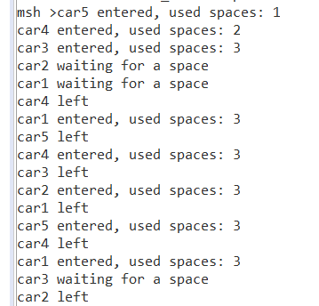
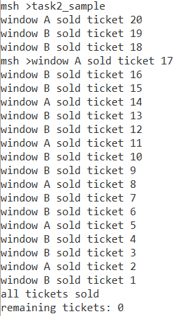
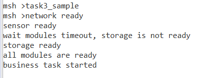
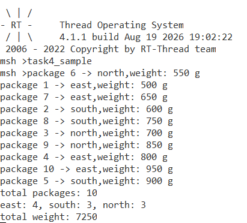

# RT‑Thread 线程间同步与通信实验报告
> 实验环境：RT‑Thread 4.1.1
> 源代码文件：`study_sample.c`
> MSH调试命令：`parking_demo`、`ticket_demo`、`startup_demo`、`package_demo`

## 目录
1. [练习一：停车场车位管理（计数信号量）](#练习一停车场车位管理计数信号量)
2. [练习二：多窗口售票系统（互斥量）](#练习二多窗口售票系统互斥量)
3. [练习三：系统启动条件检查（事件集）](#练习三系统启动条件检查事件集)
4. [练习四：快递分拣中心（消息队列）](#练习四快递分拣中心消息队列)
5. [思考题汇总](#思考题汇总)
6. [实验踩坑总结](#实验踩坑总结)
7. [文件提交说明](#文件提交说明)

## 练习一：停车场车位管理（计数信号量）
### 实验场景
停车场仅有3个车位，存在5台车辆线程竞争车位资源。计数信号量初始值设置为3代表空闲车位。车辆申请车位2秒未获取到则打印超时信息，获取车位后模拟停留一段时间，离开时释放车位，保证停车场内同时车辆不超过3台。

### 使用API
- `rt_sem_create()`：创建动态计数信号量
- `rt_sem_take(sem, tick)`：申请信号量资源，设置超时时间
- `rt_sem_release()`：释放信号量资源

### 核心逻辑
1. 创建初始值为3的计数信号量；
2. 创建5个车辆线程；
3. 线程调用`rt_sem_take`申请车位，超时时间2000ms；超时打印等待信息；
4. 获取信号量成功，打印车辆进入信息；延时模拟车辆在停车场停留；
5. 停留结束调用`rt_sem_release`释放车位，打印车辆离开；
6. 实验调试读取信号量内部`value`成员计算占用车位（仅调试，产品禁止直接访问内核结构体成员）。

### 输出结果



### 实验现象
最多同时3台车辆进入停车场，满足资源上限；车辆2s无法获取车位打印超时，之后继续重试申请车位。

### 思考题：为什么这里使用计数信号量，而不是互斥量？
互斥量计数只能为1，具备线程所有权，用于排他访问单一临界资源。
计数信号量支持初始值大于1，适合管理**多个相同的有限资源**。
停车场拥有3个车位，属于多资源场景，因此选择计数信号量，互斥量只能表示1个车位，无法满足业务。

## 练习二：多窗口售票系统（互斥量）
### 实验场景
两个售票窗口A、B，总票数20张。使用互斥量保护票数读‑判断‑修改完整临界区，避免多线程竞态，防止重复出票、票数小于0；票售罄之后两个线程自动退出。

### 使用API
- `rt_mutex_create()`：创建互斥量
- `rt_mutex_take()`：获取互斥锁
- `rt_mutex_release()`：释放互斥锁

### 核心逻辑
1. 全局变量保存剩余票数`ticket = 20`；
2. 创建两个售票线程；
3. **读取票数、判断余票、打印票号、票数自减全部放在互斥锁保护范围内**；
4. 票数等于0时，打印售罄信息，释放互斥锁后线程退出；
5. 模拟延时放在锁的外部，不占用临界区。

### 输出结果



### 对比实验
1. **去掉互斥量**：读取票数与修改票数之间加入短暂延时，会出现重复售票、票数变成负数，多线程竞态条件引发异常。
2. **添加互斥量**：完整业务流程加锁，20张票全部正常售出，票号唯一，票数不会小于0。

### 思考题：为什么只给 `ticket--` 加锁仍可能不安全？
票数读取判断 `if(ticket>0)` 和自减 `ticket--` 是两条独立CPU指令。
如果仅仅给自减操作加锁，读取判断没有保护，多个线程可以读到同一个票号，造成重复售票。
> **临界区需要保护完整的读‑判断‑修改业务流程，而不是只保护单一行代码。**

## 练习三：系统启动条件检查（事件集）
### 实验场景
设备上电，需要网络模块、传感器模块、存储模块全部初始化完成，业务线程才允许启动。
- 网络线程延时1000ms发送就绪事件；
- 传感器线程延时2000ms发送就绪事件；
- 存储线程延时5000ms发送就绪事件；
- 业务线程使用`AND`模式等待全部事件，单次最大等待3000ms；超时打印尚未就绪模块，继续循环等待。

事件位定义
```c
#define EVENT_NET_READY      (1U << 0)
#define EVENT_SENSOR_READY   (1U << 1)
#define EVENT_STORAGE_READY  (1U << 2)
```

### 使用API
- `rt_event_init()`：静态初始化事件集
- `rt_event_send()`：发送事件标志位
- `rt_event_recv()`：等待事件；`RT_EVENT_FLAG_AND`全部位置位才返回成功；`RT_EVENT_FLAG_CLEAR`接收成功自动清除标志。

> RT‑Thread4.1.1注意：`RT_EVENT_FLAG_CLEAR`模式超时返回时输出参数`e=0`，需要读取`event.set`获取真实事件标志，超时不会清除事件对象内部标志。

### 输出结果




### 思考题：如果用三个独立信号量实现这个功能，与使用事件集相比有什么区别？
1. **事件集**：单个对象管理多个bit标志；原生支持`AND`等待全部条件 / `OR`等待任意条件；资源占用小，代码简洁。
2. **三个独立信号量**：需要创建3个IPC对象；RT‑Thread没有原生API等待“全部信号量到达”，需要手写业务逻辑判断；内存开销更大，代码复杂。
> 当前场景需要等待多个独立条件全部完成，事件集是最合适组件。

## 练习四：快递分拣中心（消息队列）
### 实验场景
两个发件线程，每个线程生成5条快递消息，合计10条快递；消息队列容量设置为5。分拣线程接收消息，统计总快递数量、各区域快递数量、总重量；队列满时发送线程统计失败次数，不崩溃。

消息结构体
```c
typedef struct package_msg
{
    rt_uint32_t id;
    rt_uint8_t region;   //1华东，2华南，3华北
    rt_uint16_t weight;
}package_msg_t;
```

### 使用API
- `rt_mq_init()`：静态初始化消息队列
- `rt_mq_send()`：发送消息，队列满返回`‑RT_EFULL`
- `rt_mq_recv()`：阻塞接收消息

### 核心逻辑
1. 消息队列容量5，两个发送线程各生成5条快递；
2. 发送线程调用`rt_mq_send`，捕获队列满返回值，统计发送失败次数；
3. 分拣线程循环接收快递消息；
4. 统计总包裹数量、华东/华南/华北各个区域数量、全部快递总重量；
5. 接收满10条快递，打印全部统计结果。

### 输出结果




## 思考题汇总
1. **练习一：为什么这里使用计数信号量，而不是互斥量？**
互斥量用于排他访问，所有权绑定线程，计数只能为1；计数信号量可以管理N个相同资源。停车场3个车位属于多资源，适合计数信号量。

2. **练习二：为什么只给`ticket--`加锁仍可能不安全？**
票数读取判断和自减是两条独立指令；只保护自减，读取判断无锁，多线程会读到相同票号，发生重复售票；整个读‑判断‑修改业务流程都需要放到临界区锁内。

3. **练习三：如果用三个独立信号量实现这个功能，与使用事件集相比有什么区别？**
事件集单对象管理多bit，原生支持AND等待全部条件，代码简洁；3个独立信号量没有“等待全部条件”原生接口，需要手动写逻辑，资源开销更大，实现繁琐。

## 实验踩坑总结
1. IPC接口超时返回值为负数，超时判断必须写`‑RT_ETIMEOUT`，不能直接写`RT_ETIMEOUT`。
2. 函数内部**栈局部变量不会自动清零，必须手动初始化=0**，否则统计计数得到随机脏数据。
3. `switch‑case`每一个case末尾必须添加`break`，防止case穿透，多条分支连续执行。
4. 互斥量：`break`退出循环之前必须释放互斥锁，禁止持有锁直接跳出循环。
5. 事件集：`RT_EVENT_FLAG_CLEAR`模式超时返回输出参数e等于0，不能用e做超时判断，读取`event.set`获取标志。