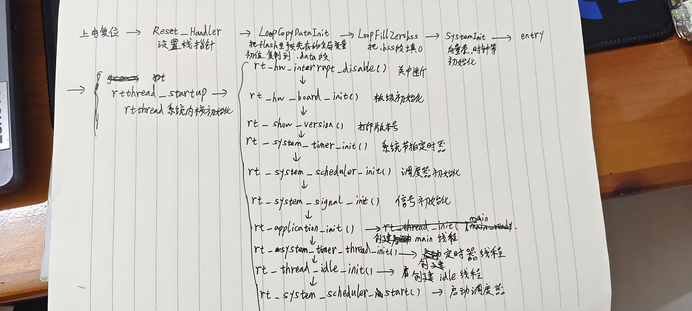
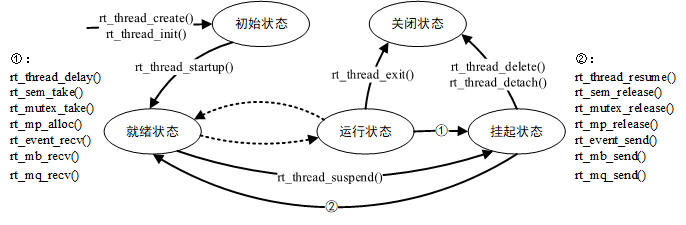
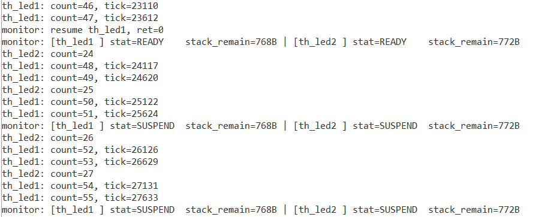
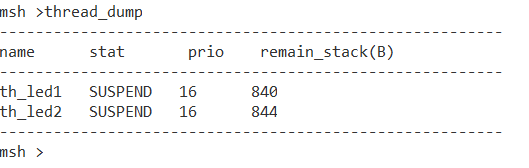

# RT‑Thread多线程实验报告
## Part 1 理论知识梳理
### 1 STM32F407启动流程与RT‑Thread引导机制
#### 1.1 从上电复位到main函数完整调用链
STM32F407上电后执行硬件复位，硬件自动读取复位向量表，获取栈顶指针以及复位处理函数入口，跳转到`Reset_Handler`。

1. 汇编启动文件`startup_stm32f407xx.s`完成内存初始化：将Flash中`.data`段的初始化数据拷贝到SRAM，把`.bss`段全部清零，保证全局未初始化变量默认为0。
2. 调用ST库的`SystemInit()`，完成FPU浮点单元使能、中断向量表VTOR配置、RCC外设时钟复位等芯片底层操作。
3. 根据编译器不同进入对应入口函数：MDK‑ARMCC为`$Sub$$main`，IAR为`__low_level_init`，本工程使用GCC工具链，入口为`entry()`。
4. 进入RT‑Thread内核总入口`rtthread_startup()`，首先关闭全局中断，防止内核初始化过程被中断打断。
5. 执行`rt_hw_board_init()`板级初始化：完成RT‑Thread堆内存注册、板卡时钟配置、控制台串口设备绑定，调用`rt_components_board_init()`执行`INIT_BOARD_EXPORT`注册的板级初始化函数。
6. 依次完成内核组件初始化：系统定时器初始化、调度器初始化、信号子系统初始化。
7. `rt_application_init()`创建main线程，线程入口是`main_thread_entry`，并不会直接调用用户编写的`main()`。
8. 创建系统后台线程：软件定时器线程负责处理延时、软件定时器任务；idle空闲线程，CPU无就绪任务时运行，承担资源回收、低功耗钩子执行。
9. 调用`rt_system_scheduler_start()`正式启动调度器，系统进入多线程运行环境。
10. main线程获取CPU之后，在`main_thread_entry`内部执行`rt_components_init()`，运行`INIT_APP_EXPORT`等应用层级注册函数，最后调用用户业务`main()`。

> 关键要点：调度器启动之前系统处于裸机、中断关闭状态；堆、调度器、系统线程全部准备完毕之后，才开启多任务，保证用户线程运行时内核环境完整可用。
>
> 

#### 1.2 自动初始化原理：INIT_BOARD_EXPORT 与 INIT_APP_EXPORT
自动初始化机制目的是避免在main函数中堆砌大量模块初始化调用。借助编译链接，把初始化函数指针存放至自定义段，内核启动阶段遍历段内指针批量执行初始化函数。

1. **宏封装生成函数指针**
`INIT_EXPORT`为底层基础宏，接收函数名与等级字符串。宏定义一个`const`类型函数指针变量，把目标函数地址赋值给该指针；通过`RT_SECTION`将变量放置到`.rti_fn.xx`自定义段，添加`RT_USED`属性，避免链接器判定函数未被引用而直接裁剪。

上层封装不同等级初始化宏：
- `INIT_BOARD_EXPORT(fn)`等级为`"1"`，用于板级初始化；
- `INIT_APP_EXPORT(fn)`等级为`"6"`，用于应用层初始化。

2. **链接脚本控制段排布**
链接脚本中配置 `KEEP(*(SORT(.rti_fn*)))`。`SORT`按照段名字符串排序，不同等级函数指针按照1→2→3…→6在内存中连续排布；`KEEP`保证段不会被链接器丢弃。

3. **内核遍历调用函数**
内核提供两组遍历接口：
- `rt_components_board_init()`：遍历等级1的段，执行`INIT_BOARD_EXPORT`注册函数。该函数在`rt_hw_board_init`内部调用，此时时钟、堆、串口硬件就绪，但调度器尚未启动，适合板卡外设、底层驱动初始化。
- `rt_components_init()`：遍历2~6等级段，`INIT_APP_EXPORT`注册函数在此执行。运行于main线程上下文，调度器已经启动，多任务环境就绪，适合用户业务模块、线程创建等逻辑。

本次实验模块入口使用`INIT_APP_EXPORT`修饰，无需修改`main.c`，系统启动时自动执行，完成三条实验线程创建。

### 2 内核基础与对象模型
#### 2.1 面向对象设计思想与线程控制块
RT‑Thread使用C语言模拟面向对象思想，线程、信号量、消息队列、定时器、设备驱动全部抽象为内核对象。所有对象头部内嵌统一`struct rt_object`基结构体，包含对象名称、类型标记、标志位、双向链表节点。系统维护对象容器数组，不同类型对象挂载到对应链表，对外提供统一创建、销毁、按名字查找接口。新增内核组件仅扩展对象类型，原有管理逻辑无需大量修改，满足开闭原则。

线程控制块`struct rt_thread`保存线程全部描述信息，关键成员说明：

|成员|功能说明|
| ---- | ---- |
|`stat`|线程状态标记，标记初始、就绪、运行、挂起、关闭；调度器依靠该成员判断线程是否允许参与CPU调度|
|`current_priority`|线程实际运行优先级，数值越小优先级越高，是抢占调度判断依据|
|`init_tick`|线程创建时配置的时间片；线程重新获取CPU，剩余时间片重置为此值|
|`sp`|线程栈指针，上下文切换核心；线程切出将寄存器现场压栈并保存sp；切回线程读取sp恢复寄存器|
|`stack_addr`|线程栈内存起始地址；栈溢出检测、剩余栈统计依赖该地址|
|`stack_size`|线程栈总字节大小|
|`entry`|线程入口函数地址|

#### 2.2 静态对象与动态对象对比、高可靠场景选用静态线程原因

|对比维度|静态内核对象|动态内核对象|
| ---- | ---- | ---- |
|内存分配位置|TCB、线程栈定义为全局数组，编译期分配，存放于BSS段|运行时调用`rt_malloc`，从系统堆申请内存|
|创建API|`rt_thread_init()`，用户传入预先定义好的TCB、栈缓冲区|`rt_thread_create()`，内核自动分配TCB与栈内存|
|生命周期|跟随程序整个生命周期，编译期内存地址固定|运行时动态生成，支持删除销毁|
|资源释放|无释放操作，内存由链接脚本管理|调用`rt_thread_delete()`，空闲线程延迟回收，内存归还堆|
|运行风险|不存在内存申请失败，资源大小编译阶段即可确定|堆耗尽会创建失败；频繁创建销毁容易产生内存碎片|

工业控制、汽车电子等高可靠性场景优先选用静态线程：
1. **行为可预测**：TCB、栈内存编译期确定地址，运行不依赖堆，不会出现运行时内存不足导致线程创建失败，可以做栈空间静态上限分析。
2. **消除内存碎片**：堆反复申请释放会产生外部碎片，长时间运行可能无法分配连续大块内存；静态对象完全不依赖堆，规避碎片风险。
3. **时序确定，故障隔离**：动态线程删除依靠idle线程延迟回收，回收时机不确定；静态对象没有销毁回收流程，时序行为稳定，便于安全认证测试。

### 3 线程状态机与调度算法
#### 3.1 线程五态模型
RT‑Thread线程分为初始态、就绪态、运行态、挂起态、关闭态，不同API触发状态迁移：

|状态|含义|典型触发API|
| ---- | ---- | ---- |
|INIT初始态|线程完成初始化，还未加入调度器|`rt_thread_create()` / `rt_thread_init()`|
|READY就绪态|线程条件满足，等待分配CPU时间片|`rt_thread_startup()`、`rt_thread_resume()`、延时超时唤醒；被高优先级线程抢占让出CPU|
|RUNNING运行态|正在占用CPU执行代码|调度器选中最高优先级就绪线程；无直接应用API，由内核完成切换|
|SUSPEND挂起态|线程放弃CPU，不再参与调度|`rt_thread_mdelay()`延时、`rt_thread_suspend()`主动挂起、等待信号量/消息队列资源不满足|
|CLOSE关闭态|线程执行结束或者被删除，等待资源回收|`rt_thread_exit()`、`rt_thread_delete()`|

状态迁移关键点：
1. `rt_thread_startup()`将初始态线程切换至就绪态，加入就绪链表；
2. 就绪态切换到运行态完全由调度器决定，应用代码无法直接操作；
3. `rt_thread_yield()`让出CPU，线程依旧保持就绪态，不会进入挂起；
4. 静态线程使用`rt_thread_detach()`，仅脱离对象容器，不会释放静态内存；动态线程使用`rt_thread_delete()`。

#### 3.2 调度机制剖析
##### （1）基于优先级的抢占式调度
RT‑Thread调度器采用优先级位图搭配双向链表，查找最高优先级就绪任务时间复杂度O(1)。

调度规则：系统始终选择就绪队列当中优先级数值最小（优先级最高）的线程运行。
当高优先级线程变为就绪态，无论当前低优先级线程执行到何处，都会立刻触发任务切换，高优先级线程抢占CPU。抢占发生在两种场景：
1. 任务上下文：调用释放信号量、恢复线程等API内部主动触发调度；
2. 中断上下文：系统tick节拍中断退出前，检查就绪队列，判断是否需要抢占切换。

本次实验monitor线程优先级10，高于两个工作线程16；monitor一旦就绪就会抢占LED工作线程，保证状态打印按时输出。

##### （2）时间片轮转调度
时间片轮转仅针对**相同优先级**的多个就绪线程。同优先级线程挂载在同一个就绪链表，每个线程拥有时间片参数`init_tick`。每一次系统tick中断，线程剩余时间片`remaining_tick`自减；计数归零，线程移动到链表尾部，让出CPU给链表下一个同优先级线程，剩余时间片重新加载初始时间片。

本实验`th_led1`、`th_led2`优先级均为16，时间片5ticks；但线程内部调用`rt_thread_mdelay`主动挂起，线程大部分时间处于挂起状态，实际线程切换更多由延时唤醒事件驱动。

## Part 2 多线程实战编程
### 任务需求说明
1. **工作线程1 th_led1（动态创建）**
优先级16，时间片5ticks，栈大小1024字节。线程循环翻转板载红色LED，每次循环打印计数，读取输出系统节拍`rt_tick_get()`。使用`rt_thread_create`从堆动态分配TCB与栈。

2. **工作线程2 th_led2（静态初始化）**
优先级16，时间片5ticks。全局定义线程控制块TCB与栈缓冲区，调用`rt_thread_init()`完成静态初始化。循环翻转板载蓝色LED，循环内部打印运行计数。

3. **监控控制线程 th_monitor（动态创建）**
优先级10，优先级高于两个工作线程；线程内部`rt_thread_mdelay(2000)`实现2秒周期。每次唤醒读取th_led1、th_led2线程状态、剩余栈空间并打印输出。
板载按键触发一次，挂起th_led1；再次触发按键，恢复th_led1运行。按键使用外部中断，中断服务函数只置位标志变量，线程挂起恢复操作放在monitor线程轮询处理，禁止在中断内直接调用线程操作API。

4. 系统集成调试
- 使用`INIT_APP_EXPORT()`注册模块初始化函数，模块自动启动，`main.c`不增加业务调用代码。
- 使用`MSH_CMD_EXPORT()`导出自定义FinSH命令`thread_dump`，串口终端输入命令打印线程状态、剩余栈大小。

### 关键实现要点
1. 剩余栈统计原理：动态线程创建时内核使用魔数`'#'(0x23)`填充整个栈；静态线程需要用户手动使用memset填充魔数。Cortex‑M栈向下生长，从栈起始地址向高地址扫描连续魔数，统计字节数量即为剩余栈大小。
2. 按键中断处理：中断回调仅设置标志位，`rt_thread_suspend`、`rt_thread_resume`在线程中执行，不允许在中断服务函数直接调用。
3. 打印格式注意：RT‑Thread的`rt_vsnprintf`与标准C库行为存在差异，`%s`后的数字代表最大输出精度，不是最小输出宽度，打印线程名称需要注意格式，避免字符串截断。
4. monitor线程优先级高于业务线程，保证2秒周期打印不会被业务线程阻塞；同时优先级不能高于msh shell线程，防止串口shell被日志刷屏，无法输入调试命令。

### 实验现象
1. 上电后红色LED周期性翻转，蓝色LED以不同周期翻转；串口输出线程计数、系统tick数值。
2. monitor线程每2秒输出一次两个线程状态、剩余栈字节。
3. 按下板载按键，红色LED停止翻转，monitor日志打印挂起提示；再次按下按键，红色LED恢复闪烁，日志打印恢复提示。
4. msh串口输入`thread_dump`，终端输出表格，展示线程名称、状态、优先级、剩余栈。

### 实验结果分析
1. 抢占调度验证：monitor线程优先级更高，2s定时唤醒后可以抢占业务线程，周期性日志不会丢失。打印时刻业务线程经常处于SUSPEND状态，是业务线程执行`rt_thread_mdelay`进入休眠。
2. 同优先级轮转：两个LED线程优先级相同，因为内部延时挂起，多数时间不在就绪态，线程切换主要由延时唤醒事件驱动。
3. 线程状态流转：LED线程在RUNNING和SUSPEND之间来回切换，符合五态模型；按键触发完成READY↔SUSPEND完整状态迁移。
4. 栈余量：两个线程栈配置1024字节，运行后栈剩余空间充足，栈大小配置合理。
5. 自动初始化生效：不修改main.c，系统启动自动创建全部业务线程；msh自定义命令正常调用，调试功能可用。

### 串口日志输出

