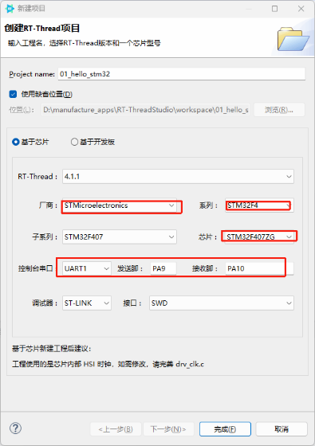
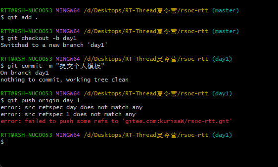

# 开发环境搭建与工程创建

## 一、RT‑Thread Studio 的安装、配置及 STM32F407 工程创建流程

### 1. 创建 STM32F407 工程

1. 打开 RT‑Thread Studio，点击左侧菜单栏 **文件 → 新建 → RT‑Thread项目**

   

### 2. 使用 STM32 ST‑LINK Utility 更新固件

> 

### 3.运行


## 二、Git基础协作命令

### 1、初始化仓库（只在第一次新建本地仓库时使用）

```bash
git init
```

作用：将当前文件夹初始化为Git仓库，生成隐藏的`.git`文件夹

### 2、绑定远程仓库（Fork项目必做）

```bash
#origin：你自己Gitee仓库
#upstream：官方上游主仓库，只需要配置1次
git remote add upstream 官方仓库地址
```

### 3、查看已经关联的远程仓库

```bash
git remote -v
```

输出会显示两组地址：`origin`(自己仓库) 和`upstream`(原官方仓库)

### 4、拉取最新代码

```bash
#拉取自己仓库master
git pull origin master
#拉取官方上游仓库最新代码（fork项目更新首选）
git pull upstream master
```

> 数据流向：远端仓库 → 本地电脑

### 5、添加文件到暂存区

```bash
#添加单个文件
git add 文件路径/文件名.md
#当前目录下所有改动全部加入暂存区
git add .
```

> 暂存区含义：相当于一个临时清单，标记好你本次准备提交哪些改动。
> **git add .会同时包含新增、修改、删除操作**，提交前建议使用`git status`检查文件列表。

### 6、提交改动到本地仓库

```bash
git commit -m "填写本次修改的说明文字"
```

> 注意必须带上参数 `-m`，后面写清楚本次做了什么修改

### 7、推送代码上传到远端仓库

```bash
git push origin 分支名
#示例
git push origin day1
```

> 数据流向：本地电脑 → 你的Gitee远端仓库

### 8、新建并且切换分支

```bash
#方式1：创建并且直接跳转到test分支
git checkout -b test
#方式2（新版git写法）
git switch -c test
```

## 四、提交 + PR完整流程

1. **网页端同步Fork仓库**
    打开你Gitee里面fork出来的仓库，点击【同步】按钮，把上游官方仓库最新改动同步到你自己的仓库



> 


```bash
#切回本地master主分支
git switch master
#拉取官方仓库最新代码
git pull upstream master
#同步更新你自己Gitee仓库master
git push origin master
#新建本次任务分支，例如day2
git checkout -b day
```

> 4. 将改动加入暂存区

```bash
git add .
```

5.提交本次修改

```bash
git commit -m "day2：xxx作业提交"
```

6.推送到自己Gitee仓库的day2分支

```bash
git push origin day2
```

## 五、Git冲突解决方法

### rebase变基

```bash
#1、切回master，同步官方最新代码
git checkout master
git pull upstream master
#2、切换到你有改动、出现冲突的功能分支
git checkout day1
#3、执行变基，把你的分支放在最新master之后
git rebase master
```

4. 如果出现冲突，终端会提示文件冲突
- 打开冲突文件，可以看到 `<<<<<<HEAD`、`======`、`>>>>>>>commit编号`标记
- 手动修改文件，保留需要的代码/文字，删掉冲突标记
5. 修改完成

```bash
git add .
#继续完成变基
git rebase --continue
```
