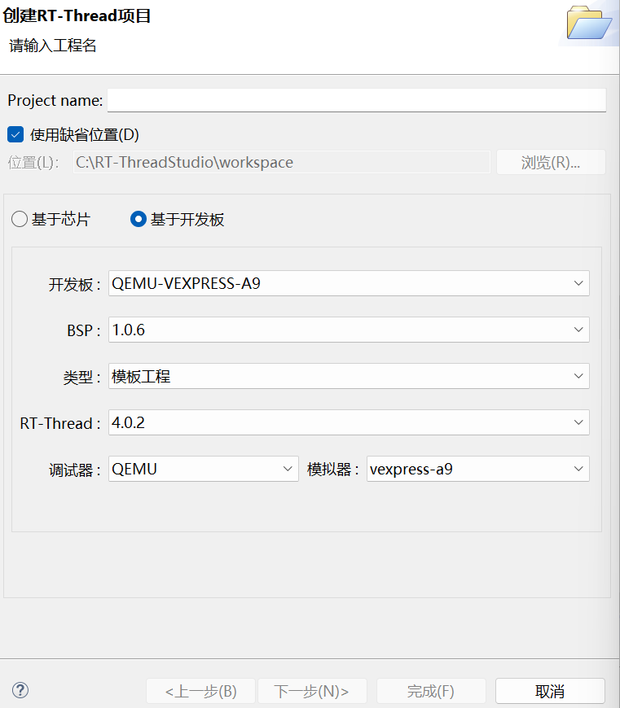

# 第一天作业
## Task1：新建 qemu-a9 工程并运行 RT-Thread

> **任务目标**：使用 RT-Thread Studio 新建一个 QEMU（vexpress-a9）工程，完成编译并在模拟器中成功运行 RT-Thread。
>
> **实验环境**：Windows + RT-Thread Studio + QEMU 4.2.0.4（vexpress-a9 平台）

---

## 一、新建工程

在 RT-Thread Studio 中选择 **QEMU vexpress-a9** 平台，新建名为 `hello` 的工程：



工程创建完成后，IDE 会自动生成 RT-Thread 完整源码目录（`applications`、`drivers`、`rt-thread` 等），入口为 `applications/main.c`。

## 二、编译工程

点击工具栏的构建按钮，使用 `arm-none-eabi-gcc` 交叉编译工具链进行编译：

```text
21:46:35 **** Incremental Build of configuration Debug for project hello ****
make -j24 all
arm-none-eabi-size --format=berkeley "rtthread.elf"
   text	   data	    bss	    dec	    hex	filename
 597909	   5276	  88148	 691333	  a8c85	rtthread.elf

              Used Size(B)           Used Size(KB)
Flash:         603185 B              589.05 KB
RAM:            93424 B               91.23 KB

21:46:36 Build Finished. 0 errors, 0 warnings. (took 1s.52ms)
```

编译结果 **0 errors, 0 warnings**，产物 `rtthread.elf` / `rtthread.bin` 生成在 `Debug` 目录下。

| 项目 | text | data | bss | Flash 占用 | RAM 占用 |
| ---- | ---- | ---- | ---- | ---------- | -------- |
| 大小 | 597909 B | 5276 B | 88148 B | 589.05 KB | 91.23 KB |

## 三、运行验证

在工程目录下执行 QEMU 命令启动模拟器（`-M vexpress-a9` 指定开发板型号，`--kernel` 指定编译出的固件，`-nographic` 以无图形界面方式运行）：

```text
C:\RT-ThreadStudio\workspace\hello>C:/RT-ThreadStudio/repo/Extract/Debugger_Support_Packages/RealThread/QEMU/4.2.0.4/qemu-system-arm.exe -M vexpress-a9 --kernel Debug/rtthread.bin -nographic -show-cursor

 \ | /
- RT -     Thread Operating System
 / | \     4.0.2 build Aug 17 2026
 2006 - 2019 Copyright by rt-thread team
lwIP-2.0.2 initialized!
[I/sal.skt] Socket Abstraction Layer initialize success.
hello rt-thread
msh />
```

从启动日志可以确认系统运行成功：

- RT-Thread 内核版本 **4.0.2**，构建日期 2026-08-17
- lwIP-2.0.2 协议栈初始化成功，Socket 抽象层（SAL）加载完成
- 打印 `hello rt-thread`（`main.c` 中 `main` 线程的输出）
- 出现 `msh />` 提示符，可输入 `ps`、`free` 等 msh 命令进行交互


# Task2：markdown 语法学习

# 一级标题

## 二级标题

### 三级标题

....

代码段

```c
#include <stdio.h>

int main()
{
	return 0;
}
```

表格

|   t1   |   t2   |
| ---- | ---- |
|   1   |   2   |

`高亮语法`

**加粗字体**
