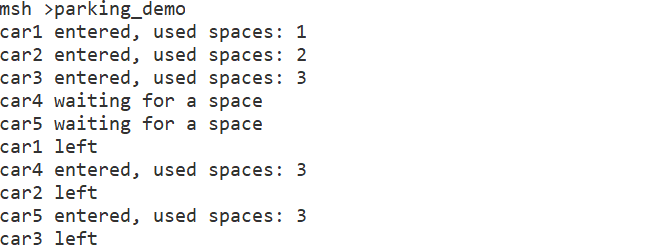
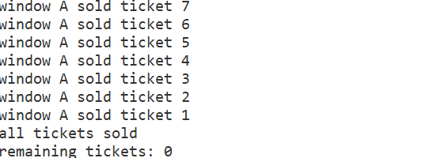
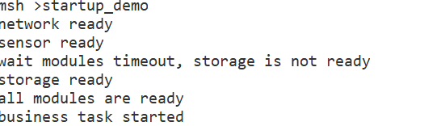
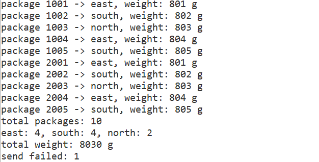

# RT-Thread 线程间同步与通信课后作业

## 一、理论总结

### 1. 信号量（Semaphore）

- 维护一个计数值，`rt_sem_take` 成功时计数减 1，`rt_sem_release` 时计数加 1；计数为 0 时 `take` 阻塞等待。
- 计数信号量适合表示"可用资源的数量"（如车位个数），允许多个线程同时获得资源，最多不超过初始值。
- 互斥量本质是二值（0/1）且**有所有权概念**（只能由持有者释放），用于保护"同一时刻只有一个线程"访问的临界资源；而车位是"多个相同资源可同时被占用"，因此用计数信号量更合适。

### 2. 互斥量（Mutex）

- 同一时刻只能被一个线程持有，未持有者 `rt_mutex_take` 会阻塞；支持**优先级继承**，可缓解优先级反转。
- 临界区 = "检查余票 + 减票 + 记录 + 打印"，必须整体放在同一把互斥量内，否则会产生竞态。

### 3. 事件集（Event Set）

- 用 32 位整数的每一位表示一个事件，`rt_event_send` 置位、`rt_event_recv` 等待。
- `RT_EVENT_FLAG_AND`：所有指定位都置 1 才返回；`RT_EVENT_FLAG_OR`：任一位置 1 即返回；可叠加 `RT_EVENT_FLAG_CLEAR` 在满足条件时自动清零。
- 事件集是"状态"而非"计数"，适合多条件同时满足的等待场景；超时返回时已置位不会被清除，可再次等待。

### 4. 消息队列（Message Queue）

- 以"消息"为单位传递数据，每个消息大小固定；`rt_mq_send` 写入、`rt_mq_recv` 读取，队列自带互斥与阻塞/超时机制。
- 适合生产者-消费者模型，天然实现线程间数据传递与解耦。

## 二、实验报告

所有练习均：至少两个线程、线程与 IPC 对象创建结果全部检查、通过 MSH 命令启动、任务结束后主动释放资源（可重复执行）。

### 练习一：停车场车位管理（计数信号量）`parking_demo`

**实现说明**：创建初始值为 3 的信号量作为车位；5 个车辆线程通过参数区分编号和错峰延时；每辆车 `rt_sem_take(2s 超时)` 申请车位，超时打印等待信息后重试；进入后停留 4s 再 `rt_sem_release` 释放。信号量保证任意时刻场内车辆 ≤ 3。

**运行结果**：

**思考题：为什么用计数信号量而不是互斥量？**

互斥量是二值且带所有权（只能由持有者释放），表示"排他访问某个共享资源"；而停车场车位是**多个完全相同、可同时被占用的资源**，用计数信号量正好把"剩余车位数量"作为计数，5 辆车可以同时竞争，最多 3 辆进入，每辆车释放时也无需是"同一个人"（所有权无关）。语义完全匹配，互斥量无法表达"最多 3 个同时进入"。

### 练习二：多窗口售票系统（互斥量）`ticket_demo`

**实现说明**：全局 `ticket_count = 20`；窗口 A/B 两个线程，循环内用同一把互斥量保护"检查余票 → 减票 → 记录票号 → 打印"完整过程；售完（余票为 0）后线程退出。最终 20 张票全部售出、票号 20~1 不重复、余票不为负。

**运行结果**：

> 运行情况说明：本次运行中 20 张票全部由窗口 A 依次售出，窗口 B 未抢到售票机会。原因是两个窗口同优先级，窗口 A 的售票循环是"热循环"：释放互斥量后立即再次获取，尚未被调度到的窗口 B 一直抢不到锁。这属于调度现象而非错误——互斥量保护依然生效：20 张票全部售出、票号 20~1 无重复、剩余票数为 0。

**对比实验**：命令 `ticket_demo_race` 不加互斥量，并在"检查余票"与"减票"之间插入 `mdelay(5)` 放大竞争窗口。运行可见两个窗口同时通过检查、重复售出同一票号、余票出现负数，验证了竞态的存在。

**思考题：为什么只给 `ticket_count--` 加锁仍可能不安全？**

"检查余票"（`ticket_count > 0`）和"减票"（`ticket_count--`）是两个独立的非原子操作。若只给 `--` 加锁，两个线程可能**同时通过检查**（都读到还有 1 张），随后各自减 1，导致重复票号或余票变为 -1。必须把"检查 + 修改 + 记录 + 打印"作为**一个完整临界区**用同一把互斥量保护。

### 练习三：系统启动条件检查（事件集）`startup_demo`

**实现说明**：三个初始化线程分别延时 1s/2s/5s 后 `rt_event_send` 对应事件位；主业务线程先用 AND 模式等待三事件，超时 3s 时（storage 尚未就绪）逐个轮询打印"未就绪模块"，再继续等待；全部就绪后打印启动信息。存储模块 5s > 3s 超时，故必然触发一次超时路径。

**运行结果**：

**思考题：用三个独立信号量实现与事件集相比有什么区别？**

- 信号量是"计数/消费"语义，主线程需要依次 `take` 三次，代码繁琐；事件集一次 AND 判断即可。
- 超时定位：三个信号量超时只能笼统知道"有一个没到"；事件集可逐个查询位状态，精确定位未就绪模块。
- 事件集是"状态"（send 一次永久有效，多个等待者共享）；信号量是"计数"（take 会消费），表达"多条件同时就绪"这类同步关系时事件集更自然、开销更小。

### 练习四：快递分拣中心（消息队列）`package_demo`

**实现说明**：创建容量为 5 条的消息队列（`sizeof(struct package_msg)`）；两个发件线程各产生 5 条快递（id 分别为 1001~1005、2001~2005，region 轮流为 1/2/3，weight 按 id 计算）；`rt_mq_send` 返回非 `RT_EOK`（队列满）时记录 `pkg_send_failed` 并延时重发，不崩溃；两个发件线程发完后各发一条 `region = 0xFF` 的结束消息（确保必达）；分拣线程 `rt_mq_recv` 循环接收，按 region 分类统计，收到 2 条结束消息后打印统计结果并退出。

**运行结果**：

> 本次实际运行 `send failed: 1`：有一次队列已满，发件线程记录失败后延时重发成功，10 条快递全部送达，正好验证了"队列满时记录失败次数、不崩溃"的要求。

## 三、重复执行说明

每个演示命令都有独立的"运行中"标志；重复执行且任务仍在运行时会打印提示并拒绝启动。任务结束后，演示函数会等所有工作线程退出（每个线程结束时释放一次完成信号量），然后**主动删除 IPC 对象并复位标志**，因此命令可以反复执行且不会因同名线程/IPC 对象残留而异常。工作线程全部使用 `rt_thread_create` 动态创建，线程函数返回后由系统自动回收。
