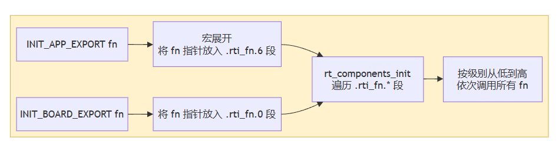
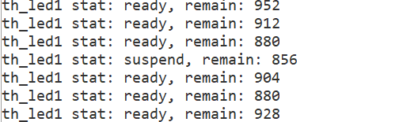
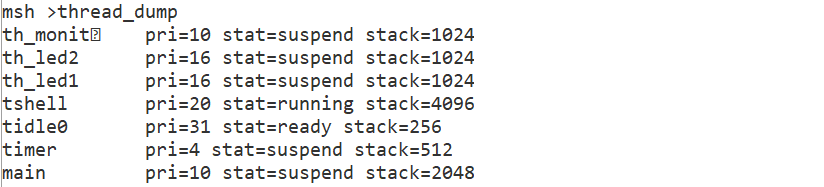

# 【DAY2】RT-Thread 启动流程、内核基础与多线程编程

---

## Part 1：理论知识梳理

### 1. STM32F407 启动流程与 RT-Thread 引导机制

#### 1.1 启动路径（Reset_Handler → main()）

系统上电复位后，硬件跳转到汇编启动代码 `Reset_Handler`，完成栈指针与向量表初始化后进入 RT-Thread 启动入口 `rtthread_startup()`。不同工具链的入口方式不同：GCC 为 `entry()`，ARMCC/CLANG 通过 `$Sub$$main()` 拦截，IAR 通过 `__low_level_init()`。

```text
上电复位
   │
   ▼
Reset_Handler（汇编启动代码：初始化栈与向量表）
   │
   ▼
工具链入口
   ├─ GCC         → entry()
   ├─ ARMCC/CLANG → $Sub$$main()
   └─ IAR         → __low_level_init()
   │
   ▼
rtthread_startup()
   ├─ ① 关全局中断        rt_hw_interrupt_disable()
   ├─ ② 板级初始化        rt_hw_board_init()      ← 时钟/串口/堆
   ├─ ③ 显示版本号        rt_show_version()
   ├─ ④ 定时器系统初始化  rt_system_timer_init()
   ├─ ⑤ 调度器初始化      rt_system_scheduler_init()
   ├─ ⑥ 创建 main 线程    rt_application_init()
   ├─ ⑦ 定时器线程初始化  rt_system_timer_thread_init()
   ├─ ⑧ 空闲线程初始化    rt_thread_idle_init()
   └─ ⑨ 启动调度器        rt_system_scheduler_start()
   │
   ▼
main_thread_entry()
   └─ rt_components_init()  →  进入用户 main()
```

`rtthread_startup()` 的核心流程：

```c
int rtthread_startup(void)
{
    rt_hw_interrupt_disable();       /* 关全局中断 */
    rt_hw_board_init();              /* 板级初始化：时钟、串口、堆 */
    rt_show_version();               /* 显示版本号 */
    rt_system_timer_init();          /* 定时器系统初始化 */
    rt_system_scheduler_init();      /* 调度器初始化 */
    rt_application_init();           /* 创建 main 线程 */
    rt_system_timer_thread_init();   /* 定时器线程初始化 */
    rt_thread_idle_init();           /* 空闲线程初始化 */
    rt_system_scheduler_start();     /* 启动调度器 */
    return 0;
}
```

启动流程可划分为四个阶段：

| 阶段 | 对应函数 | 说明 |
| ---- | -------- | ---- |
| 1. 硬件初始化 | `rt_hw_board_init()` | 初始化与系统相关的硬件 |
| 2. 内核对象初始化 | `rt_system_timer_init()`、`rt_system_scheduler_init()`、`rt_system_signal_init()` | 初始化定时器、调度器、信号等内核对象 |
| 3. 创建 main 线程 | `rt_application_init()` | 在 main 线程中对各模块依次初始化 |
| 4. 收尾并启动调度 | `rt_system_timer_thread_init()`、`rt_thread_idle_init()`、`rt_system_scheduler_start()` | 初始化定时器线程、空闲线程并启动调度器 |

**两个关键点：**

1. **启动调度器之前线程不会运行**：`rt_thread_startup()` 只是让线程进入**就绪态**等待调度；只有 `rt_system_scheduler_start()` 之后系统才运行第一个线程，并按优先级选择就绪队列中优先级最高的线程。
2. **`rt_hw_board_init()` 的职责**：完成系统时钟设置（提供系统心跳 `tick`）、串口初始化（将输入输出终端绑定到串口），堆的初始化也在此完成。

main 线程创建后，其入口 `main_thread_entry()` 会先执行 `rt_components_init()`（组件与自动初始化），再调用用户 `main()`。因此**用户 `main()` 运行在线程上下文中**，此时内核已完全就绪，可使用线程、信号量等所有内核机制。

#### 1.2 自动初始化原理（INIT_BOARD_EXPORT / INIT_APP_EXPORT）

自动初始化机制的核心是把"初始化函数"按级别注册进指定段，系统启动时统一遍历调用，从而**无需在 `main()` 里手动调用**。



- `INIT_EXPORT(fn, level)` 宏把函数指针放到链接脚本定义的 `.rti_fn.<level>` 段；
- 各级别按数值从小到大执行：`INIT_BOARD_EXPORT(0)` → `INIT_PREV_EXPORT(1)` → `INIT_DEVICE_EXPORT(2)` → `INIT_COMPONENT_EXPORT(3)` → `INIT_ENV_EXPORT(4)` → `INIT_APP_EXPORT(6)`；
- 系统启动时 `rt_components_init()` 遍历这些段，按顺序调用其中的函数指针，实现"自动初始化"。

作业源码中的 `INIT_APP_EXPORT(rt_demo_init)` 即利用该机制：三个线程的创建在系统启动阶段自动完成，`main()` 中无需任何硬编码调用。

### 2. 内核基础与对象模型

#### 2.1 对象容器与控制块（面向对象设计思想）

RT-Thread 采用**面向对象**的设计思想，把内核中可管理的事物（线程、信号量、互斥量、事件、定时器、内存池、设备等）统一抽象为"内核对象"，每个对象继承自 `struct rt_object`。所有对象按类型挂接到内核的**对象容器**（`struct rt_object_information`）中，每种类型对应一条对象链表，对象被创建时挂入容器、删除时从容器摘除。内核通过统一的"对象 → 容器 → 链表"机制管理所有资源。

线程对象 `struct rt_thread` 是 RT-Thread 中最基本的调度单位，它把 `struct rt_object parent` 作为第一个成员（继承基类），再扩展线程特有属性。关键成员作用：

| 成员 | 作用 |
| ---- | ---- |
| `parent` | 继承的内核对象基类，含对象名称 `name`、类型 `type`、链表节点，使线程能被对象容器统一管理 |
| `sp` | 栈指针，指向线程当前栈顶。线程切换时调度器把寄存器上下文保存到 `sp` 指向的位置，切回时恢复，实现上下文切换 |
| `stat` | 线程当前状态（初始/就绪/运行/挂起/关闭），对应 `RT_THREAD_INIT` 等宏 |
| `current_priority` | 线程**当前**优先级；支持运行时动态调整（`rt_thread_control` 改变优先级），与初始优先级分离 |
| `init_tick` | 线程初始化时指定的时间片大小（单位 tick），线程被调度运行时用于重置剩余时间片 |
| `remaining_tick` | 剩余时间片，由系统节拍驱动递减，减到 0 时触发同优先级轮转 |
| `init_priority` | 线程创建/初始化时设置的初始优先级 |
| `entry` / `parameter` | 线程入口函数及其参数 |
| `stack_addr` / `stack_size` | 线程栈起始地址与大小 |
| `thread_timer` | 内置线程定时器，用于线程延时、超时唤醒 |

> 说明：`RT_SCHED_THREAD_CTX` 宏展开后包含 `current_priority`、`init_priority`、`number_mask`、`number`、`high_mask` 等调度成员；`stat`、`init_tick`、`remaining_tick` 属于调度上下文的一部分。本作业 monitor 读取 `tid_led1->stat` 与 `tid_led1->stack_size` 正是直接访问控制块成员。

#### 2.2 静态对象与动态对象

| 对比项 | 动态对象（`rt_thread_create`） | 静态对象（`rt_thread_init`） |
| ---- | ---- | ---- |
| 分配位置 | 系统堆内存（需使能 `RT_USING_HEAP`） | 编译期确定，通常定义为全局变量 |
| 分配时机 | 运行时从堆动态分配（TCB + 栈） | 编译链接时静态分配（用户提供 TCB 与栈数组） |
| 栈首地址 | 内核从堆分配，按 `RT_ALIGN_SIZE` 对齐 | 用户提供，需做地址对齐（ARM 为 4 字节） |
| 生命周期 | 由 `rt_thread_delete()` 删除 | 由 `rt_thread_detach()` 脱离 |
| 释放机制 | `rt_thread_delete()` 仅置为 `RT_THREAD_CLOSE` 并挂入 `rt_thread_defunct` 队列，**由空闲线程**真正回收控制块与栈并释放回堆 | `rt_thread_detach()` 仅从容器/队列移除，内存仍留在静态区，无需回收 |
| 适用场景 | 线程数量/栈大小运行期才确定的灵活场景 | 高可靠、资源受限、不允许堆分配的场景 |

本作业正是两种方式的对照：`th_led1`、`th_monitor` 用 `rt_thread_create()` 动态创建（TCB 与栈来自堆），`th_led2` 用 `rt_thread_init()` 静态初始化（`struct rt_thread th_led2` 与 `thread2_stack[1024]` 为全局变量）。

**为什么高可靠场景强制使用静态线程？**

1. TCB 与栈在**编译期即分配固定内存**，不存在堆分配失败（返回 `RT_NULL`）的风险；
2. 不依赖堆管理器和空闲线程回收，生命周期完全可控，避免动态申请/释放带来的不确定性与实时性抖动；
3. 可在堆初始化之前或中断上下文等受限环境中使用；
4. 汽车电子、航天等安全关键系统常禁止动态内存分配（如 MISRA 规范），静态线程是唯一合规方案。

### 3. 线程状态机与调度算法

#### 3.1 五态模型

| 状态 | 宏定义 | 说明 |
| ---- | ---- | ---- |
| 初始态 | `RT_THREAD_INIT` | 线程刚创建/初始化，尚未参与调度 |
| 就绪态 | `RT_THREAD_READY` | 按优先级排队等待调度，获得 CPU 即运行 |
| 运行态 | `RT_THREAD_RUNNING` | 当前占用 CPU；单核下仅 `rt_thread_self()` 返回的线程处于该状态 |
| 挂起态 | `RT_THREAD_SUSPEND` | 阻塞等待资源或主动延时，不参与调度 |
| 关闭态 | `RT_THREAD_CLOSE` | 运行结束或被删除/脱离，不参与调度，资源待回收 |

状态转换关系及典型 API：

```text
rt_thread_create/init()      rt_thread_startup()           调度器选中
    初始态 ────────────────▶ 就绪态 ───────────────────▶ 运行态
      ▲                        ▲  ▲                        │
      │ rt_thread_delete/detach│  │ 资源就绪/超时/恢复       │ rt_thread_delay()/mdelay()
      │                        │  │ rt_thread_resume()     │ rt_sem_take()/rt_mutex_take()
      │                        │  └──────────┐             │ 资源不可用
      │                        │             │             ▼
      └────── 关闭态 ◀─────────┴─────────────┴────────── 挂起态
              (rt_thread_exit() 自动进入，空闲线程回收资源)
```

- **初始态 → 就绪态**：`rt_thread_startup()`；
- **就绪态 → 运行态**：调度器选中最高优先级就绪线程；
- **运行态 → 挂起态**：调用 `rt_thread_delay()`、`rt_thread_mdelay()`、`rt_sem_take()` 等阻塞；
- **挂起态 → 就绪态**：等待超时或资源被释放，或调用 `rt_thread_resume()`；
- **运行态 → 关闭态**：入口函数返回后自动执行 `rt_thread_exit()`；
- **任意态 → 关闭态**：`rt_thread_delete()`（动态）/ `rt_thread_detach()`（静态）。

#### 3.2 调度机制

**抢占式调度**：调度器始终从就绪队列中查找**最高优先级**线程，最高优先级线程一旦就绪总能获得 CPU，当前线程立即被换出（被抢占）。本作业中 `th_monitor` 优先级 10 高于工作线程 16，因此能周期性抢占两个 LED 线程来打印状态——这也解释了 monitor 观察时 `th_led1` 只能是 `ready`/`suspend`，永远看不到 `running`（观察瞬间 CPU 正被 monitor 自己占用）。

**时间片轮转**：仅对**同优先级**的就绪线程生效。时间片单位为 OS Tick，本作业两个工作线程时间片均为 5 ticks。当没有更高优先级线程就绪时，同优先级的 `th_led1`、`th_led2` 轮流执行，每次最多运行 5 个 tick，时间片耗尽即让出，由下一个同优先级线程继续运行：

```text
时间轴 →
th_led1 │██████│      │██████│      │██████│
th_led2 │      │██████│      │██████│      │
        每段 = 5 ticks（时间片），同优先级轮流运行
```

补充说明：两个 LED 线程循环内调用 `rt_thread_mdelay(10)` 会主动进入挂起态并让出 CPU，属于**主动让出**；而时间片轮转是被动切换（时间片耗尽）。两者结合使同优先级线程交替运行，避免了无延时死循环打印导致的串口输出交错。

---

## Part 2：多线程实战（实验结果分析）

### 线程设计

| 线程 | 创建方式 | 优先级 | 时间片 | 栈大小 | 功能 |
| ---- | ---- | ---- | ---- | ---- | ---- |
| `th_led1` | 动态 `rt_thread_create` | 16 | 5 | 1024 | 翻转 LED_R，按键（信号量）暂停/恢复 |
| `th_led2` | 静态 `rt_thread_init` | 16 | 5 | 1024 | 翻转 LED_B |
| `th_monitor` | 动态 `rt_thread_create` | 10 | 5 | 1024 | 打印线程状态与剩余栈 |

### 实验现象与串口截图




**现象分析：为什么 `th_led1` 一直是 `ready`/`suspend`，看不到 `running`？**

monitor 周期性打印 `th_led1` 的状态与剩余栈，状态始终在 `ready` 与 `suspend` 之间变化，永远不会出现 `running`，原因是：

- **单核 CPU 同一时刻只有一个线程在运行**；
- monitor 读取 `tid_led1->stat` 的瞬间，CPU 正被 monitor 自己占用（优先级 10 高于 16），此时 `th_led1` 必然不在运行，只可能是 `ready`（在就绪队列等待调度）或 `suspend`（睡眠中）；
- 因此在单核系统中，一个线程**永远无法观察到其他线程处于 `running` 态**（观察时"运行"位置必然被自己占着），只有 `rt_thread_self()` 才能读到自己的 running 状态。

剩余栈空间（`remain`）随 `rt_kprintf` 调用路径深浅在 856~928 字节间波动，属正常现象。

**按键暂停/恢复效果（信号量实现）**：

- 按键按下产生下降沿中断，`key_callback` 翻转 `led1_paused` 标志并 `rt_sem_release()` 释放信号量；
- 暂停时 `th_led1` 阻塞在 `rt_sem_take(sem_led1, RT_WAITING_FOREVER)` 上，状态转为 `suspend`（图中末尾连续两条 `suspend` 即暂停生效，此时 `count` 停止增长、LED_R 停止翻转）；
- 再次按键，标志清零并释放信号量唤醒线程，`th_led1` 恢复正常运行（`ready`/`suspend` 交替）；
- 正常运行时 `th_led1`、`th_led2` 周期打印计数并分别翻转 LED_R / LED_B（见第一张截图）。

### MSH 命令验证

通过 `MSH_CMD_EXPORT` 导出 `thread_dump` 命令，在 FinSH 终端执行可查看所有线程的状态与栈信息：



### 关键实现说明

- 挂起/恢复 `th_led1` 采用**信号量**（`rt_sem_take/release`）而非跨线程 `rt_thread_suspend`，由线程自己阻塞等待唤醒，避免强行挂起导致的死锁风险。


### 遇到的问题与解决

**1. 线程名过长被截断（`th_monitor` → `th_monit`）**

- **现象**：`thread_dump` 命令输出中，`th_monitor` 线程显示为 `th_monit`。
- **原因**：RT-Thread 线程名最大长度由 `RT_NAME_MAX` 决定（默认 8 字节），`th_monitor` 有 10 个字符，超出部分被截断。
- **解决**：将线程名缩短到 8 字符以内（如改为 `"monitor"`），或在创建线程时使用更短的名字；若不影响功能，也可保留并接受该截断。

**2. 线程无延时导致串口输出交错、不完整**

- **现象**：去掉 `rt_thread_mdelay()` 后，`th_led1` 与 `th_led2` 的打印互相撕裂，出现 `th_lcount: 1226,th_led2 count: 2146` 这类残缺交错的输出。
- **原因**：两个同优先级（16）线程都在无延时死循环打印，时间片轮转（5 ticks）经常在一条 `rt_kprintf` 输出途中就发生切换（115200 波特率下一行需数毫秒），两股输出流在串口驱动层字符级交错。
- **解决**：在线程循环中加回 `rt_thread_mdelay(10)`，让各线程打印后在时间上错开；同时可将一行信息合并为单条 `rt_kprintf`，进一步减少行间穿插。
