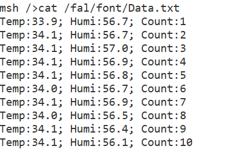

# 【DAY5】AHT10 温湿度上云 + 文件系统 + 云端控制 LED

---

## Part 1：任务 1 —— AHT10 温湿度采集并上传 EMQX

### 1. 硬件与软件包配置

- AHT10 挂在 `i2c3` 总线上，地址 `0x38`（`AHT10_I2C_ADDR`）。
- 通过 RT-Thread 软件包中心使能 `AHT10` 软件包（`PKG_USING_AHT10`），它会基于 sensor 框架注册两个设备：`temp_aht10`（温度）和 `humi_aht10`（湿度）。
- 使用 `kawaii-mqtt` 软件包作 MQTT 客户端，连接公共 EMQX 测试服务器 `broker.emqx.io:1883`。

### 2. 初始化 AHT10（sensor 框架）

```c
int aht10_read_init(void)
{
    struct rt_sensor_config cfg;
    cfg.intf.dev_name  = AHT10_I2C_BUS;             // i2c3
    cfg.intf.user_data = (void *)AHT10_I2C_ADDR;    // 0x38

    if (RT_EOK != rt_hw_aht10_init("aht10", &cfg))  // 注册 temp_aht10 / humi_aht10
    {
        LOG_E("aht10 init failed");
        return -RT_ERROR;
    }

    rt_thread_t ath10 = rt_thread_create("aht10_read", aht10_read_task, RT_NULL,
                                         2048, 25, 10);
    ...
    rt_thread_startup(ath10);
    return RT_EOK;
}
```

### 3. 读取温湿度并上云（aht10_read_task）

```c
void aht10_read_task(void *parameter)
{
    struct rt_sensor_data aht10_data;

    while (1)
    {
        rt_device_read(rt_device_find("temp_aht10"), 0, &aht10_data, 1);
        Temp = aht10_data.data.temp / 10.0f;   // 单位 0.1℃，立刻取出

        rt_device_read(rt_device_find("humi_aht10"), 0, &aht10_data, 1);
        Humi = aht10_data.data.humi / 10.0f;

        rt_snprintf(buf, sizeof(buf), "{\"temp\":%.1f,\"humi\":%.1f}", Temp, Humi);

        mqtt_message_t msg;
        msg.qos = QOS0;
        msg.payloadlen = rt_strlen(buf);
        msg.payload = buf;
        mqtt_publish(mqtt_client_g, KAWAII_MQTT_PUBTOPIC, &msg);   // 发布到 EMQX

        rt_thread_mdelay(3000);
    }
}
```

> 注意：`rt_device_read` 用同一个 `aht10_data` 结构体，读温度后要**立刻取出** Temp，再读湿度取 Humi，否则会被下一次 read 覆盖。

### 4. MQTT 客户端连接（mqtt_task_entry）

```c
/* 连接失败自动重试 */
do
{
    ret = mqtt_connect(mqtt_client_g);
    if (ret != 0)
    {
        LOG_E("mqtt connect failed: %d, retry...", ret);
        rt_thread_mdelay(5000);
    }
} while (ret != 0);
```

线程入口先轮询 `netdev_is_internet_up` 等待网络就绪（最多 30 次），再执行上面的连接流程，避免 WiFi 还没连接成功就去连 MQTT 服务器。

### 5. 验证结果（MQTTX 客户端）

用 MQTTX 订阅发布主题，能看到开发板上报的温湿度消息：


---

## Part 2：任务 2 —— 文件系统启动流程 + 挂载 font 分区 + 写 Data.txt

### 1. 文件系统启动流程梳理

本项目文件系统链路（rtconfig.h 中 `RT_USING_DFS` + `RT_USING_DFS_ELMFAT` + `RT_USING_FAL` + `BSP_USING_FLASH_FATFS` + `BSP_USING_FLASH_FS_AUTO_MOUNT` 全部使能），启动顺序如下：

```text
rt_hw_board_init()
  └─ INIT_BOARD_EXPORT    → 串口/GPIO 等底层
  └─ INIT_DEVICE_EXPORT   → SFUD 探测 W25Q64，注册 norflash0 块设备
  └─ INIT_COMPONENT_EXPORT→ fal_init() 初始化 FAL；elm_init() 注册 FatFS
  └─ INIT_ENV_EXPORT
  └─ INIT_APP_EXPORT      → filesystem_mount()
        ├─ 挂 romfs 到 "/"（只读根文件系统，目录表在 drv_filesystem.c）
        └─ onboard_fal_mount()
              ├─ fal_init()
              ├─ fal_blk_device_create("filesystem") → 创建块设备
              └─ dfs_mount(... "/fal" ...)           → filesystem 分区挂到 /fal
```

关键点：`/fal` 能在根文件系统里找到，是因为 `drv_filesystem.c` 的 `_romfs_root[]` 目录表里注册了 `"fal"` 目录。

### 2. 挂载 font 分区

FAL 分区表里 font 分区位于 W25Q64，起始 `(512+1024+512)*1024`，大小 3MB。挂载思路：**不改 romfs 表**，直接把 font 挂到已存在的 `/fal` 目录的子路径 `/fal/font`（`/fal` 上挂的是可写 FATFS，可 `mkdir`）。

```c
int main(void)
{
    fal_blk_device_create("font");              // 在 font 分区上创建块设备
    mkdir("/fal/font", 0);                      // 建挂载点目录（/fal 可写）
    dfs_mount("font", "/fal/font", "elm", 0, 0); // 挂载 FATFS
    ...
}
```

首次使用需要先格式化分区（shell 命令）：

```text
mkfs -t elm font
```

### 3. 温湿度同步写入 Data.txt

在 `aht10_read_task` 里，发布 MQTT 之前追加写入文件系统：

```c
char line[128];
count++;
rt_snprintf(line, sizeof(line),
            "Temp:%.1f; Humi:%.1f; Count:%d\n", Temp, Humi, count);

int fd = open("/fal/font/Data.txt", O_RDWR | O_CREAT | O_APPEND, 0);
if (fd >= 0)
{
    write(fd, line, rt_strlen(line));
    close(fd);
}
```

### 4. 验证结果

```text
msh >mount
filesystem  device  mountpoint
----------  ------  ----------
rom         (null)  /
elm         filesyst?52  /fal
elm         font    /fal/font

msh >cat /fal/font/Data.txt
Temp:33.8; Humi:77.7; Count:19
Temp:33.8; Humi:77.7; Count:20
Temp:33.8; Humi:57.8; Count:21
```

串口终端 `cat` 读取 Data.txt 的实测截图：



---

## Part 3：任务 3 —— 云端下发指令翻转 LED

### 1. 实现思路

订阅回调里解析 payload，匹配 `"led_toggle"`（长度 10）就翻转 LED。注意 MQTT payload **可能没有 `\0` 结尾**，所以用 `payloadlen` 判断长度 + `rt_strncmp` 比较，不能用 `strcmp`。

```c
static void mqtt_sub_callback(void *client, message_data_t *msg)
{
    if (msg->message->payloadlen == 10 &&
        rt_strncmp((char *)msg->message->payload, "led_toggle", 10) == 0)
    {
        rt_pin_write(PIN_LED_B, !rt_pin_read(PIN_LED_B));   // 翻转 LED
    }
    LOG_I("mqtt recv: topic=%s msg=%.*s", msg->topic_name,
          (int)msg->message->payloadlen, (char *)msg->message->payload);
}
```

初始化时把 `PIN_LED_B`（PF11）配置为输出，并订阅下行 topic：

```c
int mqtt_task_init(void)
{
    rt_pin_mode(PIN_LED_B, PIN_MODE_OUTPUT);
    rt_pin_write(PIN_LED_B, PIN_LOW);
    ...
    mqtt_subscribe(mqtt_client_g, KAWAII_MQTT_SUBTOPIC, QOS0, mqtt_sub_callback);
}
```

### 2. 验证结果

用 MQTT 客户端（如 MQTTX）向订阅 topic 发布 `led_toggle`，板上 LED 每次收到都翻转一次，串口打印：

```text
[main] I/mqtt recv: topic=rtt-hub072 msg=led_toggle
```

---

## Part 4：踩坑记录

1. **`cat` 显示乱码（`锛锛?`）**：格式串里用了全角 `：`、`；`（UTF-8 占 3 字节），串口按 GBK 解码显示乱码。改成半角 `:`、`;` 后正常，纯 ASCII 任何终端不乱码。
2. **`rt_strncmp` 比较 payload**：MQTT payload 不保证有 `\0` 结尾，必须用 `payloadlen` 限定长度比较，避免越界。

---
