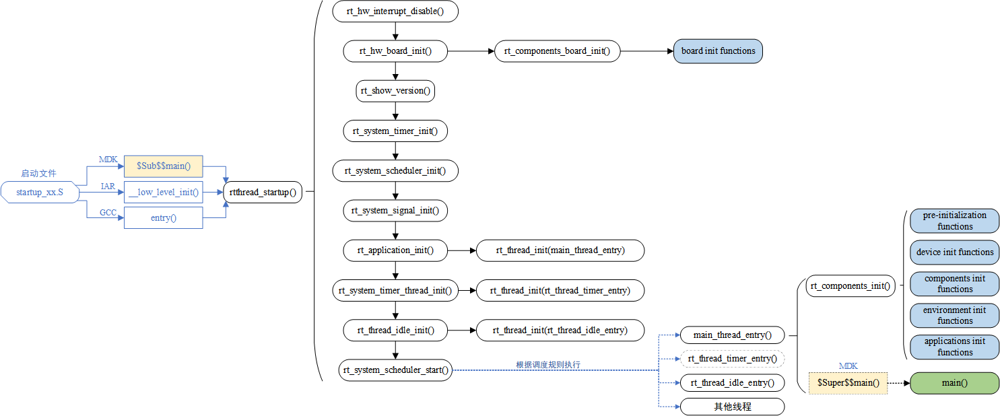
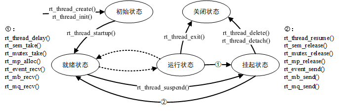

# 第二天笔记

## 1. 线程基础

### 1.1 启动流程

RT-Thread 支持多种平台和多种编译器，但 `rtthread_startup()` 是统一规定的启动入口。整体流程是：**上电复位 → 启动汇编 → RT-Thread 启动函数 `rtthread_startup()` → 用户入口 `main()`**。



以 STM32F407 + MDK-ARM 为例，整个过程分六个阶段：

**① RTT 转入**

```
startup_stm32f407xx.s (Reset_Handler)
        │
$Sub$$main() / _low_level_init() / entry()   ← 不同编译器的"main 前钩子"
        │
rtthread_startup()
```

> MDK 使用链接器扩展符号 `$Sub$$main` / `$Super$$main`：`$Sub$$main` 里先调用 `rtthread_startup()`，再转 `$Super$$main` 进入用户 `main()`，从而在 `main()` 之前完成系统初始化。对应代码在 `components.c`：
> ```c
> int $Sub$$main(void)
> {
>     rtthread_startup();
>     return 0;
> }
> ```

**② 板级初始化**

```
rt_hw_interrupt_disable()      ← 关中断
        │
rt_hw_board_init()             ← 系统时钟、串口、系统堆
        │
rt_components_board_init()     ← 调用 INIT_BOARD_EXPORT 声明的函数
```

**③ 内核初始化**

```
rt_show_version()              ← 打印版本信息
rt_system_timer_init()         ← 系统定时器
rt_system_scheduler_init()     ← 调度器
rt_system_signal_init()        ← 信号（可选，RT_USING_SIGNALS）
```

**④ 系统线程初始化**

```
rt_application_init()          ← 创建 main 线程
rt_system_timer_thread_init()  ← 定时器线程
rt_thread_idle_init()          ← 空闲线程（优先级最低）
```

**⑤ 调度器启动**

```
rt_system_scheduler_start()    ← 启动调度，从此不再返回
        │
main_thread_entry() / rt_thread_timer_entry() / rt_thread_idle_entry()
```

**⑥ main 线程运行**

```
rt_components_init()           ← 调用其余各等级 INIT_xxx_EXPORT 声明的函数
        │
main()                         ← 用户应用入口
```

核心启动代码：

```c
int rtthread_startup(void)
{
    rt_hw_interrupt_disable();      /* 关中断 */
    rt_hw_board_init();             /* 板级初始化：时钟/串口/系统堆 */
    rt_show_version();              /* 打印版本 */
    rt_system_timer_init();         /* 定时器初始化 */
    rt_system_scheduler_init();     /* 调度器初始化 */
#ifdef RT_USING_SIGNALS
    rt_system_signal_init();        /* 信号初始化 */
#endif
    rt_application_init();          /* 创建 main 线程 */
    rt_system_timer_thread_init();  /* 定时器线程初始化 */
    rt_thread_idle_init();          /* 空闲线程初始化 */
    rt_system_scheduler_start();    /* 启动调度器，之后不再返回 */
    return 0;
}
```

> 启动调度器之前创建的线程执行 `rt_thread_startup()` 后只会进入就绪态等待调度；启动调度器后，系统才转入就绪队列中优先级最高的线程开始运行。

### 1.2 自动初始化原理

自动初始化：初始化函数**不需要被显式调用**，只需在定义处用宏声明，系统启动时就会按顺序自动执行。

```c
int rt_hw_usart_init(void)      /* 串口初始化函数 */
{
    rt_hw_serial_register(&serial1, "uart1",
                          RT_DEVICE_FLAG_RDWR | RT_DEVICE_FLAG_INT_RX, uart);
    return 0;
}
INIT_BOARD_EXPORT(rt_hw_usart_init);   /* 声明为自动初始化，无需手动调用 */
```

底层实现依赖**自定义 RTI 符号段**：把函数指针放到指定段中，形成一张"初始化函数表"，启动时遍历调用。

```c
/* 初始化函数指针类型 */
typedef int (*init_fn_t)(void);

/* 底层通用宏：定义常量函数指针变量 __rt_init_xxx，并放到 .rti_fn.<level> 段 */
#define INIT_EXPORT(fn, level)                          \
    RT_USED const init_fn_t __rt_init_##fn              \
    RT_SECTION(".rti_fn." level) = fn

/* 六个等级的对外宏 */
#define INIT_BOARD_EXPORT(fn)     INIT_EXPORT(fn, "1")
#define INIT_PREV_EXPORT(fn)      INIT_EXPORT(fn, "2")
#define INIT_DEVICE_EXPORT(fn)    INIT_EXPORT(fn, "3")
#define INIT_COMPONENT_EXPORT(fn) INIT_EXPORT(fn, "4")
#define INIT_ENV_EXPORT(fn)       INIT_EXPORT(fn, "5")
#define INIT_APP_EXPORT(fn)       INIT_EXPORT(fn, "6")
```

> 对 `INIT_BOARD_EXPORT(x_init)` 而言：定义一个名为 `__rt_init_x_init` 的**常量函数指针变量**，其值为 `x_init` 的函数地址，并被强制放入 `.rti_fn.1` 段；`RT_USED`（`__attribute__((used))`）告诉链接器"即使没被调用也要保留"。该 RTI 段位于内存分布的 RO 段中。

六个等级按执行先后：

| 顺序 | 宏接口 | 说明 |
| --- | --- | --- |
| 1 | `INIT_BOARD_EXPORT(fn)` | 非常早期，调度器还未启动（硬件相关） |
| 2 | `INIT_PREV_EXPORT(fn)` | 纯软件初始化、无太多依赖 |
| 3 | `INIT_DEVICE_EXPORT(fn)` | 外设驱动初始化（如网卡） |
| 4 | `INIT_COMPONENT_EXPORT(fn)` | 组件初始化（如文件系统、LWIP） |
| 5 | `INIT_ENV_EXPORT(fn)` | 系统环境初始化（如挂载文件系统） |
| 6 | `INIT_APP_EXPORT(fn)` | 应用初始化（如 GUI） |

两个执行入口：

- `rt_components_board_init()`：在板级初始化中较早调用，遍历 `INIT_BOARD_EXPORT` 声明的函数。
- `rt_components_init()`：在 main 线程中调用（此时硬件与内核已就绪），遍历其余五个等级声明的函数。

### 1.3 线程控制块

RT-Thread 用纯 C 实现面向对象：**通过结构体嵌套模拟继承，并统一管理所有内核对象**。所有内核对象（线程、信号量、互斥量、消息队列等）都以 `struct rt_object` 作为第一个成员（`parent`）：

```c
struct rt_object
{
    char        name[RT_NAME_MAX];   /* 对象名称 */
    rt_uint8_t  type;                /* 对象类型 */
    rt_uint8_t  flag;                /* 对象标志 */
    rt_list_t   list;                /* 对象链表节点 */
};
```

线程控制块 `struct rt_thread` 继承自 `rt_object` 并扩展私有属性：

```c
struct rt_thread
{
    struct rt_object parent;         /* 继承内核对象 */

    void        *sp;                 /* 栈指针（上下文切换） */
    void        *entry;              /* 入口函数指针 */
    void        *parameter;          /* 入口参数 */
    void        *stack_addr;         /* 栈地址 */
    rt_uint32_t  stack_size;         /* 栈大小 */

    rt_err_t     error;              /* 线程错误码 */

    /* 调度上下文：stat 状态、current_priority 当前优先级、
       init_tick/remaining_tick 时间片 等 */
    RT_SCHED_THREAD_CTX

    struct rt_timer thread_timer;    /* 内置定时器（延时/超时） */
    rt_thread_cleanup_t cleanup;     /* 线程退出清理函数 */
    rt_ubase_t user_data;            /* 用户私有数据 */
};
```

关键成员作用：

| 成员 | 作用 |
| --- | --- |
| `sp` | 保存线程栈指针，用于上下文切换 |
| `stat` | 记录线程状态，决定是否可被调度 |
| `current_priority` | 线程当前优先级，决定调度顺序 |
| `init_tick` / `remaining_tick` | 实现同优先级时间片轮转 |
| `thread_timer` | 实现线程延时与超时机制 |
| `cleanup` | 线程退出时执行清理工作 |
| `user_data` | 线程私有数据存储 |

线程通过 `rt_object` 中的链表节点（`list`）串入内核对象容器的双向链表统一管理。

---

## 2. 线程状态机

### 2.1 线程的五种状态

| 状态 | 宏定义 | 说明 |
| --- | --- | --- |
| 初始态 | `RT_THREAD_INIT` | 刚创建还没运行；不参与调度 |
| 就绪态 | `RT_THREAD_READY` | 按优先级排队，等待被调度执行 |
| 运行态 | `RT_THREAD_RUNNING` | 正在运行（单核下只有 `rt_thread_self()` 返回的线程） |
| 挂起态（阻塞态） | `RT_THREAD_SUSPEND` | 资源不可用或主动延时；不参与调度 |
| 关闭态 | `RT_THREAD_CLOSE` | 线程运行结束；不参与调度 |

### 2.2 五种状态的转化



状态转换的典型路径：

- **初始态 → 就绪态**：调用 `rt_thread_startup()`。
- **就绪态 → 运行态**：被调度器选中，获得 CPU。
- **运行态 → 挂起态**：调用 `rt_thread_delay()`、`rt_sem_take()`、`rt_mutex_take()`、`rt_mb_recv()` 等，或资源不可用。
- **挂起态 → 就绪态**：等待超时，或其他线程释放了所等待的资源。
- **运行态 → 关闭态**：线程函数运行结束，末尾执行 `rt_thread_exit()`。
- **挂起态 → 关闭态**：调用 `rt_thread_delete()` / `rt_thread_detach()`。

---

## 3. 调度算法

RT-Thread 的线程调度是**基于优先级的全抢占式 + 同优先级时间片轮转**。最大支持 256 个优先级（0~255，数值越小优先级越高，0 为最高），STM32 默认配置 32 个优先级，最低优先级留给空闲线程。

### 3.1 抢占式调度

解决**不同优先级线程之间**的 CPU 分配，核心原则：**系统始终让就绪态中优先级最高的线程占用 CPU**。

当一个高优先级线程因条件满足（延时结束、等待的信号量被释放、收到消息等）从挂起态变为就绪态时，若当前运行线程优先级更低，调度器会立刻打断当前线程，把 CPU 交给高优先级线程——这个过程叫"抢占"。中断服务程序使高优先级线程就绪时，中断返回后也会发生抢占。

> 抢占式调度保证最高优先级任务一旦就绪，总能得到 CPU 使用权。

### 3.2 时间片轮转

解决**相同优先级线程之间**的 CPU 公平分配，防止某个同优先级线程一直"饿死"其他线程。

- 时间片单位为系统节拍（OS Tick），仅对**同优先级就绪态线程**有效。
- 依赖 SysTick 周期中断：每次 Tick 中断里当前线程的 `remaining_tick` 减 1。
- 当 `remaining_tick` 减到 0：
  1. 把该线程的 `remaining_tick` 恢复为 `init_tick`；
  2. 把它从所在优先级就绪队列的**头部移到尾部**；
  3. 触发调度，下一个同优先级线程获得 CPU。

> 例如 A、B 同优先级，A 时间片 10 tick、B 时间片 5 tick，则系统在二者间轮流执行，A 每次跑 10 tick，B 每次跑 5 tick。

---

## 4. 线程常用 API

### 4.1 静态初始化 / 脱离

静态线程：线程控制块与线程栈由**用户提供**（一般设为全局变量，编译期确定），内核不负责动态分配。

```c
rt_err_t rt_thread_init(struct rt_thread *thread,
                        const char *name,
                        void (*entry)(void *parameter), void *parameter,
                        void *stack_start, rt_uint32_t stack_size,
                        rt_uint8_t priority, rt_uint32_t tick);
```

- `stack_start`：用户提供的栈起始地址，需做对齐（ARM 上 4 字节对齐）。
- 成功返回 `RT_EOK`。

脱离静态线程：

```c
rt_err_t rt_thread_detach(rt_thread_t thread);   /* 与 rt_thread_init 对应 */
```

```c
/* 静态线程示例 */
static struct rt_thread thread1;
static rt_uint8_t thread1_stack[512];

rt_thread_init(&thread1, "thread1", thread1_entry, RT_NULL,
               &thread1_stack[0], sizeof(thread1_stack),
               200, 10);                 /* 优先级 200，时间片 10 tick */
rt_thread_startup(&thread1);
```

### 4.2 动态创建 / 删除

动态线程：系统从**动态内存堆**分配线程句柄和栈空间（需开启 `RT_USING_HEAP`）。

```c
rt_thread_t rt_thread_create(const char *name,
                             void (*entry)(void *parameter),
                             void *parameter,
                             rt_uint32_t stack_size,
                             rt_uint8_t priority,
                             rt_uint32_t tick);
```

- 成功返回线程句柄，失败返回 `RT_NULL`。

删除动态线程：

```c
rt_err_t rt_thread_delete(rt_thread_t thread);   /* 与 rt_thread_create 对应 */
```

> `rt_thread_delete()` 只是把线程状态改为 `RT_THREAD_CLOSE` 并放入 `rt_thread_defunct` 僵尸队列，真正的内存释放（控制块 + 栈）由**空闲线程**在下次运行时完成。

```c
/* 动态线程示例 */
rt_thread_t tid = rt_thread_create("thread2", thread2_entry, RT_NULL,
                                   512, 250, 25); /* 栈 512B，优先级 250，时间片 25 */
if (tid != RT_NULL)
    rt_thread_startup(tid);
```

### 4.3 内存分配方式对比

| 对比项 | 静态线程 | 动态线程 |
| --- | --- | --- |
| **分配位置** | RW 段 / ZI 段（编译期确定） | 动态内存堆（运行时） |
| **生命周期** | 程序整个运行期一直存在 | 由运行逻辑控制，按需创建/销毁 |
| **释放机制** | 长期占用 RAM，可被复用 | 删除后释放 RAM |
| **是否依赖堆** | 不依赖堆管理器，分配时间确定 | 依赖内存堆（`RT_USING_HEAP`） |
| **适用场景** | 高可靠、资源受限、需确定性 | 灵活、数量动态变化的场景 |

### 4.4 其他常用接口

| 接口 | 说明 |
| --- | --- |
| `rt_thread_startup(thread)` | 启动线程：初始态 → 就绪态，加入调度队列 |
| `rt_thread_self()` | 获取当前运行线程句柄 |
| `rt_thread_yield()` | 让出 CPU，把自己移到同优先级队列尾部，仍处于就绪态 |
| `rt_thread_delay(tick)` | 延时（单位：OS Tick） |
| `rt_thread_mdelay(ms)` | 延时（单位：毫秒） |
| `rt_thread_suspend(thread)` | 挂起线程（只能挂起自己） |
| `rt_thread_resume(thread)` | 恢复挂起线程到就绪态 |
| `rt_thread_control(thread, cmd, arg)` | 线程控制（改优先级、启动、关闭等） |

> `rt_thread_control` 支持的命令：`RT_THREAD_CTRL_CHANGE_PRIORITY`（改优先级）、`RT_THREAD_CTRL_STARTUP`（启动）、`RT_THREAD_CTRL_CLOSE`（关闭）、`RT_THREAD_CTRL_RESET_PRIORITY`（重置优先级）。

---

## 5. SCons 构建系统

RT-Thread 使用 SCons（Python 写的构建工具）组织工程，核心是**自上而下递归解析各级 `SConscript`**。

### 5.1 脚本结构

| 文件 | 作用 |
| --- | --- |
| `SConstruct` | **顶层构建脚本**（入口）：设置工具链环境、目标名、导出 `RTT_ROOT`/`rtconfig`，调用 `PrepareBuilding()`、`DoBuilding()` 完成构建 |
| `SConscript` | 各目录的构建脚本：声明该目录的源文件、头文件路径、编译组，并可递归调用子目录 `SConscript` |
| `rtconfig.py` | 平台/工具链配置：编译器路径 `EXEC_PATH`、`CFLAGS`/`AFLAGS`/`LFLAGS`、目标扩展名 `TARGET_EXT` 等 |
| `building.py` | RT-Thread 提供的构建辅助函数库（`GetCurrentDir`、`DefineGroup`、`Glob`、`GetDepend` 等） |

顶层 `SConstruct` 关键片段：

```python
import rtconfig
from building import *

TARGET = 'rt-thread.' + rtconfig.TARGET_EXT      # 输出目标名

env = Environment(tools=['mingw'],
    AS = rtconfig.AS, ASFLAGS = rtconfig.AFLAGS,
    CC = rtconfig.CC, CFLAGS = rtconfig.CFLAGS,
    AR = rtconfig.AR, ARFLAGS = '-rc',
    LINK = rtconfig.LINK, LINKFLAGS = rtconfig.LFLAGS)

Export('RTT_ROOT')          # 导出变量给各级 SConscript 使用
Export('rtconfig')

objs = PrepareBuilding(env, RTT_ROOT, has_libcpu=False)   # 准备构建环境
DoBuilding(TARGET, objs)    # 执行构建，生成 elf/bin/hex
```

目录级 `SConscript`（如 `applications/SConscript`）：

```python
from building import *

cwd     = GetCurrentDir()          # 当前目录
CPPPATH = [cwd]                    # 头文件搜索路径
src     = Glob('*.c')              # 收集本目录所有 .c 文件

group = DefineGroup('Applications', src, depend=[''], CPPPATH=CPPPATH)

# 递归处理含 SConscript 的子目录
for item in os.listdir(cwd):
    if os.path.isfile(os.path.join(cwd, item, 'SConscript')):
        group = group + SConscript(os.path.join(item, 'SConscript'))

Return('group')
```

常用 `building.py` 函数：

| 函数 | 说明 |
| --- | --- |
| `GetCurrentDir()` | 返回当前 SConscript 所在目录 |
| `Glob('*.c')` | 通配符收集源文件 |
| `DefineGroup(name, src, depend, CPPPATH)` | 定义编译组；`depend` 指定依赖的宏，未定义则不编译该组 |
| `GetDepend('MACRO')` | 判断 `rtconfig.h` 中是否定义某宏（用于条件编译） |
| `SConscript(path)` | 递归处理子目录脚本 |
| `Import()` / `Export()` | 在各级脚本间传递变量 |

### 5.2 常用命令

在工程根目录（含 `SConstruct` 处）执行：

| 命令 | 说明 |
| --- | --- |
| `scons` | 编译工程（生成 elf/bin/hex） |
| `scons -j4` | 并行编译（4 个进程，加快速度） |
| `scons -c` | 清理编译产物 |
| `scons -s` | 静默输出（不打印详细命令） |
| `scons --target=mdk5` | 生成 Keil MDK5 工程文件 |
| `scons --target=mdk4` | 生成 Keil MDK4 工程文件 |
| `scons --target=iar` | 生成 IAR 工程文件 |
| `scons --verbose` | 输出详细编译命令 |

> 在 RT-Thread Studio 里，点"构建"按钮底层就是调用 SCons；命令行 `scons --target=mdk5` 常用于把工程导出成 Keil 工程。

---

## 小结

- **启动流程**：`Reset_Handler → $Sub$$main → rtthread_startup() → 调度器启动 → main()`；`rtthread_startup()` 依次完成板级初始化、内核初始化、系统线程初始化、启动调度器。
- **自动初始化**：通过 `RT_SECTION(".rti_fn.<level>")` 把函数指针放进 RTI 段，链接器自动收集成表，启动时按 `BOARD → PREV → DEVICE → COMPONENT → ENV → APP` 顺序调用。
- **线程控制块**：`struct rt_thread` 以 `struct rt_object parent` 为基类，扩展栈、状态、优先级、时间片等属性，统一挂在对象容器链表上。
- **五态**：初始态 → 就绪态 → 运行态，运行态 ↔ 挂起态，最终到关闭态。
- **调度**：不同优先级**抢占式**调度（高优先级先跑），同优先级**时间片轮转**（`remaining_tick` 耗尽轮换）。
- **线程 API**：静态 `rt_thread_init/detach`，动态 `rt_thread_create/delete`；静态对象放 RW/ZI 段不依赖堆，动态对象从堆分配、删除后释放。
- **SCons**：`SConstruct`（顶层）+ `SConscript`（各目录）逐级解析，`rtconfig.py` 配工具链，`building.py` 提供辅助函数；常用命令 `scons`、`scons -j4`、`scons -c`、`scons --target=mdk5`。
