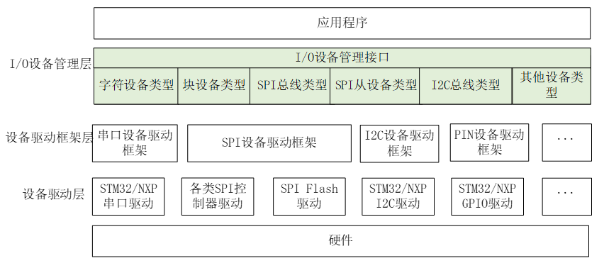

# 第四天学习

> RT-Thread I/O 设备框架与外设驱动开发

> 参考资料（RT-Thread 官方文档）：
> - [I/O 设备模型](https://www.rt-thread.org/document/site/master/#/rt-thread-version/rt-thread-standard/programming-manual/device/device)
> - [PIN 设备](https://www.rt-thread.org/document/site/master/#/rt-thread-version/rt-thread-standard/programming-manual/device/pin/pin)
> - [I2C 总线设备](https://www.rt-thread.org/document/site/master/#/rt-thread-version/rt-thread-standard/programming-manual/device/i2c/i2c)
> - [SPI 设备](https://www.rt-thread.org/document/site/master/#/rt-thread-version/rt-thread-standard/programming-manual/device/spi/spi)

---

## 1. I/O 设备框架概念

### 1.1 RTT 分层结构

RT-Thread 提供了一套简单的 I/O 设备模型框架，位于硬件和应用程序之间。官方把它划分为**三层**（应用程序不属于设备模型框架本身，而是通过 I/O 设备管理接口访问设备）：



- **I/O 设备管理层**：实现了对设备驱动程序的封装。应用程序通过它提供的**标准接口**访问底层设备，设备驱动的升级、更替不会影响上层应用。它把硬件操作相关的代码与应用解耦，降低了耦合性、复杂性，提高了可靠性。
- **设备驱动框架层**：对同类硬件设备驱动做抽象，把不同厂家同类设备驱动的**相同部分**抽取出来，把**不同部分**留出接口，由具体驱动实现（如串口、I2C、SPI、RTC、看门狗等框架）。
- **设备驱动层**：真正驱使硬件设备工作的程序，负责**创建并注册** I/O 设备。操作逻辑简单的设备可以不经过驱动框架层，直接注册到 I/O 设备管理器中。

从下到上不断抽象、屏蔽下层差异，体现了"面向对象抽象 + 面向接口编程"的思想：驱动层不同厂商的同类设备 → 对接到驱动框架层同一个父类接口（多对一）→ 再对接到 I/O 设备管理层（再次多对一）。

### 1.2 rt_device 结构体

`rt_device` 是所有设备的基类，内核对象模型之上的"设备对象"，定义如下：

```c
struct rt_device
{
    struct rt_object          parent;        /* 内核对象基类，含 name/type/flag/list */

#ifdef RT_USING_DM
    struct rt_bus            *bus;           /* 挂载的总线 */
    rt_list_t                 node;          /* 总线节点 */
    struct rt_driver         *drv;           /* 设备驱动 */
#ifdef RT_USING_OFW
    void                     *ofw_node;      /* 设备树节点 */
#endif
    void                     *power_domain_unit;  /* 电源域单元 */
#ifdef RT_USING_DMA
    const void               *dma_ops;       /* DMA 操作表 */
#endif
#endif

    enum rt_device_class_type type;          /* 设备类型 */
    rt_uint16_t               flag;          /* 设备参数（标志） */
    rt_uint16_t               open_flag;     /* 设备打开标志 */
    rt_uint8_t                ref_count;     /* 设备被引用次数 */
#ifdef RT_USING_DM
    rt_uint8_t                master_id;     /* master ID, 0 - 255 */
#endif
    rt_uint8_t                device_id;     /* 设备 ID, 0 - 255 */

    /* 数据收发回调函数 */
    rt_err_t (*rx_indicate)(rt_device_t dev, rt_size_t size);
    rt_err_t (*tx_complete)(rt_device_t dev, void *buffer);

#ifdef RT_USING_DEVICE_OPS
    const struct rt_device_ops *ops;         /* 设备操作方法集合 */
#else
    /* 兼容旧接口：init/open/close/read/write/control 函数指针 */
    rt_err_t  (*init)   (rt_device_t dev);
    rt_err_t  (*open)   (rt_device_t dev, rt_uint16_t oflag);
    rt_err_t  (*close)  (rt_device_t dev);
    rt_ssize_t (*read)  (rt_device_t dev, rt_off_t pos, void *buffer, rt_size_t size);
    rt_ssize_t (*write) (rt_device_t dev, rt_off_t pos, const void *buffer, rt_size_t size);
    rt_err_t  (*control)(rt_device_t dev, int cmd, void *args);
#endif

#ifdef RT_USING_POSIX_DEVIO
    const struct dfs_file_ops *fops;         /* POSIX 文件操作接口 */
    struct rt_wqueue           wait_queue;
#endif

    rt_err_t (*readlink)(rt_device_t dev, char *buf, int len);

    void                     *user_data;     /* 设备的私有数据 */
};
typedef struct rt_device *rt_device_t;
```

要点：

- `parent` 继承内核对象，使设备可注册到对象容器，支持按名字查找。
- `type` 标识设备类型；`ref_count` 记录被打开/引用的次数。
- `ops`（开启 `RT_USING_DEVICE_OPS` 时）把操作方法封装为结构体，驱动只需实现一组函数指针。
- `read/write` 的返回类型是 `rt_ssize_t`（有符号，负数表示错误）。
- 开启 `RT_USING_DM` 时额外记录总线/驱动/电源域/DMA 等信息；开启 `RT_USING_POSIX_DEVIO` 时支持 POSIX 文件接口。

### 1.3 设备分类

`type` 字段由 `enum rt_device_class_type` 定义，官方列出的设备类型：

| 类型宏 | 说明 |
| --- | --- |
| `RT_Device_Class_Char` | 字符设备（串口、按键等，逐字节非结构化传输） |
| `RT_Device_Class_Block` | 块设备（每次传输一个数据块，如 512 字节） |
| `RT_Device_Class_NetIf` | 网络接口设备 |
| `RT_Device_Class_MTD` | 内存设备（Flash 等） |
| `RT_Device_Class_RTC` | RTC 设备 |
| `RT_Device_Class_Sound` | 声音设备 |
| `RT_Device_Class_Graphic` | 图形设备（LCD 等） |
| `RT_Device_Class_I2CBUS` | I2C 总线设备 |
| `RT_Device_Class_USBDevice` | USB device 设备 |
| `RT_Device_Class_USBHost` | USB host 设备 |
| `RT_Device_Class_SPIBUS` | SPI 总线设备 |
| `RT_Device_Class_SPIDevice` | SPI 设备 |
| `RT_Device_Class_SDIO` | SDIO 设备 |
| `RT_Device_Class_Miscellaneous` | 杂类设备（如看门狗） |

> 字符设备与块设备的区别在于**数据与系统的传输处理方式**：字符设备允许非结构化的串行传输（一次一个字节）；块设备每次传输一个数据块，块大小由硬件强制决定。

---

## 2. I/O API

### 2.1 设备管理 API（生命周期）

设备管理 API 管理设备的**生命周期**：创建 → 注册 → 注销 → 销毁。

#### （1）创建

```c
rt_device_t rt_device_create(int type, int attach_size);
```

- `type`：设备类型（见 1.3）。
- `attach_size`：用户私有数据大小。系统从动态堆分配一个设备控制块，大小为 `sizeof(struct rt_device) + attach_size`。
- 成功返回设备句柄，失败（动态内存分配失败）返回 `RT_NULL`。

#### （2）注册

```c
rt_err_t rt_device_register(rt_device_t dev, const char *name, rt_uint16_t flags);
```

- `dev`：待注册的设备。
- `name`：设备名称，最大长度由 `RT_NAME_MAX` 指定，多余部分自动截掉；名称需唯一。
- `flags`：设备模式标志，可用"或"组合：

```c
#define RT_DEVICE_FLAG_RDONLY       0x001 /* 只读 */
#define RT_DEVICE_FLAG_WRONLY       0x002 /* 只写 */
#define RT_DEVICE_FLAG_RDWR         0x003 /* 读写 */
#define RT_DEVICE_FLAG_REMOVABLE    0x004 /* 可移除 */
#define RT_DEVICE_FLAG_STANDALONE   0x008 /* 独立（不允许重复打开） */
#define RT_DEVICE_FLAG_SUSPENDED    0x020 /* 挂起 */
#define RT_DEVICE_FLAG_STREAM       0x040 /* 流模式（串口输出 \n 前自动补 \r） */
#define RT_DEVICE_FLAG_INT_RX       0x100 /* 中断接收 */
#define RT_DEVICE_FLAG_DMA_RX       0x200 /* DMA 接收 */
#define RT_DEVICE_FLAG_INT_TX       0x400 /* 中断发送 */
#define RT_DEVICE_FLAG_DMA_TX       0x800 /* DMA 发送 */
```

注册成功后，可在 FinSH 用 `list_device` 查看所有设备（名称、类型、引用次数）。

#### （3）注销

```c
rt_err_t rt_device_unregister(rt_device_t dev);
```

- 将设备从设备管理器中移除，之后无法再按名字查找，但**设备控制块占用的内存不会被释放**（可重新注册）。

#### （4）销毁

```c
void rt_device_destroy(rt_device_t device);
```

- 真正释放设备控制块占用的内存。**销毁前必须先注销**。

> 辅助接口：
> - `rt_device_t rt_device_find(const char *name)`：按名字查找设备，找到返回句柄，找不到返回 `RT_NULL`。
> - `rt_err_t rt_device_set_rx_indicate(dev, rx_ind)`：设置接收指示回调，收到数据时通知上层。
> - `rt_err_t rt_device_set_tx_complete(dev, tx_done)`：设置发送完成回调（DMA 完成或 FIFO 写满时调用）。

### 2.2 设备 ops 相关 API

开启 `RT_USING_DEVICE_OPS` 时，驱动操作函数封装在 `struct rt_device_ops` 中：

```c
struct rt_device_ops
{
    rt_err_t  (*init)   (rt_device_t dev);
    rt_err_t  (*open)   (rt_device_t dev, rt_uint16_t oflag);
    rt_err_t  (*close)  (rt_device_t dev);
    rt_ssize_t (*read)  (rt_device_t dev, rt_off_t pos, void *buffer, rt_size_t size);
    rt_ssize_t (*write) (rt_device_t dev, rt_off_t pos, const void *buffer, rt_size_t size);
    rt_err_t  (*control)(rt_device_t dev, int cmd, void *args);
};
```

应用层统一通过以下接口访问设备：

| 操作 | 应用层接口 | 对应 ops 成员 | 说明 |
| --- | --- | --- | --- |
| 初始化 | `rt_device_init(dev)` | `init` | 初始化完成后 `flag` 置为激活态（`RT_DEVICE_FLAG_ACTIVATED`），已激活则不再重复初始化 |
| 打开 | `rt_device_open(dev, oflag)` | `open` | 打开设备，`ref_count` 加 1；未初始化会自动先初始化 |
| 关闭 | `rt_device_close(dev)` | `close` | 关闭设备，`ref_count` 减 1，减到 0 才真正关闭 |
| 读操作 | `rt_device_read(dev, pos, buf, size)` | `read` | 从设备读数据 |
| 写操作 | `rt_device_write(dev, pos, buf, size)` | `write` | 向设备写数据 |
| 控制 | `rt_device_control(dev, cmd, args)` | `control` | 发送控制命令 |

要点：

- **open/close 配对使用**：打开一次对应关闭一次，设备才会被完全关闭。
- `open` 的 `oflag` 可取 `RT_DEVICE_OFLAG_RDONLY / WRONLY / RDWR`，以及 `RT_DEVICE_FLAG_STREAM / INT_RX / DMA_RX / INT_TX / DMA_TX` 等；**只有以 `INT_RX` 或 `DMA_RX` 方式打开，接收回调才会被调用**。
- `read/write` 返回 `rt_ssize_t`：字符设备按字节计，块设备按"块"计；`pos` 对块设备以块为单位。
- `control` 的通用命令宏：

```c
#define RT_DEVICE_CTRL_RESUME    0x01   /* 恢复设备 */
#define RT_DEVICE_CTRL_SUSPEND   0x02   /* 挂起设备 */
#define RT_DEVICE_CTRL_CONFIG    0x03   /* 配置设备 */
#define RT_DEVICE_CTRL_SET_INT   0x10   /* 设置中断 */
#define RT_DEVICE_CTRL_CLR_INT   0x11   /* 清中断 */
#define RT_DEVICE_CTRL_GET_INT   0x12   /* 获取中断状态 */
```

---

## 3. GPIO 应用与驱动开发

RT-Thread 提供 **PIN 设备**（`pin`）统一管理 GPIO，使用前需在 `rtconfig.h` 中开启 `RT_USING_PIN`。

### 3.1 GPIO 引脚分类

芯片引脚一般分为 4 类：**电源、时钟、控制与 I/O**。其中 I/O 口在使用模式上又分为：

- **GPIO**（General Purpose Input/Output，通用输入/输出）；
- **功能复用 I/O**（如 SPI / I2C / UART 等）。

GPIO 主要特性：

- **可编程控制中断**：中断触发模式可配置（共 5 种，见 3.4）。
- **输入/输出模式可控制**：
  - 输出模式：推挽、开漏、上拉、下拉（通过写高低电平控制外设）。
  - 输入模式：浮空、上拉、下拉、模拟（读取引脚高低电平）。

### 3.2 获取引脚编号

RT-Thread 的**引脚编号**与芯片物理引脚号不是同一概念，由 PIN 设备驱动定义，有 3 种获取方式：

```c
/* 方式1：API 获取，名字格式为 "端口.引脚" */
rt_base_t pin = rt_pin_get("PF.9");

/* 方式2：BSP 宏定义（stm32 BSP，需 #include <board.h>） */
rt_base_t pin = GET_PIN(F, 9);

/* 方式3：查看 PIN 驱动文件 drv_gpio.c 中 pins[] 数组的引脚编号映射 */
```

```c
#include <rtdevice.h>
#include <board.h>    /* 使用 GET_PIN 需包含，否则提示无 'F' 定义 */

#define LED0_PIN   GET_PIN(F, 9)
```

### 3.3 设备管理接口

#### （1）设置模式

```c
void rt_pin_mode(rt_base_t pin, rt_uint8_t mode);
```

`mode` 可取以下 5 种宏（具体芯片支持需看 PIN 驱动实现）：

| 模式宏 | 值 | 说明 |
| --- | --- | --- |
| `PIN_MODE_OUTPUT` | 0x00 | 输出 |
| `PIN_MODE_INPUT` | 0x01 | 输入 |
| `PIN_MODE_INPUT_PULLUP` | 0x02 | 上拉输入 |
| `PIN_MODE_INPUT_PULLDOWN` | 0x03 | 下拉输入 |
| `PIN_MODE_OUTPUT_OD` | 0x04 | 开漏输出 |

#### （2）设置 / 读取电平

```c
void       rt_pin_write(rt_base_t pin, rt_ssize_t value); /* value: PIN_LOW / PIN_HIGH */
rt_ssize_t rt_pin_read (rt_base_t pin);                    /* 返回 PIN_LOW / PIN_HIGH */
```

示例（点灯）：

```c
rt_pin_mode(LED0_PIN, PIN_MODE_OUTPUT);
rt_pin_write(LED0_PIN, PIN_LOW);    /* 低电平点亮 */
```

#### （3）绑定 / 使能 / 脱离中断回调

```c
rt_err_t rt_pin_attach_irq(rt_base_t pin, rt_uint8_t mode,
                           void (*hdr)(void *args), void *args);
rt_err_t rt_pin_irq_enable(rt_base_t pin, rt_uint8_t enabled);
rt_err_t rt_pin_detach_irq(rt_base_t pin);
```

- `mode`：中断触发方式（5 种）：

| 中断模式宏 | 值 | 说明 |
| --- | --- | --- |
| `PIN_IRQ_MODE_RISING` | 0x00 | 上升沿触发 |
| `PIN_IRQ_MODE_FALLING` | 0x01 | 下降沿触发 |
| `PIN_IRQ_MODE_RISING_FALLING` | 0x02 | 边沿触发（上升沿和下降沿都触发） |
| `PIN_IRQ_MODE_HIGH_LEVEL` | 0x03 | 高电平触发 |
| `PIN_IRQ_MODE_LOW_LEVEL` | 0x04 | 低电平触发 |

- `hdr` / `args`：中断回调函数及其参数（回调在中断上下文执行，需短小、不能阻塞）。
- `rt_pin_irq_enable(pin, PIN_IRQ_ENABLE)` 使能，`PIN_IRQ_DISABLE` 禁止。
- `rt_pin_detach_irq` 脱离回调后**中断并没有关闭**，仍可再次绑定其他回调。

```c
void key_irq(void *args)
{
    /* 处理按键，例如释放信号量唤醒线程 */
}

rt_pin_mode(KEY0_PIN, PIN_MODE_INPUT_PULLUP);
rt_pin_attach_irq(KEY0_PIN, PIN_IRQ_MODE_FALLING, key_irq, RT_NULL);
rt_pin_irq_enable(KEY0_PIN, PIN_IRQ_ENABLE);
```

---

## 4. I2C 主机应用与驱动开发

使用前开启 `RT_USING_I2C`（及 `RT_USING_I2C_BITOPS` 软件模拟，或 BSP 硬件 I2C 驱动）。RT-Thread 把 I2C 主机虚拟为 I2C 总线设备。

### 4.1 I2C 协议介绍

- **二线制、半双工、双向同步串行总线**：`SCL`（双向时钟线）+ `SDA`（双向数据线）。与 SPI 不同，I2C 只用一根线收发数据。
- **主从方式**：允许同时有多个主设备，每个器件有唯一地址，同一时刻只允许一个主设备；主设备产生时钟并寻址从设备。
- 总线空闲时 SDA、SCL 均为高电平。关键时序：
  - **开始条件 START**：SCL 为高电平时，主机将 SDA 拉低。
  - **停止条件 STOP**：SDA 为低电平时，主机将 SCL 拉高并保持高电平，再将 SDA 拉高。
  - **重复开始条件**：一次通信中主机可再发一个 START，用于切换读写或更换从机。
- **从机地址**：主机发送的第一个字节，高 7 位为地址，最低位为 R/W 读写位（1 读、0 写）；支持 7 位与 10 位地址模式。
- **应答 ACK / NACK**：每传完一个字节，接收方回 ACK；读数据时由主机发 ACK，读到最后一个字节主机可发 NACK 后跟停止条件。
- 数据传输每字节 8 位，**高位在前**，字节数不限制。

### 4.2 消息结构体

一次 I2C 传输由若干条**消息**组成，每条消息用 `struct rt_i2c_msg` 描述：

```c
struct rt_i2c_msg
{
    rt_uint16_t addr;    /* 从机地址 */
    rt_uint16_t flags;   /* 读、写标志等 */
    rt_uint16_t len;     /* 读写数据字节数 */
    rt_uint8_t  *buf;    /* 读写数据缓冲区指针 */
};
```

> 注意：`addr` **不包含读写位**，读写方向由 `flags` 控制。

`flags` 可用"|"组合：

| 标志宏 | 值 | 说明 |
| --- | --- | --- |
| `RT_I2C_WR` | 0x0000 | 写标志（默认值，不能与读标志组合） |
| `RT_I2C_RD` | 1u<<0 | 读标志（不能与写标志组合） |
| `RT_I2C_ADDR_10BIT` | 1u<<2 | 10 位地址模式 |
| `RT_I2C_NO_START` | 1u<<4 | 无开始条件 |
| `RT_I2C_IGNORE_NACK` | 1u<<5 | 忽视 NACK |
| `RT_I2C_NO_READ_ACK` | 1u<<6 | 读的时候不发送 ACK |
| `RT_I2C_NO_STOP` | 1u<<7 | 不发送结束位 |

### 4.3 标准传输流程

核心接口：

```c
rt_ssize_t rt_i2c_transfer(struct rt_i2c_bus_device *bus,
                           struct rt_i2c_msg         msgs[],
                           rt_uint32_t               num);
```

- 返回"消息数组的元素个数"表示成功，否则返回错误码。
- 一次传输可组织多条消息；需要重复开始条件时发送 2 条消息。
- **注意**：该接口内部会调用 `rt_mutex_take()`，**不能在中断服务程序中调用**（会触发 assertion）。

流程：查找 I2C 总线设备 → 组织消息 → 调用 `rt_i2c_transfer()` → 校验返回值。

```c
#define I2C_BUS_NAME "i2c1"

struct rt_i2c_bus_device *i2c_bus =
    (struct rt_i2c_bus_device *)rt_device_find(I2C_BUS_NAME);

/* 读 8 位寄存器：先写寄存器地址（写消息），再读数据（读消息） */
static rt_uint8_t read_reg8(rt_uint8_t dev_addr, rt_uint8_t reg)
{
    rt_uint8_t data = 0;
    struct rt_i2c_msg msgs[2];

    msgs[0].addr  = dev_addr;
    msgs[0].flags = RT_I2C_WR;
    msgs[0].buf   = &reg;
    msgs[0].len   = 1;

    msgs[1].addr  = dev_addr;
    msgs[1].flags = RT_I2C_RD;
    msgs[1].buf   = &data;
    msgs[1].len   = 1;

    if (rt_i2c_transfer(i2c_bus, msgs, 2) == 2)
        return data;

    return 0xFF;
}
```

> 更简单的封装接口（推荐，内部封装自 `rt_i2c_transfer`）：
> ```c
> rt_ssize_t rt_i2c_master_send(struct rt_i2c_bus_device *bus,
>                              rt_uint16_t addr, rt_uint16_t flags,
>                              const rt_uint8_t *buf, rt_uint32_t count);
> rt_ssize_t rt_i2c_master_recv(struct rt_i2c_bus_device *bus,
>                              rt_uint16_t addr, rt_uint16_t flags,
>                              rt_uint8_t *buf, rt_uint32_t count);
> ```
> 小技巧：用 `RT_I2C_NO_STOP` + `RT_I2C_NO_START` 可把多次调用拼接成一条连续传输：
> ```c
> rt_i2c_master_send(bus, addr, RT_I2C_NO_STOP,  prefix, prefix_len); /* 只发起始位，不发停止位 */
> rt_i2c_master_send(bus, addr, RT_I2C_NO_START, buffer, len);        /* 不发起始位，只发停止位 */
> ```

---

## 5. SPI 主机应用与驱动开发

使用前开启 `RT_USING_SPI`。RT-Thread 把 SPI 主机虚拟为 SPI 总线设备。

### 5.1 SPI 协议介绍

- **四线、全双工、同步串行总线**，常用于短距离通信（EEPROM、FLASH、RTC、ADC 等）：
  - `MOSI`：主机输出 / 从机输入数据线；
  - `MISO`：主机输入 / 从机输出数据线；
  - `SCLK`：串行时钟线（主设备输出给从设备）；
  - `CS`：片选线（也叫 SS/CSB/CSN/EN），**低电平有效**。
- **主从方式**：通信由主设备发起，主设备通过 CS 选择从机并提供时钟，数据经 MOSI 输出、经 MISO 输入。
- 挂载在同一 SPI 控制器上的从设备共享 SCK/MISO/MOSI，但每个从设备 CS 引脚独立；任一时刻只有一个 CS 有效。
- **时序模式**由 `CPOL`（时钟极性）与 `CPHA`（时钟相位）决定：

| 模式 | CPOL（空闲电平） | CPHA（采样沿） |
| --- | --- | --- |
| Mode 0 | 0（低） | 0（首个时钟沿采样） |
| Mode 1 | 0（低） | 1（第二个时钟沿采样） |
| Mode 2 | 1（高） | 0（首个时钟沿采样） |
| Mode 3 | 1（高） | 1（第二个时钟沿采样） |

### 5.2 注册与挂载流程

SPI 采用"**总线 + 设备**"两级结构：BSP 驱动先注册 SPI 总线，应用再把具体从设备挂载到总线上。

- **总线注册**（BSP 层完成，应用一般不直接调用）：

```c
rt_err_t rt_spi_bus_register(struct rt_spi_bus *bus,
                             const char *name,
                             const struct rt_spi_ops *ops);
```

- **设备挂载**（RT-Thread 5.0.0 新增，**推荐**，片选引脚基于 PIN 框架统一管理）：

```c
rt_err_t rt_spi_bus_attach_device_cspin(struct rt_spi_device *device,
                                        const char           *name,
                                        const char           *bus_name,
                                        rt_base_t            cs_pin,
                                        void                 *user_data);
```

- **设备挂载**（5.0.0 之前旧接口，片选通过 `user_data` 传递，兼容保留）：

```c
rt_err_t rt_spi_bus_attach_device(struct rt_spi_device *device,
                                  const char           *name,
                                  const char           *bus_name,
                                  void                 *user_data);
```

- **设备卸载**：

```c
rt_err_t rt_spi_bus_detach_device(struct rt_spi_device *device);       /* 高层接口，推荐 */
rt_err_t rt_spi_bus_detach_device_cspin(struct rt_spi_device *device); /* 底层实现 */
```

命名规则：总线命名为 `spix`，设备命名为 `spixy`，如 `spi10` 表示挂在 `spi1` 总线上的 0 号设备。

```c
struct rt_spi_device *spi_device =
    (struct rt_spi_device *)rt_malloc(sizeof(struct rt_spi_device));

/* 新接口：直接指定片选引脚 */
rt_spi_bus_attach_device_cspin(spi_device, "spi10", "spi1", GET_PIN(B, 14), RT_NULL);
/* 或：rt_spi_bus_attach_device_cspin(spi_device, "spi10", "spi1", rt_pin_get("PB.14"), RT_NULL); */
```

### 5.3 控制 API 配置参数

```c
rt_err_t rt_spi_configure(struct rt_spi_device *device,
                          struct rt_spi_configuration *cfg);
```

配置结构体：

```c
struct rt_spi_configuration
{
    rt_uint8_t mode;        /* 模式 */
    rt_uint8_t data_width;  /* 数据宽度：8 / 16 / 32 位 */
    rt_uint16_t reserved;   /* 保留 */
    rt_uint32_t max_hz;     /* 最大频率（Hz） */
};
```

`mode` 是"位序 + 主从 + 时序 + 片选"等标志的组合：

```c
/* 数据传输顺序：MSB 在前 / LSB 在前 */
#define RT_SPI_LSB      (0<<2)
#define RT_SPI_MSB      (1<<2)

/* SPI 主从模式 */
#define RT_SPI_MASTER   (0<<3)
#define RT_SPI_SLAVE    (1<<3)

/* 时钟极性 CPOL（bit0）与时钟相位 CPHA（bit1）组合的 4 种时序 */
#define RT_SPI_MODE_0   (0 | 0)              /* CPOL=0, CPHA=0 */
#define RT_SPI_MODE_1   (0 | RT_SPI_CPHA)    /* CPOL=0, CPHA=1 */
#define RT_SPI_MODE_2   (RT_SPI_CPOL | 0)    /* CPOL=1, CPHA=0 */
#define RT_SPI_MODE_3   (RT_SPI_CPOL | RT_SPI_CPHA) /* CPOL=1, CPHA=1 */

#define RT_SPI_CS_HIGH  (1<<4)               /* 片选高电平有效 */
#define RT_SPI_NO_CS    (1<<5)               /* 无片选 */
#define RT_SPI_3WIRE    (1<<6)               /* SI/SO 共用一根线 */
#define RT_SPI_READY    (1<<7)               /* 从机拉低以暂停 */
```

```c
struct rt_spi_configuration cfg;

cfg.mode       = RT_SPI_MASTER | RT_SPI_MODE_0 | RT_SPI_MSB;
cfg.data_width = 8;
cfg.max_hz     = 20 * 1000 * 1000;   /* 20 MHz */

rt_spi_configure(spi_dev, &cfg);
```

### 5.4 常用传输函数

自定义传输的核心是 `struct rt_spi_message`，可组成**单向链表**一次传输多段：

```c
struct rt_spi_message
{
    const void *send_buf;           /* 发送缓冲区指针（RT_NULL 表示只接收） */
    void *recv_buf;                 /* 接收缓冲区指针（RT_NULL 表示只发送） */
    rt_size_t length;               /* 发送/接收数据长度（单位：word） */
    struct rt_spi_message *next;    /* 下一条消息 */
    unsigned cs_take    : 1;        /* 传输前片选选中 */
    unsigned cs_release : 1;        /* 传输后释放片选 */
};
```

> 首条消息 `cs_take=1`、末条消息 `cs_release=1`；`send_buf`/`recv_buf` 非空时其可用空间不得小于 `length`。

常用传输函数：

| 函数 | 返回值 | 说明 |
| --- | --- | --- |
| `rt_spi_transfer_message(dev, msg)` | `struct rt_spi_message *` | 自定义传输（消息链表）；成功返回 `RT_NULL`，失败返回剩余未发送消息指针 |
| `rt_spi_transfer(dev, tx, rx, size)` | `rt_ssize_t` | 一次全双工收发（片选选中→收发→释放） |
| `rt_spi_send(dev, buf, size)` | `rt_size_t` | 只发送，忽略接收 |
| `rt_spi_recv(dev, buf, size)` | `rt_size_t` | 只接收（主设备发 0xFF 产生时钟） |
| `rt_spi_send_then_send(dev, tx1, n1, tx2, n2)` | `rt_err_t` | 连续两次发送，中间片选不释放 |
| `rt_spi_send_then_recv(dev, tx, n1, rx, n2)` | `rt_err_t` | 先发送后接收，中间片选不释放 |
| `rt_spi_sendrecv8(dev, senddata, recvdata)` | `rt_err_t` | 收发 1 个字节 |
| `rt_spi_sendrecv16(dev, senddata, recvdata)` | `rt_err_t` | 收发 2 个字节 |

> **注意**：SPI 数据传输相关接口内部调用 `rt_mutex_take()`，**不能在中断服务程序中调用**。

```c
/* 读寄存器示例：先发命令/地址，再读回数据（用 rt_spi_transfer_message 组织两条消息） */
#define W25Q_SPI_DEVICE_NAME "spi10"

struct rt_spi_device *spi_dev =
    (struct rt_spi_device *)rt_device_find(W25Q_SPI_DEVICE_NAME);

rt_uint8_t w25x_read_id = 0x90;   /* 命令 */
rt_uint8_t id[5] = {0};
struct rt_spi_message msg1, msg2;

msg1.send_buf   = &w25x_read_id;
msg1.recv_buf   = RT_NULL;
msg1.length     = 1;
msg1.cs_take    = 1;
msg1.cs_release = 0;
msg1.next       = &msg2;

msg2.send_buf   = RT_NULL;
msg2.recv_buf   = id;
msg2.length     = 5;
msg2.cs_take    = 0;
msg2.cs_release = 1;
msg2.next       = RT_NULL;

rt_spi_transfer_message(spi_dev, &msg1);

/* 等价简写：rt_spi_send_then_recv(spi_dev, &w25x_read_id, 1, id, 5); */
```

> 特殊场景（需独占总线一段时间、保持片选有效）：先用 `rt_spi_take_bus()` 获取总线，`rt_spi_take()` 选中片选，期间用 `rt_spi_transfer_message()` 传输（此时 `cs_take`/`cs_release` 均置 0），结束用 `rt_spi_release()` 释放片选、`rt_spi_release_bus()` 释放总线。
