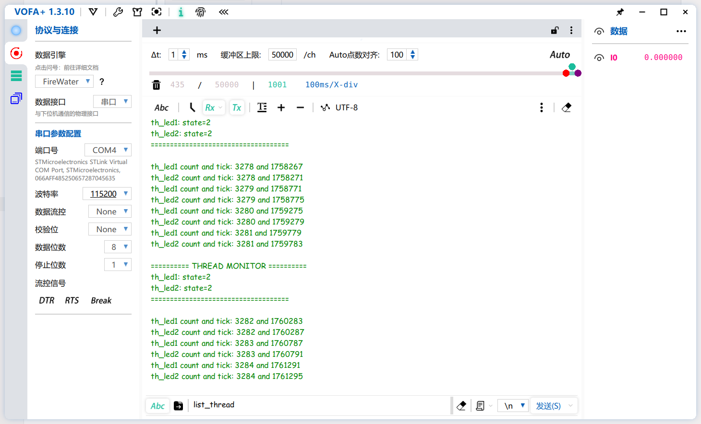

# 【DAY2】RT-Thread 启动流程、内核基础与多线程编程

- **目标平台**：STM32F407 星火号（`stm32f407-rtspark`）
- **提交仓库**：`https://gitee.com/rtthread/rsoc-rtt`
- **作业交付物**：理论总结与实验报告（`README.md`）+ 可编译源码（`*.c`）通过 Gitee PR 提交。

## Part 1：理论知识梳理文档（写入作业目录 `README.md`）

### 1. STM32F407 启动流程与 RT-Thread 引导机制

- **启动路径**：详细画出/写出从上电复位 `Reset_Handler` 到进入 `main()` 的完整调用链。

  > startup_stm32f407xx.s(`Reset_Handler` ) --> `SystemInit`()
  >
  > ​					|
  >
  > ​					-----------------------------> entry() --> rtthread_startup() --> 进行`rt_hw_board_init`  等初始化 --> `main()`			

- **自动初始化原理**：解释 `INIT_BOARD_EXPORT` 与 `INIT_APP_EXPORT` 的底层实现原理。

  > ​	宏 `INIT_XXX_EXPORT(fn)` 所做的事情，本质上就是告诉编译器："把函数 `fn` 的**地址**作为一个 4 字节的常量，塞到名叫 `.rti_fn.<level>` 的段里去"；剩下的交给 ld：在链接时把所有 `.rti_fn.*` 段按字符串排序后连成一排（所以 level 字符串的字典序 = 内存顺序 = 调用顺序）；最后 `rt_components_board_init` / `rt_components_init` 用 "指针 for 循环" 从 `&哨兵A` 走到 `&哨兵B` / 从 `&哨兵B` 走到 `&哨兵C`，对遍历到的每一个 4 字节函数指针执行 `(*ptr)()`

### 2. 内核基础与对象模型

- **对象容器与控制块**：简述 RT-Thread 面向对象的设计思想，线程控制块（`struct rt_thread`）中关键成员（如 `stat`、`current_priority`、`init_tick`、`sp`）的作用。

  > RT-Thread 采用「**继承 + 容器数组 + 双向链表**」的轻量面向对象设计（纯 C，用"结构体首成员"语义模拟继承），核心由 3 层构成：
  >
  > 1. 基类 `struct rt_object`（所有内核对象的公共头部）
  > 2. 类型枚举 `enum rt_object_class_type`（区分对象种类 + 标记"静态 vs 动态"）
  > 3. 对象容器 `_object_container[]` 数组（按类型一条链表，集中管理所有同类对象）
  > 4. 对象生命周期（创建 → 入容器 → 销毁 → 出容器）
  >
  > 线程控制块 `struct rt_thread` 关键成员的作用：
  >
  >  1. `sp` — 栈指针（stack pointer）当前保存位置；
  >
  >     - 线程**不运行时**，`sp` 保存这个线程**上次被切走时栈顶的位置**（也就是 r4~r11 + 异常帧被 push 之后的栈指针值）。
  >
  >     - 下次再调度回它时，PendSV 从 `thread->sp` 恢复 r4~r11、设置 PSP、异常返回就回到它被切走那条指令之后。
  >
  >     - 线程第一次运行之前，`sp` 被 `rt_hw_stack_init` 预置为"布置好的假栈帧"的底部——这就是我们前面 8/18 回答里解释的"首次切换为什么能直接跑到 main_thread_entry"。
  >
  >  2.  `stat` — 线程状态 + 若干附加标志位（共享一个 `rt_uint8_t`）；
  >
  >  3. `current_priority` — 当前有效优先级（数字越小优先级越高）；
  >
  >     - 调度器 `_scheduler_get_highest_priority_thread()` 找到就绪表里优先级数值**最小**的那一条链表，就是最高优先级队列，取 `.next` 作为 to_thread（[scheduler.c#L170-L191](file:///D:/Complie/RT-ThreadStudio/workspace/01_hello_stm32/rt-thread/src/scheduler.c#L170-L191)）。
  >
  >     - 配合 `number_mask`、`high_mask`（[rtdef.h#L665-L669](file:///D:/Complie/RT-ThreadStudio/workspace/01_hello_stm32/rt-thread/include/rtdef.h#L665-L669)）用于在位图 `rt_thread_ready_priority_group` 里快速查找优先级（用 `__rt_ffs` 找第一个置 1 的 bit，O(1) 调度）。
  >
  >     - 对互斥量持有者做「优先级继承」时，被提升的就是这个 `current_priority`；释放锁后用 `init_priority` 还原。
  >
  >  4.  `init_tick` — 初始时间片配额 & `remaining_tick` — 当前剩余时间片；
  >
  >     - 每个 SysTick tick 进入 `rt_tick_increase`，`remaining_tick--`。
  >     - 当 `remaining_tick == 0`，说明当前线程这轮时间片用完了：**重置 `remaining_tick = init_tick`**，同时给 `stat` 打上 `RT_THREAD_STAT_YIELD` 标记，再调用 `rt_schedule()` 让同优先级的下一个线程先跑。

- **内存分配方式**：对比静态对象与动态对象的区别（分配位置、生命周期、释放机制），分析为什么某些高可靠场景强制使用静态线程。

  > |         维度         |                 静态对象（`rt_thread_init`）                 |                动态对象（`rt_thread_create`）                |
  > | :------------------: | :----------------------------------------------------------: | :----------------------------------------------------------: |
  > |    **控制块位置**    | 全局 `struct rt_thread xxx` 变量，或局部 `static` → 在 **.bss / .data 段**（编译期预留的 RAM 静态区，地址在 link.lds 里就确定了） | `rt_object_allocate` 内部用 `RT_KERNEL_MALLOC(sizeof(struct rt_thread))` → 位于 **堆（heap）**，[object.c#L200](file:///D:/Complie/RT-ThreadStudio/workspace/01_hello_stm32/rt-thread/src/object.c#L200) |
  > |      **栈位置**      | `ALIGN(8) static rt_uint8_t main_stack[N];` → 同样在 **.bss**（见 [components.c#L169-L171](file:///D:/Complie/RT-ThreadStudio/workspace/01_hello_stm32/rt-thread/src/components.c#L169-L171)） | `RT_KERNEL_MALLOC(stack_size)` → 位于**堆**（[thread.c#L459-L461](file:///D:/Complie/RT-ThreadStudio/workspace/01_hello_stm32/rt-thread/src/thread.c#L459-L461)） |
  > |    **type 字段**     | 初始化时 `object->type = type | RT_Object_Class_Static`（最高位=1） → [object.c#L116](file:///D:/Complie/RT-ThreadStudio/workspace/01_hello_stm32/rt-thread/src/object.c#L116) | 不 OR 0x80 → [object.c#L204](file:///D:/Complie/RT-ThreadStudio/workspace/01_hello_stm32/rt-thread/src/object.c#L204) |
  > |     **生命周期**     | 与声明范围一致：`static` 全局对象 = 程序全程。**不会被释放，也不可能释放失败**。 | 用户调用 `rt_thread_delete` 之后，不会立刻释放。线程先变为 CLOSE，挂到 `rt_thread_defunct` 队列，idle 线程里的 `rt_defunct_execute` 统一做 `RT_KERNEL_FREE(控制块) + RT_KERNEL_FREE(栈)` → [thread.c#L95-L113](file:///D:/Complie/RT-ThreadStudio/workspace/01_hello_stm32/rt-thread/src/thread.c#L95-L113) + [idle.c#L129-L146](file:///D:/Complie/RT-ThreadStudio/workspace/01_hello_stm32/rt-thread/src/idle.c#L129-L146) |
  > |     **释放函数**     | `rt_thread_detach` → 只做两步：① 如果还在调度链里则摘链；② 调用 `rt_object_detach` 从容器 `object_list` 摘链。**绝对不动内存**，由声明时的作用域自动失效（全局则永远持有）。[thread.c#L405-L430](file:///D:/Complie/RT-ThreadStudio/workspace/01_hello_stm32/rt-thread/src/thread.c#L405-L430) | `rt_thread_delete` → 把状态置 CLOSE 并入 defunct，idle 才真正 free 两块堆内存。[thread.c#L508-L532](file:///D:/Complie/RT-ThreadStudio/workspace/01_hello_stm32/rt-thread/src/thread.c#L508-L532) |
  > | **创建是否可能失败** |      不可能（内存在编译/链接时就固定了，运行时零失败）       | 可能失败：heap 不足时 `RT_KERNEL_MALLOC` 返回 NULL，API 返回 RT_NULL。用户必须每次判空。 |
  > |   **内存碎片风险**   |  无。静态区是一次性固定分配，不存在"分配→释放→再分配"过程。  | 有。长时间运行、反复 create/delete 线程的场景下，堆会出现外部碎片，导致"总剩余字节数够，但最大连续块不够"进而 malloc 失败。 |
  >
  > 强制使用静态线程：
  >
  > 1. **资源完全确定（No Surprise）**
  > 2. **OOM（Out of Memory）失败路径被根除**
  > 3. **碎片 & 泄漏问题被根除**

### 3. 线程状态机与调度算法

- **五态模型**：绘制或描述 RT-Thread 线程状态（初始态、就绪态、运行态、挂起态、关闭态）及触发状态转换的典型 API。

  > |        宏名         |  值  |                             含义                             |
  > | :-----------------: | :--: | :----------------------------------------------------------: |
  > |  `RT_THREAD_INIT`   | 0x00 | 初始态：线程对象已初始化（控制块字段填好、栈布置完毕），但还没进入就绪表。 |
  > |  `RT_THREAD_READY`  | 0x01 | 就绪态：已进入 `rt_thread_priority_table[prio]` 就绪链表，只等调度器选上。 |
  > | `RT_THREAD_SUSPEND` | 0x02 | 挂起态/阻塞态：不在就绪表里，CPU 不会选到它。在等信号量、事件、消息、延时、或挂起自己。 |
  > | `RT_THREAD_RUNNING` | 0x03 |                    运行态：正在 CPU 上。                     |
  > |  `RT_THREAD_CLOSE`  | 0x04 | 关闭态：线程已执行完毕（`entry` 返回）或被用户主动 delete/detach，进入 defunct 链表等 idle 回收，或静态对象已从容器摘链。 |

- **调度机制剖析**：
  
  - **抢占式调度**：只要就绪表里存在比当前运行线程优先级**更高（数字更小）\**的线程，调度器就会立即剥夺当前线程的 CPU，立刻切到高优先级线程——剥夺发生在\**每一个调度点**（SysTick tick、IPC 唤醒、退出临界区、OS API 返回、中断出口等）。
  - **时间片轮转**：当**同一个优先级上挂了多个就绪线程**时，RT-Thread 不会让第一个线程一直跑到阻塞，而是采用「每个线程分配一个 tick 配额 = `init_tick`，配额用完就把它从链表头移到链表尾，下一轮先跑链表第二个」的策略。

## Part 2：多线程实战编程（C 语言实现）

