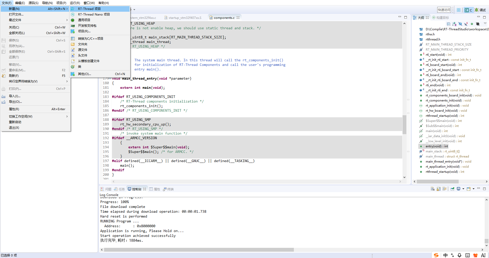
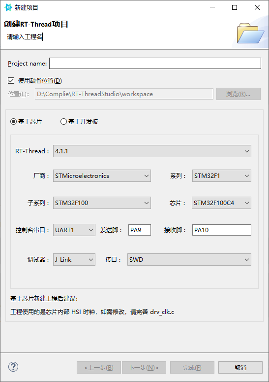

# 1. RTTStudio的使用

## 1. 新建RTT项目

##  

## 2. 基于芯片（开发板）进行创建



​	在创建的时候需要注意RTT的版本号、芯片具体型号、芯片的串口以及烧录器（调试器）

## 3. 烧录

​	使用STLINK进行烧录的时候可能会出现error，报错固件版本太低需要更新，可以多尝试几个软件进行更新，***<u>以防部分软件版本过低</u>***！！！


==============================================================================================================

# 2. Git基础操作与开源协作流程培训


## 一、Git基础环境配置与核心指令

### 1.1 环境初始化与身份配置

| 配置项      | 命令                                         | 说明                                                         |
| ----------- | -------------------------------------------- | ------------------------------------------------------------ |
| 安装与汉化  | —                                            | 安装Git[Git - 安装 Git](https://git-scm.com/book/zh/v2/起步-安装-Git) |
| 全局用户名  | `git config --global user.name "你的用户名"` | 设置提交者身份标识                                           |
| 全局邮箱    | `git config --global user.email "你的邮箱"`  | 确保提交记录可追溯                                           |
| SSH密钥生成 | `ssh-keygen -t rsa -C "你的邮箱地址"`        | 生成SSH密钥对                                                |
| 添加公钥    | —                                            | 将`~/.ssh/id_rsa.pub`内容添加到Git平台账户设置               |

> 由于gitee默认开启了禁止命令行推送暴露个人邮箱，所以可以尝试跳过命令：git config --global user.email "你的邮箱"，或者在gitee设置->邮箱管理 里面关闭“禁止命令行推送暴露个人邮箱”

### 1.2 核心操作指令

```bash
# 仓库初始化与拉取
git init              	# 初始化本地仓库
git clone <url>       	# 克隆远端仓库到本地
git pull             	# 拉取远端最新代码

# 本地变更管理
git add <file>        	# 将文件加入暂存区，或者直接使用git add .
git commit -m "xxx"   	# 提交变更到本地仓库
git push origin master	# 推送本地提交到远端仓库，如果没有分支要求可以直接git push

# 分支管理
git checkout -b <branch>  # 创建并切换到新分支
```

> ⚠️ **注意**：日常开发应在独立分支进行，**严禁直接操作受保护的master分支**。

---

## 二、开源协作流程与PR提交规范

### 2.1 Fork模式下的协作机制

```
┌─────────────────┐      Fork       ┌─────────────────┐
│   上游仓库      │  ────────────►  │   个人Fork仓库   │
│  (upstream)     │                 │   (origin)      │
└─────────────────┘                 └─────────────────┘
         ▲                                  │
         │      fetch / pull               │ push
         │      (同步上游代码)              │ (推送功能分支)
         └──────────────────────────────────┘
```

**关键步骤：**

| 步骤            | 命令/操作                                       | 说明                     |
| --------------- | ----------------------------------------------- | ------------------------ |
| 1. Fork仓库     | Git平台界面操作                                 | 将上游仓库Fork到个人账户 |
| 2. 克隆个人仓库 | `git clone <个人仓库URL>`                       | 下载到本地开发           |
| 3. 添加上游远程 | `git remote add upstream <上游URL>`             | 建立与上游的关联         |
| 4. 创建功能分支 | `git checkout -b xxx`                           | 按日期/功能创建分支      |
| 5. 同步上游代码 | `git fetch upstream` / `git pull upstream main` | 保持代码最新，解决冲突   |
| 6. 推送并提PR   | `git push origin xxx` → 平台界面创建PR          | 请求合并到上游           |

> ⚠️ **严禁在个人Fork仓库中直接修改master分支**，所有开发必须在功能分支完成。

### 2.2 PR提交与审核流程

```
学员开发完成 → push到个人Fork功能分支 → 平台创建PR → 指定Reviewer(如果无法指定就跳过)
                                                      ↓
                                              审查通过 → 合并到上游
                                              审查不通过 → 修改后重新提交
```

- **Reviewer指定**：提交PR时需指定对应的组长或导师
- **冲突解决**：本地分支落后上游时，先`fetch upstream`合并最新代码，再解决冲突

---

## 三、git常用命令速查表

```bash
# 配置
git config --global user.name "xxx"
git config --global user.email "xxx@example.com"

# 仓库操作
git init
git clone <url>					
git remote set-url origin url	#直接修改远程仓库地址
# 第一次 clone 自己的 Fork 后，只执行一次，告诉 Git："原始仓库在这里，以后我叫它 upstream"
git remote add upstream <url>	#添加上游地址
git remote -v					#查看当前仓库的远端地址

# 日常开发
git checkout -b <branch>		#创建并且进入新分支		
git add .						#添加暂存文件
git commit -m "描述信息"		 #类似于添加日志
git push origin <branch>		

# 同步上游
git fetch upstream <branch>		#下载上游branch分支仓库，如果不写就是全部分支
git merge upstream/master		#合并上游代码
# 或
git pull upstream master

# 查看状态
git status
git log --oneline
git branch						#查看所有分支
```
