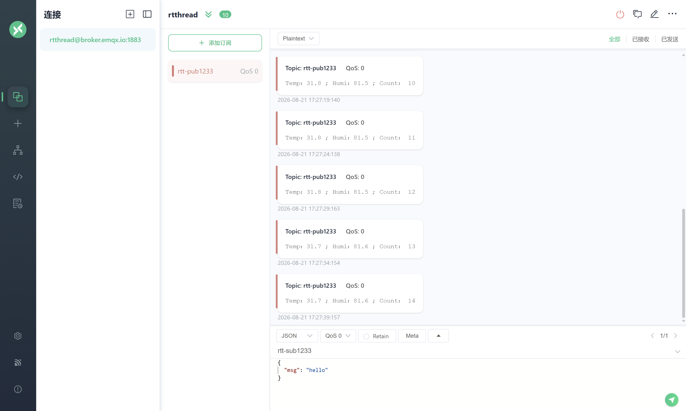
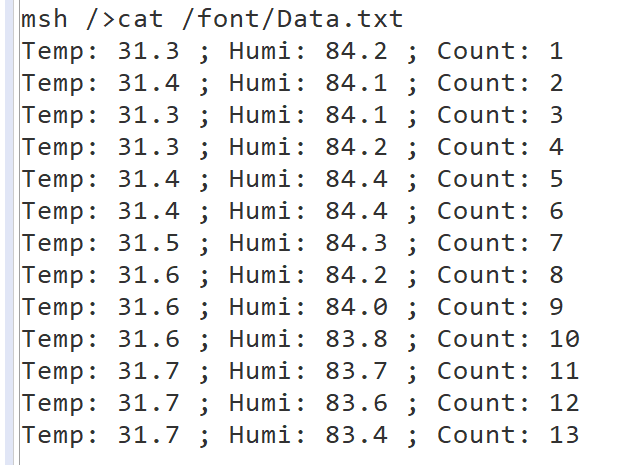

# 【RSOC26】 AHT10温湿度采集上传与文件系统实战

## 一、AHT10温湿度采集 + MQTT上传

### 1.1 软件包配置

在 RT-Thread Settings 中开启以下选项：
- **Hardware Drivers Config** → 开启 I2C3（AHT10 挂在 i2c3 总线上）
- **RT-Thread online packages** → 下载并开启 `aht10` 软件包
- **RT-Thread online packages** → 下载并开启 `kawaii-mqtt` 软件包
- **Network** → 开启 SAL、netdev、lwIP
- **Board Drivers** → 开启 RW007 WiFi 模块

### 1.2 AHT10 采集

核心 API：
```c
aht10_device_t dev = aht10_init("i2c3");       // 初始化，传入I2C总线名
float temp = aht10_read_temperature(dev);       // 读温度
float humi = aht10_read_humidity(dev);          // 读湿度
```

注意：未安装 `rt_vsprintf_full` 时，`%f` 无法正常打印，需用 `%d.%d` 拆分整数和小数：
```c
rt_kprintf("Temp: %d.%d\n", (int)temp, (int)(temp * 10) % 10);
```

### 1.3 kawaii-mqtt 连接 EMQX

kawaii-mqtt 核心流程：
```c
mqtt_client_t *client = mqtt_lease();           // 获取客户端
mqtt_set_host(client, "broker.emqx.io");        // 设置Broker地址
mqtt_set_port(client, "1883");                  // 端口
mqtt_set_client_id(client, "唯一ID");           // 客户端ID必须唯一
mqtt_set_clean_session(client, 1);
mqtt_connect(client);                           // 连接
mqtt_subscribe(client, "订阅主题", QOS0, 回调); // 订阅
mqtt_publish(client, "发布主题", &msg);          // 发布
```

发布消息时需填充 `mqtt_message_t`：
```c
mqtt_message_t msg;
memset(&msg, 0, sizeof(msg));
msg.qos = QOS0;
msg.payload = (void *)buf;
msg.payloadlen = strlen(buf);    // 必须设置长度！
```



### 1.4 踩坑记录

| 问题 | 原因 | 解决 |
|------|------|------|
| `%f` 打印乱码 | 未启用 `rt_vsprintf_full` | 改用 `%d.%d` 拆分打印 |
| MQTT连接失败 | WiFi还没连上就开始连 | 延时等待10秒再连接 |
| 客户端被顶掉 | client_id和别人重复 | 用带个人标识的唯一ID |

---

## 二、文件系统 + font分区挂载 + Data.txt写入

### 2.1 配置步骤

在 RT-Thread Settings 中开启：
- **RT-Thread Components → DFS**：`RT_USING_DFS`、`RT_USING_DFS_ELMFAT`、`RT_USING_DFS_ROMFS`
- **Board Drivers**：`BSP_USING_SPI_FLASH`、`BSP_USING_FAL`、`BSP_USING_FLASH_FATFS`、`BSP_USING_FLASH_FS_AUTO_MOUNT`

### 2.2 文件系统启动流程

1. **DFS组件初始化**：系统启动时初始化文件系统注册表、文件描述符表
2. **注册文件系统类型**：FatFS、RomFS 等通过初始化函数注册到 DFS
3. **SPI Flash 初始化**（`INIT_COMPONENT_EXPORT`）：探测 W25Q64，注册为块设备
4. **FAL 初始化**：根据 `fal_cfg.h` 的分区表划分分区
5. **自动挂载**（`INIT_APP_EXPORT`）：先挂载 romfs 到 `/`，再挂载 elm-fat 到 `/fal`

### 2.3 挂载 font 分区

font 分区在 `fal_cfg.h` 中已定义，但不会自动挂载，需要代码中手动操作：
```c
// 1. 创建块设备
struct rt_device *dev = fal_blk_device_create("font");

// 2. 首次需格式化
dfs_mkfs("elm", "font");

// 3. 挂载到 /font 目录
dfs_mount("font", "/font", "elm", 0, 0);
```

### 2.4 写入 Data.txt

使用 POSIX 接口追加写入：
```c
int fd = open("/font/Data.txt", O_WRONLY | O_CREAT | O_APPEND, 0);
if (fd >= 0)
{
    write(fd, payload_buf, strlen(payload_buf));
    write(fd, "\n", 1);
    close(fd);
}
```

每条数据格式：`Temp: 26.1 ; Humi: 45.2 ; Count: 1`

### 2.5 踩坑记录

| 问题 | 原因 | 解决 |
|------|------|------|
| W25Q64 SFUD 探测失败 | W25Q64 和 RW007 共享 SPI2，初始化时序冲突 | 在 `spi_flash_init.c` 中加延时+重试机制 |
| `FAL_USING_NOR_FLASH_DEV_NAME` 为 "norflash0" | 和 `fal_cfg.h` 中的设备名 "W25Q64" 不匹配 | 改为 "W25Q64" |
| font 挂载失败（mkdir报错） | romfs 根目录是只读的，无法 `mkdir` | 在 `drv_filesystem.c` 的 romfs 根目录数组中添加 font 目录项 |
| 每次开机都格式化 | `dfs_mkfs` 无条件调用 | 先尝试 `dfs_mount`，失败才格式化 |
| 中文冒号乱码 | elm-fat code page 为 437，不支持中文 | 改用 ASCII 冒号 |

**W25Q64 初始化重试关键代码（spi_flash_init.c）：**
```c
rt_thread_mdelay(500);  // 等SPI总线稳定
if (RT_NULL == rt_sfud_flash_probe("W25Q64", "spi20"))
{
    rt_kprintf("W25Q64 probe failed, retry after 2s...\n");
    rt_thread_mdelay(2000);
    if (RT_NULL == rt_sfud_flash_probe("W25Q64", "spi20"))
    {
        return -RT_ERROR;
    }
}
```

**romfs 根目录添加 font 入口（drv_filesystem.c）：**
```c
const struct romfs_dirent _romfs_root[] =
{
    {ROMFS_DIRENT_DIR, "fal", RT_NULL, 0},
    {ROMFS_DIRENT_DIR, "font", RT_NULL, 0},   // 新增
};
```

---



## 三、云端指令控制 LED 翻转

### 3.1 实现思路

1. 板卡订阅下行主题 `rsoc/zhangsiyuan/device/down`
2. 用 MQTTX 向该主题发送控制指令
3. 板卡在消息回调中解析指令，控制 LED

### 3.2 核心代码

```c
static rt_bool_t led_state = RT_FALSE;

static void sub_callback(void *client, message_data_t *msg)
{
    char *payload = (char *)msg->message->payload;
    if (rt_strstr(payload, "toggle") || rt_strstr(payload, "led"))
    {
        led_state = !led_state;
        rt_pin_write(PIN_LED_R, led_state ? PIN_LOW : PIN_HIGH);
    }
    else if (rt_strstr(payload, "on"))
    {
        led_state = RT_TRUE;
        rt_pin_write(PIN_LED_R, PIN_LOW);
    }
    else if (rt_strstr(payload, "off"))
    {
        led_state = RT_FALSE;
        rt_pin_write(PIN_LED_R, PIN_HIGH);
    }
}
```

### 3.3 MQTTX 测试

| 操作 | MQTTX 发送内容 | 效果 |
|------|---------------|------|
| LED翻转 | `toggle` 或 `led` | 开↔关切换 |
| LED亮 | `on` | 点亮 |
| LED灭 | `off` | 熄灭 |

---

## 四、今日总结

今天完成了 AHT10 温湿度采集、kawaii-mqtt 上传、文件系统挂载、Data.txt 写入、云端 LED 控制四大任务。最大的收获是：

1. **不同 MQTT 库的 API 差异很大**，不能照搬示例代码，要仔细阅读头文件
2. **SPI 总线共享设备的初始化时序**很关键，W25Q64 和 RW007 共享 SPI2 导致探测时序问题，需要延时重试
3. **romfs 是只读的**，不能在运行时 `mkdir`，挂载点必须在 romfs 根目录中预先定义
4. **文件系统挂载应"先试挂载、失败再格式化"**，避免每次开机都擦写 Flash
