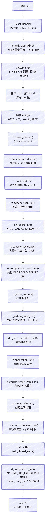
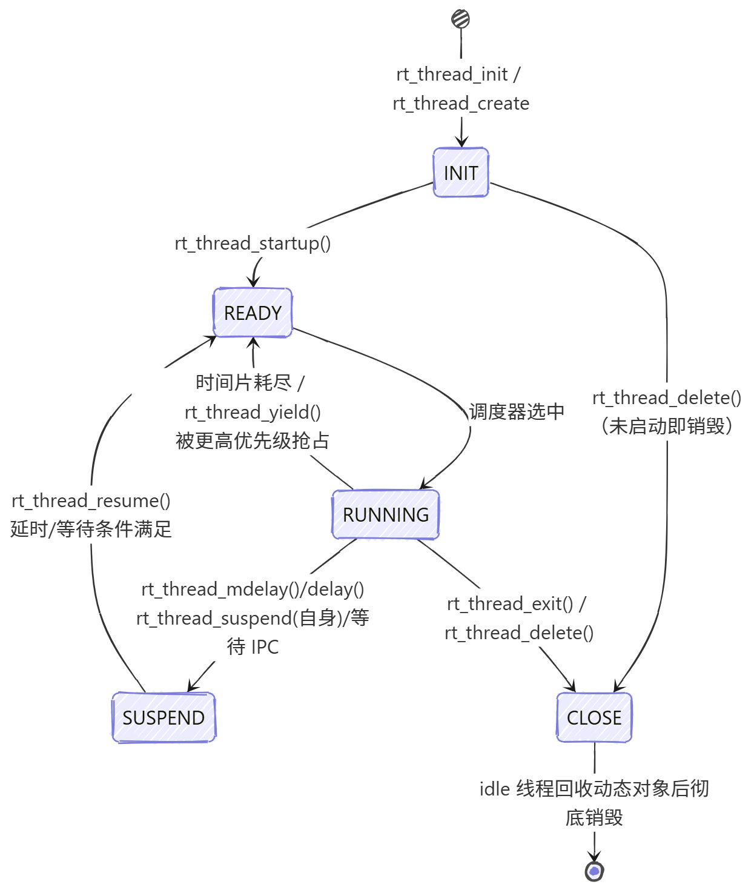

# 【DAY2】RT-Thread 启动流程、内核基础与多线程编程 —— 张思源（第3组）

- **目标平台**：STM32F407 星火一号（`stm32f407-rtspark`，RT-Thread Studio 工程 `02_thread_sample`）
- **内核配置**：`RT_TICK_PER_SECOND=1000`、`RT_THREAD_PRIORITY_MAX=32`、`RT_NAME_MAX=8`、`RT_USING_HEAP`、`RT_USING_COMPONENTS_INIT`、`RT_USING_MSH`
- **提交内容**：本 `README.md`（Part 1 理论 + Part 2 实验分析）+ `thread_study.c`（作业源码）

---

## Part 1：理论知识梳理

### 1. STM32F407 启动流程与 RT-Thread 引导机制

#### 1.1 上电复位 → main() 的完整调用链



要点：

- 复位向量表第一条是栈顶指针，第二条是 `Reset_Handler`，由硬件在复位时自动加载，无需软件干预。
- 进入 `rtthread_startup()` 前系统处于"裸机 + 中断关闭"状态，内核资源（timer、调度器、堆、idle）依次建好后才打开调度，保证第一个用户线程启动时系统已完整可用。
- 本工程使用 GCC 工具链，因此引导入口是 `entry()`（ARMCC 下为 `$Sub$$main`，IAR 下为 `__low_level_init`）。

#### 1.2 自动初始化原理（INIT_BOARD_EXPORT / INIT_APP_EXPORT）

自动初始化的本质是**"把初始化函数指针放到链接脚本指定的代码段中，由内核按段顺序统一调用"**，实现"声明即注册、启动自动加载"，避免在 `main.c` 里硬编码调用。

**① 宏定义（`rtdef.h`）：**

```c
#define INIT_EXPORT(fn, level)                                    \
    RT_USED const init_fn_t __rt_init_##fn RT_SECTION(".rti_fn." level) = fn

#define INIT_BOARD_EXPORT(fn)     INIT_EXPORT(fn, "1")   /* 板级，最先 */
#define INIT_PREV_EXPORT(fn)      INIT_EXPORT(fn, "2")
#define INIT_DEVICE_EXPORT(fn)    INIT_EXPORT(fn, "3")
#define INIT_COMPONENT_EXPORT(fn) INIT_EXPORT(fn, "4")
#define INIT_ENV_EXPORT(fn)       INIT_EXPORT(fn, "5")
#define INIT_APP_EXPORT(fn)       INIT_EXPORT(fn, "6")   /* 应用级，最后 */
```

`INIT_EXPORT(fn, level)` 把函数 `fn` 的**地址**（`init_fn_t` 即 `int (*)(void)`）以 `const` 指针形式放置到名为 `.rti_fn.<level>` 的自定义段中，并加了 `RT_USED` 防止被链接器当作未引用而裁剪。

**② 链接脚本（`linkscripts/STM32F407ZG/link.lds`）：**

```ld
KEEP(*(SORT(.rti_fn*)))
```

`SORT()` 按名字对 `.rti_fn*` 段排序（`"0" < "1" < "1.end" < "2" ... < "6.end"`），因此不同级别的初始化函数在内存中是**按顺序连续排列**的；`KEEP` 强制保留这些段。

**③ 内核执行（`components.c`）：**

系统用 `rti_start("0")` / `rti_board_start("0.end")` / `rti_board_end("1.end")` / `rti_end("6.end")` 作为段区间边界符号：

```c
/* 板级初始化：board 级别 */
void rt_components_board_init(void)
{
    for (fn_ptr = &__rt_init_rti_board_start;
         fn_ptr <  &__rt_init_rti_board_end; fn_ptr++)
        (*fn_ptr)();            /* 调用每个 INIT_BOARD_EXPORT 的函数 */
}

/* 应用初始化：app 及以下级别 */
void rt_components_init(void)
{
    for (fn_ptr = &__rt_init_rti_board_end;
         fn_ptr <  &__rt_init_rti_end; fn_ptr++)
        (*fn_ptr)();            /* 调用 INIT_APP_EXPORT 等其余函数 */
}
```

- `rt_components_board_init()` 在 `rt_hw_board_init()` 中被调用（此时堆/时钟/串口已就绪）；
- `rt_components_init()` 在 main 线程的 `main_thread_entry()` 中、进入用户 `main()` 之前调用。
- 本作业 `thread_study_init()` 用 `INIT_APP_EXPORT` 注册，因此在 main 线程中被自动执行、自动创建三个线程，`main.c` 无需任何改动。

---

### 2. 内核基础与对象模型

#### 2.1 面向对象设计与对象容器

RT-Thread 将内核中所有可管理的实体抽象为**对象**：线程、定时器、信号量、互斥锁、事件、消息队列、信号、内存池、设备等都属于对象。每个对象共享对象基类：

```c
struct rt_object
{
    char        name[RT_NAME_MAX];  /* 对象名 */
    rt_uint8_t  type;               /* 对象类型 */
    rt_uint8_t  flags;              /* 内核对象标志 */
    rt_list_t   list;               /* 双向链表节点，用于挂到对象容器中 */
};
```

所有对象被统一挂到**对象容器**（`rt_object_container[]`，按类型分为 16 类）对应的双向链表上，支持 `rt_object_find()` 按名字查找、`rt_object_allocate()` 动态创建、`rt_object_init()` 静态创建、`rt_object_delete()/detach()` 销毁。对象模型的价值在于：内核对象的管理（创建/查找/销毁/遍历）统一实现，各内核组件（线程/IPC/定时器/设备）复用同一套机制，新增对象类型只需扩展容器数组即可，符合"开放-封闭"原则。

线程对象在容器中的关系：每个 `rt_thread` 首部内嵌一个 `rt_object`，因此线程对象本身也在容器里；`rt_object_get_type()` 可校验指针是否是合法线程对象（内核多处用 `RT_ASSERT` 校验）。

#### 2.2 线程控制块 struct rt_thread 关键成员

```c
struct rt_thread
{
    rt_object_t   parent;         /* 对象继承：name/type/flags/list */
    rt_list_t     tlist;          /* 就绪队列/等待队列链表节点 */
    void         *sp;             /* 栈指针（保存现场/恢复现场的关键） */
    void         *entry;          /* 线程入口函数 */
    void         *parameter;      /* 入口函数参数 */
    void         *stack_addr;     /* 栈区基地址 */
    rt_uint32_t   stack_size;     /* 栈区大小 */
    rt_uint8_t    stat;           /* 线程状态（五态） */
    rt_uint8_t    current_priority; /* 当前优先级（越小越高） */
    rt_ubase_t    init_tick;      /* 初始化时设置的时间片长度 */
    rt_ubase_t    remaining_tick; /* 剩余时间片 */
    struct rt_timer thread_timer; /* 内建定时器（延时/超时的实现基础） */
    ...
};
```

| 成员 | 作用 |
| --- | --- |
| `stat` | 线程当前状态（INIT/READY/SUSPEND/RUNNING/CLOSE），调度器据此决定线程能否被调度；本作业 monitor 线程即读取 `stat` 判断挂起/恢复。 |
| `current_priority` | 当前优先级，数值越小优先级越高，是抢占式调度选核的依据。 |
| `init_tick` | 创建线程时传入的时间片长度（ticks），时间片轮转调度时每次恢复执行都重置为它。 |
| `remaining_tick` | 剩余时间片，tick 中断里递减，减到 0 触发同优先级轮转。 |
| `sp` | 栈指针；线程切换时把现场寄存器压栈后保存 `sp`，切回时恢复 `sp` 再弹栈，是上下文切换的核心。 |
| `stack_addr/stack_size` | 栈区边界信息，用于栈越界检查（`RT_USING_OVERFLOW_CHECK`）和剩余栈统计（本作业 `get_stack_remain()` 依赖它）。 |

#### 2.3 内存分配方式：静态对象 vs 动态对象

| 对比项 | 静态对象 | 动态对象 |
| --- | --- | --- |
| 分配位置 | 编译期确定，TCB/栈是全局变量/数组，位于**全局数据段（BSS）** | 运行期从**堆（heap）**用 `rt_malloc` 分配 |
| 创建方式 | `rt_thread_init()`（手动传 TCB 与栈数组） | `rt_thread_create()`（内核自动分配 TCB + 栈） |
| 生命周期 | 与程序同生命周期，不依赖堆 | 可用 `rt_thread_delete()` 回收（由空闲线程延迟清理），可按需动态增减 |
| 释放机制 | 无需释放（静态段由链接器管理） | `rt_thread_delete()` 后 TCB/栈归还堆 |
| 失败风险 | 编译期固定，不会运行时分配失败 | 堆耗尽时返回 `RT_NULL`，需判空 |
| 内存碎片 | 无 | 频繁创建/销毁易产生碎片 |
| 适用场景 | 高可靠/资源受限/不允许动态失败 | 灵活、数量动态变化的应用 |

**为什么高可靠场景强制使用静态线程？**

1. **确定性**：静态线程的 TCB 和栈在链接期就固定了地址与大小，运行时不依赖堆，不会出现"堆不足导致创建失败"，行为完全可预测，便于做 WCET/栈上限静态分析。
2. **无碎片**：堆上反复 malloc/free 会产生外部碎片，长时间运行可能累积到无法分配足够大的连续块，这对安全关键系统（航空、医疗、汽车、工业控制）是致命隐患。
3. **可验证性**：静态分配意味着内存映射在编译产物里可见，便于对栈占用做静态核查；动态分配在运行期才确定，难以审计。
4. **延迟与故障隔离**：动态删除依赖空闲线程延迟回收，时序不可控；静态线程永远存在，无生命周期管理开销。

因此安全等级高的产品（如 DO-178C / ISO 26262 相关）通常规定内核对象全部静态创建。

---

### 3. 线程状态机与调度算法

#### 3.1 五态模型



| 状态 | 含义 | 典型进入 API | 典型退出 API |
| --- | --- | --- | --- |
| INIT 初始态 | 已创建/初始化，尚未就绪 | `rt_thread_init` / `rt_thread_create` | `rt_thread_startup` |
| READY 就绪态 | 已进入就绪队列，等待获得 CPU | 调度器选择其他线程、被唤醒 | 被调度器选中 → RUNNING |
| RUNNING 运行态 | 正在占用 CPU | 调度器选择 | `rt_thread_yield`、时间片耗尽、`rt_thread_mdelay`、`rt_thread_suspend` |
| SUSPEND 挂起态 | 因延时/等待 IPC/主动挂起而暂停 | `rt_thread_mdelay`、`rt_thread_suspend`、信号量等 | `rt_thread_resume`、延时/等待超时或信号到达 |
| CLOSE 关闭态 | 线程已退出，等待回收 | `rt_thread_exit`、`rt_thread_delete` | 由 idle 线程清理（动态对象） |

#### 3.2 调度机制剖析

RT-Thread 调度器使用**优先级位图 + 就绪双向链表**结构：每个优先级对应一个链表，`rt_thread_ready_priority_group` 位图用 32 位标记哪些优先级非空，查最高优先级就绪线程只需一条 `__rt_ffs()` 位运算，查找复杂度 O(1)，调度开销恒定，非常适合作业系统/实时内核。

##### （1）抢占式调度（Priority-based Preemptive）

- 就绪队列按优先级排序（数值越小优先级越高），**最高优先级就绪线程永远最先运行**。
- 当更高优先级线程变为就绪时（例如中断中释放信号量、创建高优先级线程、`rt_thread_resume` 高优先级线程），调度器会**立即打断**当前线程，保存其现场后切换过去 —— 这就是"抢占"。
- RT-Thread 的抢占发生在两个层面：
  - **任务级**：线程主动调用 `rt_schedule()` 或可导致调度的 API（`rt_sem_release`、`rt_thread_resume` 等），在函数内部触发调度；
  - **中断级**：每次 tick 中断退出前（`rt_tick_increase` → `rt_schedule`）都会检查是否需要切换，保证抢占延时确定性（ms 级）。
- 本作业中 `th_monitor`（优先级 10）与两个工作线程（优先级 16）就是抢占关系：monitor 一旦就绪即抢占工作线程。

##### （2）时间片轮转（Round-Robin）

- 仅对**同优先级**的多个就绪线程生效：它们按先来先服务进入就绪链表，每个线程获得一个时间片（`init_tick` ticks）的执行权。
- 线程运行期间，tick 中断里 `remaining_tick--`；减到 0 时调度器把该线程移到就绪链表末尾，并让出 CPU 给下一个同优先级线程，`remaining_tick` 重新装载为 `init_tick`。
- 本作业 `th_led1` 与 `th_led2` 同为优先级 16、时间片 5 ticks，若两者都只执行轻量代码（无长延时），它们会交替运行；但由于两个线程各自 `rt_thread_mdelay()` 主动挂起，实际交替主要由延时唤醒的先后决定——这也演示了"延时 + 抢占 + 轮转"的协作效果。

---

## Part 2：多线程实战编程

### 2.1 代码结构（`thread_study.c`）

| 对象 | 创建方式 | 优先级 | 时间片 | 栈 | 功能 |
| --- | --- | --- | --- | --- | --- |
| `th_led1` | 动态 `rt_thread_create` | 16 | 5 | 1024B | 翻转 LED_R(PF12)，打印计数与 `rt_tick_get()` |
| `th_led2` | 静态 `rt_thread_init`（全局 TCB+栈） | 16 | 5 | 1024B | 翻转 LED_B(PF11)，打印计数 |
| `th_monitor` | 动态 `rt_thread_create` | 10 | 5 | 1024B | 每 2s 打印两线程状态与剩余栈；处理按键挂起/恢复 `th_led1` |

设计要点：

1. **自动初始化**：`thread_study_init()` 通过 `INIT_APP_EXPORT()` 注册，由 `rt_components_init()` 在 main 线程中自动调用，`main.c` 零改动。
2. **MSH 命令**：`MSH_CMD_EXPORT(thread_dump, ...)` 导出自定义命令，可在 FinSH 里执行 `thread_dump` 查看线程状态与剩余栈。
3. **静态 vs 动态对比**：`th_led2` 的 TCB（`led2_thread`）与栈（`led2_stack[]`）均为全局静态定义，`rt_thread_init` 时指定；`th_led1`、`th_monitor` 由 `rt_thread_create` 从堆分配。
4. **剩余栈统计**：RT-Thread 创建线程时用 `'#'(0x23)` 填充整个栈区，ARM 栈向下生长，因此从 `stack_addr` 向高地址扫描连续 `'#'` 的字节数即为剩余栈（`get_stack_remain()`）。
5. **按键控制**：KEY_UP(PC5) 配置为下降沿中断，ISR 中只置位 `key_pressed` 标志；monitor 线程每 2s 检查标志，根据 `th_led1->stat` 决定 `rt_thread_resume(th_led1)` 或发出挂起请求。

### 2.2 编译验证

在工程根目录执行：

```bash
scons -j8          # 或使用 RT-Thread Studio 的"构建"按钮
```

本作业在本地已验证**编译链接通过**（`rtthread.elf` 生成成功，`-Wall` 零告警）：

```
text    data     bss     dec     hex    filename
60652   1880    4464   66996   105b4   rtthread.elf
```

### 2.3 硬件运行现象

**现象描述：**

- [ ] 上电后 LED_R 周期性翻转（500ms），LED_B 周期性翻转（1000ms）
- [ ] 按下 KEY_UP 后 LED_R 停止翻转（`th_led1` 被挂起），monitor 日志显示 `suspend`
- [ ] 再次按下 KEY_UP 后 LED_R 恢复翻转，monitor 日志显示 `resume`
- [ ] msh 串口输入 `thread_dump` 可查看线程状态与剩余栈

### 2.4 串口日志

实际串口日志：

```
 \ | /
- RT -     Thread Operating System
 / | \     4.1.1 build Aug 18 2026 10:53:54
 2006 - 2022 Copyright by RT-Thread team
[I/thread_study] thread_study_init done
[I/thread_study] th_led2: count=0
[I/thread_study] th_led1: count=0, tick=13
[I/thread_study] th_led1: count=1, tick=518
[I/thread_study] th_led2: count=1
[I/thread_study] th_led1: count=2, tick=1023
[I/thread_study] monitor: [th_led1] stat=SUSPEND stack_remain=780B | [th_led2] stat=SUSPEND stack_remain=792B
...
[I/thread_study] th_led1: count=28, tick=14153
```

**msh 下执行 `thread_dump` 输出：**

```
--------------------------------------------------------
name      stat       prio    remain_stack(B)
--------------------------------------------------------
th_led1   SUSPEND    16      XXX
th_led2   RUNNING    16      XXX
--------------------------------------------------------
```

**按键挂起/恢复日志（按下 KEY_UP 后）：**

```
[I/thread_study] monitor: request th_led1 suspend
[I/thread_study] th_led1: self suspend
...（红灯停止翻转）
[I/thread_study] monitor: resume th_led1
[I/thread_study] th_led1: resumed
...（红灯恢复翻转）
```

### 2.5 结果分析

1. **优先级抢占**：monitor（优先级 10）就绪后会立即抢占两个工作线程（优先级 16），因此 monitor 的日志每 2s 必然出现，且不会因工作线程忙碌而丢失。实测中 monitor 采样时刻两个工作线程均处于 `SUSPEND`（正在 `rt_thread_mdelay` 休眠），符合预期；若采样时刻恰好有线程就绪/运行，也会观察到 `READY/RUNNING`。
2. **时间片轮转**：`th_led1`/`th_led2` 同优先级（16）同时间片（5 ticks）。实测日志中 `th_led1` 每 ~505ms、`th_led2` 每 ~1000ms 打印一次，交替由 `rt_thread_mdelay` 的挂起/唤醒决定，二者互不阻塞，说明同优先级轮转与延时调度协作正常。
3. **状态机迁移**：实测 `th_led1` 的 tick 从 13→518→1023→1528… 等差递增，验证了 `rt_tick_get()` 反映系统节拍（1ms）；线程在 RUNNING（执行打印）与 SUSPEND（`rt_thread_mdelay` 休眠）之间往复切换，符合五态模型。
4. **剩余栈**：实测 `th_led1` 剩余栈 780B、`th_led2` 剩余栈 792B（1024B 栈），余量充足，说明当前栈配置合理；静态线程 `th_led2` 的栈在全局数据段（地址固定），动态线程 `th_led1` 的栈来自堆，二者剩余栈统计均正常。
5. **踩坑记录（rt_vsnprintf 字符串精度）**：最初 monitor 日志用 `%-5s` 打印线程名，实测输出被截成 `th_le`。原因：RT-Thread 的 `rt_vsnprintf`（`kservice.c`，开了 `RT_PRINTF_PRECISION`）把 `%s` 前的数字解释为**最大长度（精度）**而非最小字段宽度，`th_led1` 超长被截断。改为 `%-8s` 后正常显示完整线程名。这也说明 RT-Thread 的格式化打印与标准 C 在 `%s` 精度语义上存在差异，打印长字符串时需注意。
