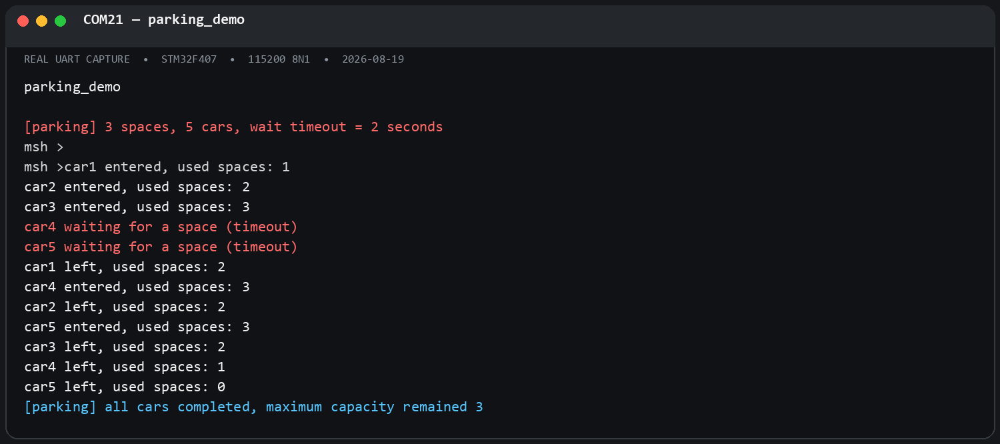
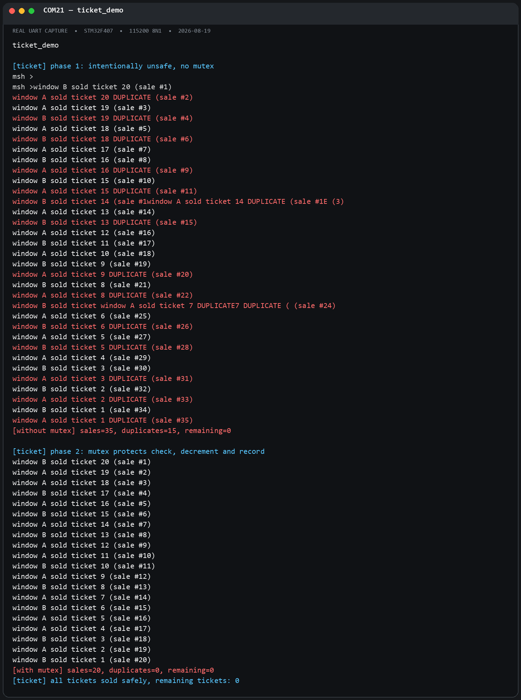
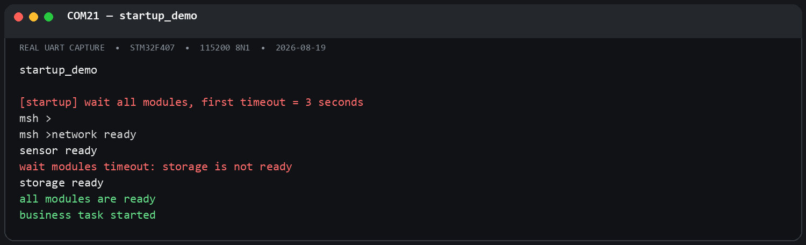
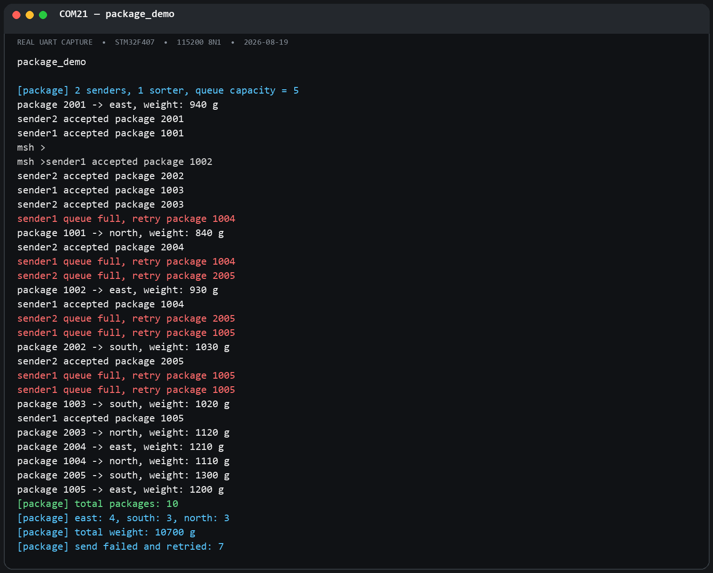

# RT-Thread 线程间同步与通信课后作业

- 姓名：杨智文
- 组别：第3组
- 开发板：STM32F407 星火号
- RT-Thread：5.2.2
- 源码：[`ipc_homework.c`](./ipc_homework.c)

## 一、实验目标

本作业没有直接复制 `kernel_samples`，而是围绕四个实际场景分别设计线程、IPC 对象、结束条件、异常处理和重复执行保护：

| MSH 命令 | 场景 | IPC 机制 | 线程数 |
| --- | --- | --- | ---: |
| `parking_demo` | 3 个车位供 5 辆车竞争 | 计数信号量 | 1 个管理线程 + 5 个车辆线程 |
| `ticket_demo` | 两个窗口销售 20 张票 | 互斥量 | 1 个管理线程 + 每阶段 2 个售票线程 |
| `startup_demo` | 等待三个模块全部初始化 | 事件集 | 1 个管理线程 + 3 个初始化线程 + 1 个业务线程 |
| `package_demo` | 双生产者向分拣线程发送快递 | 消息队列、信号量 | 1 个管理线程 + 2 个发送线程 + 1 个分拣线程 |

每个线程和 IPC 对象创建后都检查返回值。命令运行期间再次执行会提示 `already running`；任务完成后管理线程删除动态 IPC 对象并清除运行标志，因此可以重新执行，不会残留同名对象。

## 二、练习一：停车场车位管理

### 1. 设计

- 创建初始值为 3 的计数信号量 `parksem`，每个计数代表一个空闲车位。
- 创建 5 个车辆线程，车辆在 2 秒内未获得车位时打印超时信息，延时后继续申请。
- 车辆进入时消耗一个信号量，离开时释放一个信号量。
- 使用短临界区保护 `used_spaces` 统计变量，实际可用车位仍由信号量管理。
- 管理线程通过完成信号量等待 5 辆车全部结束，再释放所有对象。

### 2. 实测结果

前 3 辆车占满车位，car4 和 car5 首次等待均超时；前车离开后，两辆车依次进入。`used spaces` 的最大值始终为 3，结束时恢复为 0。



### 3. 思考题：为什么使用计数信号量，而不是互斥量？

停车位是包含 3 个相同单元的资源池，计数信号量可以直接表示“还剩几个资源”，并允许最多 3 个车辆线程同时成功获取资源。互斥量只有锁定和解锁两种状态，并且具有所有者语义，只适合保护同一临界区，无法自然表达 3 个并发名额。互斥量通常还带有优先级继承，用来解决锁竞争中的优先级反转；停车位计数不需要这种所有权机制。

## 三、练习二：多窗口售票系统

### 1. 无锁对比实验

两个线程先读取相同的余票值，再故意延时 10 ms，最后写回 `observed - 1`。两个窗口可能同时读到同一个票号，导致重复售票。本次实测结果为：

```text
[without mutex] sales=35, duplicates=15, remaining=0
```

无锁阶段的个别打印行发生交叉，这也说明多个线程同时输出时没有形成完整的原子日志；最终统计数据由临界区单独保护。

### 2. 加锁实验

互斥量保护“检查余票 → 取得票号 → 余票减 1 → 记录和打印”整个业务事务。实测结果为：

```text
[with mutex] sales=20, duplicates=0, remaining=0
[ticket] all tickets sold safely, remaining tickets: 0
```



### 3. 思考题：为什么只给 `ticket_count--` 加锁仍可能不安全？

售票不是单个减法操作，而是一个不可分割的检查与更新序列。如果“检查是否有票”和“读取票号”位于锁外，两个线程仍可能同时判断有票并取得同一个旧值；即使减法本身串行执行，后续记录的票号也可能重复。正确临界区必须覆盖所有依赖共享状态一致性的步骤，而不仅是 `ticket_count--`。

## 四、练习三：系统启动条件检查

### 1. 事件位

```c
#define EVENT_NET_READY      (1U << 0)
#define EVENT_SENSOR_READY   (1U << 1)
#define EVENT_STORAGE_READY  (1U << 2)
```

- 网络线程延时 500 ms 后发送网络就绪事件。
- 传感器线程延时 1000 ms 后发送传感器就绪事件。
- 存储线程延时 5000 ms 后发送存储就绪事件。
- 业务线程使用 `RT_EVENT_FLAG_AND | RT_EVENT_FLAG_CLEAR` 等待全部 3 位。
- 第一次最多等待 3000 ms，超时后检查事件位并指出 storage 尚未完成，随后再次等待。

### 2. 实测结果

```text
network ready
sensor ready
wait modules timeout: storage is not ready
storage ready
all modules are ready
business task started
```



### 3. 思考题：三个信号量与事件集有什么区别？

三个独立信号量也能分别表示三个模块完成，但业务线程通常需要逐个 `take`，等待顺序会影响超时处理，而且难以一次得到“哪些模块已经完成、哪些仍未完成”的状态快照。事件集把多个布尔条件编码在一个对象中，能够通过 AND 模式一次等待全部条件，通过 OR 模式等待任意条件，并可直接检查未到达的事件位，因此更适合多条件汇合。信号量则更适合资源计数或一对一/累计通知。

## 五、练习四：快递分拣中心

### 1. 设计

- 消息队列容量为 5，每条消息包含不重复 ID、区域和重量。
- sender1 产生 1001～1005，sender2 产生 2001～2005。
- 两个发送线程各发送 5 条消息；队列满时累计失败次数、打印日志并延时重试，不丢弃快递。
- 分拣线程按区域统计数量和总重量，并故意使用较慢的处理速度制造队列满场景。
- 两个发送线程完成后，管理线程向队列发送 ID 为 0 的结束消息。

### 2. 实测统计

```text
total packages: 10
east: 4, south: 3, north: 3
total weight: 10700 g
send failed and retried: 7
```

10 个快递 ID 均不重复；7 次发送失败均由队列暂时已满引起，重试后全部成功分拣。



消息队列按值复制固定大小的 `package_msg`，解耦了生产者和消费者的执行速度。有限容量提供背压；发送失败重试策略避免了队列满时崩溃或静默丢包。结束消息与普通消息走同一队列，因此能保证此前成功入队的快递先被处理。

## 六、编译、烧录与串口验证

工程没有提供 `CMakeLists.txt`，因此终端构建使用 RT-Thread BSP 原生的 SCons/SConscript 机制，确保 Kconfig 选择和 `applications/*.c` 自动纳入构建，而不是另建一套不一致的 CMake 源文件列表。

完整构建结果：

```text
CC build\applications\ipc_homework.o
LINK rt-thread.elf
arm-none-eabi-objcopy -O binary rt-thread.elf rtthread.bin
text: 78464, data: 772, bss: 4372, total: 83608 bytes
scons: done building targets.
```

烧录使用 STM32CubeProgrammer 命令行工具：

```text
Device: STM32F405xx/F407xx/F415xx/F417xx
Flash size: 1 MBytes
Firmware: rtthread.bin, 77.38 KB
Address: 0x08000000
Download verified successfully
Software reset is performed
```

串口为 ST-Link 虚拟串口 COM21，参数 `115200 8N1`。通过 `help` 已确认四条命令均注册成功，并逐条执行获得上述结果。截图由 COM21 直接捕获的真实 UART 文本等宽渲染而成，内容未使用示例日志替代。

## 七、结论

- 计数信号量适合表示多个同类有限资源。
- 互斥量应覆盖完整共享状态事务，而非只保护单个写操作。
- 事件集适合多个独立条件的 AND/OR 汇合与状态诊断。
- 消息队列通过消息复制实现线程解耦，并需要明确处理容量耗尽和结束协议。
- 所有演示均完成对象创建检查、运行状态检查、任务结束回收和重复执行验证。
