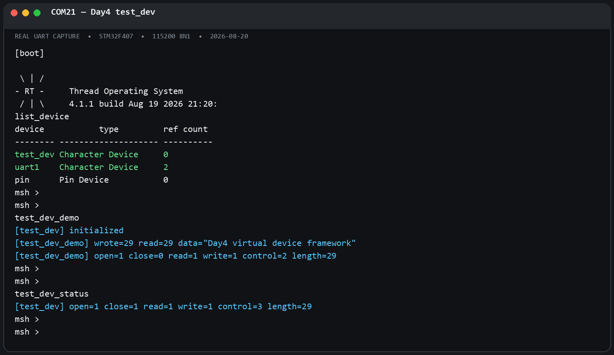

# Day4：RT-Thread 设备框架、PIN 设备与虚拟设备驱动

姓名：杨智文  
组别：第 3 组  
日期：2026-08-20

## 1. 课堂笔记：统一设备模型

RT-Thread 用统一的 `rt_device` 抽象屏蔽不同外设的差异。应用层不必了解 GPIO、串口、SPI 等硬件细节，而是遵循统一调用流程：

```text
rt_device_find() → rt_device_open() → rt_device_read()/write()/control() → rt_device_close()
```

设备对象被注册到内核设备管理器后，应用可按名称查找。设备管理层再通过设备的操作函数指针，将通用 API 分发给具体驱动实现。这样应用层、设备框架层和 BSP/HAL 层职责清晰，替换硬件时通常只需替换底层驱动。

`rt_device_register()` 负责把静态设备加入系统设备链表；`rt_device_create()` 可创建动态设备对象。设备驱动可按需要提供 `init`、`open`、`close`、`read`、`write` 和 `control` 等操作。

## 2. PIN 设备如何对接

本工程已启用 `RT_USING_PIN`。其实际调用链如下：

```text
应用：GET_PIN()/rt_pin_mode()/rt_pin_write()/rt_pin_read()
        ↓
通用 PIN 框架：components/drivers/misc/pin.c
        ↓  调用 _hw_pin.ops 中的 pin_mode/pin_write/pin_read/IRQ 操作
BSP：libraries/HAL_Drivers/drv_gpio.c 的 _stm32_pin_ops
        ↓
STM32 HAL：HAL_GPIO_Init/HAL_GPIO_WritePin/HAL_GPIO_ReadPin
        ↓
GPIO/EXTI 硬件寄存器
```

具体对接过程：

1. BSP 启动时，`drv_common.c` 调用 `rt_hw_pin_init()`。
2. `drv_gpio.c` 打开 GPIO 时钟，并组织 `_stm32_pin_ops` 操作表。
3. `rt_hw_pin_init()` 通过 `rt_device_pin_register("pin", &_stm32_pin_ops, RT_NULL)` 注册名为 `pin` 的 PIN 设备。
4. 通用层保存该操作表；应用调用 `rt_pin_write()` 等 API 时，通用层转调 BSP 的 `stm32_pin_write()` 等函数。
5. BSP 将 RT-Thread 的逻辑引脚转换为 STM32 GPIO 端口和引脚号，最后调用 HAL 完成硬件访问。中断场景中，`rt_pin_attach_irq()`、`rt_pin_irq_enable()` 也沿同一条操作表链路配置 EXTI，并由中断服务程序回调应用注册的函数。

这说明 PIN 既能给应用提供简单的 `rt_pin_*` API，也能作为 `pin` 设备纳入 RT-Thread 的设备管理体系。

## 3. 虚拟字符设备：`test_dev`

本次设计了一个不依赖实体外设的字符设备，用于练习完整的设备驱动框架层。源码见 [test_dev.c](test_dev.c)。

- 设备名：`test_dev`
- 类型：`RT_Device_Class_Char`
- 私有数据：128 字节内存缓冲区、当前数据长度、读写位置和操作统计信息
- 并发保护：互斥锁 `td_lock`
- 支持操作：初始化、打开、关闭、读、写、控制
- 控制命令：`TEST_DEV_CTRL_CLEAR` 清空缓冲区；`TEST_DEV_CTRL_GET_STATS` 获取操作统计
- MSH 命令：`test_dev_demo` 演示完整生命周期；`test_dev_status` 查看当前统计

驱动注册流程为：创建/准备设备对象与私有数据 → 设置设备操作函数 → `rt_device_register(test_dev, "test_dev", RT_DEVICE_FLAG_RDWR)` → 应用通过 `rt_device_find("test_dev")` 使用设备。

本 BSP 未启用 `RT_USING_DEVICE_OPS`，因此源码同时兼容两种设备操作方式：启用该宏时使用 `rt_device_ops` 操作表；未启用时使用本 BSP 的传统设备成员函数指针。该处理保证同一驱动能够适配不同的 RT-Thread 配置。

## 4. 编译、烧录与验证

使用工程原生 SCons 构建后，生成的固件已通过 ST-Link 烧录至 STM32F407 开发板。烧录校验通过，串口为 COM21、115200 8N1。

实际串口验证：

```text
msh >list_device
device           type         ref count
-------- -------------------- ----------
test_dev Character Device     0
uart1    Character Device     2
pin      Pin Device           0

msh >test_dev_demo
[test_dev] initialized
[test_dev_demo] wrote=29 read=29 data="Day4 virtual device framework"
[test_dev_demo] open=1 close=0 read=1 write=1 control=2 length=29

msh >test_dev_status
[test_dev] open=1 close=1 read=1 write=1 control=3 length=29
```

其中 `test_dev_demo` 在打印首次统计后执行关闭操作，因此随后执行 `test_dev_status` 时可看到 `close=1`。完整验证截图如下：



## 5. 小结

PIN 驱动体现了 RT-Thread 通过操作表把通用 API 对接到 BSP/HAL 的方法；`test_dev` 则把同一思想扩展为可查找、可打开、可读写和可控制的虚拟字符设备。两者都说明：应用只面对统一接口，硬件差异由驱动框架层消化。
