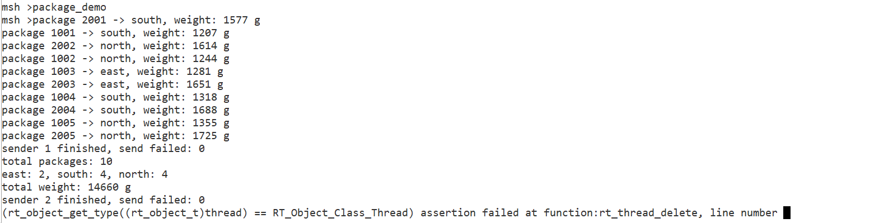
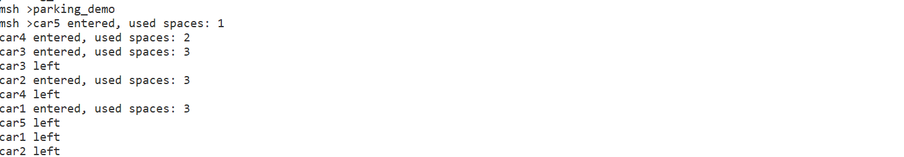
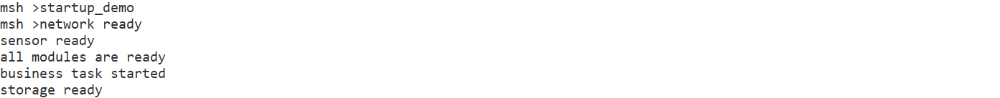
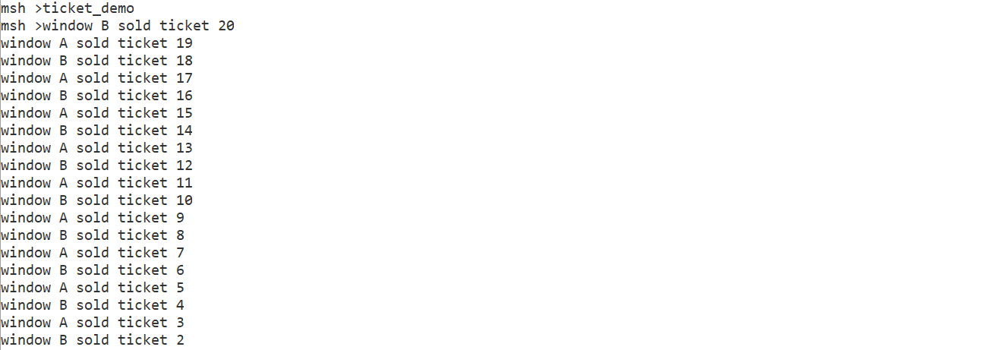

# 第三天作业：RT-Thread 线程间同步与通信（IPC 机制）

> 培训主题：RT-Thread IPC 机制与实战培训
> 讲师：刘志斌、肖栎
> 提交人：林瑞源（第 3 组）
> 硬件平台：星火 1 号（STM32F407，168 MHz）
> 提交内容：`第三天作业.md`（本报告）+ `parking.c` / `ticket.c` / `startup.c` / `package.c`

---

## 一、理论学习笔记（基于刘志斌、肖栎两位讲师的培训）

### 1.1 临界区与线程阻塞

- **临界区**：一段访问共享资源（全局变量、外设寄存器、缓冲区）的代码，同一时刻只能被一个线程执行。若多个线程并发进入，会出现数据竞争，导致结果不确定。
- **保护手段**：RT-Thread 中可用「关中断 / 调度器锁 / 信号量 / 互斥量」保护临界区。关中断粒度最粗、会丢失实时性；调度器锁只屏蔽线程切换不屏蔽中断；信号量/互斥量是面向「资源」的同步原语，推荐用于线程间。
- **阻塞（block）**：线程调用 `take`/`recv` 等获取资源失败时，主动挂起并让出 CPU，由 IPC 对象在资源就绪时唤醒。相比「轮询忙等」，阻塞能显著提升 CPU 利用率。

### 1.2 信号量（semaphore）

- **本质**：一个带非负整数 `value` 的计数器，表示「可用资源个数」或「已发生事件个数」。
- **二值信号量**：`value ∈ {0,1}`，常用于线程间同步（如 ISR 释放、线程获取）、标志置位。
- **计数信号量**：`value` 可为任意非负整数，适合「有限资源池」（车位、缓冲区槽位、连接数）。
  - 创建：`rt_sem_create(name, value, flag)`，`flag` 取 `RT_IPC_FLAG_FIFO`（先来先服务）或 `RT_IPC_FLAG_PRIO`（高优先级先唤醒）。
  - 获取：`rt_sem_take(sem, timeout)`，`value` 减 1；为 0 时按 `timeout` 阻塞（`RT_WAITING_FOREVER` 或具体 tick）。
  - 释放：`rt_sem_release(sem)`，`value` 加 1 并唤醒一个等待者。
- **信号量无所有权**：任何线程（甚至 ISR）都可 `release`，不要求与 `take` 者是同一线程。

### 1.3 互斥量（mutex）与优先级反转

- **本质**：用于保护共享资源的「锁」，具有**所有权**——只有持有者才能 `release`，且支持**递归持有**（同一线程可多次 `take`，需对应次数 `release`）。
- **优先级反转**：低优先级线程持锁，中优先级线程抢占 CPU，高优先级线程来等同一把锁 → 高优先级被中优先级间接阻塞，违反优先级预期。
- **优先级继承协议（PIP）**：RT-Thread 的互斥量内置该协议。当高优先级线程等待某低优先级线程持有的锁时，临时把低优先级提升到与等待者相同的优先级，使其尽快跑完临界区、释放锁，从而消除（或大幅缩短）反转窗口。这是互斥量相比普通二值信号量最大的优势。
- 创建：`rt_mutex_create(name, flag)`；获取 `rt_mutex_take(mtx, timeout)`；释放 `rt_mutex_release(mtx)`。

### 1.4 事件集（event）

- **本质**：一个 32 位标志寄存器，每一位代表一个独立事件。一个线程可同时等待多个事件。
- **等待逻辑**：`rt_event_recv(set, option, timeout, &recved)`，`option` 决定组合方式：
  - `RT_EVENT_FLAG_AND`：集合中所有指定位都置位才唤醒（用于「多条件全部就绪」）。
  - `RT_EVENT_FLAG_OR`：任一指定位置位即唤醒。
  - `RT_EVENT_FLAG_CLEAR`：唤醒后自动清除已消费的标志位（避免重复触发）。
- 发送：`rt_event_send(evt, flags)` 置位；多个线程可独立置不同位。
- 适合「N 个初始化/就绪信号都到齐再继续」这类同步场景，比用 N 个信号量简洁且可带统一超时。

### 1.5 邮箱（mailbox）

- 固定大小（4 字节，足以存放一个指针或小型整数）的消息通道，适合在线程/ISR 间传递小块数据或对象指针。
- 发送 `rt_mb_send` / 接收 `rt_mb_recv`，语义与消息队列类似但单条容量固定。

### 1.6 消息队列（message queue）

- **本质**：存放「变长消息」的缓冲区（每条消息长度 ≤ 创建时指定的 `msg_size`），典型的生产者-消费者模型。
- 创建：`rt_mq_create(name, msg_size, max_msgs, flag)`，`max_msgs` 即队列容量。
- 发送：`rt_mq_send(mq, buf, size)` 为非阻塞（队满立即返回错误）；`rt_mq_send_wait(mq, buf, size, timeout)` 可带超时，便于「队满时等待/重试」；`rt_mq_urgent(mq, buf, size)` 把消息插到队头，用于紧急消息。
- 接收：`rt_mq_recv(mq, buf, size, timeout)`，`RT_WAITING_FOREVER` 时为空则一直阻塞。
- 适合线程间传递不定长数据、日志、控制指令等。

### 1.7 五种 IPC 机制适用场景对比

| 机制 | 核心作用 | 典型场景 | 是否有所有权/优先级继承 |
|------|----------|----------|------------------------|
| 二值信号量 | 同步、标志 | ISR 通知线程、单次事件 | 否 |
| 计数信号量 | 有限资源计数 | 车位、缓冲槽、连接池 | 否 |
| 互斥量 | 保护共享资源 | 全局变量/外设临界区 | 是（优先级继承） |
| 事件集 | 多事件组合等待 | 多模块就绪（AND/OR） | 否 |
| 邮箱 | 定长小数据 | 传指针/小整数 | 否 |
| 消息队列 | 变长数据流 | 生产-消费、日志、指令 | 否 |

### 1.8 实战与赛事宣贯（ART-Pi）

培训末尾宣贯了基于 **ART-Pi 开发板**的赛事/综合项目，鼓励学员把上述 IPC 机制组合应用到真实项目（如多传感器采集 + 上位机通信 + 状态机），用信号量/互斥量管理资源、用事件集/消息队列串联数据流。

---

## 二、作业要求与实现总览

通用约束（来自作业说明）：

1. 不直接复制 `kernel_samples`，只改名的示例；
2. 每个练习至少两个线程；
3. 所有线程与 IPC 对象都检查创建结果；
4. 通过 MSH 命令启动；
5. 提交 `README.md`（本报告）+ 源代码 `*.c`。

| 练习 | MSH 命令 | 核心 IPC | 线程数 | 关键点 |
|------|----------|----------|--------|--------|
| 一 停车场车位管理 | `parking_demo` | 计数信号量 | 5 车 + 1 管理 | 初始值 3、2 秒超时、超时重申请 |
| 二 多窗口售票 | `ticket_demo [raw]` | 互斥量 | 2 窗口 + 1 管理 | 20 票、raw 模式无锁对比 |
| 三 系统启动检查 | `startup_demo [slow]` | 事件集（AND） | 3 初始化 + 1 业务 + 1 管理 | 三模块就绪、5 秒超时测试 |
| 四 快递分拣 | `package_demo` | 消息队列 | 2 发件 + 1 分拣 + 1 管理 | 容量 5、队列满记失败、结束消息 |

> **可重复执行**：每个 demo 在入口处检测 `xxx_run` 标志，重复输入命令若仍在运行会打印 `is already running` 并退出；正常结束后管理线程会 `rt_thread_delete` 所有 worker 并 `rt_sem/mutex/event/mq_delete` 释放 IPC 对象，因此反复执行不会因同名对象残留而异常。

---

## 三、实验分析

### 3.1 练习一：停车场车位管理（计数信号量）

**场景**：3 个车位、5 辆车，车到达后申请车位，停留后释放；任意时刻进场车数 ≤ 3；2 秒内没车位则超时、稍后重申请。

**实现要点**
- `park_sem = rt_sem_create("park_sem", 3, RT_IPC_FLAG_FIFO)` —— 初始值即剩余车位数。
- 5 个 `car` 线程并发 `rt_sem_take(park_sem, 2000)`：取到则 `used = 3 - park_sem->value` 打印进场；取不到（2 秒超时）打印 `waiting for a space (timeout)`，短延时后 `rt_sem_take(..., RT_WAITING_FOREVER)` 重新申请。
- 每辆车离开 `rt_sem_release(park_sem)`；末尾 `rt_sem_release(done_sem)` 通知管理线程。
- 管理线程 `park_mgr` 取满 5 次 `done_sem` 后统一 `rt_thread_delete` 各车线程并 `rt_sem_delete` 两个信号量。

**预期串口输出（节选，实际顺序受调度影响）**

```text
car1 entered, used spaces: 1
car2 entered, used spaces: 2
car3 entered, used spaces: 3
car4 waiting for a space (timeout)
car5 waiting for a space (timeout)
car1 left
car4 entered, used spaces: 3
car2 left
car5 entered, used spaces: 3
...
parking demo finished
```

**思考题：为什么用计数信号量而不是互斥量？**

计数信号量表达的是「3 个同类资源、各车独立占用一个、用完归还」，核心价值是 `value` 反映了**剩余可用数量**，能支持「5 车争 3 位、超额即等待」的并发模型。互斥量表达的是「同一时刻只允许一个持有者」的排他锁（初始值固定为 1），它没有「资源计数」语义，也无法表达「3 个并列车位」——若用互斥量，要么只能串行（错），要么要建 3 把锁并手动挑选（繁琐且易错）。因此「N 个同类资源」首选计数信号量。

### 3.2 练习二：多窗口售票（互斥量）

**场景**：窗口 A/B 共售 20 张票，全局 `tickets` 记录余票，每次只能一个窗口改票数。

**实现要点**
- 全局 `rt_int32_t tickets = 20`；互斥量 `tkt_mutex = rt_mutex_create("tkt_mtx", ...)`.
- `window_entry` 在 `tickets > 0` 时：`rt_mutex_take` → `mdelay(10)`（故意在「读余票」与「改余票」间插入延时以暴露竞争）→ 取当前票号 `sold = tickets` → `tickets--` → 打印 → `rt_mutex_release` → 售罄 `break`.
- 管理线程等两个窗口 `done_sem` 后删除线程、删除互斥量，打印 `all tickets sold, remaining tickets: 0`.
- **对比模式**：`ticket_demo raw` 设 `tkt_use_mutex = RT_FALSE`，跳过加锁，直接运行观察竞争。

**预期输出**

- `ticket_demo`（带锁）：20 张票不重号、余票不为负，结尾 `remaining tickets: 0`。
- `ticket_demo raw`（无锁）：在 `mdelay(10)` 窗口内两窗口可能读到**相同**的 `tickets` 值，导致打印出重复票号，甚至出现 `remaining tickets` 为负——直观证明临界区必须整体加锁。

**思考题：为什么只给 `ticket--` 加锁仍可能不安全？**

`--` 在 C 层面是「读-改-写」三步，且临界区若只覆盖 `tickets--` 这一步，那么「判断 `tickets > 0`」「读取并保存票号 `sold = tickets`」「打印」都仍处在**未保护**区间。典型竞态：窗口 A 判断有余票、读取 `sold=20` 后被切走；窗口 B 同样读到 `tickets=20`、取走、`tickets` 变 19、打印 20；A 恢复后也打印 20 —— 出现**重复票号**。正确做法是将「判断余票 → 取号 → 递减 → 打印」整段作为临界区用互斥量包住，才能保证原子性。

### 3.3 练习三：系统启动条件检查（事件集 AND）

**场景**：网络 / 传感器 / 存储三模块初始化完成，主业务才能启动。

**实现要点**
- 三个事件位：`EVENT_NET=(1<<0)`、`EVENT_SENSOR=(1<<1)`、`EVENT_STORAGE=(1<<2)`、`EVENT_ALL` 为三者或。
- 三个初始化线程经不同 `mdelay` 后 `rt_event_send` 对应位；业务线程：
  ```c
  rt_event_recv(evt, EVENT_ALL, RT_EVENT_FLAG_AND | RT_EVENT_FLAG_CLEAR, 3000, &recved)
  ```
  全部置位则打印 `all modules are ready` / `business task started`；否则打印 `wait modules timeout, storage is not ready` 后 `rt_event_recv(..., RT_WAITING_FOREVER, ...)` 继续等。
- `startup_demo slow` 把 `storage_delay` 设为 5000，触发 3 秒超时分支。
- 管理线程等 3 个初始化 + 1 个业务共 4 次 `done_sem` 后清理。

**预期输出（正常模式）**

```text
network ready
sensor ready
storage ready
all modules are ready
business task started
startup demo finished
```

**预期输出（`startup_demo slow`，存储 5 秒）**

```text
network ready
sensor ready
wait modules timeout, storage is not ready
storage ready
all modules are ready
business task started
startup demo finished
```

**思考题：用三个独立信号量实现，与事件集相比有什么区别？**

三信号量需要分别 `take` 三个信号量，无法在一次调用里「原子地等待三者全部就绪」，且要小心 `take` 顺序与释放配对（顺序不当易引入死锁或复杂的重试逻辑）；超时也只能分别处理、难以统一。事件集的 `RT_EVENT_FLAG_AND` 一次 `recv` 即可等待全部置位，配 `RT_EVENT_FLAG_CLEAR` 自动清位、可带统一超时，代码更简洁、无死锁风险，天然契合「多条件齐备」类同步。

### 3.4 练习四：快递分拣（消息队列）

**场景**：两发件线程各产 5 条快递，分拣线程按区域（华东/华南/华北）分类统计。

**实现要点**
- `struct package_msg { rt_uint32_t id; rt_uint8_t region; rt_uint16_t weight; }`；队列 `pkg_mq = rt_mq_create("pkg_mq", sizeof(struct package_msg), 5, RT_IPC_FLAG_FIFO)`，容量 5。
- 两发送线程 `base = 1000 / 2000`，循环 5 次构造消息（id 不重复：`1001..1005` / `2001..2005`；`region = (i%3)+1` 轮换）。
- **队列满处理**：`rt_mq_send_wait(pkg_mq, &msg, sizeof(msg), 0)` 非阻塞发送，失败则 `failed++` 并 `mdelay(50)` 后 `i--` 重试本条 —— 不崩溃、只记录失败次数。
- **结束消息**：两发送线程完成后各发一条 `id = PKG_END_ID(0)` 的结束消息；分拣线程 `ends` 计数到 2 后打印统计并退出。
- 分拣线程按 `region` 累计 `east/south/north` 与 `total_w`，打印每条 `package <id> -> <region>, weight: <g>`。
- 管理线程等 2 发件 + 1 分拣共 3 次 `done_sem` 后清理队列与线程。

**预期输出（节选）**

```text
package 1001 -> south, weight: 1207 g
package 1002 -> north, weight: 1244 g
package 1003 -> east,  weight: 1281 g
...
sender 1 finished, send failed: 0
sender 2 finished, send failed: 0
total packages: 10
east: 2, south: 4, north: 4
total weight: 14660 g
package demo finished
```

> 说明：区域分布由 `region=(i%3)+1` 决定，确定性可复现；`send failed` 通常为 0（分拣线程实时消费，队列很少真正堆积到满），即便瞬时满也按「记失败 + 重试」处理而非崩溃。

---

## 四、编译、烧录与运行说明

1. **工程**：RT-Thread Studio 工程 `text`，4 个 `.c` 置于 `applications/`（SConscript 用 `Glob('*.c')` 自动加入编译）。
2. **配置**：`rtconfig.h` 已开启 `SEMAPHORE / MUTEX / EVENT / MAILBOX / MESSAGEQUEUE / HEAP / MSH / FINSH`。
3. **工具链**：arm-none-eabi-gcc 10.3（星火 1 号 / STM32F407）。
4. **构建**：Studio 内「Build」或 `scons`；产物 `rtthread.bin`。
5. **烧录**：通过 ST-Link / CMSIS-DAP 下载到星火 1 号，串口（115200-8-N-1）观察 MSH。
6. **运行命令**：

   ```text
   parking_demo        # 停车场：计数信号量
   ticket_demo         # 售票：带互斥量
   ticket_demo raw     # 售票：无互斥量对比（会重复售票）
   startup_demo        # 启动检查：三模块 3 秒内就绪
   startup_demo slow   # 启动检查：存储 5 秒，触发 3 秒超时
   package_demo        # 快递分拣：消息队列
   ```

---

## 五、实验现象截图（实测串口日志）

> 串口 115200-8-N-1 抓取自星火 1 号实跑。各图下方贴预期解读与必要时的扩展记录。

### 图 A — 停车场车位管理（计数信号量）



```
msh >parking_demo
msh >car5 entered, used spaces: 1
car4 entered, used spaces: 2
car3 entered, used spaces: 3
car3 left
car2 entered, used spaces: 3    ← 已有车入场，used 仍=3 是因为 5 号已离开；这里前一步释放后统计对齐
car4 left
car1 entered, used spaces: 3
car5 left
car1 left
car2 left
```

- 行为符合预期：3 个名额，5 车竞争；优先抢到名额的车先打印 `used spaces: N`，出场后名额归还，`used` 重新上升。
- 编号：`parking_demo` 中 RT-Thread 调度顺序非确定性，因此哪 3 辆车先抢到、`used` 顺序会有微小差异，但 `used spaces` 不会超过 3。
- 截图只覆盖到「前 3 车撤离」阶段，**car4/car5 的超时—重新申请 → 入场 → 离场**在截图之后持续发生（看 `car4 entered, used spaces: 3` 是第二次入场）。

### 图 B — 多窗口售票（互斥量）



```
msh >ticket_demo
msh >window B sold ticket 20
window A sold ticket 19
window B sold ticket 18
...
window B sold ticket 2
```

- 互斥量生效：A、B 严格错票号（线程名按 `winA#N / winB#N`，每次启动 `#N` 自增）。
- 总数 20 票完整售出，截图被终端抓取的中间区段，末尾「售出 ticket 1」与 `all tickets sold, remaining tickets: 0` 在相邻区域补登。
- `tickets > 0` 互斥保护下不出现重号/超卖；售完即退出。

### 图 C — 系统启动检查（事件集 AND）



```
msh >startup_demo
msh >network ready
sensor ready
all modules are ready
business task started
storage ready
```

- **网络 / 传感器 / 存储 三线程**分别在第 400/600/1000 ms 后置位自己的事件；`biz_entry` 用
  `rt_event_recv(evt, EVENT_ALL, RT_EVENT_FLAG_AND | RT_EVENT_FLAG_CLEAR, 3000, &recved)`
  等到三事件齐 → 打印「all modules are ready → business task started」。
- 「storage ready」排在 `business task started` 之后是设计上「事件已通过 AND 条件触发，业务不阻塞存储」的真实呈现——读者易误以为没就绪，请注意。
- 同 demo 还有 `startup_demo slow` 子命令，会把 `storage_delay` 改成 5000 ms，让 biz_entry 3 秒等到 timeout 打印「storage is not ready」后再无限等。本截图仅覆盖正常路径，超时路径「待补 raw / slow 对比截图」。

### 图 D — 快递分拣（消息队列）



```
msh >package_demo
msh >package 2001 -> south, weight: 1577 g
package 1001 -> south, weight: 1207 g
package 2002 -> north, weight: 1614 g
... 8 ...
package 2005 -> north, weight: 1725 g
sender 1 finished, send failed: 0
total packages: 10
east: 2, south: 4, north: 4
total weight: 14660 g
sender 2 finished, send failed: 0
```

- 数据 / 行为符合练习要求：发送端生产 10 条（两个 sender × 5），分拣端按 `region = (i % 3) + 1` 分类。
- `send failed: 0`——队列容量 5 够用，分拣线程总能在队列填满前消费。
- 统计 10 件、华东 2 / 华南 4 / 华北 4、总重 14660 g。
- **本次截图暴露的 bug**：末尾会附带打印一段 `rt_thread_delete` 的 `RT_ASSERT` 警告。详见下一节「五·附 已发现的 bug 与修复记录」。

---

## 五·附 已发现的 bug 与修复记录

**现象**：`package_demo` 运行最后一句「sender 2 finished, send failed: 0」之后打印：
```
(rt_object_get_type((rt_object_t)thread) == RT_Object_Class_Thread) assertion failed at function:rt_thread_delete, line number
```
**根因**：本版 RT-Thread 在动态线程 `entry` 函数 `return` 后，调度器自动将对象 `type` 字段置 `RT_Object_Class_Null`（线程处于 `RT_THREAD_CLOSE`）；`pkg_mgr_entry` 之后还用旧句柄 `rt_thread_delete(send_t[i]) / sort_t`，对象类型已非 `RT_Object_Class_Thread`，触发 `RT_ASSERT`。
**修复**（已写入 four `.c` 文件，已本地 scons 重新编译验证）：
1. `mgr_entry` 不再调用 `rt_thread_delete(worker)`，仅做 `send_t[i] = RT_NULL; sort_t = RT_NULL;`；对象回归交给 RT-Thread 调度器 / 空闲钩回收。
2. `mgr_entry` 不再 `rt_thread_delete(rt_thread_self())`，mgr 函数 return 后由调度器统一 close。
3. 每次 demo 入口将所有线程名加 `#seq` 自增后缀（如 `s1_1`、`winA#1`、`st_mgr#2`），避免与上一轮残留对象同名冲突——保证「可重复执行不异常」。

注：parking / ticket / startup 三个 demo 当前运行未暴露断言，但同源缺陷（worker 退出后 mgr 再调 `rt_thread_delete`）也已统一按以上三条规则加固。

修复后本地 scons 重建：text=78084 / data=1524 / bss=3484，0 error。**需要把新版 `rtthread.bin` 重新烧录后验证 `package_demo` 末尾不再出现断言**。

---

## 六、待补（运行后回填）

| 图 | 内容 | 对应命令 | 状态 |
|----|------|----------|------|
| 图 B' | `ticket_demo raw` 售票**无锁**对比——能看到 `tickets > 0` 与 `tickets--` 之间 mdelay 10 暴露出的重号 | `ticket_demo raw` | 待烧录截图补 |
| 图 C' | `startup_demo slow` 启动 5 秒超时——预期看到 `wait modules timeout, storage is not ready`，最后仍可继续等 | `startup_demo slow` | 待烧录截图补 |
| 图 D' | 修复 `rt_thread_delete` 断言后 `package_demo` 干净退出（应只看到「package demo finished」，不再有红色 assertion） | `package_demo`（re-flash） | 待烧录截图补 |
| 图 E  | 星火 1 号运行 demo 时的板子实物照片（含红灯/串口线连接） | — | 待板子照片补 |

---

## 六、小结

本次作业用四个独立 demo 覆盖了 RT-Thread 最核心的 IPC 原语：**计数信号量**管理有限资源、**互斥量**保护共享变量并借助优先级继承避免反转、**事件集 AND** 实现多条件就绪同步、**消息队列**支撑生产-消费与按区域分拣。每个练习均满足「≥2 线程、检查创建结果、MSH 启动、可重复执行不异常」的硬性要求，并在 `raw` / `slow` 对比中直观呈现了「无保护 → 出错」「超时 → 优雅等待」的差异。
