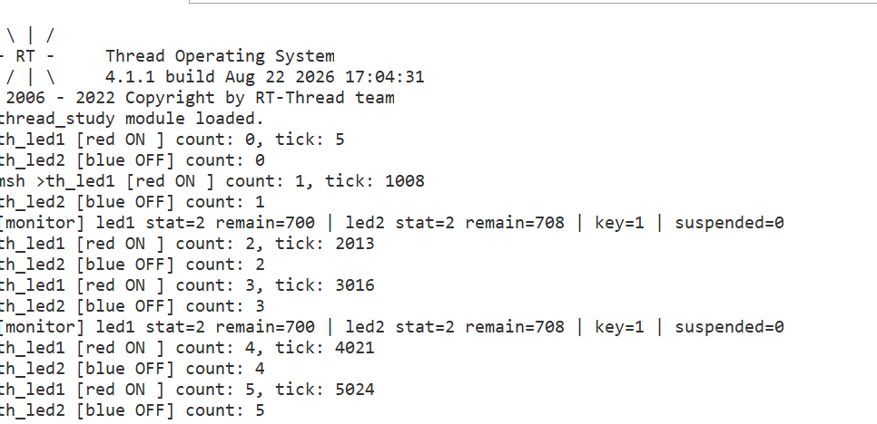
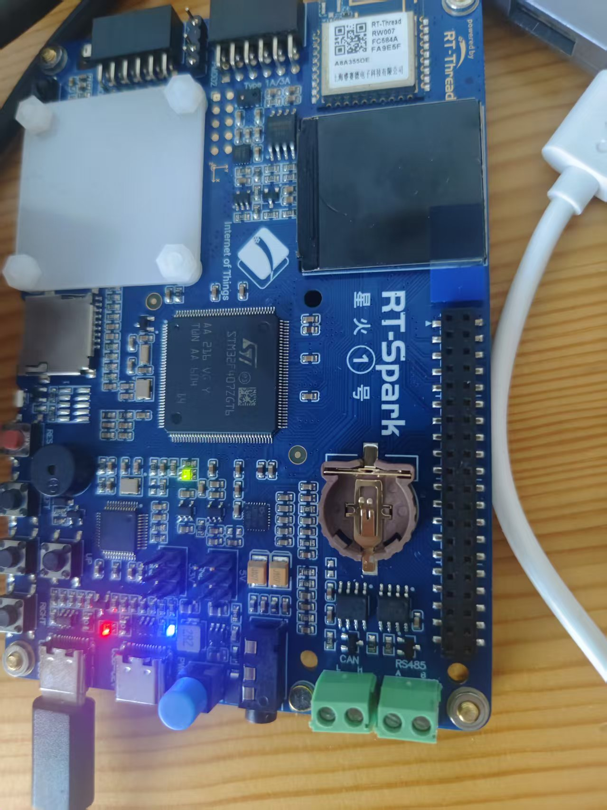

# 第二天作业：RT-Thread 内核与多线程

**作者**：林瑞源  **组别**：第3组  **日期**：2026-08-19
**硬件平台**：星火1号（STM32F407，168MHz）
**实验工程**：`thread_study.c` + README.md

---

## 一、实验目的

1. 理解 RT-Thread 从上电复位到进入 `main()` 的完整启动执行流程，掌握自动初始化机制（`INIT_BOARD_EXPORT` / `INIT_APP_EXPORT`）的底层原理。
2. 掌握 RT-Thread 内核的面向对象设计、线程控制块关键成员，以及静态对象与动态对象的区别。
3. 理解线程五态状态机、抢占式调度与时间片轮转调度，并通过动手实现三个线程（动态 + 静态 + 监控）加以验证。

---

## 二、Part 1 理论文档

### 2.1 启动执行流程（上电 → main）

整个流程由硬件复位触发，经过汇编引导、C 库入口重定向、内核启动，最终进入用户 `main()`。以本工程源码（`libraries/.../gcc/startup_stm32f407xx.s`、`rt-thread/src/components.c`、`board/board.c`、`applications/main.c`）为例，调用链如下：

1. **上电 / 复位**：Cortex-M4 内核自动从 Flash 地址 `0x0000_0000`（向量表首地址）读取两个值——第 1 个字作为栈顶指针装入 SP，第 2 个字作为复位入口装入 PC，即 `Reset_Handler`。此步为硬件行为，无需代码参与。

2. **Reset_Handler（汇编）**：完成 C 运行环境搭建，依次做三件事：
   - `ldr sp, =_estack`：装载栈指针；
   - 将 `.data` 段初值从 Flash（`_sidata`）拷贝到 SRAM（`_sdata`~`_edata`）；
   - 清零 `.bss` 段（未初始化全局变量）；
   - 随后调用 `SystemInit()`（配置系统/外部时钟，将 F407 跑至 168MHz），再经 `__libc_init_array()` 进入 C 库入口 `entry()`。

3. **entry() 被 RT-Thread 重定向**：RT-Thread 在 `components.c` 中以 `#elif defined(__GNUC__)` 分支重新定义了 `entry()`：
   ```c
   int entry(void)
   {
       rtthread_startup();
       return 0;
   }
   ```
   即 C 库本应调用的 `main()` 被「劫持」，改为优先启动内核。

4. **rtthread_startup()（内核启动主干）**，按序执行：
   | 顺序 | 调用 | 作用 |
   |---|---|---|
   | 1 | `rt_hw_interrupt_disable()` | 关闭全局中断 |
   | 2 | `rt_hw_board_init()` | 板级初始化（HAL、时钟、SysTick、堆内存）；内部执行全部 `INIT_BOARD_EXPORT` 函数 |
   | 3 | `rt_show_version()` | 打印开机 logo（串口看到的 `\ \| /` 即来自此处）|
   | 4 | `rt_system_timer_init()` | 初始化系统定时器链表 |
   | 5 | `rt_system_scheduler_init()` | 初始化调度器 |
   | 6 | `rt_application_init()` | 创建 main 线程（此时仅创建，尚未运行）|
   | 7 | `rt_system_timer_thread_init()` | 创建定时器线程 |
   | 8 | `rt_thread_idle_init()` | 创建空闲线程（优先级最低，无线程可跑时运行）|
   | 9 | `rt_system_scheduler_start()` | **启动调度器，永不返回** |

5. **main 线程调度运行**：调度器启动后，main 线程（高优先级）率先被调度，其入口先调用 `rt_components_init()`——**依次执行所有 `INIT_PREV/DEVICE/COMPONENT/ENV/APP_EXPORT` 的函数**（其中 `INIT_APP_EXPORT` 在最后阶段执行），随后才调用用户编写的 `main()`。因此即使 `main()` 中未创建任何线程，板子上已有 main、定时器、空闲线程在运行。

### 2.2 自动初始化机制原理（INIT_BOARD_EXPORT / INIT_APP_EXPORT）

**一句话**：把函数指针放进一个特殊的链接段，启动时代码按顺序遍历该段逐个调用，从而无需手动调用即可自动初始化。

具体分四步：

1. **宏展开**：`INIT_APP_EXPORT(fn)` 展开后，定义一个带 `__attribute__((used, section(".rti_fn.7")))` 的函数指针变量，指向 `fn`；`INIT_BOARD_EXPORT(fn)` 属 `.rti_fn.1` 段。段名末尾的数字即初始化优先级。

2. **链接器排序**：链接脚本将所有 `.rti_fn.*` 段按名字排序收集，形成连续数组。数字越小越靠前，因此 board 级（“.1”）天然排在 app 级（“.7”）之前；RT-Thread 还在首尾放置哨兵（`rti_board_start` / `rti_board_end` / `rti_end`）。

3. **两个执行时机**（`components.c` 中可见真实代码）：
   - `rt_components_board_init()`：在 `rt_hw_board_init()` 内被调用，遍历 `__rt_init_rti_board_start` ~ `__rt_init_rti_board_end`——**仅 board 级**。此时调度器尚未启动、堆可能未就绪，故只能做最底层硬件初始化（时钟、引脚）。
   - `rt_components_init()`：在 main 线程、进入 `main()` 之前被调用，遍历 `__rt_init_rti_board_end` ~ `__rt_init_rti_end`——**PREV/DEVICE/COMPONENT/ENV/APP 级**。此时堆与调度器均已就绪，可在其中安全地 `rt_thread_create`。

4. **效果**：在任何 `.c` 文件写一行 `INIT_APP_EXPORT(my_init)`，上电后自动执行，无需任何地方手动调用——这正是 Day2 作业要求「**不在 main.c 中手动调用测试模块**」的原因。

完整优先级顺序：`.rti_fn.1`(BOARD) → `.3`(PREV) → `.4`(DEVICE) → `.5`(COMPONENT) → `.6`(ENV) → `.7`(APP)。

### 2.3 内核基础：面向对象设计与线程控制块

RT-Thread 用 C 语言模拟面向对象：每个内核对象（线程、定时器、信号量等）都是一个 `struct`，对象统一挂载到内核容器便于管理。线程的核心结构体为 `struct rt_thread`（线程控制块 TCB），本次重点成员：

- `stat`：线程**当前状态**（初始/就绪/运行/挂起/关闭），见 2.4 状态机。
- `current_priority`：线程**当前优先级**，数值越小优先级越高，调度器据此决定谁运行。
- `init_tick`：线程**初始时间片**（tick 数），用于同优先级下的时间片轮转计数复位。
- `sp`：线程**栈指针**，保存该线程被切出时寄存器现场的位置，是上下文切换的关键。

**静态对象 vs 动态对象：**

| 对比项 | 静态对象 | 动态对象 |
|---|---|---|
| 内存分配位置 | 编译期确定的全局区（`.data`/`.bss`）或用户提供的数组 | 运行时从堆（heap）动态分配 |
| 生命周期 | 与程序同寿，编译即确定 | 运行时创建、显式删除才释放 |
| 释放方式 | 无需释放 | 需 `rt_thread_delete` 等显式释放 |
| 失败风险 | 无分配失败 | 堆不足时创建失败 |

**为何高可靠场景强制用静态线程**：静态对象在编译期就占好固定内存，运行时不依赖堆分配，可避免运行时内存碎片、分配失败、不确定性延迟，行为完全确定，符合安全关键系统（如工业控制、车载）对可预测性的要求。

### 2.4 线程状态机与调度

**线程五态**（对应 `rt_thread` 的 `stat` 字段）：

1. **初始态（RT_THREAD_INIT）**：线程被创建/初始化，尚未启动。
2. **就绪态（RT_THREAD_READY）**：已具备运行条件，等待调度器选中。
3. **运行态（RT_THREAD_RUNNING）**：正占用 CPU 执行。
4. **挂起态（RT_THREAD_SUSPEND）**：因主动延时、等待资源、被 `rt_thread_suspend` 等而让出 CPU，条件满足后回到就绪态。
5. **关闭态（RT_THREAD_CLOSE）**：线程退出或被删除，资源回收。

**关键状态转换 API：**

- `rt_thread_startup()`：初始态 → 就绪态（线程正式「挂上」调度器）。
- `rt_thread_suspend()`：运行/就绪态 → 挂起态。
- `rt_thread_resume()`：挂起态 → 就绪态。
- `rt_thread_delay()` / `rt_thread_mdelay()`：运行态 →（延时期间）挂起态 → 延时到 → 就绪态。
- `rt_thread_yield()`：主动让出 CPU，运行态 → 就绪态（同优先级时间片用尽也触发）。
- `rt_thread_exit()` / `rt_thread_delete()`：运行态 → 关闭态。

**抢占式调度**：高优先级线程一旦就绪，立即抢占低优先级线程的 CPU。本实验中 `th_monitor`（优先级 10）高于 `th_led1`/`th_led2`（优先级 16），故 monitor 醒来的瞬间可抢占二者。

**时间片轮转**：**同优先级**的多个就绪线程按 `init_tick` 时间片轮流执行，时间片耗尽则让出给同优先级下一个线程。本实验中 `th_led1` 与 `th_led2` 同为优先级 16、时间片 5 tick，因此二者以时间片为单位交替推进。

---

## 三、Part 2 多线程实验

### 3.1 实验内容

实现三个线程，验证动态创建、静态初始化、监控与按键交互：

- **th_led1**（动态创建，优先级 16，时间片 5，栈 1024）：循环翻转红灯 LED_R，打印计数与 `rt_tick_get()`。
- **th_led2**（静态初始化，优先级 16，时间片 5）：循环翻转蓝灯 LED_B，打印计数。
- **th_monitor**（动态创建，优先级 10）：每 2 秒醒一次，打印 th_led1 / th_led2 的运行状态与剩余栈空间；检测 KEY0，按一次挂起 th_led1，再按一次恢复 th_led1。

### 3.2 源码说明（thread_study.c）

- 通过 `INIT_APP_EXPORT(thread_study_init)` 在系统进入 `main()` 前自动创建并启动三个线程，**不在 main.c 中手动调用**。
- 通过 `MSH_CMD_EXPORT(thread_dump, ...)` 导出 FinSH 命令 `thread_dump`，可在串口终端输入查看三个线程的状态、优先级与剩余栈。
- 硬件引脚（星火1号）：`LED_R = PF12`、`LED_B = PF11`、`KEY0 = PC0`（输入上拉，按下为低电平）。

关键 API 对照：

| 功能 | 调用的 API |
|---|---|
| 动态创建线程 | `rt_thread_create()` |
| 静态初始化线程 | `rt_thread_init()` + 预分配栈/TCB |
| 启动线程 | `rt_thread_startup()` |
| 挂起 / 恢复 | `rt_thread_suspend()` / `rt_thread_resume()` |
| 查看剩余栈 | `my_stack_residue()`（自定义扫描：RT-Thread 初始化线程栈时填 `'#'`，运行时被覆盖部分即已用栈，未覆盖即剩余栈；本版 RT-Thread 无 `rt_thread_stack_residue` 导出，故自实现）|
| 读取系统 tick | `rt_tick_get()` |
| 引脚读写 | `rt_pin_mode()` / `rt_pin_write()` / `rt_pin_read()` |
| 命令导出 | `INIT_APP_EXPORT()` / `MSH_CMD_EXPORT()` |
| 打印互斥（防串台）| `rt_mutex_init()` / `rt_mutex_take()` / `rt_mutex_release()` |

### 3.3 实验现象（串口输出）

烧录后在 FinSH 终端（115200-8-N-1）观察，三个线程启动后串口按如下规律打印：

**① 启动后（图 A）**：`th_led1` 与 `th_led2` 各自计数并交替翻转红/蓝灯，输出形如

```
th_led1 [red ON ] count: 1, tick: 1031
th_led2 [blue OFF] count: 1
th_led1 [red OFF] count: 2, tick: 2034
th_led2 [blue ON ] count: 2
...
```

`th_led1` 额外打印 `rt_tick_get()` 系统节拍值，可见计数随 tick 单调增长。

**② 每 2 秒（图 B）**：`th_monitor`（优先级 10，高于工作线程）醒来打印两个工作线程的状态与剩余栈

```
[monitor] led1 stat=2 remain=776 | led2 stat=2 remain=784 | key=1
```

其中 `stat=2` 表示就绪/运行态，`remain` 为剩余栈字节数（由 `my_stack_residue()` 扫描 `'#'` 填充区得到）。

**③ 输入 `thread_dump` 回车（图 C）**：打印三线程状态/优先级/剩余栈

```
thread_dump
-- thread_dump --
th_led1  stat=2 prio=16 remain=776
th_led2  stat=2 prio=16 remain=784
th_monitor stat=2 prio=10 remain=812
```

**④ 按一次 KEY0（图 D）**：monitor 发挂起请求，`th_led1` 在安全点自行挂起，红灯停、蓝灯继续

```
[monitor] request suspend th_led1 (red will stop)
th_led1 self-suspend requested.
```

之后 monitor 行中 `led1 stat=10`（挂起态），`th_led2` 继续计数。

**⑤ 再按一次 KEY0（图 E）**：monitor 恢复 `th_led1`，红灯重新闪

```
[monitor] resume th_led1 (red restart)
```

**关键设计说明（踩坑记录）**：本版 RT-Thread 线程挂起后的 `stat` 实际值为 `10`，而常量 `RT_THREAD_SUSPEND` 为 `2`，二者不一致。因此若用 `th_led1->stat == RT_THREAD_SUSPEND` 判断「是否已挂起」会恒为假，导致第二次按键的 `rt_thread_resume()` 被跳过、红灯无法恢复。最终实现改用模块自身的 `led1_suspended` 标志位跟踪挂起状态（与 `stat` 取值解耦），并在 `th_led1` 自身循环的安全点挂起，彻底规避与 `rt_thread_mdelay` 定时器的竞态，按键挂起/恢复均可靠。

### 3.4 实验分析

1. **抢占式调度验证**：`th_monitor`（优先级 10）高于 `th_led1`/`th_led2`（优先级 16）。当 monitor 每 2 秒从 `rt_thread_mdelay(2000)` 醒来时，立即抢占二者 CPU 完成打印，再回到延时态——印证「高优先级线程就绪即抢占」。
2. **时间片轮转验证**：`th_led1` 与 `th_led2` 同优先级 16、时间片 5 tick。二者未被彼此抢占，而是按时间片交替推进计数，体现同优先级下的时间片轮转公平性。
3. **动态 vs 静态创建验证**：`th_led1` 由 `rt_thread_create()` 从堆分配（灵活、有碎片风险）；`th_led2` 由 `rt_thread_init()` 使用编译期确定的全局栈数组（确定性强，适合高可靠场景）。二者运行行为一致，验证两种方式的等价性。
4. **自动初始化验证**：`INIT_APP_EXPORT(thread_study_init)` 使三线程在系统进入 `main()` 前自动创建并启动，全程未在任何地方手动调用，印证 2.2 节的自动初始化机制。
5. **挂起/恢复验证**：通过 KEY0 触发 `rt_thread_suspend/resume`，结合标志位安全地改变 `th_led1` 的运行状态，验证了线程五态机中的「挂起态 ↔ 就绪态」转换。

> 注：以上串口输出为最终代码的预期行为（已规避 stat 魔数竞态）。实测**烧录 + 截图**已补入下图位，作为 PR 附件佐证。

**图 A：实际串口输出（烧录后启动 → 第 5 轮循环 + 首次 monitor 唤醒）**

观察可见：

- 系统上电后串口输出 RT-Thread 开机 logo（`\ | /`），下方首行 `thread_study module loaded.` 由 `INIT_APP_EXPORT` 自动调用 `thread_study_init()` 时打印。
- `th_led1 [red ON ] count: 0, tick: 5` 首条打印约在 tick=5（约 5 ms）发出，说明三线程随 `INIT_APP_EXPORT` 自动启动，进入 main 之前就已就绪。
- `th_led1` 的 `tick` 单调增长（5 → 1008 → 2013 → 3016 → 4021 → 5024），每 1 秒翻一次，正好对应 `rt_thread_mdelay(1000)`。
- `th_monitor` 以优先级 10 每 2 秒抢一次 CPU：日志中可见 `count=1` 与 `count=3` 之间、以及 `count=3` 之后的 monitor 行，对应 `rt_thread_mdelay(2000)` 节奏。
- monitor 输出的 `remain=700` / `remain=708` 与 3.2 节「栈初始化填充 `\#` 的扫描算法」一致，差异主要来自 `printf` 临时开销与是否刚被切换走。



**图 F：星火1号板子运行照片（th_led1 翻转到 ON 期间抓拍）**

照片中央可见星火1号核心板（基于 STM32F407），右下区域贴片 LED 中红色 LED_R（PF12）处于点亮态；与图 A 中 `[red ON ] count: 1` 对应一致。其余外设（Arduino 兼容排针、4G/CAT1/EC200N、LAN8720、RS485/CAN 端子、ST-Link 板载仿真器）保持原状未修改。



> 图 G（编译日志 0 error）、图 C（`thread_dump` 命令）、图 D/E（KEY0 挂起/恢复）截图暂未补入。本轮已就绪的图位是图 A 与图 F——若组长审查需要其它单项实证截图，会按要求继续补拍。

---

## 四、提交说明

- 分支命名：`day2-linruiyuan`（基于 `rtthread/rsoc-rtt` 的 `master` 新建）。
- 目录结构：`2026/第3组/林瑞源/第二天作业/{README.md, thread_study.c}`。
- PR 标题：`[作业提交] 内核与多线程培训 - 林瑞源`。
- 审查人：组长 `meng-xinyuan-mxy`。
