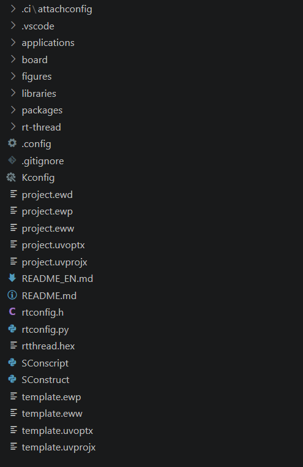
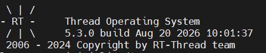

# 【RSOC26】RT-Thread 工程构建与 Git 协作流程总结

## 一、学习概述

RT-Thread 的 BSP 工程通过 Kconfig 描述可配置功能，由 SCons 解析构建脚本、组织源码并调用交叉编译工具链。掌握从源码树导出独立工程、确认配置和完成构建的过程，是后续进行驱动、组件和应用开发的基础。

工程内容的迭代则由 Git 记录。本文先总结 RT-Thread 独立工程的导出、目录组成与构建过程，再梳理 Git 的变更流转、分支协作、冲突处理和远程认证。

## 二、从源码树导出独立工程

RT-Thread 源码树中同时包含内核、公共组件、CPU 架构支持以及多个硬件平台的 BSP。直接复制完整源码树会携带大量与目标硬件无关的文件，因此可以在目标 BSP 目录中生成一份独立工程。

基本过程如下：

1. 准备与目标硬件匹配的 RT-Thread 源码版本。
2. 打开 Env 终端，进入源码树中对应的 BSP 根目录。
3. 确认该目录存在 `SConstruct`、`SConscript`、`Kconfig` 和 `rtconfig.py` 等构建文件。
4. 执行发布工程命令：

```bash
cd <rt-thread-source>/bsp/<target-bsp>
scons --dist
```

`scons --dist` 会在 BSP 下生成 `dist` 目录，复制当前 BSP 所需的 RT-Thread 源码、板级文件和构建脚本，并剔除与目标工程无关的其他 BSP 和 CPU 架构内容。较新版本也可在命令中指定输出目录：

```bash
scons --dist --project-path=<output-directory>
```

生成后可将独立工程移至开发目录。后续配置和编译均在该工程根目录中完成，不再依赖完整的上游源码树。

## 三、独立工程的目录结构



从工程结构可以看出，导出结果已将应用、板级支持、芯片库、软件包和 RT-Thread 源码整合到同一目录中。各主要部分的职责如下：

| 目录或文件 | 作用 |
| --- | --- |
| `applications/` | 存放应用层源码，通常包括主程序入口及用户任务 |
| `board/` | 存放板级初始化、外设配置、时钟、引脚、链接脚本和底层驱动适配内容 |
| `libraries/` | 存放芯片级支持库，例如 CMSIS、设备头文件及底层外设库 |
| `packages/` | 存放根据工程配置获取的软件包和驱动包 |
| `rt-thread/` | 存放内核、组件、设备框架和 CPU 架构适配等 RT-Thread 主体源码 |
| `figures/` | 存放 README 或其他说明文档引用的图片 |
| `.vscode/` | 存放代码索引、任务或调试等编辑器配置 |
| `.ci/` | 存放持续集成或辅助自动化配置 |
| `Kconfig` | 定义工程可配置项及菜单层级 |
| `.config` | 保存当前选定的 Kconfig 配置 |
| `rtconfig.h` | 根据配置生成的 C 宏定义，用于控制内核、组件和驱动的条件编译 |
| `rtconfig.py` | 定义交叉编译器、工具路径、编译参数、链接参数和输出目标 |
| `SConstruct` | SCons 的顶层构建入口，负责初始化构建环境并汇总各模块 |
| `SConscript` | 按模块组织源文件、头文件路径和编译条件 |
| `README.md` / `README_EN.md` | 提供工程说明、硬件资源、构建方法和使用注意事项 |

目录中的 `template.*` 是工程模板，`project.*` 是根据当前配置生成的兼容工程文件。它们不参与 SCons 命令本身的核心依赖解析，但可用于其他工程环境中的编辑、下载和调试。

## 四、工程配置与 SCons 构建

### 1. 确认与更新配置

进入独立工程根目录后，可使用以下命令调整组件、驱动和软件包选项：

```bash
menuconfig
```

保存配置后，`.config` 会记录选项状态，同时生成或更新 `rtconfig.h`。如果配置中启用了软件包，还需同步对应依赖：

```bash
pkgs --update
```

### 2. 执行并行构建

截图中使用了以下命令：

```bash
scons -j16
```

`-j16` 表示最多并行执行 16 个构建任务，可以利用多核处理器缩短全量编译时间。若需要按顺序分析报错信息，可暂时去掉 `-j` 参数，直接执行 `scons`。需要清除旧的中间文件时，可先执行：

```bash
scons -c
```

### 3. 构建脚本的执行链路

SCons 首先读取顶层 `SConstruct`，再由各级 `SConscript` 收集当前配置所需的源文件和头文件搜索路径。`rtconfig.py` 向构建系统提供工具链与编译、汇编、链接参数，`rtconfig.h` 中的配置宏则决定哪些模块进入当前构建。

完整构建过程可概括为：

```text
Kconfig/.config
       ↓
   rtconfig.h
       ↓
SConstruct 读取 rtconfig.py
       ↓
SConscript 递归收集源码
       ↓
交叉编译器生成目标文件
       ↓
链接生成 rt-thread.elf
       ↓
objcopy 生成 rtthread.hex / rtthread.bin
       ↓
size 输出程序段与存储占用
```

### 4. 构建结果分析

从构建日志可以看出，外设支持包中的 I2C、电源控制、时钟、随机数、定时器和串口等模块已完成编译，随后链接生成 `rt-thread.elf`。构建系统又将 ELF 转换为 `rtthread.hex` 和 `rtthread.bin`，便于后续使用不同方式下载固件。

截图中的内存统计如下：

| 区域 | 已使用 | 区域大小 | 占用率 |
| --- | ---: | ---: | ---: |
| CODE | 81,856 B | 1 MB | 7.81% |
| RAM1 | 5,484 B | 128 KB | 4.18% |
| RAM2 | 0 B | 64 KB | 0.00% |

`arm-none-eabi-size` 输出中，`text` 为 81,856 B，`data` 为 1,972 B，`bss` 为 3,508 B，总计十进制大小为 87,336 B。日志最后出现 `scons: done building targets.`，表明编译、链接和格式转换均已完成。

### 5. 固件下载与运行验证

将构建生成的固件下载到目标硬件并复位后，控制台输出了 RT-Thread 启动标识、系统版本和构建时间，如下图所示。



终端显示系统版本为 RT-Thread 5.3.0，并输出完整的启动信息。该结果表明固件已成功进入目标设备，启动流程和控制台输出功能正常，从工程导出、配置、构建到下载验证的基本流程已完成。

## 五、Git 中的变更流转

一次修改从产生到进入远程仓库，通常需要经过以下四个阶段：

```text
工作区 -- git add --> 暂存区 -- git commit --> 本地仓库 -- git push --> 远程仓库
```

- **工作区**：用于创建或编辑文件，此时的变更尚未纳入版本历史。
- **暂存区**：用于组织下一次提交的变更集合。`git add` 表示选择待提交内容，不代表文件已上传。
- **本地仓库**：`git commit` 将暂存内容保存为带有作者、时间和说明信息的版本节点。
- **远程仓库**：`git push` 将本地已存在的提交发送至远程分支，供协作者访问和审查。

若推送时出现 `Everything up-to-date`，表明当前本地分支没有待推送的新提交。此时应依次检查工作区状态、暂存区内容和本地提交记录。

## 六、Fork、Clone 与远程关系

Fork 与 Clone 位于不同的操作层级，其作用如下：

| 操作 | 发生位置 | 主要作用 |
| --- | --- | --- |
| Fork | 代码托管平台 | 在个人空间中建立上游项目的副本 |
| Clone | 本地设备 | 将远程仓库复制为可进行编辑和提交的本地仓库 |
| Pull Request | 代码托管平台 | 请求将指定分支的变更审查后合并至目标分支 |

在 Fork 协作模式中，本地仓库通常配置两个远程：

```text
origin    -> 个人远程副本，主要用于推送分支
upstream  -> 上游仓库，主要用于同步公共基线
```

远程配置可通过以下命令查看和补充：

```bash
git remote -v
git remote add upstream <upstream-url>
git fetch upstream
```

将个人推送目标与上游同步目标分开，可以减少对公共基线的直接操作，并使本地分支能够及时获取上游变更。

## 七、标准的分支协作流程

### 1. 同步主分支

开始新任务前，应先将本地主分支更新至最新状态。以下命令中的分支名需根据项目实际配置调整：

```bash
git switch <main-branch>
git pull --rebase origin <main-branch>
```

在配置上游远程的情况下，可执行：

```bash
git fetch upstream
git rebase upstream/<main-branch>
```

### 2. 创建任务分支

```bash
git switch -c <topic-branch>
```

主分支应保持稳定，各项任务宜在独立分支中完成。这种方式能够限定变更范围，并降低并行开发时的相互影响。

### 3. 检查本地变更

```bash
git status
git diff
```

`git status` 用于确认工作区和暂存区状态，`git diff` 用于查看具体内容差异。提交前进行检查，可以避免临时文件、无关变更或敏感信息进入版本历史。

### 4. 创建本地提交

```bash
git add <file-or-directory>
git commit -m "<concise-change-description>"
```

明确指定待提交文件，有助于控制提交范围。提交说明应准确概括变更的目的和性质，并避免使用含义不明的描述。

### 5. 推送并发起合并请求

```bash
git push -u origin <topic-branch>
```

推送完成后，可在代码托管平台上创建 Pull Request。提交前应核对以下信息：

1. 源分支与目标分支选择正确。
2. 变更列表仅包含当前任务所需内容。
3. 标题和说明能够准确概括变更。
4. 测试、文档和审查信息已按项目规范填写。

当目录初始化、文档编写或功能修改属于不同目的时，宜拆分为独立的提交或 Pull Request，以保持单次变更的聚焦性和可审查性。

## 八、合并冲突的处理

当不同分支对同一段内容产生不兼容的修改时，Git 会标记合并冲突，并要求由开发者确定最终内容。基本处理步骤如下：

1. 使用 `git status` 定位冲突文件。
2. 结合上下文整合双方变更，并删除冲突标记。
3. 执行 `git add <file>` 标记该文件已完成处理。
4. 继续 merge 或 rebase 流程，验证结果后重新推送。

为减少冲突，应在开始任务和发起 Pull Request 前同步上游变更，同时避免对无关模块进行修改。

## 九、提交身份与远程认证

Git 提交身份与代码托管平台的访问认证属于两组独立配置：

- `user.name` 和 `user.email` 会记录在 Commit 中，用于标识变更作者。
- HTTPS 凭据或 SSH 密钥用于验证账户是否具有远程仓库的访问权限。

如需为当前项目单独设置提交身份，可使用不带 `--global` 的仓库级配置：

```bash
git config user.name "xxx"
git config user.email "xxx"
```

使用 SSH 认证时，仅可将公钥添加到代码托管平台。私钥、账户密码、访问令牌、内部地址及其他敏感信息不得出现在截图、文档或版本库中。

## 十、学习总结

通过本次学习，已建立从 BSP 导出、工程配置、依赖同步到编译、链接和固件生成的基本认识。同时，Git 可以将工程变更记录为可追溯的历史，并通过分支和 Pull Request 支持多人协作。在后续实践中，应重点保持以下习惯：

1. 修改配置后及时更新软件包和生成配置，并通过完整构建验证其一致性。
2. 任务开始前同步最新基线，降低基于过时版本开发的风险。
3. 为独立任务创建独立分支，并使每次提交表达单一、明确的变更意图。
4. 推送前检查工作区状态和内容差异，避免提交无关文件或敏感信息。
5. 通过 Pull Request 完成变更说明、审查与合并，保证协作过程可追溯。
