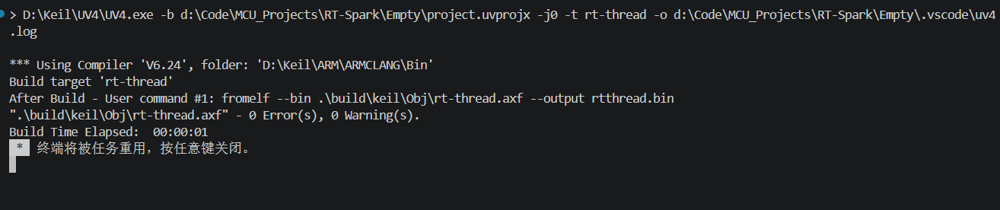
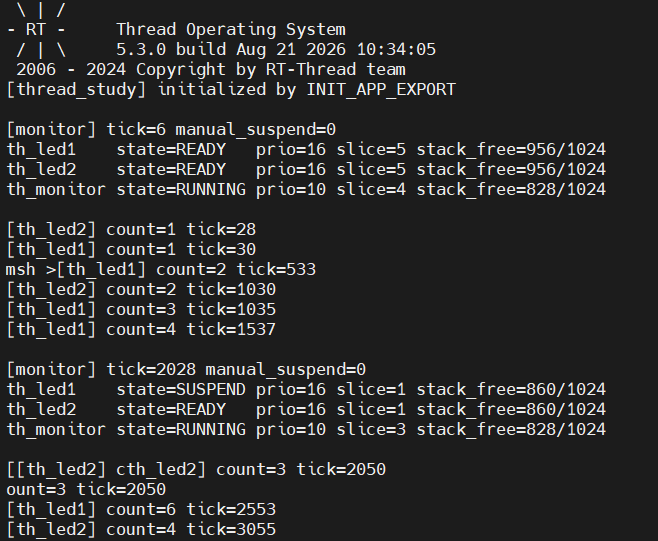
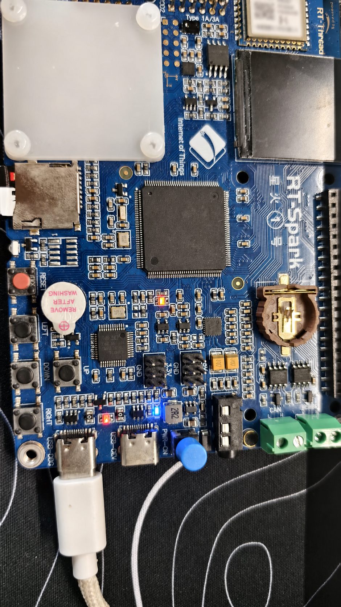
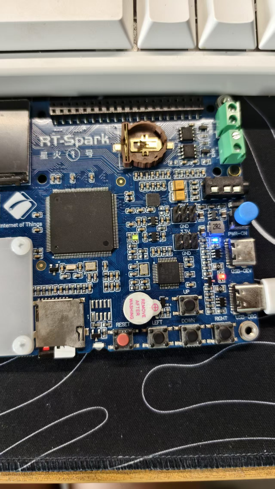

# RT-Thread 内核启动与多线程实验报告

## 1. 实验目标

本实验面向 STM32F407 星火号开发板，围绕 RT-Thread 的启动流程、自动初始化机制、内核对象管理和线程调度展开。实验程序创建两个同优先级 LED 线程与一个高优先级监控线程，并通过按键控制其中一个线程的挂起与恢复，同时提供 MSH 查询命令。

## 2. 实验环境与资源

| 项目 | 配置 |
| --- | --- |
| 目标芯片 | STM32F407 |
| 操作系统 | RT-Thread 5.x |
| 构建系统 | SCons |
| 编译器 | GNU Arm Embedded Toolchain |
| 串口参数 | 115200 bit/s，8 数据位，1 停止位，无校验、无流控 |
| 红色 LED | PF12 |
| 蓝色 LED | PF11 |
| 控制按键 | KEY_UP，PC5，低电平有效 |

## 3. RT-Thread 启动流程

### 3.1 从复位入口到用户主函数

本工程使用 GCC 工具链，完整启动链路可以概括为：

```text
上电或复位
  ↓
Reset_Handler
  ├─ 设置主栈指针
  ├─ SystemInit()：配置基础时钟与系统环境
  ├─ 将 .data 从 Flash 复制到 RAM
  ├─ 清零 .bss
  └─ __libc_init_array()：执行 C/C++ 运行库初始化
  ↓
entry()
  ↓
rtthread_startup()
  ├─ 关闭本地中断
  ├─ rt_hw_board_init()：板级、时钟、堆和早期组件初始化
  ├─ rt_show_version()
  ├─ rt_system_timer_init()
  ├─ rt_system_scheduler_init()
  ├─ rt_application_init()：创建并启动 main 线程
  ├─ rt_system_timer_thread_init()
  ├─ rt_thread_idle_init()
  ├─ rt_thread_defunct_init()
  └─ rt_system_scheduler_start()
  ↓
main_thread_entry()
  ├─ rt_components_init()：执行普通组件和应用级自动初始化
  └─ main()：进入用户主函数
```

由此可见，用户编写的 `main()` 并不是 MCU 复位后直接执行的第一个 C 函数。调度器启动后，系统以 `main` 线程的上下文执行组件初始化和用户主函数，因此 `main()` 中可以直接使用线程延时等内核服务。

### 3.2 自动初始化宏的实现

`INIT_BOARD_EXPORT(fn)` 与 `INIT_APP_EXPORT(fn)` 最终都会展开为 `INIT_EXPORT(fn, level)`。该宏不会立即调用函数，而是完成两项工作：

1. 生成一个指向初始化函数的常量函数指针；
2. 通过编译器段属性将指针放入形如 `.rti_fn.<level>` 的链接段。

其中，板级初始化使用等级 `1`，应用初始化使用等级 `6`。链接脚本按初始化等级排列这些段，并定义起止符号。运行时：

- `rt_components_board_init()` 遍历板级初始化区间，适合时钟、引脚和基础驱动等早期初始化；
- `rt_components_init()` 在 `main` 线程中遍历后续区间，按等级调用设备、组件、环境和应用初始化函数。

本实验使用：

```c
INIT_APP_EXPORT(thread_study_init);
```

因此 `thread_study_init()` 会在 `rt_components_init()` 阶段自动执行，不需要也不应在 `main.c` 中再次调用。固件符号表中能够找到 `__rt_init_thread_study_init`，说明该函数指针已经进入自动初始化表。

## 4. 内核对象与线程控制块

### 4.1 对象容器

RT-Thread 将线程、信号量、互斥量、事件、邮箱和消息队列等统一抽象为内核对象。每类对象都有对应的对象信息结构，其中保存对象链表和对象尺寸。对象创建或初始化时会被纳入相应容器，调试命令因而能够按类型遍历系统中的对象。

线程控制块 `struct rt_thread` 的首成员是通用对象 `struct rt_object parent`，其中保存名称、类型、标志和对象链表节点。在线程专有部分中，以下字段较为关键：

| 字段 | 作用 |
| --- | --- |
| `sp` | 当前线程的栈指针。发生上下文切换时，寄存器现场通过该位置保存和恢复 |
| `stack_addr` / `stack_size` | 线程栈的起始地址与容量，用于栈初始化和使用量检查 |
| `stat` | 调度上下文中的线程状态，并可附带 yield 等状态标志 |
| `current_priority` | 当前有效优先级；使用互斥量优先级继承时可能与初始优先级不同 |
| `init_tick` | 配置的初始时间片长度 |
| `remaining_tick` | 当前时间片剩余 tick 数 |
| `thread_timer` | 线程内置定时器，延时或带超时阻塞时用于唤醒线程 |

在当前内核版本中，调度相关字段封装在 `sched_thread_ctx` 及其私有调度结构中，可通过内核提供的调度上下文宏定位。应用程序只读取这些字段用于观察，不对其直接改写。

### 4.2 静态对象与动态对象

动态线程通过 `rt_thread_create()` 创建，线程控制块和栈由系统堆分配；线程结束后使用 `rt_thread_delete()` 回收。其优点是生命周期灵活，缺点是依赖堆状态，长期反复分配可能带来碎片与分配失败风险。

静态线程由应用预先提供 `struct rt_thread` 和栈数组，再通过 `rt_thread_init()` 初始化；不再使用时调用 `rt_thread_detach()`。其内存地址、大小和分配时机均确定，不依赖运行期堆分配。

高可靠、长时间运行或资源严格受控的系统通常优先采用静态对象，主要原因是内存占用可预测、初始化失败条件更少、不会产生堆碎片，也便于在设计阶段完成容量核算。这并不表示动态对象不能使用，而是应根据对象生命周期和故障容忍目标选择分配方式。

## 5. 线程状态与调度

### 5.1 五种基本状态

| 状态 | 含义 | 常见进入方式 |
| --- | --- | --- |
| `INIT` | 已完成初始化，但尚未进入调度 | `rt_thread_init()` 或 `rt_thread_create()` 后、启动前 |
| `READY` | 已具备运行条件，正在就绪队列等待 CPU | `rt_thread_startup()`、`rt_thread_resume()` 或等待条件满足 |
| `RUNNING` | 当前正在 CPU 上执行 | 调度器选中该线程 |
| `SUSPEND` | 暂时不可运行，包括主动挂起、延时或等待 IPC | `rt_thread_suspend()`、`rt_thread_mdelay()`、等待信号量等 |
| `CLOSE` | 线程已退出，等待脱离或资源回收 | 线程入口返回、`rt_thread_delete()` 等 |

需要注意，状态值为 `SUSPEND` 不一定表示人工调用了挂起接口；线程延时和阻塞等待同样会处于该状态。本实验另设 `manual_suspend` 标志，用于区分 KEY_UP 触发的主动挂起。

### 5.2 抢占与时间片

RT-Thread 采用基于优先级的抢占式调度，优先级数值越小，实际优先级越高。当优先级为 10 的监控线程由延时状态转为就绪时，可以抢占优先级为 16 的 LED 线程。

多个线程处于同一优先级时，调度器结合时间片实施轮转。本实验中 `th_led1` 和 `th_led2` 的优先级均为 16，初始时间片均为 5 tick。系统 tick 中断递减当前线程的剩余时间片；时间片耗尽且同优先级存在其他就绪线程时，当前线程让出处理器并移动到同优先级就绪队列末尾。线程主动延时或阻塞也会提前触发重新调度。

## 6. 实验程序设计

### 6.1 线程参数

| 线程 | 创建方式 | 优先级 | 时间片 | 栈 | 功能 |
| --- | --- | ---: | ---: | ---: | --- |
| `th_led1` | 动态 | 16 | 5 tick | 1024 B | 每 500 ms 翻转红色 LED，输出计数与系统 tick |
| `th_led2` | 静态 | 16 | 5 tick | 1024 B | 每 1000 ms 翻转蓝色 LED，输出计数与系统 tick |
| `th_monitor` | 动态 | 10 | 5 tick | 1024 B | 每 2000 ms 输出三个线程的状态、优先级、剩余时间片与栈余量 |

### 6.2 挂起与恢复策略

KEY_UP 使用下降沿中断并进行 100 ms 软件消抖。监控线程收到首次按键事件后设置挂起请求；`th_led1` 在自身循环的安全点调用：

```c
rt_thread_suspend(rt_thread_self());
rt_schedule();
```

这样可避免在目标线程可能占用共享资源时从外部强制停止它。再次按下 KEY_UP 后，监控线程调用 `rt_thread_resume(led1_thread)`，红色 LED 线程恢复运行。蓝色 LED 线程始终保持独立运行，可用于观察挂起操作只影响目标线程。

### 6.3 栈余量统计

RT-Thread 初始化线程栈时会填入 `'#'`。监控函数从 `stack_addr` 开始统计仍保持填充值的连续字节数，以估算未使用栈空间。该结果适合实验观察和栈容量初步评估；正式产品还应结合最坏执行路径、异常嵌套和长期压力测试保留安全裕量。

### 6.4 自定义 MSH 命令

程序通过下列宏导出 `thread_dump`：

```c
MSH_CMD_EXPORT(thread_dump, show thread study status and unused stack);
```

在串口终端输入 `thread_dump`，可立即查看三个实验线程，而不必等待监控线程的 2 秒周期。固件符号表中已确认存在 `__fsym_thread_dump`，表明命令已进入 FinSH/MSH 符号表。

## 7. 构建过程与结果

### 7.1 构建命令

进入工程根目录，在 Env 终端确认 `RTT_ROOT` 指向工程内的 `rt-thread`，`RTT_EXEC_PATH` 指向 GNU Arm 工具链的 `bin` 目录，然后执行：

```bash
scons -j16
```

本次实际构建已完成，`thread_study.c` 编译、链接及固件格式转换均成功，生成：

- `rt-thread.elf`
- `rtthread.hex`
- `rtthread.bin`

内存统计如下：

| 区域 | 已使用 | 容量 | 占用率 |
| --- | ---: | ---: | ---: |
| CODE | 82 KB | 1 MB | 8.01% |
| RAM1 | 6656 B | 128 KB | 5.08% |
| RAM2 | 0 B | 64 KB | 0.00% |

ELF 段统计为 `text=83968 B`、`data=1228 B`、`bss=5424 B`，总计 `90620 B`。

为进一步确认工程文件和应用源码均可被另一套交叉编译流程正确识别，又使用 Arm Compiler 6.24 完成辅助构建验证，结果为 `0 Error(s), 0 Warning(s)`，并成功生成二进制固件。



## 8. 上板验证记录

### 8.1 验证步骤

1. 将 `rtthread.bin` 从地址 `0x08000000` 下载到开发板并复位运行。
2. 打开串口终端，设置为 115200-8-N-1、无流控。
3. 确认启动后出现 `[thread_study] initialized by INIT_APP_EXPORT`。
4. 观察红色与蓝色 LED 以不同周期翻转，并确认两个计数持续增加。
5. 等待监控线程输出线程状态和 `stack_free` 数据。
6. 在 MSH 中输入 `thread_dump`，确认命令可以立即输出三个线程的信息。
7. 按一次 KEY_UP，等待日志出现挂起请求及 `suspend itself`，确认红色 LED 停止、蓝色 LED 继续。
8. 再按一次 KEY_UP，确认日志出现恢复提示，红色 LED 恢复翻转和计数。

### 8.2 串口日志

固件烧录后，串口首先输出 RT-Thread 5.3.0 启动画面，随后出现自动初始化提示：

```text
[thread_study] initialized by INIT_APP_EXPORT
```

该结果证明实验模块并非由 `main()` 显式调用，而是通过应用初始化表自动执行。首次监控输出如下：

```text
[monitor] tick=6 manual_suspend=0
th_led1    state=READY   prio=16 slice=5 stack_free=956/1024
th_led2    state=READY   prio=16 slice=5 stack_free=956/1024
th_monitor state=RUNNING prio=10 slice=4 stack_free=828/1024

[th_led2] count=1 tick=28
[th_led1] count=1 tick=30
```

运行约 2 秒后的监控结果为：

```text
[monitor] tick=2028 manual_suspend=0
th_led1    state=SUSPEND prio=16 slice=1 stack_free=860/1024
th_led2    state=READY   prio=16 slice=1 stack_free=860/1024
th_monitor state=RUNNING prio=10 slice=3 stack_free=828/1024
```

其中 `manual_suspend=0`，所以 `th_led1` 的 `SUSPEND` 来自周期性延时，而不是按键触发的人工挂起。这验证了线程延时同样会使线程进入挂起态。监控线程从延时中唤醒后以优先级 10 抢占两个优先级 16 的 LED 线程，因此采样时保持 `RUNNING`。



从连续 tick 可以得到：`th_led1` 相邻计数通常间隔约 503 ms，`th_led2` 相邻计数通常间隔约 1002 ms，与程序设置的 500 ms 和 1000 ms 周期基本一致。稳定运行后两个 LED 线程的未使用栈空间约为 860 B，监控线程约为 828 B，当前 1024 B 栈配置仍有较充分余量。

日志中偶尔出现两条信息字符交错，例如两个线程在相近 tick 同时调用 `rt_kprintf()` 时输出被拼接。这是多个线程并发使用同一串口输出资源时缺少互斥保护所致，不表示线程计数或调度失效。

### 8.3 硬件现象

开发板能够正常启动并持续运行。两张照片记录了不同时刻板载指示灯的亮灭状态，结合串口中持续递增的两个线程计数，可以确认两个 LED 控制线程均已实际运行。





## 9. 实验总结

本实验完成了 RT-Thread 启动过程、自动初始化机制、内核对象模型与抢占式调度的源码分析，并在 STM32F407 星火号开发板上实现了动态线程、静态线程和监控线程。构建与上板结果表明，应用模块能够通过 `INIT_APP_EXPORT` 自动加载，三个线程按设定的优先级和周期运行，监控信息能够反映线程状态、剩余时间片与栈余量。程序同时提供 KEY_UP 线程控制逻辑和 `thread_dump` MSH 查询接口，形成了较完整的线程创建、运行、观察与控制示例。
