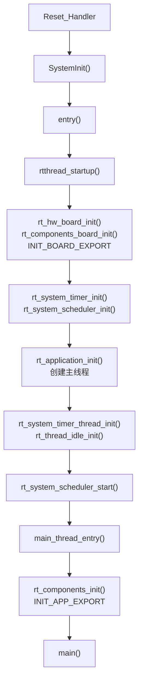
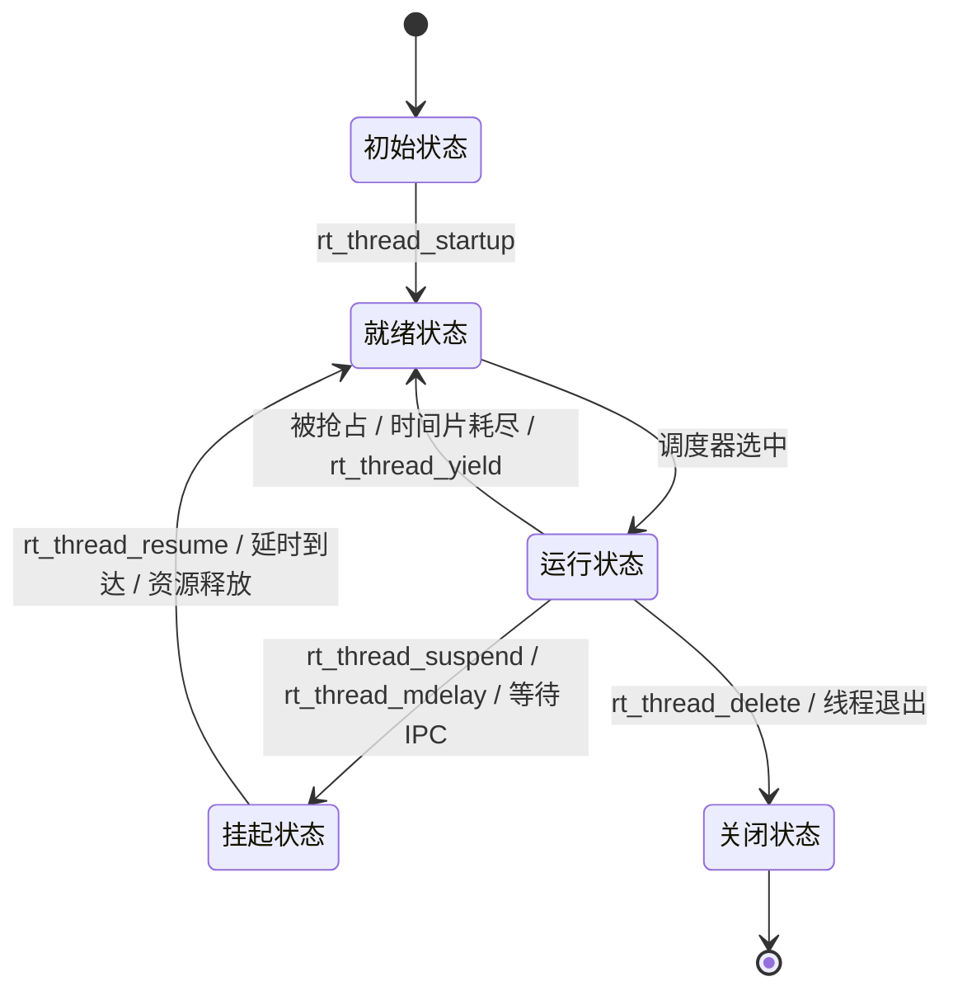
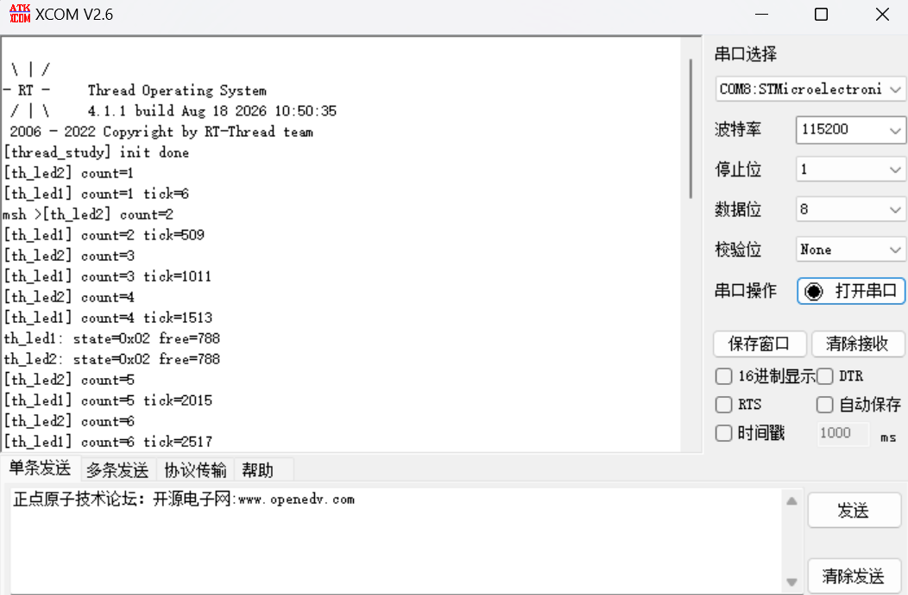
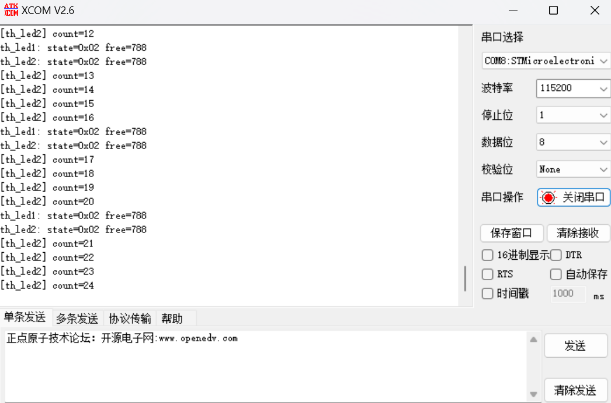

# Day2 作业 Part 1：理论知识梳理

> 姓名：陈相臣  
> 组别：第3组  
> 目标平台：STM32F407 星火号  
> 文档范围：本文件包含 Day2 作业的 Part 1 理论整理和 Part 2 实验结果分析与串口截图。

## 0. 从裸机开发到 RTOS

传统裸机程序通常采用“前台 + 后台”结构：后台是一个无限循环 `while (1)`，在循环中依次调用各个功能处理函数；前台是中断服务程序，负责响应异步事件并通知后台。

裸机模式在简单系统中容易理解，但随着功能变复杂会暴露出几个问题：

- **并发性弱**：多任务只能通过轮询或中断配合实现，程序并发工作效率低。
- **实时性难保证**：某个处理函数执行时间过长时，其他任务的响应时间会随之变长。
- **可维护性差**：功能之间耦合较强，修改一个功能可能影响整个循环。
- **可重用性差**：模块化程度低，容易重复实现相同功能。

RTOS 的核心思想是“分而治之”，把复杂系统拆成多个相对独立的任务。RT-Thread 中任务的基本实体就是线程，由内核根据优先级、时间片和线程状态进行统一调度。

## 1. STM32F407 启动流程与 RT-Thread 引导机制

### 1.1 从上电复位到 main() 的完整调用链

STM32F407 使用 ARM Cortex-M4 内核，上电后从向量表读取初始栈指针和复位入口。以本工程使用的 GCC 启动文件为例，调用链如下：

```text
Reset_Handler
    -> SystemInit()
    -> entry()
        -> rtthread_startup()
            -> rt_hw_interrupt_disable()
            -> rt_hw_board_init()
                -> rt_system_heap_init()
                -> hw_board_init()
                -> rt_console_set_device()
                -> rt_components_board_init()
            -> rt_show_version()
            -> rt_system_timer_init()
            -> rt_system_scheduler_init()
            -> rt_application_init()
            -> rt_system_timer_thread_init()
            -> rt_thread_idle_init()
            -> rt_system_scheduler_start()
                -> main_thread_entry()
                    -> rt_components_init()
                    -> main()
```

各阶段作用如下：

- `Reset_Handler`：设置初始栈指针 `_estack`，把 `.data` 段从 Flash 复制到 RAM，清零 `.bss` 段。
- `SystemInit()`：完成芯片时钟系统、FPU 等基础硬件初始化。
- `entry()`：RT-Thread 在 `components.c` 中提供的入口，内部调用 `rtthread_startup()`。
- `rtthread_startup()`：关闭中断，依次初始化板级硬件、定时器、调度器和主要系统线程，最后启动调度器。
- `rt_hw_board_init()`：初始化堆空间、系统时钟、控制台设备，并执行 `INIT_BOARD_EXPORT` 对应的板级初始化函数。
- `rt_application_init()`：创建主线程，主线程入口为 `main_thread_entry()`。
- `rt_system_scheduler_start()`：启动调度器，内核开始选择最高优先级就绪线程运行。调度器启动后函数不会正常返回。
- `main_thread_entry()`：先调用 `rt_components_init()` 执行组件和应用的自动初始化，再调用用户编写的 `main()`。

下图概括了启动过程：



### 1.2 自动初始化机制

RT-Thread 使用链接器 section 和函数指针数组实现自动初始化。其核心宏定义如下：

```c
#define INIT_EXPORT(fn, level) \
    RT_USED const init_fn_t __rt_init_##fn RT_SECTION(".rti_fn." level) = fn

#define INIT_BOARD_EXPORT(fn)   INIT_EXPORT(fn, "1")
#define INIT_APP_EXPORT(fn)     INIT_EXPORT(fn, "6")
```

`INIT_EXPORT(fn, level)` 会声明一个函数指针常量，并把它放入名为 `.rti_fn.<level>` 的链接器 section。链接脚本中通过以下方式把这些 section 按名称排序并集中到一个地址区间：

```text
__rt_init_start = .;
KEEP(*(SORT(.rti_fn*)))
__rt_init_end = .;
```

初始化等级和调用顺序如下：

| 等级 | 宏 | 典型用途 |
| --- | --- | --- |
| 0 | `INIT_EXPORT(rti_start, "0")` | 起始标记 |
| 0.end | `INIT_EXPORT(rti_board_start, "0.end")` | 板级初始化起始标记 |
| 1 | `INIT_BOARD_EXPORT(fn)` | 板级外设初始化 |
| 1.end | `INIT_EXPORT(rti_board_end, "1.end")` | 板级初始化结束标记 |
| 2 | `INIT_PREV_EXPORT(fn)` | 纯软件预初始化 |
| 3 | `INIT_DEVICE_EXPORT(fn)` | 设备初始化 |
| 4 | `INIT_COMPONENT_EXPORT(fn)` | 文件系统、网络等组件初始化 |
| 5 | `INIT_ENV_EXPORT(fn)` | 环境初始化 |
| 6 | `INIT_APP_EXPORT(fn)` | 应用程序初始化 |
| 6.end | `INIT_EXPORT(rti_end, "6.end")` | 结束标记 |

内核在 `rt_components_board_init()` 中遍历 `INIT_BOARD_EXPORT` 对应的函数指针区间；在 `rt_components_init()` 中遍历后续等级的函数指针区间，并逐个调用。

两者的关键区别是执行时机：

- `INIT_BOARD_EXPORT` 在 `rt_hw_board_init()` 阶段执行，此时调度器尚未启动。
- `INIT_APP_EXPORT` 在主线程的 `main_thread_entry()` 中执行，此时调度器已经启动，可以在初始化函数里创建并启动其他线程。

因此，本作业中的 `thread_study_init()` 使用 `INIT_APP_EXPORT(thread_study_init)` 自动加载，不能在 `main.c` 中再次手动调用。

## 2. 内核基础与对象模型

### 2.1 RT-Thread 的面向对象设计

RT-Thread 采用类似面向对象的容器管理模式。所有内核对象都由一个基础结构 `struct rt_object` 派生：

```c
struct rt_object
{
    char       name[RT_NAME_MAX];
    rt_uint8_t type;
    rt_uint8_t flag;
    rt_list_t  list;
};
```

`struct rt_object` 包含对象名称、类型、标志和链表节点。线程、信号量、互斥量、事件、消息队列、定时器和设备等控制块都在自身结构开头包含 `struct rt_object parent`，相当于继承自基类。内核按对象类型维护多个对象容器链表，便于统一查找和管理。

### 2.2 线程控制块 `struct rt_thread`

线程控制块是内核管理线程的核心数据结构，保存线程名称、状态、优先级、入口函数、栈信息和调度参数等。

关键成员如下：

| 成员 | 作用 |
| --- | --- |
| `name` | 线程名称，最大长度由 `RT_NAME_MAX` 决定 |
| `type` / `flags` | 对象类型和标志 |
| `list` / `tlist` | 内核对象链表节点、线程链表节点 |
| `sp` | 线程栈指针，用于保存和恢复线程上下文 |
| `entry` | 线程入口函数 |
| `parameter` | 传给入口函数的参数 |
| `stack_addr` / `stack_size` | 线程栈起始地址和大小，用于栈空间检查 |
| `error` | 线程错误码 |
| `stat` | 线程状态，低 3 位由 `RT_THREAD_STAT_MASK` 提取 |
| `current_priority` | 当前有效优先级，调度器依据它选择线程 |
| `init_tick` | 配置的时间片大小，单位是系统节拍 |
| `remaining_tick` | 当前时间片的剩余节拍数 |
| `thread_timer` | 线程内置定时器，用于延时等待 |
| `cleanup` | 线程退出时的清理函数 |
| `user_data` | 用户私有数据 |

其中 `stat` 的低 3 位定义如下：

```c
#define RT_THREAD_INIT    0x00
#define RT_THREAD_READY   0x01
#define RT_THREAD_SUSPEND 0x02
#define RT_THREAD_RUNNING 0x03
#define RT_THREAD_CLOSE   0x04
#define RT_THREAD_STAT_MASK 0x07
```

读取线程状态时通常使用 `thread->stat & RT_THREAD_STAT_MASK`，避免高位信号或让出标志影响判断。

### 2.3 线程栈

每个线程都有独立的栈空间。线程切换时，CPU 寄存器等上下文会保存到当前线程栈中；恢复运行时，再从栈中读取这些上下文。栈还用于存放函数调用过程中的局部变量、返回地址和函数参数。

ARM Cortex-M 架构中，线程栈通常由高地址向低地址增长。用户提供静态线程栈时，栈首地址需要按系统要求对齐，例如 ARM 平台按 4 字节或 `RT_ALIGN_SIZE` 对齐。

### 2.4 静态对象与动态对象

RT-Thread 线程对象可以静态初始化，也可以动态创建。

| 对比项 | 静态线程 | 动态线程 |
| --- | --- | --- |
| 创建接口 | `rt_thread_init()` | `rt_thread_create()` |
| 控制块来源 | 用户提供全局 `struct rt_thread` | 内核从动态堆分配 |
| 栈来源 | 用户提供全局栈数组 | 内核从动态堆分配 |
| 内存分配时间 | 编译/链接时确定 | 运行时分配 |
| 启动接口 | `rt_thread_startup()` | `rt_thread_startup()` |
| 删除/回收 | `rt_thread_detach()` | `rt_thread_delete()` |
| 优点 | 内存确定，不依赖堆，可靠性高 | 创建灵活，适合运行期动态任务 |
| 缺点 | 灵活性较低，占用静态内存 | 可能分配失败，存在堆碎片风险 |

高可靠系统中通常优先使用静态线程，因为静态对象的控制块和栈在链接阶段就已经确定，不依赖动态堆分配，可以避免内存不足导致创建失败，也便于做最坏情况下的内存分析。动态线程则适合任务数量不确定或需要按需创建、销毁的场景。

## 3. 线程状态机与调度算法

### 3.1 五态模型

RT-Thread 线程共有五种基本状态：

| 状态 | 宏定义 | 说明 |
| --- | --- | --- |
| 初始状态 | `RT_THREAD_INIT` | 线程刚创建或初始化，尚未启动，不参与调度 |
| 就绪状态 | `RT_THREAD_READY` | 等待调度器选中，按优先级进入就绪队列 |
| 运行状态 | `RT_THREAD_RUNNING` | 当前正在使用 CPU；单核系统通常只有一个线程处于该状态 |
| 挂起状态 | `RT_THREAD_SUSPEND` | 因延时、等待资源或主动挂起而暂停，不参与调度 |
| 关闭状态 | `RT_THREAD_CLOSE` | 线程运行结束，等待资源回收，不参与调度 |

状态转换如下图所示：



常见 API 与状态转换的对应关系：

| API | 状态变化 |
| --- | --- |
| `rt_thread_create()` / `rt_thread_init()` | 创建线程，进入初始状态 |
| `rt_thread_startup()` | 初始状态到就绪状态 |
| 调度器选择该线程 | 就绪状态到运行状态 |
| `rt_thread_suspend()` | 运行状态到挂起状态 |
| `rt_thread_resume()` | 挂起状态到就绪状态 |
| `rt_thread_mdelay()` | 当前线程暂时挂起，延时结束后恢复就绪 |
| `rt_thread_yield()` | 让出 CPU，仍保持就绪状态 |
| `rt_thread_delete()` / `rt_thread_detach()` | 删除或分离线程，进入关闭或回收流程 |

线程入口函数通常需要主动让出 CPU，例如在循环中调用 `rt_thread_mdelay()`，否则高优先级或同优先级其他线程可能无法及时获得执行机会。

### 3.2 抢占式调度

RT-Thread 使用基于优先级的抢占式调度：

- 线程优先级范围为 `0` 到 `RT_THREAD_PRIORITY_MAX - 1`，数值越小优先级越高，`0` 为最高优先级。
- 调度器始终选择当前就绪队列中优先级最高的线程运行。
- 当出现比当前运行线程优先级更高的就绪线程时，当前线程会被立即换出，高优先级线程抢占 CPU。
- 最低优先级通常留给空闲线程，用户程序一般不使用。

本作业中，监控线程 `monitor` 优先级为 `10`，两个工作线程 `th_led1` 和 `th_led2` 优先级为 `16`。因此监控线程满足唤醒条件时，可以抢占工作线程并优先执行。

### 3.3 时间片轮转调度

时间片轮转只对相同优先级的就绪线程有效：

- 每个线程都配置一个时间片 `tick`，保存在 `init_tick` 中。
- 系统每个时钟节拍会递减当前线程的 `remaining_tick`。
- 当 `remaining_tick` 减到 `0` 时，调度器把当前线程放回就绪队列末尾，并从同优先级就绪线程中选择下一个线程运行，同时重新装载其时间片。
- 时间片只约束同优先级线程的单次运行时长，不能改变不同优先级线程之间的抢占关系。

例如两个同优先级线程 A 和 B，A 时间片为 `10`，B 时间片为 `5`。如果没有更高优先级线程就绪，系统会在 A 和 B 之间轮流切换，A 每次运行约 `10` 个节拍，B 每次运行约 `5` 个节拍。

本作业中，`th_led1` 和 `th_led2` 优先级同为 `16`，时间片均为 `5`，因此它们以时间片轮转方式交替执行。

## 4. 系统线程

### 4.1 空闲线程

空闲线程是系统创建的最低优先级线程，通常处于就绪状态。当没有其他就绪线程需要运行时，调度器会运行空闲线程。空闲线程不能被挂起，通常是一个无限循环。

空闲线程还承担资源回收任务：线程退出后先进入 `rt_thread_defunct` 僵尸队列，由空闲线程回收其控制块和栈资源。空闲线程也提供钩子函数接口，可用于功耗管理、看门狗喂狗等后台任务。

### 4.2 主线程

RT-Thread 中的 `main()` 本身运行在主线程中。系统启动时创建主线程，入口函数为 `main_thread_entry()`。主线程先执行 `rt_components_init()` 完成组件和应用自动初始化，再调用用户编写的 `main()`。

本作业的应用初始化函数 `thread_study_init()` 通过 `INIT_APP_EXPORT` 注册，因此会在主线程进入 `main()` 之前被自动调用。

## 5. Part 2 实验结果分析与串口截图

### 5.1 实验环境

- 开发板：STM32F407 星火号
- 调试串口：115200 8N1
- 观察对象：板载 LED_R、LED_B、KEY0
- 软件：RT-Thread 内核多线程示例 `thread_study.c`

### 5.2 程序运行现象

系统上电后，`thread_study_init()` 通过 `INIT_APP_EXPORT` 自动创建并启动以下线程：

| 线程 | 创建方式 | 优先级 | 时间片 | 主要功能 |
| --- | --- | --- | --- | --- |
| `th_led1` | 动态创建 | 16 | 5 ticks | 每 500 ms 翻转 LED_R，并打印计数和 `rt_tick_get()` |
| `th_led2` | 静态初始化 | 16 | 5 ticks | 每 500 ms 翻转 LED_B，并打印计数 |
| `monitor` | 动态创建 | 10 | 5 ticks | 每 2000 ms 打印两个工作线程状态和剩余栈空间，并检测 KEY0 |

串口首先输出 `[thread_study] init done`，随后可以持续看到两个工作线程打印计数。由于 `th_led1` 和 `th_led2` 优先级相同、时间片均为 `5`，它们以时间片轮转方式交替执行。监控线程每 2 秒采样一次，此时两个工作线程通常正处于 `rt_thread_mdelay(500)` 的延时挂起状态，因此状态值显示为 `0x02`，即 `RT_THREAD_SUSPEND`。

按下 KEY0 后，监控线程检测到按键低电平，设置 `th_led1_suspend_request`，`th_led1` 检测到请求后主动调用 `rt_thread_suspend()` 挂起自己。此后 LED_R 停止翻转，串口中只继续打印 `th_led2` 的计数。再次按下 KEY0 后，监控线程调用 `rt_thread_resume()` 恢复 `th_led1`，LED_R 重新开始翻转。

### 5.3 串口截图

正常运行时，两个工作线程周期打印计数，监控线程输出线程状态和剩余栈空间：



按下 KEY0 后，`th_led1` 被挂起，`th_led2` 仍继续运行：


