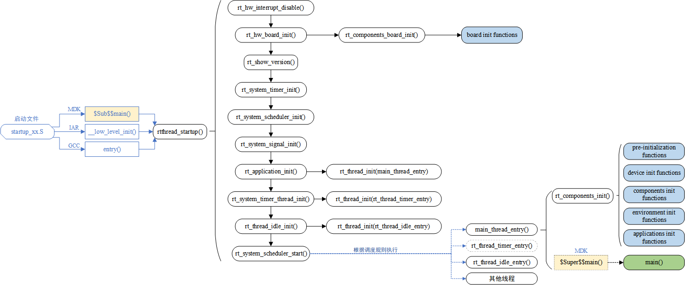
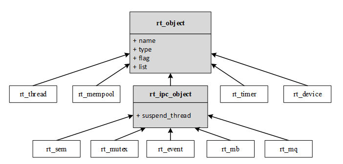
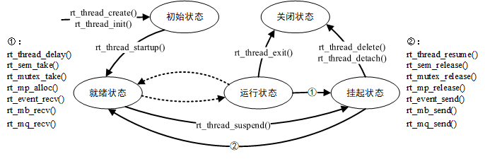
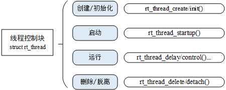

# RT-Thread 内核基础与线程

## 小结

本课程介绍了RTOS的基础线程、启动流程及线程控制块，旨在帮助学员理解RTOS相较于裸机的优势及其核心概念。

### 1. RTOS相较于裸机的优势

| 优势 | 说明 |
|------|------|
| **并发性** | 支持多任务并行处理，解决了裸机前后台模式下任务阻塞的问题 |
| **实时性** | 任务间的阻塞不影响其他任务，保证了系统的实时响应 |
| **可维护性** | 代码模块化程度高，易于理解和修改 |
| **可重用性** | 标准化的组件库使得代码可重用，减少了重复开发 |

### 2. RTOS核心概念：线程

**线程**：RTOS的基本执行单元，通过"分而治之"的思想将复杂任务拆解为多个独立的线程。

**线程生命周期**：包含初始态、就绪态、运行态、挂起态和关闭态。线程通过调度器在不同状态间切换。

| 状态 | 说明 |
|------|------|
| **运行态** | 线程正在执行业务代码 |
| **挂起态** | 线程因调用delay、等待信号量、邮箱等IPC操作而暂停，让出CPU |
| **就绪态** | 线程已准备好，等待被调度器选中执行 |
| **关闭态** | 线程执行完毕或被主动终止，进入销毁流程 |

### 3. 线程控制块 (TCB)

**定义**：TCB是管理线程的核心数据结构，包含了线程的栈、入口函数、参数、优先级、状态等信息。

**结构**：在RT-Thread中，TCB继承自一个基类（rt_object），并通过成员变量（如sp, entry, parameter, stack_addr等）来具体描述线程的属性。

### 4. 线程调度与系统线程

**调度策略**：RT-Thread采用抢占式优先级调度。优先级高的线程会抢占CPU；当优先级相同时，则依据时间片（tick）进行轮询。

**系统线程**：包含main线程、idle（空闲）线程和timer线程。

**idle线程**：优先级最低，用于系统空闲时的资源回收、低功耗管理和执行用户定义的钩子函数。

### 5. 启动流程

**启动阶段**：系统从复位向量开始，经过芯片级初始化（如关闭中断、外设初始化）、RT-Thread内核初始化（如创建main线程、timer线程、idle线程、启动调度器）等步骤。

---

## 一、系统启动流程

### 1.1 整体启动链路

以 STM32F407（Cortex-M4）为例，从上电复位到用户 main() 函数的完整流程如下：



```
上电复位
   │
   ▼
Reset_Handler（汇编：startup_stm32f407xx.s）
   │ 1. 取出向量表 Reset 向量，设置 MSP 主栈
   │ 2. 调用 SystemInit() 配置时钟（168MHz）
   │ 3. 跳转 __main 进入 C 运行环境
   ▼
main()（C 入口）
   │
   ▼
$Sub$$main()   ← 编译器自动插入的钩子（RT-Thread 通过它"截获"main）
   │
   ▼
rtthread_startup()   ← 内核启动总入口
   │
   ├─ rt_hw_board_init()        板级初始化：时钟、串口、堆区（rt_heap）
   ├─ rt_system_tick_init()     系统时钟节拍初始化（SysTick 1ms/tick）
   ├─ rt_hw_interrupt_init()    中断向量初始化
   ├─ rt_system_scheduler_init() 调度器初始化（就绪队列/位图）
   ├─ rt_system_signal_init()   信号机制初始化
   ├─ rt_application_init()     创建 main 线程（main_thread_entry，优先级 10）
   ├─ rt_components_init()      组件自动初始化（INIT_*_EXPORT 依次执行）
   └─ rt_system_scheduler_start() 启动调度器 → 切换第一个线程
        │
        ▼
main_thread_entry → 用户真正的 main() 开始执行
```

### 1.2 关键点

- **用户 main() 其实是一个线程**：RT-Thread 把 main 包装成优先级 10 的 `main` 线程，
  所以 main 里调用 `rt_thread_mdelay` 会主动让出 CPU，而不是死循环占死 CPU。
- **$Sub$$main / $Super$$main 机制**：编译器支持符号替换，`$Sub$$main` 先执行，
  内部处理完再调用 `$Super$$main`（真正的 main）。这是 RT-Thread 不需要改动
  startup 汇编就能接管启动过程的原因。

### 1.3 组件自动初始化

RT-Thread 提供分级初始化宏，注册的初始化函数在 `rt_components_init()` 里按优先级执行：

| 宏 | 优先级 | 执行时机/用途 |
| --- | --- | --- |
| `INIT_BOARD_EXPORT` | 1 | 板级外设初始化（时钟/GPIO） |
| `INIT_PREV_EXPORT` | 2 | 纯初始化、无依赖 |
| `INIT_DEVICE_EXPORT` | 3 | 外设驱动初始化 |
| `INIT_COMPONENT_EXPORT` | 4 | 组件初始化（如 FinSH） |
| `INIT_ENV_EXPORT` | 5 | 环境/依赖注入 |
| `INIT_APP_EXPORT` | 6 | 应用初始化（最晚） |

```c
// 用法示例
#include <rtthread.h>
static int app_init(void)
{
    rt_kprintf("app init\n");
    return 0;
}
INIT_APP_EXPORT(app_init);   // 自动注册，无需手动调用
```

---

## 二、内核基础

### 2.1 内核对象模型

RT-Thread 内核采用面向对象设计，所有内核对象都继承自基类 `rt_object`：



**核心对象说明：**

| 对象 | 说明 |
|------|------|
| `rt_thread` | 线程对象，OS的基本调度单位 |
| `rt_timer` | 定时器对象 |
| `rt_mempool` | 内存池对象 |
| `rt_device` | 设备对象 |
| `rt_sem` / `rt_mutex` | 信号量 / 互斥量 |
| `rt_event` | 事件 |
| `rt_mb` / `rt_mq` | 邮箱 / 消息队列 |

### 2.2 内核组成（src/ 目录）

| 模块 | 源文件 | 作用 |
| --- | --- | --- |
| 调度器 | scheduler.c | 就绪队列、优先级调度、时间片轮转 |
| 线程 | thread.c | 线程创建/删除/挂起/恢复/延时 |
| 时钟 | clock.c | tick 维护，rt_tick_get() |
| 定时器 | timer.c | 软件定时器 rt_timer_* |
| IPC | ipc.c | 信号量/互斥量/事件/邮箱/消息队列 |
| 内存 | mem.c / memheap.c / mempool.c / slab.c | 堆内存管理 |
| 对象 | object.c | 内核对象系统（链表管理所有对象） |
| 设备 | device.c | 设备框架 rt_device_* |
| 中断 | irq.c | 中断安装与进入/退出 |
| 空闲 | idle.c | 空闲线程 + 空闲钩子 |
| 服务 | kservice.c | rt_kprintf 等基础服务 |

### 2.3 线程控制块（TCB）

线程的一切信息都存在 TCB 中，`struct rt_thread` 的关键字段：

| 字段 | 说明 |
|------|------|
| `name` | 线程名（调试/识别） |
| `init_priority / current_priority` | 优先级（数值越小优先级越高） |
| `stack_addr / stack_size / sp` | 线程栈（独立运行空间，保存上下文和局部变量） |
| `entry / parameter` | 入口函数和参数 |
| `stat` | 线程状态（初始/就绪/运行/挂起/关闭） |
| `init_tick / remaining_tick` | 时间片（用于同优先级轮转） |
| `cleanup` | 退出时的清理回调 |

### 2.4 线程状态机



**状态转换：**

| 转换 | 触发条件 |
|------|----------|
| 初始 → 就绪 | `rt_thread_startup()` |
| 就绪 → 运行 | 调度器选中（最高优先级） |
| 运行 → 挂起 | `rt_thread_mdelay()` / 等待信号量/邮箱等 |
| 挂起 → 就绪 | 延时结束 / 资源可用 |
| 运行 → 关闭 | 线程 return 或 `rt_thread_exit()` |

### 2.5 调度机制

- **抢占式调度**：就绪队列中最高优先级的线程获得 CPU；高优先级线程一就绪，立即抢占低优先级线程。
- **时间片轮转（Round-Robin）**：同优先级多个线程，每个线程分一个时间片（单位 tick），时间片耗尽自动切到队列下一个线程。
- 优先级 0~31（`RT_THREAD_PRIORITY_MAX`），31 是空闲线程（idle)，优先级最低。
- 调度切换在**内核里不可抢占**（临界区/关中断保护），保证就绪队列一致性。

### 2.6 时钟节拍与空闲线程

- **tick**：系统心跳，由 SysTick 定时器中断产生，本工程 1000 ticks/s（1ms）。
- `rt_thread_mdelay(ms)` 延时 = 挂起当前线程 n 个 tick，期间让出 CPU。
- **空闲线程 idle（优先级 31）**：所有用户线程挂起/结束后运行，执行钩子并进 WFI 低功耗等待，避免空转。

---

## 三、线程

### 3.1 动态创建 vs 静态初始化



| 对比项 | 动态 rt_thread_create() | 静态 rt_thread_init() |
| --- | --- | --- |
| TCB 分配 | 系统从堆自动分配 | 用户提供（全局 struct rt_thread） |
| 栈分配 | 系统从堆自动分配 | 用户提供数组（如 char stack[1024]） |
| 返回值 | 返回线程句柄 rt_thread_t | 无返回值（直接操作对象） |
| 释放 | rt_thread_delete() | rt_thread_detach() |
| 适用场景 | 数量不确定、需动态管理 | 数量固定、节省动态分配开销 |

```c
/* 动态创建 */
rt_thread_t tid = rt_thread_create("name", entry, param,
                                   stack_size, priority, timeslice);
if (tid) rt_thread_startup(tid);

/* 静态初始化 */
static struct rt_thread t;
static char t_stack[1024];
rt_thread_init(&t, "name", entry, param,
               t_stack, sizeof(t_stack), priority, timeslice);
rt_thread_startup(&t);
```

### 3.2 常用线程 API

| API | 作用 |
| --- | --- |
| `rt_thread_create` / `rt_thread_init` | 创建（动态/静态） |
| `rt_thread_startup` | 启动（加入调度） |
| `rt_thread_suspend` / `rt_thread_resume` | 挂起 / 恢复 |
| `rt_thread_delay` / `rt_thread_mdelay` | 延时（tick / ms） |
| `rt_thread_delete` / `rt_thread_detach` | 销毁（动态 / 静态） |
| `rt_thread_self` | 获取当前线程句柄 |
| `rt_scheduler_sethook` | 注册调度器钩子（每次切换回调） |

### 3.3 入口函数的两种模式

```c
/* 模式一：无限循环（持续任务，推荐）——必须延时让出 CPU */
void thread_entry(void *param)
{
    while (1)
    {
        /* 干活 */
        rt_thread_mdelay(1000);
    }
}

/* 模式二：有限循环（一次性任务）——执行完自动退出（进关闭态） */
void thread_entry(void *param)
{
    for (int i = 0; i < 10; i++)
    {
        rt_kprintf("count: %d\n", i);
    }
}
```

### 3.4 线程栈与上下文切换

- 线程栈**从高地址向低地址增长**，保存：局部变量、返回地址、上下文（寄存器、PC）。
- 切换时：当前线程上下文**保存进自己的栈** → 恢复目标线程的上下文 → 跳转执行。
- 实现位于 `libcpu/arm/cortex-m4/context_gcc.S`（`rt_hw_context_switch*`），
  Cortex-M4 借助 **PendSV 异常**完成切换，切换过程不阻塞高优先级中断。

---

## 四、简单外设（配合线程）

### 4.1 rt_pin 引脚框架

```c
#include <rtdevice.h>

rt_pin_mode(GET_PIN(F, 9), PIN_MODE_OUTPUT);        // 配置输出
rt_pin_mode(GET_PIN(A, 0), PIN_MODE_INPUT_PULLUP);  // 配置上拉输入
rt_pin_write(GET_PIN(F, 9), PIN_HIGH);              // 输出高
rt_uint8_t v = rt_pin_read(GET_PIN(A, 0));          // 读取电平
```

### 4.2 LED + 按键（线程化）

```c
static void led_thread_entry(void *param)   /* LED 500ms 闪烁 */
{
    rt_pin_mode(LED_PIN, PIN_MODE_OUTPUT);
    while (1)
    {
        rt_pin_write(LED_PIN, PIN_HIGH);
        rt_thread_mdelay(500);
        rt_pin_write(LED_PIN, PIN_LOW);
        rt_thread_mdelay(500);
    }
}

static void key_thread_entry(void *param)   /* 按键检测 + 软件消抖 */
{
    rt_pin_mode(KEY_PIN, PIN_MODE_INPUT_PULLUP);
    while (1)
    {
        if (rt_pin_read(KEY_PIN) == PIN_LOW)   /* 按下（低电平） */
        {
            rt_thread_mdelay(20);              /* 消抖 */
            if (rt_pin_read(KEY_PIN) == PIN_LOW)
                rt_kprintf("KEY pressed!\n");
        }
        rt_thread_mdelay(10);
    }
}
```

---

## 五、调试手段

| 手段 | 用法 | 场景 |
| --- | --- | --- |
| `rt_kprintf` | 直接打印 | 最快、最常用 |
| 日志宏 | `LOG_D/I/W/E`（需 `DBG_TAG`/`DBG_LVL` + `#include <rtdbg.h>`） | 分级过滤调试信息 |
| 调度器钩子 | `rt_scheduler_sethook(hook)` | 观察线程切换、上下文切换 |
| msh 命令 | `list_thread` / `list_device` / `free` / `ps` | 实时查线程/设备/内存 |
| 导出命令 | `MSH_CMD_EXPORT(fn, desc)` | 把自己的函数变成 msh 命令 |

```c
#define DBG_TAG "demo"
#define DBG_LVL DBG_LOG
#include <rtdbg.h>

LOG_D("debug %d", 1);
LOG_I("info");
LOG_E("error!");

MSH_CMD_EXPORT(peripheral_sample, led & key sample);  // msh 里敲 peripheral_sample
```

**调度器钩子示例：**

```c
static void hook_of_scheduler(struct rt_thread* from, struct rt_thread* to)
{
    rt_kprintf("from: %s --> to: %s \n", from->name, to->name);
}
rt_scheduler_sethook(hook_of_scheduler);
```

---

## 六、SCons 构建系统

### 6.1 为什么需要构建工具

传统 Makefile 语法复杂易错，导致开发者精力被配置脚本消耗。SCons 的出现就是为了**用降低配置门槛来换取开发效率**。

**常见构建方式对比：**

| 构建工具 | 特点 |
|----------|------|
| GNU Make | 历史悠久，但语法混乱，Windows 下使用不便 |
| CMake | 功能强大，但需要额外生成 Makefile |
| **SCons** | 基于 Python，语法清晰，与 RT-Thread 深度集成 |

### 6.2 SCons 简介

SCons 是一套由 **Python 语言**编写的开源构建系统，类似于 GNU Make。它采用 SConstruct 和 SConscript 文件来替代 Makefile。

> RT-Thread 选择 SCons 的唯一目的：**使大家从复杂的 Makefile 配置、IDE 配置中脱离出来，把精力集中在 RT-Thread 功能开发上。**

### 6.3 RT-Thread 中的 SCons 脚本结构

```
BSP 目录
├── rtconfig.py    ← 编译器配置文件（工具链、编译参数）
├── SConstruct     ← SCons 入口脚本
├── SConscript     ← 分散在各级源码目录，控制源码构建
└── Kconfig        ← menuconfig 配置入口
```

**三个核心文件的作用：**

| 文件 | 作用 |
|------|------|
| `rtconfig.py` | 指定编译器、编译器参数（CCFLAGS、AFLAGS、LFLAGS） |
| `SConstruct` | SCons 入口脚本，初始化构建环境 |
| `SConscript` | 组织源码的主力军，每个源文件目录一个 |

### 6.4 SCons 基本命令

| 命令 | 说明 |
|------|------|
| `scons` | 直接编译 BSP |
| `scons -j8` | 多线程编译（加快速度） |
| `scons -c` | 清除编译产物 |
| `scons --target=mdk5` | 生成 Keil MDK5 工程 |
| `scons --target=iar` | 生成 IAR 工程 |
| `scons --target=cmake` | 生成 CMake 工程 |
| `scons --dist` | 搭建项目框架，生成可移植的 dist 目录 |
| `scons --menuconfig` | 图形化配置系统 |
| `scons --verbose` | 显示完整编译参数 |

### 6.5 SConscript 编写基础

SConscript 文件使用 Python 语法编写，核心函数包括：

```python
from building import *        # 导入 RT-Thread 自定义构建函数

cwd = GetCurrentDir()         # 获取当前脚本路径
CPPPATH = [cwd]              # 头文件搜索路径
src = Glob('*.c')            # 获取当前目录所有 .c 文件

# 根据配置决定是否编译某些源文件
if GetDepend('RT_USING_HELLO'):
    src += ['hello.c']

# 定义一个构建组（对应 IDE 中的 Group）
group = DefineGroup('hello', src, depend=[''], CPPPATH=CPPPATH)

Return('group')               # 返回构建组给上级脚本
```

### 6.6 SCons 与 Kconfig 的配合

RT-Thread 的构建系统由三部分组成：

```
┌─────────────────┐
│    Kconfig      │ ← 配置系统（声明式功能裁剪）
├─────────────────┤
│   rtconfig.py   │ ← 编译器配置（工具链、编译参数）
├─────────────────┤
│     SCons       │ ← 构建系统（条件编译、依赖感知构建）
└─────────────────┘
```

- `menuconfig` 读取 Kconfig 生成 `.config` 文件
- SCons 读取 `.config` 决定哪些源文件参与编译
- 编译选项最终生成 `rtconfig.h`

### 6.7 编译器配置（rtconfig.py）

```python
# 工具链选择：gcc / keil / iar
CROSS_TOOL = 'gcc'

# 编译器路径
EXEC_PATH = '/usr/local/gcc-arm-none-eabi-5_4-2016q3/bin/'

# 编译选项
CFLAGS = '-mcpu=cortex-m3 -mthumb -ffunction-sections -fdata-sections'
AFLAGS = '-c + DEVICE + '-x assembler-with-cpp'
LFLAGS = DEVICE + '-Wl,--gc-sections,-Map=rtthread-stm32.map'

# 优化级别：'debug' = 无优化，'release' = O2 优化
BUILD = 'debug'
```

### 6.8 静态 vs 动态线程创建的选择

> 张丙儒指出：**静态编译具备内存占用的确定性，而动态创建因依赖系统堆，其申请时机与次数均不可控**。这本质上是用**编译期的资源规划**来换取**运行时的稳定性**。

**场景选择建议：**

| 场景 | 推荐方式 | 原因 |
|------|----------|------|
| 常规应用开发 | 动态/静态均可 | 更看重便捷性，对底层内存确定性要求不严苛 |
| 数量固定的线程 | 静态 | 节省动态分配开销，内存布局更清晰 |
| 数量不确定的线程 | 动态 | 灵活管理，需要注意堆状态 |
| **军工/高安全场景** | **全静态** | 必须规避内存碎片化风险，系统的绝对可控性是压倒一切的硬指标 |

---

## 七、一日速记

1. **启动**：复位 → Reset_Handler → main → $Sub$$main → rtthread_startup →
   创建 main 线程 → 启动调度器 → 用户 main 在线程里跑。
2. **优先级**：数值越小越高；0~31，31 是 idle 空闲线程。
3. **调度**：抢占（不同优先级）+ 时间片轮转（同优先级）。
4. **状态**：初始 → 就绪 → 运行 → 挂起 → 关闭。
5. **动态/静态**：create 用堆、delete 释放；init 用数组、detach 脱离。
6. **延时**：mdelay = 挂起让出 CPU，空闲线程趁机运行。
7. **外设**：rt_pin_mode/write/read 三步驱动 GPIO，外设任务线程化。
8. **调试**：rt_kprintf + LOG + 调度器钩子 + msh 命令四件套。
9. **构建**：scons + Kconfig + menuconfig 三位一体，SCons 基于 Python 语法清晰。
10. **选型**：常规开发动态静态均可，高安全场景必须全静态确保内存确定性。
