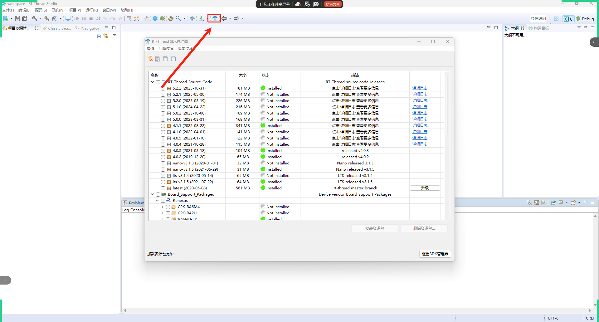
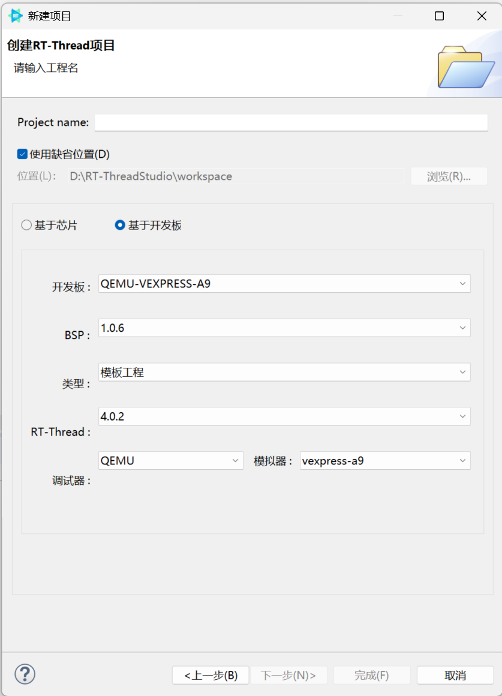
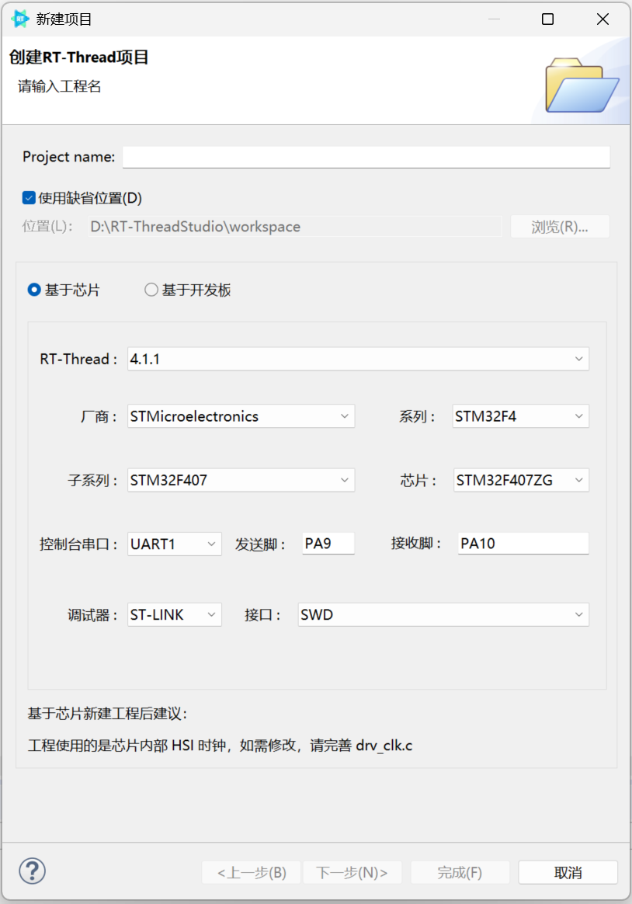
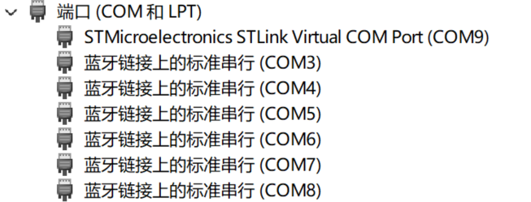
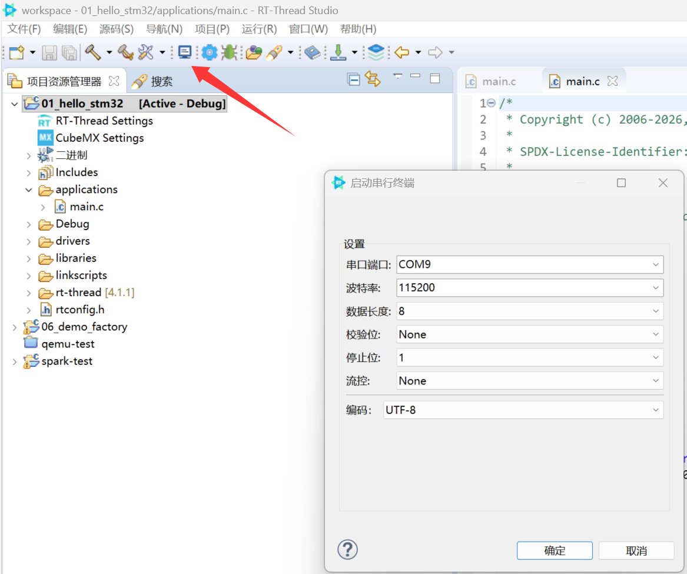
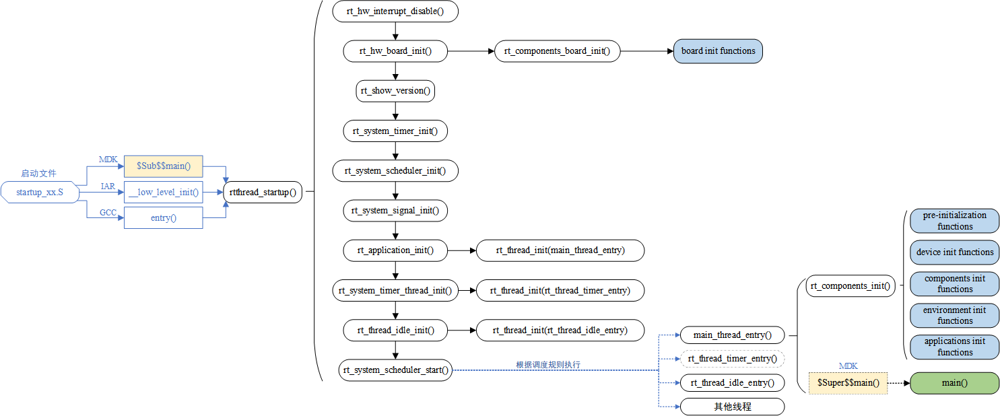

# RT-Thread 夏令营笔记

## 目录

- [1. RT-Thread 的三条版本路线](#1-rt-thread-的三条版本路线)
- [2. Markdown 基础语法](#2-markdown-基础语法)
- [3. 新建并认识 QEMU A9 工程](#3-新建并认识-qemu-a9-工程)
- [4. RT-Thread 启动流程](#4-rt-thread-启动流程)
- [5. Git 与 Gitee](#5-git-与-gitee)

## 1. RT-Thread 的三条版本路线

RT-Thread 是面向嵌入式设备的实时操作系统（RTOS）。它通过线程调度，让多个任务按优先级快速切换执行，从而满足设备对实时性、资源占用和功能扩展的不同需求。

RT-Thread 提供三条主要路线：**标准版**侧重完整功能，**Nano 版**侧重极小资源占用，**Smart 版**侧重运行更复杂的用户态应用。三者并非完全独立：Nano 可以看作标准版的精简内核，Smart 则在标准版的基础上加入了用户态机制。因此，初学阶段建议先以标准版建立整体认识。

| 路线 | 核心特点 | 适用场景 | 学习建议 |
| --- | --- | --- | --- |
| 标准版本 | 完整的 RT-Thread 系统，可按需配置内核、驱动、组件、网络与软件包 | 需要外设驱动、文件系统、网络、物联网组件等功能的 MCU 项目 | 作为学习基础，优先掌握线程、同步通信、设备模型和组件使用 |
| Nano 版本 | 极简的硬实时内核，支持线程、定时器、信号量、邮箱、调度等基础能力，资源占用很小 | 家电、消费电子、医疗设备、工业控制等入门级 32 位 MCU 场景 | 适合资源紧张或希望先聚焦 RTOS 内核原理的项目 |
| Smart 版本 | 将应用与内核分离；应用运行在独立的用户态地址空间，通过系统调用访问内核服务 | 配有 MMU、资源更充足，需要隔离性和复杂应用能力的处理器平台 | 建议在掌握标准版后学习，并补充 MMU、用户态/内核态和系统调用知识 |

## 2. Markdown 基础语法

Markdown 是一种轻量级标记语言：用少量易读的符号写纯文本，就能排版出标题、列表、链接和代码块。`.md` 文件就是 Markdown 文件；本笔记的内容正是使用 Markdown 编写的。

### 2.1 标题与段落

在行首写 `#` 创建标题，`#` 的数量越多，标题层级越低。段落之间保留一个空行。

```md
# 一级标题
## 二级标题
### 三级标题

这是第一个段落。

这是另一个段落。
```

### 2.2 无序列表与有序列表

无序列表使用 `-`，有序列表使用数字加英文句点。列表内容建议与符号之间保留一个空格。

```md
- 线程
- 信号量
  - 二值信号量
  - 计数信号量

1. 创建线程
2. 启动调度器
3. 观察运行结果
```

### 2.3 强调与行内代码

用 `**文字**` 标记重点，用反引号包住函数名、命令或变量名。

```md
**重点：线程需要入口函数。**

使用 `rt_thread_create()` 创建线程。
```

效果：**重点：线程需要入口函数。** 使用 `rt_thread_create()` 创建线程。

### 2.4 链接与图片

链接的格式是 `[显示文字](链接地址)`；图片只是在前面多一个 `!`。图片路径可以是网络地址，也可以是仓库中的相对路径。

```md
[RT-Thread 官网](https://www.rt-thread.org/)


```

### 2.5 代码块

用三个反引号包住多行代码；在开头的反引号后填写语言名称，可以获得语法高亮。

````md
```c
static void led_entry(void *parameter)
{
    /* 线程入口函数 */
}
```
````

### 2.6 引用与分隔线

行首使用 `>` 创建引用；连续三个减号 `---` 可创建分隔线。

```md
> 注意：中断服务程序中不能执行可能阻塞的操作。

---
```

### 2.7 表格

表格用竖线 `|` 分隔列，第二行用减号 `-` 表示表头和内容的分界。

```md
| API | 作用 |
| --- | --- |
| `rt_thread_create()` | 创建线程 |
| `rt_thread_startup()` | 启动线程 |
```


## 3. 新建并认识 QEMU A9 工程

创建工程前，可通过 RT-Thread Studio 工具栏打开 SDK 管理器，安装需要的 RT-Thread 源码或 BSP 资源包。



QEMU 是一个模拟器，可以在电脑上模拟开发板的处理器和部分外设。这里使用的 BSP（Board Support Package，板级支持包）是 `qemu-vexpress-a9`，它面向 QEMU 模拟的 ARM VExpress-A9 平台。这样即使暂时没有实体开发板，也可以学习 RT-Thread 的编译、启动和基础功能。

### 3.1 从新建 QEMU A9 工程开始

在 RT-Thread Studio 中新建项目时，选择 **RT-Thread Project**，然后在 BSP/开发板选择界面中选择 `qemu-vexpress-a9`（QEMU/VExpress A9）。

新建工程时需要关注的选项如下：



工程创建后，先查看 `applications/main.c`。该参考工程的 `main()` 只输出 `hello rt-thread`，它是验证工程能否正常启动的最小应用入口。

```c
int main(void)
{
    printf("hello rt-thread\n");
    return 0;
}
```

> QEMU 负责模拟硬件；RT-Thread 仍然运行在模拟出来的 ARM 平台中。因此，应用代码的编写方式与真实开发板基本一致，但具体硬件外设的行为仍应以真实板卡验证为准。

### 3.2 QEMU A9 工程结构


```text
qemu-test/
├─ applications/          # 用户应用：main.c、其他业务代码
├─ drivers/               # 板级初始化与外设驱动
├─ rt-thread/             # RT-Thread 内核、组件、CPU 架构适配与构建工具
├─ build/、Debug/          # Studio 构建过程生成的中间文件或输出目录
├─ Kconfig                # BSP 配置菜单入口
├─ cconfig.h              # 根据配置生成的 C 宏定义
├─ rtconfig.h             # RT-Thread 功能配置结果
├─ rtconfig.py            # GCC 工具链、编译参数、链接参数与目标文件后缀配置
├─ SConstruct             # SCons 构建入口
├─ SConscript             # 收集各子目录源码的构建脚本
├─ link.lds               # 链接脚本：规定程序和内存的布局
├─ qemu.bat / qemu.sh     # 以带图形界面的方式启动 QEMU
├─ qemu-nographic.bat/.sh # 不启动图形界面，在终端中查看输出
├─ qemu-dbg.bat/.sh       # 以调试方式启动 QEMU
├─ sd.bin                 # 提供给 QEMU 的模拟 SD 卡镜像
└─ .project、.cproject    # RT-Thread Studio（Eclipse）工程元数据
```

#### 3.2.1 应用目录：`applications/`

`applications/main.c` 是用户应用的起点。当前工程还包含 `mnt.c`、`lcd_init.c` 等应用文件；`applications/SConscript` 会自动收集该目录下的 `.c`、`.cpp` 文件参与编译。

通常新增自己的业务功能时，优先在这个目录创建 `.c` 文件，而不是直接修改 `rt-thread` 目录中的内核文件。

#### 3.2.2 板级与驱动目录：`drivers/`

`drivers/board.c` 负责最早期的板级初始化，例如中断初始化、堆初始化、组件初始化和控制台设备设置。该目录还包含串口、定时器、LCD、SDIO、网卡、鼠标和键盘等 QEMU A9 平台相关驱动。

驱动是否编译由 `drivers/Kconfig` 控制。例如 UART1 默认启用；网卡驱动依赖网络组件，LCD 驱动依赖图形引擎。配置改变后，相关宏会体现在 `rtconfig.h` 和 `cconfig.h` 中。

#### 3.2.3 内核目录：`rt-thread/`

该目录是 RT-Thread 源码主体，常见子目录包括：

| 目录 | 作用 |
| --- | --- |
| `src/` | 线程调度、时钟、IPC、内存管理等内核核心实现 |
| `include/` | 常用内核头文件，例如 `rtthread.h` |
| `components/` | 文件系统、网络、设备框架等可选组件 |
| `libcpu/` | 与 CPU 架构相关的启动、上下文切换、中断和 MMU 适配代码 |
| `tools/` | SCons、配置与工程生成等开发工具脚本 |

对于 QEMU A9，`rt-thread/libcpu/arm/zynq7000/` 中包含 ARM Cortex-A 相关的启动、中断、上下文切换和 MMU 支持代码。

#### 3.2.4 配置、构建与启动文件

1. `Kconfig` 是配置菜单的入口，它会继续包含 RT-Thread 内核和 `drivers/Kconfig` 的配置项。
2. `SConstruct` 是构建总入口，调用 `applications`、`drivers` 与 `rt-thread` 等目录的 `SConscript` 收集源码。
3. `rtconfig.py` 指定 ARM GNU 工具链前缀 `arm-none-eabi-`、Cortex-A 编译参数和链接脚本 `link.lds`；编译后会生成 `rtthread.elf`，并转换出 `rtthread.bin`。
4. `qemu.bat` 使用 `qemu-system-arm -M vexpress-a9` 启动模拟器；`qemu-nographic.bat` 适合只在终端观察串口输出。

> 文件修改优先级：编写功能改 `applications/`；调整硬件相关内容改 `drivers/`；通过配置工具修改功能开关；仅在学习或移植内核时才进入 `rt-thread/`。

### 3.3 STM32F407ZG 芯片工程

与 QEMU 工程不同，STM32F407ZG 工程运行在真实 MCU 上。RT-Thread Studio 新建项目时选择“基于芯片”，并依次选择 STMicroelectronics、STM32F4、STM32F407 和 STM32F407ZG。

控制台选择 UART1：发送引脚为 PA9，接收引脚为 PA10；调试器使用 ST-LINK，调试接口选择 SWD。工程默认使用芯片内部 HSI 时钟，若要修改时钟，需要再配置 drv_clk.c。



参考工程 01_hello_stm32 的应用入口在 applications/main.c。程序每隔 1 秒通过日志输出一次 Hello RT-Thread!；下载到开发板后，可用 Studio 内置串行终端观察输出。

先在 Windows 设备管理器的“端口（COM 和 LPT）”中确认 ST-LINK 虚拟串口的 COM 号。



串行终端需要选择实际识别到的串口号（图中为 COM9），并设置为：波特率 115200、数据位 8、校验位 None、停止位 1、流控 None、编码 UTF-8。



#### 3.3.1 启动文件：startup_stm32f407xx.S

截图中的 startup_stm32f407xx.S 位于 CMSIS 的 STM32F407 系列模板目录，是供 GNU GCC 工具链使用的汇编启动文件。它最先在芯片复位后运行，不是普通业务代码。

它完成以下几件事：

1. 设置初始栈指针 SP。
2. 将 Flash 中 .data 段的初始值复制到 SRAM，并将 .bss 段清零。
3. 调用 SystemInit() 完成芯片底层时钟等初始化。
4. 进入 RT-Thread 的 entry()；entry() 随后调用 rtthread_startup()，RT-Thread 创建主线程后，最终才执行 applications/main.c 中的 main()。
5. 提供中断向量表：复位、HardFault、SysTick，以及 USART1 等外设中断发生时，处理器会从该表找到对应的中断处理函数。

启动路径可以概括为：复位 → startup_stm32f407xx.S → SystemInit() → entry() → rtthread_startup() → main()。

通常无需修改该文件。只有在移植到不同芯片、调整启动流程，或排查启动和中断异常时，才需要阅读或修改它。
#### 3.3.2 MSH 基础操作

MSH 是 RT-Thread 的 FinSH 组件提供的命令行 Shell。通过 Studio 串行终端连接开发板后，复位开发板并按一次 Enter；看到 msh > 或 msh /> 提示符，就可以输入命令并按 Enter 执行。

常用命令如下：

| 命令 | 用途 |
| --- | --- |
| help | 查看当前系统实际注册的命令 |
| version | 查看 RT-Thread 版本信息 |
| ps | 查看系统中的线程 |
| free | 查看内存使用情况 |
| list_device | 查看已注册设备 |
| clear | 清屏 |
| reboot | 立即重启开发板，未保存的运行状态会丢失 |

输入 help 可查看当前工程可用命令；命令是否出现取决于当前启用的组件和驱动。

    msh >help
    RT-Thread shell commands:
    clear            - clear the terminal screen
    version          - show RT-Thread version information
    list_thread      - list thread
    list_device      - list device in system
    ps               - List threads in the system.
    free             - Show the memory usage in the system.
    reboot           - Reboot System

输入 ps 可查看线程运行情况：

    msh >ps
    thread   pri  status      sp     stack size max used left tick  error
    -------- ---  ------- ---------- ----------  ------  ---------- ---
    tshell    20  running 0x000000d0 0x00001000    15%   0x00000007 OK
    tidle0    31  ready   0x00000060 0x00000100    56%   0x00000015 OK
    timer      4  suspend 0x00000080 0x00000200    25%   0x00000009 OK
    main      10  suspend 0x000000b4 0x00000800    14%   0x00000013 OK

其中，thread 是线程名称；pri 是优先级，数值越小优先级越高；status 表示线程状态；stack size 是分配的栈大小；max used 是历史最大栈使用比例。tshell 是当前正在执行命令的 Shell 线程；suspend 表示线程正在等待，不一定是异常。

输入 free 可查看堆内存统计：

    msh >free
    total    : 125816
    used     : 7076
    maximum  : 7076
    available: 118740

total 是总堆内存，used 是当前已使用内存，maximum 是运行以来的最大使用量，available 是当前可用内存。上述数值会随工程配置和运行状态变化。

如果没有出现 MSH 提示符，优先检查串口号、115200 波特率、串口是否被其他软件占用，并确认 RT_USING_FINSH 和 FINSH_USING_MSH 已启用。

## 4. RT-Thread 启动流程

[RT-Thread 官方编程手册：基础知识与启动流程](https://www.rt-thread.org/document/site/#/rt-thread-version/rt-thread-standard/programming-manual/basic/basic?id=rt-thread-%e5%90%af%e5%8a%a8%e6%b5%81%e7%a8%8b)

RT-Thread 启动并不是复位后直接执行用户的 main()。芯片先运行启动文件，完成最基础的硬件和内存准备，再进入 RT-Thread 内核；内核创建线程并启动调度器后，用户 main() 才在主线程中执行。



### 4.1 从启动文件进入 RT-Thread

芯片复位后，启动文件首先运行。不同工具链的入口不同：MDK 使用 $Sub$$main()，IAR 使用 __low_level_init()，GNU GCC 使用 entry()。它们最终都会进入 rtthread_startup()。

对本次 STM32F407ZG 的 GCC 工程而言，startup_stm32f407xx.S 先设置栈和内存段、调用 SystemInit()，再调用 entry()；entry() 继续调用 rtthread_startup()。

### 4.2 rtthread_startup() 完成内核初始化

rtthread_startup() 按顺序完成关键准备工作：

1. 关闭中断，避免初始化尚未完成时发生中断。
2. 调用 rt_hw_board_init()，完成板级初始化；其中可执行板级自动初始化函数。
3. 显示 RT-Thread 版本，初始化系统定时器、调度器和信号机制。
4. 创建主线程、定时器服务线程和空闲线程。
5. 启动调度器 rt_system_scheduler_start()，由调度器根据优先级运行线程。

### 4.3 主线程执行组件初始化与用户 main()

调度器启动后，主线程执行 main_thread_entry()。它先调用 rt_components_init()，依次完成预初始化、设备、组件、环境和应用等自动初始化函数；随后才调用 applications/main.c 中的 main()。

因此可以把完整路径记为：复位 → 启动文件 → rtthread_startup() → 创建系统线程 → 启动调度器 → main_thread_entry() → 组件初始化 → 用户 main()。

> 关键理解：用户 main() 不是裸机意义上的第一个 C 函数；在 RT-Thread 中，它运行在已经由内核创建并调度的主线程里。

## 5. Git 与 Gitee

Git 是分布式版本控制工具，用于记录文件的历史修改；Gitee 是托管 Git 仓库的平台。把夏令营笔记放入 Git 仓库后，可以保存版本、同步到远程，并在需要时恢复到历史版本。

### 5.1 在 Gitee 创建笔记仓库

登录 Gitee 后，点击右上角“+”并选择“新建仓库”。仓库名称可使用 rt-thread-summer-camp-notes，填写简短介绍，并按自己的分享需求选择公开或私有。

当前笔记目录已经有 01.md 和图片文件。为了避免首次上传时与线上文件冲突，创建远程仓库时建议不要勾选 README、.gitignore 或许可证初始化选项，创建一个空仓库即可。创建完成后，在仓库页面复制 SSH 地址，格式类似：

    git@gitee.com:你的用户名/rt-thread-summer-camp-notes.git

仓库名称、归属、路径、可见性和初始化选项的详细说明可参考 [Gitee：创建你的第一个仓库](https://gitee.com/help/articles/4120)。

### 5.2 配置账户 SSH 公钥

Gitee 可以通过 SSH 协议访问 Git 仓库。配置账户 SSH 公钥后，当前电脑可使用 SSH 地址拉取和推送你有权限的仓库。

Windows 建议使用 Windows PowerShell 或 Git Bash；命令提示符不自带 cat 和 ls 命令。

#### 5.2.1 生成 SSH 密钥

下面命令的目的是生成一对 ED25519 密钥：

    ssh-keygen -t ed25519 -C "Gitee SSH Key"

命令会依次询问保存位置、密码短语和确认密码短语。直接连续按三次 Enter 可使用默认保存位置且不设置密码短语；若电脑可能被他人使用，建议设置密码短语。

生成后会得到两个文件：

- id_ed25519：私钥，用于证明当前电脑身份。
- id_ed25519.pub：公钥，用于上传到 Gitee。

#### 5.2.2 查看并复制公钥

先确认密钥文件已经生成。PowerShell 中执行：

    Get-ChildItem $HOME\.ssh

读取公钥时，PowerShell 使用：

    Get-Content $HOME\.ssh\id_ed25519.pub

Git Bash 使用：

    cat ~/.ssh/id_ed25519.pub

复制输出的整行内容；它通常以 ssh-ed25519 开头。

#### 5.2.3 在 Gitee 添加并测试

在 Gitee 中依次进入“个人设置 → 安全设置 → SSH 公钥 → 添加公钥”，粘贴公钥内容、填写标题，并按页面要求验证账户密码。添加后，可在同一页面查看或删除已添加的公钥。

下面命令的目的是测试当前 SSH 密钥是否已经绑定到 Gitee 账户：

    ssh -T git@gitee.com

若输出中包含已成功认证和你的用户名，说明 SSH 配置完成；Gitee 不提供 SSH Shell 登录是正常现象。完整官方步骤见 [Gitee：SSH 公钥设置](https://help.gitee.com/base/account/SSH%E5%85%AC%E9%92%A5%E8%AE%BE%E7%BD%AE)。

> 安全提示：只能复制和上传以 .pub 结尾的公钥文件；绝不能上传、发送或提交不带 .pub 后缀的私钥文件 id_ed25519。仓库部署公钥与账户 SSH 公钥用途不同，部署公钥请参考 [添加部署公钥](https://help.gitee.com/repository/ssh-key/generate-and-add-ssh-public-key)。

### 5.3 Git 的基本同步流程

Git 的常用流程可以理解为：本地工作区 → 暂存区 → 本地提交历史 → 远程仓库。

1. 初始化当前目录为 Git 仓库。一个目录只需执行一次；已经是 Git 仓库时不要重复初始化。

       git init

2. 拉取远程分支的最新提交到本地。下面以 master 为例；实际项目应使用仓库的默认分支名。

       git pull origin master

3. 将指定文件或目录加入暂存区。暂存区是“下一次提交的待提交清单”，便于决定本次要提交哪些修改。

       git add 文件或目录路径

4. 把暂存区内容创建为一次本地提交，并使用 -m 写明本次修改说明。

       git commit -m "本次修改说明"

5. 将当前本地分支的提交推送到远程仓库。

       git push origin master

6. 修改名为 origin 的远程仓库地址。将示例地址替换为自己的 Gitee SSH 仓库地址。

       git remote set-url origin git@gitee.com:你的用户名/你的仓库.git

7. 获取远端 master 分支的最新提交和引用，但不自动合并到当前本地分支，也不修改工作区文件。

       git fetch origin master

   获取后，远端分支的状态会更新到 origin/master；需要将更新合并到本地时，再使用 git pull 或 git merge。

8. 查看所有远程仓库的名称，以及用于拉取和推送的地址。

       git remote -v

   git remote -v 不显示分支列表；若要查看远端分支，可使用：

       git branch -r

9. 基于当前分支的当前提交创建名为 test 的新分支，并立即切换到该分支。

       git checkout -b test

   创建后可使用下面命令确认，带 * 的分支就是当前所在分支：

       git branch

同步方向需要记住：git pull 是“远端 → 本地”，git push 是“本地 → 远端”。

> 提交完成后，本地 Git 历史中才会保存这次可追溯的版本；仅执行 git add 不等于已经完成版本保存。

### 5.4 简单冲突处理

当本地与远端修改了同一文件的同一位置时，执行 git pull 或合并分支可能产生冲突。Git 会暂停合并，要求手动决定保留哪部分内容。

1. 先查看发生冲突的文件：

       git status

2. 打开冲突文件，找到以下标记，保留正确内容后删除这三行标记及不需要的内容：

       <<<<<<< HEAD
       本地修改
       =======
       远端修改
       >>>>>>> origin/master

3. 将解决后的文件加入暂存区，并创建一次解决冲突的提交：

       git add 冲突文件路径
       git commit -m "resolve merge conflict"

4. 再继续推送：

       git push

如果暂时无法判断应该保留哪一边，可放弃本次合并并恢复到合并前状态：

       git merge --abort

> 处理冲突的关键不是选“本地”或“远端”，而是确认最终文件同时保留所需修改，并且不留下 <<<<<<<、=======、>>>>>>> 标记。

### 5.5 Fork 与 Pull Request（PR）流程

当自己没有原始仓库的直接写入权限时，使用 Fork 和 PR 提交作业。整体流程是：原始仓库 → 自己的 Fork 仓库 → 本地分支 → Pull Request。

1. 在 Gitee 将原始仓库 Fork 到自己的账号。Fork 会创建一份属于自己的远程仓库副本，自己可以向该副本推送分支。

2. 克隆自己 Fork 后的仓库到本地。后续提交应推送到自己的 Fork，而不是直接推送到原始仓库。

3. 从主分支创建作业分支，例如 test，并在该分支完成修改：

       git checkout -b test

4. 将修改加入暂存区、创建本地提交，并推送作业分支到自己的 Fork：

       git add 文件或目录路径
       git commit -m "完成作业内容"
       git push -u origin test

5. 在 Gitee 的自己 Fork 仓库中创建 Pull Request，并选择：

   - 来源：自己 Fork 仓库中的 test 作业分支。
   - 目标：原始仓库老师指定的分支，通常是 main 或 master。

6. 提交 PR 前，检查文件列表、提交记录、来源分支和目标分支；确认无误后再创建 PR。

> 关键理解：PR 不是直接向原始仓库提交代码，而是请求把“自己 Fork 仓库中已推送的作业分支”合并到原始仓库的指定分支。
