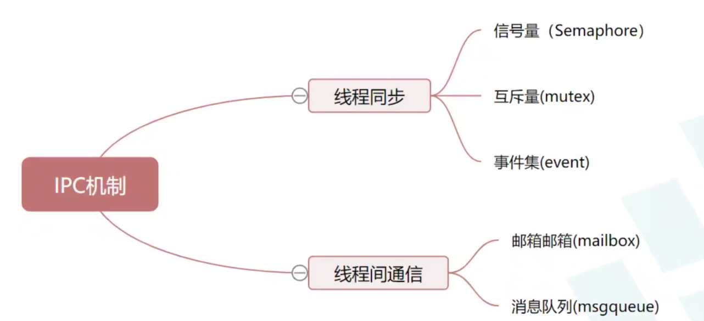

# RT-Thread 夏令营笔记03：线程同步与线程间通信（IPC）

## 目录

- [1. 多线程协作的基础概念（Multithread Coordination）](#1-多线程协作的基础概念multithread-coordination)
- [2. 信号量（Semaphore）：等待事件或管理多个资源](#2-信号量semaphore等待事件或管理多个资源)
- [3. 互斥量（Mutex）：为共享数据加锁](#3-互斥量mutex为共享数据加锁)
- [4. 事件集（Event）：等待一个或多个事件](#4-事件集event等待一个或多个事件)
- [5. 邮箱（Mailbox）：在线程间传递一个机器字](#5-邮箱mailbox在线程间传递一个机器字)
- [6. 消息队列（Message Queue）：传递指定大小的数据块](#6-消息队列message-queue传递指定大小的数据块)
## 1. 多线程协作的基础概念（Multithread Coordination）

在 RTOS 中，多个线程会交替运行。只要它们会访问同一份资源，或者一个线程需要等另一个线程完成某件事，就需要使用 IPC（Inter-Process Communication，此处也包含线程间同步与通信机制）进行协调。

### 1.1 线程同步与线程间通信



- **线程同步**解决“线程何时可以继续执行、谁先谁后”的问题。例如，线程 2 必须等线程 1 完成某项工作后才能继续，或多个线程不能同时修改同一份共享数据。信号量、互斥量和事件集主要用于协调这类执行顺序与资源访问关系。
- **线程间通信**解决“线程之间传递什么数据”的问题。例如，按键线程把按键状态交给 LED 线程，传感器线程把采样值交给显示线程。邮箱和消息队列用于传递这些数据。

两者并非完全割裂：线程接收邮箱或消息队列时，若暂时没有数据也会等待，因此通信机制也能带来同步效果；但区分重点是，**同步侧重执行时机，通信侧重数据传递**。

### 1.2 临界区与共享资源

**临界区**可以理解为：访问某个共享资源的那一段代码或资源本身，在同一时刻只允许一个线程使用。课程中用“一个房间里有饮水机、健身器材、厕所，多个住户轮流使用”来类比。

例如，两个线程都要依次修改 `number1` 和 `number2`，那么“读取、修改并写回这两个变量”的代码必须作为一个整体执行；否则线程可能在中途切换，导致两个变量暂时或长期不一致。

### 1.3 阻塞、非阻塞与挂起

- **阻塞（blocking）**：线程所需资源暂不可用时，线程等待该资源，暂时不继续执行后续逻辑。
- **非阻塞（non-blocking）**：线程尝试获取资源；若无法获得，立即返回，由线程自行决定执行其他逻辑还是稍后重试。
- **挂起状态**：等待 IPC 对象的线程通常会从运行/就绪状态转入挂起状态；资源可用、事件到达或等待超时后，线程回到就绪状态，等待调度器再次运行它。

可以把阻塞获取理解为在饮水机前等待接满水；非阻塞获取则类似把杯子交给自动饮水机，随后先去做其他事情，等通知再处理结果。

> 注意：阻塞不是“CPU 什么都不做”。当前线程被挂起后，调度器仍可运行其他就绪线程。

## 2. 信号量（Semaphore）：等待事件或管理多个资源

信号量（Semaphore）是内核对象，用一个计数值表示“可用许可”的数量。线程通过**获取**（take）消耗一个许可，通过**释放**（release）增加一个许可，从而实现同步或资源计数。

### 2.1 二值信号量与计数信号量

| 类型 | 取值范围 | 常见初值 | 适合解决的问题 | 类比 |
| --- | --- | --- | --- | --- |
| 二值信号量 | `0` 或 `1` | 通常为 `0` | 等待一次事件发生 | 红灯停、绿灯行；按键后允许 LED 操作 |
| 计数信号量 | `0` 到最大值 | 可用资源数量 `N` | 管理多个同类资源实例 | 有 `N` 个车位的停车场 |

二值信号量初值为 `0` 时，表示“事件尚未发生”：等待它的线程会阻塞；另一个线程或中断服务程序释放该信号量后，值变为 `1`，等待线程便可以被唤醒并获取它。

计数信号量初值为 `N` 时，表示还有 `N` 个可用资源。每成功获取一次，计数减一；计数到 `0` 后，新的获取请求需要等待其他线程释放资源。

### 2.2 信号量的生命周期与等待策略

RT-Thread 为信号量提供动态创建和静态初始化两套接口，它们的销毁方式必须配对：

| 方式 | 创建/初始化 | 结束使用 | 适用理解 |
| --- | --- | --- | --- |
| 动态方式 | `rt_sem_create()` | `rt_sem_delete()` | 内核从堆中创建对象，结束时释放对象 |
| 静态方式 | `rt_sem_init()` | `rt_sem_detach()` | 用户提供控制块，结束时从内核对象管理中脱离 |

`flag` 用于选择等待队列的组织方式：

- `RT_IPC_FLAG_FIFO`：先等待的线程优先得到信号量；
- `RT_IPC_FLAG_PRIO`：优先级更高的等待线程优先得到信号量。

课程建议：对实时性更敏感的场景，优先使用按优先级等待；只有业务确实强调先来后到时，再考虑 FIFO。

```c
/* 动态创建：初值为 0，表示同步事件尚未发生 */
rt_sem_t sem = rt_sem_create("dsem", 0, RT_IPC_FLAG_PRIO);

/* 静态初始化：sem_obj 由用户预先定义 */
rt_sem_init(&sem_obj, "ssem", 0, RT_IPC_FLAG_PRIO);
```

### 2.3 获取与释放

常用操作如下：

```c
rt_err_t result;

/* 最多等待 timeout 个 tick；RT_WAITING_FOREVER 表示一直等待 */
result = rt_sem_take(sem, timeout);

/* 不等待：拿不到就立刻返回 */
result = rt_sem_trytake(sem);
/* 与 rt_sem_take(sem, 0) 的“不等待”效果相同 */

/* 释放一个许可，可能唤醒等待该信号量的线程 */
rt_sem_release(sem);
```

`rt_sem_take()` 成功时，信号量值减一；若当前值为 `0`，则根据 `timeout` 决定立即返回、等待有限时间，还是永久等待。`rt_sem_release()` 使计数增加，或直接使符合条件的等待线程恢复就绪。


### 2.4 信号量示例执行流程

```text
在 MSH 输入 semaphore_sample
       ↓
semaphore_sample() 开始执行
       ↓
创建动态信号量 dsem，初始计数值 = 0
       ↓
初始化并启动 thread1（优先级 25）
       ↓
初始化并启动 thread2（优先级 24，更高）
       ↓
thread2 等待信号量
       ↓
thread1 每计数 10 次，释放一次信号量
       ↓
thread2 被唤醒，number 加 1
       ↓
thread2 再次等待信号量
       ↓
重复 10 次
       ↓
thread1 结束；thread2 最终停在“永久等待信号量”
```

线程 1 共释放 10 次信号量，因此线程 2 成功获取 10 次，`number` 最终为 `10`。这里的信号量只传递“可以执行一次”的通知，不传递 `count` 的具体数值。

## 3. 互斥量（Mutex）：为共享数据加锁

互斥量（Mutex）可以看作专门用于保护临界区的“锁”。它在未被持有时为开锁状态；一个线程获取后，互斥量处于闭锁状态，其他线程不能再成功获取，直到持有者释放它。

### 3.1 互斥量与二值信号量的关键差异

| 特性 | 二值信号量 | 互斥量 |
| --- | --- | --- |
| 主要用途 | 同步通知，也可用于简单互斥 | 保护共享临界区 |
| 所有权 | 无；可由其他线程或中断释放 | 有；只能由持有线程释放 |
| 递归获取 | 不支持；同一线程重复等待可能把自己阻塞 | 支持；内核记录持有次数 |
| 优先级反转处理 | 不提供互斥量的优先级继承语义 | 通过优先级继承缓解优先级反转 |

“互斥量是特殊的二值信号量”只说明它也具有锁定/解锁的两种状态；实际使用时应重点关注它的所有权、递归计数和优先级继承机制。

### 3.2 优先级反转与优先级继承

假设线程优先级为 `A > B > C`，共享资源 `M` 被低优先级线程 `C` 持有：

```text
① C 持有 M 并开始执行
② A 就绪，尝试获取 M，但 M 尚未释放，因此 A 被阻塞
③ B 就绪；B 的优先级高于 C，于是抢占 C
④ C 无法继续运行并释放 M，A 只能继续等待
```

此时高优先级线程 `A` 间接被中优先级线程 `B` 延迟，这就是**优先级反转**。

互斥量使用**优先级继承协议**缓解该问题：当高优先级线程 `A` 等待 `C` 持有的互斥量时，内核会临时把 `C` 的优先级提高到足以尽快运行并释放锁；待 `C` 释放互斥量后，再恢复其原有优先级。这样 `B` 就不会在这段时间内抢占 `C`，`A` 能更早取得资源。

> 注意：优先级继承不是让低优先级线程永久变高，而是持锁期间的临时调整。持锁时间应尽量短；持锁期间也不应随意修改线程优先级，以免破坏该机制的预期效果。

### 3.3 常用 API

互斥量同样支持动态创建和静态初始化：

```c
/* 动态创建与销毁 */
rt_mutex_t mutex = rt_mutex_create("mutex", RT_IPC_FLAG_PRIO);
rt_mutex_delete(mutex);

/* 静态初始化与脱离 */
rt_mutex_init(&mutex_obj, "mutex", RT_IPC_FLAG_PRIO);
rt_mutex_detach(&mutex_obj);

/* 获取、非阻塞尝试与释放 */
rt_mutex_take(mutex, timeout);
rt_mutex_trytake(mutex);
rt_mutex_release(mutex);
```

课程强调，互斥量的等待最终按优先级处理，以支持实时性要求；无论如何设置 `flag`，设计上都应把它看作优先级相关的同步对象，而不是依赖严格 FIFO 顺序的队列。

### 3.4 临界区保护方式的边界

互斥量的做法是：获取失败的**线程**进入挂起，让其他线程和中断仍有机会运行；因此适合长度可控的线程级共享数据保护。

课程还对比了更底层的临界区保护方式：某些方式会限制调度或中断响应，适用于对时序要求极高且代码极短的场景。其具体影响取决于所调用的 API 和 RT-Thread 版本；无论使用哪种方式，都不应在受保护区域中加入长时间延时或耗时操作，否则会明显损害系统实时性。

### 3.5 互斥量示例：保证两个变量同步

示例创建一个互斥量，用它保护共享的 `number1` 与 `number2`。线程 1 和线程 2 都必须在操作这两个变量前先获取锁，结束后释放锁。

```text
线程 1：获取 mutex
        number1++
        延时 10 ms
        number2++
        释放 mutex

线程 2：获取 mutex
        检查 number1 是否等于 number2
        number1++、number2++
        释放 mutex
```

#### 3.5.1 没有完整互斥保护时为什么会不一致

如果把线程 1 的互斥量获取和释放注释掉，线程 1 执行完 `number1++` 后会延时 10 ms。此时，优先级更高的线程 2 可能抢占执行：

```text
线程 1：number1 从 0 加到 1
线程 1：延时，尚未来得及执行 number2++
线程 2：读取到 number1 = 1、number2 = 0
```

因此线程 2 会观察到不相等的结果；之后两线程继续交错执行时，`number2` 可能持续比 `number1` 小 1。

#### 3.5.2 加上互斥量后为什么能保持一致

在线程 1 先获取互斥量后，即使它在 `number1++` 与 `number2++` 之间延时，线程 2 也无法获得同一个互斥量，只能挂起等待。线程 1 完整更新两个变量并释放锁后，线程 2 才能继续检查，因此能够观察到一致的值。

```text
线程 1：获取 mutex → number1++ → number2++ → 释放 mutex
线程 2：                                      获取 mutex → 检查
```

这里的临界区是“成对更新和读取 `number1`、`number2` 的逻辑”，而互斥量是保护该临界区的工具；两者不是同一个概念。

## 4. 事件集（Event）：等待一个或多个事件

事件集（Event）用于表达“某些事件是否已经发生”。一个事件集可由多个线程发送、被多个线程等待，因此适合一对多或多对多的同步场景。

### 4.1 用 32 位标志位表示事件

事件集内部使用一个 32 位无符号整数保存事件状态：每一位对应一个独立事件；位为 `1` 表示该事件已发生，位为 `0` 表示尚未发生或已被清除。

```c
#define EVENT_0  (1U << 0)  /* 0x01 */
#define EVENT_1  (1U << 1)  /* 0x02 */
#define EVENT_3  (1U << 3)  /* 0x08 */
#define EVENT_5  (1U << 5)  /* 0x20 */
```

例如，`EVENT_3 | EVENT_5` 的值为 `0x28`，表示同时关心事件 3 与事件 5。事件之间相互独立，线程通过位运算把需要关注的一个或多个事件组合起来。

### 4.2 逻辑或、逻辑与与清除标记

线程接收事件时，可用不同选项描述“什么条件满足后才继续运行”：

| 选项 | 含义 | 公交站类比 |
| --- | --- | --- |
| `RT_EVENT_FLAG_OR` | 等待集合中任意一个事件发生即可返回 | 有多条公交可到目的地，任来一辆即可出发 |
| `RT_EVENT_FLAG_AND` | 等待集合中所有事件都发生才返回 | 同伴到站且公交到站，两个条件都满足才出发 |
| `RT_EVENT_FLAG_CLEAR` | 成功接收后，清除本次接收对应的事件位 | 已处理的通知不再保留给下一次等待 |

事件集只负责**同步**，不携带业务数据；需要传递数值、指针或数据块时，应使用邮箱或消息队列。事件也没有排队性：同一个事件位在尚未被处理前重复置位，结果仍然只是 `1`，不会累计为两次通知。

### 4.3 生命周期与常用 API

事件集同样有动态与静态两种创建方式，销毁接口需要配对：

```c
/* 动态创建与删除 */
rt_event_t event = rt_event_create("event", RT_IPC_FLAG_PRIO);
rt_event_delete(event);

/* 静态初始化与脱离 */
rt_event_init(&event_obj, "event", RT_IPC_FLAG_PRIO);
rt_event_detach(&event_obj);

/* 发送事件：置位 EVENT_3 */
rt_event_send(event, EVENT_3);

/* 接收事件：recved 保存实际收到的事件位 */
rt_uint32_t recved;
rt_event_recv(event, EVENT_3 | EVENT_5,
              RT_EVENT_FLAG_OR | RT_EVENT_FLAG_CLEAR,
              RT_WAITING_FOREVER, &recved);
```

`rt_event_send()` 的第二个参数是要置位的事件掩码；多个事件可用按位或组合。`rt_event_recv()` 的关键参数依次是：等待掩码、接收选项、超时时间，以及保存实际接收事件的输出变量。

### 4.4 事件集示例：先等事件 3 或 5，再等两者同时发生

课程示例静态初始化一个事件对象，并创建两个线程：线程 1 接收事件，线程 2 依次发送事件 3、事件 5、事件 3。

```text
线程 1：以 OR | CLEAR 等待 EVENT_3 或 EVENT_5
线程 2：发送 EVENT_3
线程 1：被唤醒，收到 0x08；随后延时 1 秒

线程 2：发送 EVENT_5，再延时 200 ms，发送 EVENT_3
线程 1：以 AND | CLEAR 等待 EVENT_3 和 EVENT_5
线程 1：两位均置位后被唤醒，收到 0x28
```

关键接收逻辑如下：

```c
rt_uint32_t recved;

/* 第一次：事件 3、事件 5 任意发生即可继续 */
rt_event_recv(&event, EVENT_3 | EVENT_5,
              RT_EVENT_FLAG_OR | RT_EVENT_FLAG_CLEAR,
              RT_WAITING_FOREVER, &recved);

rt_thread_mdelay(1000);

/* 第二次：必须同时具备事件 3 和事件 5 */
rt_event_recv(&event, EVENT_3 | EVENT_5,
              RT_EVENT_FLAG_AND | RT_EVENT_FLAG_CLEAR,
              RT_WAITING_FOREVER, &recved);
```

第一次收到 `EVENT_3` 后，`CLEAR` 会清除该位；所以第二次以 `AND` 等待时，线程 2 先发送 `EVENT_5` 仍不足以唤醒线程 1，必须再发送一次 `EVENT_3`，两位同时为 `1` 后才满足条件。

> 调试建议：在两处 `rt_event_recv()`、三处 `rt_event_send()` 和 `recved` 的打印处断点。先观察线程 1 因事件尚未发生而挂起，再观察 `OR` 与 `AND` 两次返回条件的差异。

## 5. 邮箱（Mailbox）：在线程间传递一个机器字

邮箱（Mailbox）用于在线程之间传递单个机器字宽度的值，开销较低。课程以“按键检测线程把按键状态发到邮箱，LED 线程从邮箱读出状态后控制亮灭”为例；也可以让多个传感器线程把数据或数据指针发送给 LCD 线程。

在常见的 32 位 MCU 上，一封邮件通常为 4 字节，即一个 `rt_ubase_t` 宽度，能够存放一个 32 位整数或一个指针。这个“4 字节”是 32 位平台的结果；跨平台理解时，应以 `rt_ubase_t` 的宽度为准。

### 5.1 发送、接收与紧急邮件

| 操作 | API | 行为 |
| --- | --- | --- |
| 立即发送 | `rt_mb_send()` | 邮箱未满时立即写入；满时立即返回错误 |
| 等待发送 | `rt_mb_send_wait()` | 邮箱满时可等待空位，等待时间由 `timeout` 指定 |
| 紧急发送 | `rt_mb_urgent()` | 把邮件插入队首，使其优先被接收 |
| 接收 | `rt_mb_recv()` | 邮箱为空时可按 `timeout` 阻塞等待 |

普通发送常采用非阻塞方式，因此适合由中断服务程序、定时器或线程向接收线程投递一个简短通知或值；接收一般应放在普通线程中，因为邮箱为空时可能需要等待。

```c
rt_ubase_t value;

/* 发送一个整数或指针值 */
rt_mb_send(mb, (rt_ubase_t)value_to_send);

/* 接收的第二个参数是保存邮件值的地址 */
rt_mb_recv(mb, &value, RT_WAITING_FOREVER);
```

### 5.2 创建方式

| 方式 | 创建/初始化 | 结束使用 | 额外参数 |
| --- | --- | --- | --- |
| 动态方式 | `rt_mb_create(name, size, flag)` | `rt_mb_delete()` | `size` 为可容纳的邮件数量 |
| 静态方式 | `rt_mb_init(mb, name, msgpool, size, flag)` | `rt_mb_detach()` | 需要用户提供 `msgpool` 邮箱缓冲区 |

静态邮箱的缓冲区应能容纳 `size` 个 `rt_ubase_t` 元素。例如，以 `sizeof(mb_pool) / sizeof(mb_pool[0])` 计算邮件数量，比直接把“除以 4”写死更稳妥。

### 5.3 邮箱示例：交替传递字符串指针

示例静态创建邮箱，定义两条普通字符串和结束字符串 `"over"`。线程 2 轮流向邮箱发送前两条字符串；线程 1 永久等待接收并打印。普通字符串各发送 5 次后，线程 2 再发送 `"over"`，线程 1 收到该结束标记后退出并脱离邮箱。

```text
线程 2：str1、str2、str1、str2 ……（各 5 次）→ "over"
                                  ↓
邮箱：保存每个字符串的首地址
                                  ↓
线程 1：接收地址 → 打印字符串 → 收到 "over" 后结束
```

简化后的接收逻辑如下：

```c
char *str;

while (1)
{
    rt_mb_recv(&mb, (rt_ubase_t *)&str, RT_WAITING_FOREVER);
    rt_kprintf("%s\\n", str);

    if (rt_strcmp(str, "over") == 0)
        break;
}
```

这个例子说明邮箱只传递指针值：字符串常量本身在程序整个运行期间有效，所以接收线程可安全打印；若换成临时缓冲区，则需要另行保证其生命周期。

> 调试建议：观察邮箱缓冲区中的值会看到地址而不是字符串内容。沿着该地址查看内存，才能看到实际的字符序列。

## 6. 消息队列（Message Queue）：传递指定大小的数据块

消息队列（Message Queue）可看作邮箱的扩展：邮箱每封邮件只能传递一个机器字，而消息队列能传递用户在创建时指定大小的消息块，适合结构体、传感器采样帧或串口接收缓冲数据等内容。

> 一个消息队列的**单条消息大小在创建时确定**，并不是每条消息都可任意变长。创建时应根据最大需要传递的数据块设置 `msg_size`；不同队列可以设置不同的消息大小。

### 6.1 队列如何管理消息

消息队列使用消息块和链表管理缓存：

```text
空闲消息链表 ──取出一个空闲块──→ 写入消息 ──→ 消息队列尾部
                                                    ↓
接收线程 ←──复制消息到接收缓冲区 ←── 取出队首消息
                    ↓
             消息块回到空闲链表
```

当没有空闲消息块时，队列已满；普通发送会返回错误，等待发送则可等待接收方取走消息并释放空闲块。

### 6.2 创建、发送与接收 API

```c
/* 动态创建：单条消息大小为 msg_size，最多 max_msgs 条 */
rt_mq_t mq = rt_mq_create("mq", msg_size, max_msgs, RT_IPC_FLAG_PRIO);
rt_mq_delete(mq);

/* 静态初始化：pool_size 是消息池总字节数 */
rt_mq_init(&mq_obj, "mq", msgpool, msg_size, pool_size, RT_IPC_FLAG_PRIO);
rt_mq_detach(&mq_obj);

/* 普通发送、等待发送、紧急发送与接收 */
rt_mq_send(mq, buffer, size);
rt_mq_send_wait(mq, buffer, size, timeout);
rt_mq_urgent(mq, buffer, size);
rt_mq_recv(mq, recv_buffer, size, timeout);
```

普通发送将消息放到队尾；`rt_mq_urgent()` 把消息插到队首，因此下一次接收优先得到该紧急消息。接收时必须提供接收缓冲区，内核会把队首消息复制到该缓冲区中。

### 6.3 消息队列示例：紧急消息优先读取

课程示例静态创建消息队列，将单条消息大小设为 1 字节。线程 2 按顺序发送普通字符消息；线程 1 以永久等待方式接收并打印。在线程 1 的一次较长延时期间，线程 2 持续投递普通消息，并在指定计数处发送紧急消息 `i`。

```text
普通队列顺序：b → c → d → e → f → g → h
紧急发送 i 后：i → b → c → d → e → f → g → h
                 ↑
             插入队首，下一次优先接收
```

运行时，线程 1 先接收到 `a`；随后线程 2 发送了多个普通消息和紧急消息 `i`。因此线程 1 下一次接收的不是原本队首的 `b`，而是插队后的 `i`；再之后才按原有顺序接收 `b`、`c` 等普通消息。

```c
char msg;

/* 线程 2：普通消息入队尾 */
rt_mq_send(&mq, &msg, sizeof(msg));

/* 线程 2：紧急消息插入队首 */
msg = 'i';
rt_mq_urgent(&mq, &msg, sizeof(msg));

/* 线程 1：从队首取一条消息 */
rt_mq_recv(&mq, &msg, sizeof(msg), RT_WAITING_FOREVER);
```

> 调试建议：在普通发送、`rt_mq_urgent()` 和 `rt_mq_recv()` 处断点，观察消息链表的队首/队尾变化。重点验证：紧急消息只改变当前队列的读取顺序，并不会丢失已经入队的普通消息。
