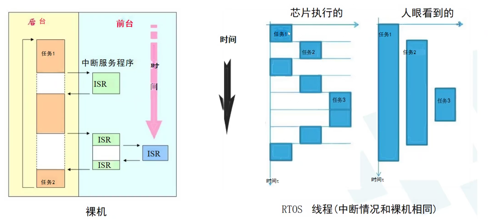
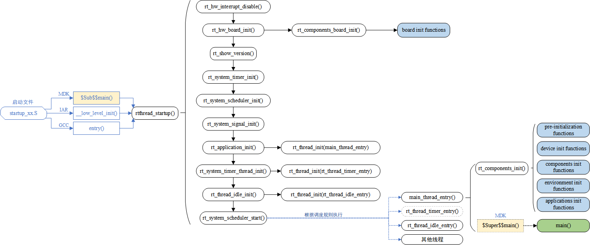
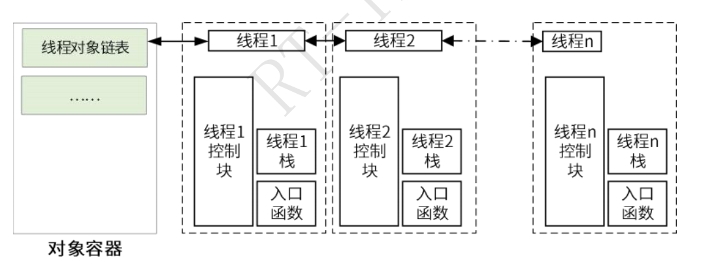
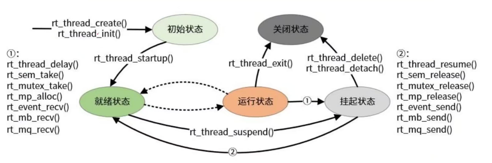
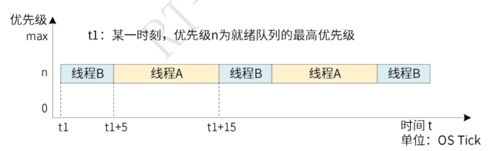
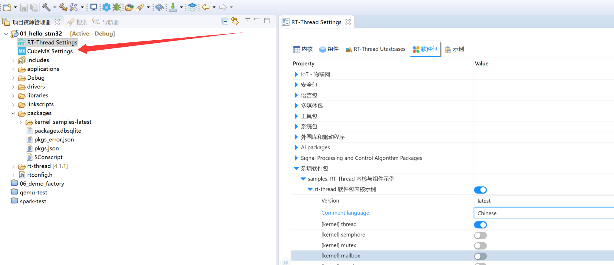

# RT-Thread 夏令营笔记02：RTOS、线程机制与 SCons 构建系统


## 目录

- [1. 从裸机前后台系统到 RTOS](#1-从裸机前后台系统到-rtos)
- [2. RT-Thread 从复位到用户 main 函数](#2-rt-thread-从复位到用户-main-函数)
- [3. 线程控制块与线程栈](#3-线程控制块与线程栈)
- [4. 线程生命周期](#4-线程生命周期)
- [5. 调度：优先级与时间片](#5-调度优先级与时间片)
- [6. 两个关键系统线程](#6-两个关键系统线程)
- [7. 线程创建、启动与让出 CPU](#7-线程创建启动与让出-cpu)
- [8. SCons 构建系统](#8-scons-构建系统)
- [9. Studio 工程创建、调试与线程示例](#9-studio-工程创建调试与线程示例)

## 1. 从裸机前后台系统到 RTOS

### 1.1 裸机前后台模型的阻塞问题

裸机程序常见为“前后台”模型：

- **后台**：在 `while (1)` 循环中按顺序执行读取传感器、SPI 通信、LCD 刷新等任务。
- **前台**：由串口接收、SPI 接收等硬件中断触发的中断服务程序（ISR）。中断可暂时打断 CPU 正在执行的后台代码。

这种模式适合任务少、逻辑简单的项目，但后台任务本质上仍是串行执行。例如，SPI 任务为了等待一个标志位而阻塞 1 秒时，排在后面的 LCD 刷新任务也会被延后；即使 LCD 本应高频刷新，实际画面也可能卡顿。

裸机模式的常见局限如下：

| 局限 | 原因 | 结果 |
| --- | --- | --- |
| 并发效率低 | 后台任务依次运行，长任务会占住 CPU | 其他任务难以及时处理 |
| 实时性受影响 | 阻塞或长延时会传递给后续任务 | 高优先级业务可能错过响应时机 |
| 可维护性较差 | 业务逻辑常交织在一个主循环中 | 修改一项功能可能影响多处流程 |
| 可重用性较差 | 模块边界不清晰、硬件和业务耦合 | 换项目或换芯片时容易重复改写 |

> 中断能处理紧急事件，但不能替代完整的任务组织方式。中断服务程序通常应尽量短小，不宜把耗时或可能阻塞的业务全部放入其中。

### 1.2 RTOS 的分而治之思路

RTOS（Real-Time Operating System，实时操作系统）的基本思路是**分而治之**：将一个复杂系统拆成多个职责单一的线程（也常称任务），再由内核调度器决定当前执行哪个线程。



例如可以拆分为：

- SPI 接收线程：接收 W5500 等模块的数据；
- 串口通信线程：处理 AT 指令或其他串口报文；
- LCD 刷新线程：按设定节奏刷新显示；
- 业务处理线程：完成协议解析和控制逻辑。

单核 MCU 在任一时刻仍然只执行一个线程；所谓“多个任务同时运行”，是调度器在不同线程间快速切换后带来的宏观效果。重要的是，RTOS 中的延时通常会让**当前线程**暂时挂起并让出 CPU，调度器可转而运行其他就绪线程；它不同于裸机中常见的忙等延时。

## 2. RT-Thread 从复位到用户 main 函数

RT-Thread 中的用户 `main()` 并不是芯片复位后直接运行的第一个 C 函数。内核必须先完成板级初始化、创建系统线程并启动调度器，随后用户代码才在 Main 线程中执行。

先通过下面的全景流程定位各小节的内容：

```text
① 芯片复位
   → 汇编启动文件完成最小运行环境准备
   → 工具链对应的早期 C 入口接入 RT-Thread
   → RT-Thread 系统启动                                           （见 2.1）

② RT-Thread 完成内核初始化
   → 初始化板级硬件、系统时钟与调度器
   → 创建 Main、Timer、Idle 等系统线程
   → 启动调度器                                                   （见 2.2）

③ 调度器选择最高优先级的就绪线程
   → 先运行优先级更高的系统线程（如已启用的 Timer 线程）
   → Main 线程获得运行机会                                         （见 2.3）
```



### 2.1 芯片启动与工具链入口

本节对应全景流程的 **①**，只解释“芯片复位后如何进入 `rtthread_startup()`”；系统线程创建、调度器启动和用户 `main()` 的执行分别在 2.2、2.3 节说明。

芯片复位后，通常先从汇编启动文件（ STM32 工程中的 `startup_*.S`）开始。它负责最早期的准备，如设置初始栈、初始化 `.data`/`.bss` 段，并进行 `SystemInit()` 等芯片级初始化。准备完成后，程序才具备稳定运行 C 代码的基础。

MDK、IAR、GCC 是**编译阶段使用的工具链**，典型入口有：MDK 的 `$Sub$$main()`、IAR 的 `__low_level_init()`、GCC BSP 中常见的 `entry()`，它们会为程序提供或配合不同的早期 C 入口；RT-Thread 利用这个入口，在用户 `main()` 之前调用 `rtthread_startup()`。这些工具链的共同目标是**从汇编启动文件进入早期 C 代码，并在用户 main() 前接入 RT-Thread 初始化。** 对 GCC 工程排查启动问题时，可从 `startup_*.S`、`entry()` 和 `rtthread_startup()` 依次跟踪。

### 2.2 rtthread_startup 的主要工作

`rtthread_startup()` 负责把芯片从“能运行 C 代码”带到“能调度线程”。典型过程如下；每一步的函数名与图对应：

1. **关闭全局中断**（`rt_hw_interrupt_disable()`）：避免内核和硬件尚未准备完成时被中断打断。
2. **板级初始化**（`rt_hw_board_init()`）：完成时钟、堆、控制台串口等底层准备；其中可调用 `rt_components_board_init()`，执行已注册的 board init functions。
3. **输出 Logo**（`rt_show_version()`）：串口控制台准备好后，打印 RT-Thread 的版本和 Logo。
4. **初始化系统时钟**（`rt_system_timer_init()`）：系统 Tick 为延时、超时和时间片提供基础。
5. **初始化调度器**（`rt_system_scheduler_init()`）：建立就绪线程等调度管理结构，供后续选择可执行线程。
6. **初始化信号机制（可选）**（`rt_system_signal_init()`）：是否执行取决于是否启用信号功能。
7. **创建 Main 线程**（`rt_application_init()`）：其入口函数为 `main_thread_entry()`；实际使用静态还是动态方式创建取决于当前 BSP。
8. **创建 Timer 服务线程（可选）**（`rt_system_timer_thread_init()`）：其入口函数为 `rt_thread_timer_entry()`；未启用软件定时器功能时不会创建。
9. **创建 Idle 空闲线程**（`rt_thread_idle_init()`）：其入口函数为 `rt_thread_idle_entry()`。Idle 本质上也是系统线程；当系统中没有其他就绪线程可运行、CPU 处于空闲状态时，调度器就会运行它。
10. **启动调度器**（`rt_system_scheduler_start()`）：内核开始按调度规则运行线程。

> 初始化期间关闭中断不等于系统永远不响应中断。启动过程完成后，系统会恢复正常的中断与调度运行。

### 2.3 主线程、自动初始化与用户代码

调度器启动时会选择当前就绪线程中优先级最高的线程。默认配置下，Timer 线程若启用通常优先级较高；没有更高优先级就绪线程时，Main 线程会开始运行。

Main 线程的入口并非立刻执行用户 `main()`，而是先完成自动初始化机制：

```text
Main 线程入口
  → 执行自动初始化
  → 依次完成预初始化、设备、组件、环境和应用初始化
  → 用户 main()
```

开发者可通过不同阶段的初始化宏注册驱动、组件或应用初始化函数。`rt_components_init()` 会按照配置和初始化阶段统一调用这些函数，因此不必在 `main()` 中手动逐个调用。完成这些准备后，才进入 `applications/main.c` 中的用户 `main()`。

这也说明：在 RT-Thread 中，`main()` 本质上运行在一个由内核创建和调度的线程中，而不是裸机意义上的唯一程序入口。

### 2.4 在 01_hello_stm32 工程中定位启动流程

以下位置基于本机 `D:\RT-ThreadStudio\workspace\01_hello_stm32` 工程。阅读源码时，建议先沿着“启动汇编 → `entry()` → `rtthread_startup()` → `main_thread_entry()` → 用户 `main()`”这条主线跟踪；其余文件用于展开每一步的具体实现。

| 流程阶段 | 当前工程中的文件 | 关键函数或内容 |
| --- | --- | --- |
| 芯片复位与最早期初始化 | `libraries/CMSIS/Device/ST/STM32F4xx/Source/Templates/gcc/startup_stm32f407xx.S` | `Reset_Handler`，设置初始栈、初始化内存段，并跳转到 C 入口。 |
| GCC 早期 C 入口 | `rt-thread/src/components.c` | `entry()` 调用 `rtthread_startup()`。同一文件也包含 MDK/IAR 对应入口的条件编译代码。 |
| RT-Thread 启动主流程 | `rt-thread/src/components.c` | `rtthread_startup()`：关闭中断、板级初始化、定时器与调度器初始化、创建系统线程、启动调度器。 |
| 板级硬件初始化 | `drivers/board.c` | `rt_hw_board_init()`：堆、时钟、串口控制台等板级初始化的具体实现。 |
| board 自动初始化 | `rt-thread/src/components.c` | `rt_components_board_init()`：执行已注册的 board init functions。 |
| 创建 Main 线程 | `rt-thread/src/components.c` | `rt_application_init()`：根据是否启用堆，调用 `rt_thread_create()` 或 `rt_thread_init()` 创建 Main 线程。 |
| Main 线程与自动初始化 | `rt-thread/src/components.c` | `main_thread_entry()` 调用 `rt_components_init()`，然后进入用户 `main()`。 |
| 系统线程实现 | `rt-thread/src/timer.c`、`rt-thread/src/idle.c` | `rt_system_timer_thread_init()` 创建 Timer 服务线程；`rt_thread_idle_init()` 创建 Idle 线程。 |
| 调度器实现 | `rt-thread/src/scheduler.c` | `rt_system_scheduler_start()` 启动调度器；该文件还包含就绪队列选择与调度逻辑。 |
| 线程创建实现 | `rt-thread/src/thread.c` | `rt_thread_init()`、`rt_thread_create()`、`rt_thread_startup()` 等线程 API 的具体实现。 |
| 用户应用入口 | `applications/main.c` | 用户编写的 `main()`，由 Main 线程在自动初始化完成后调用。 |

> 不同 RT-Thread 版本或 BSP 的目录、代码行号可能不同；排查当前工程时，以函数名搜索和调用关系为准。

## 3. 线程控制块与线程栈

### 3.1 线程由哪些部分构成

线程控制块（Thread Control Block，TCB）是内核管理线程的数据结构。在 RT-Thread 中，线程控制块由 `struct rt_thread` 定义；每创建一个线程，就会有一个对应的 `struct rt_thread` 作为它的线程内核对象。

多个线程内核对象会链接到内核的**对象容器**中统一管理。图中的“线程对象链表”通常是**双向链表**：每个 `struct rt_thread` 都通过内嵌的 `parent`（`struct rt_object`）携带链表节点，节点包含前驱和后继链接，因此内核可方便地将线程插入、删除或遍历。这个对象容器链表用于管理已注册的线程对象；它与调度器使用的就绪线程队列不是同一个概念。



从运行视角，可以将一个线程概括为：

```text
线程控制块（记录名称、状态、优先级、入口函数和参数等管理信息）
        +
线程栈（保存局部变量与线程切换现场的独立内存空间）
```

其中，入口函数 `entry` 和入口参数 `parameter` 是**记录在线程控制块中的信息**，并不是与线程控制块并列的独立内存对象。

下面是课堂对应版本中 `struct rt_thread` 的核心字段定义（不同 RT-Thread 版本或配置可能增减部分字段）：

```c
struct rt_thread
{
    struct rt_object parent;            /* 内核对象父类：名称、类型、链表节点等 */

    /* 栈与入口 */
    void *sp;                           /* 当前栈指针 */
    void *entry;                        /* 线程入口函数 */
    void *parameter;                    /* 传给入口函数的参数 */
    void *stack_addr;                   /* 线程栈起始地址 */
    rt_uint32_t stack_size;             /* 线程栈大小 */

    /* 状态与调度 */
    rt_err_t error;                     /* 线程错误代码 */
    rt_uint8_t stat;                    /* 线程状态 */
    rt_uint8_t current_priority;        /* 当前优先级 */
    rt_uint8_t init_priority;           /* 初始优先级 */
    rt_uint32_t number_mask;            /* 调度器内部的优先级位图/掩码信息 */

    ...

    rt_ubase_t init_tick;               /* 初始时间片计数值 */
    rt_ubase_t remaining_tick;          /* 剩余时间片计数值 */

    /* 定时与退出清理 */
    struct rt_timer thread_timer;       /* 内置线程定时器 */
    void (*cleanup)(struct rt_thread *tid); /* 线程退出清理函数 */
    rt_uint32_t user_data;              /* 用户自定义数据 */
};
```

> 阅读源码时，优先关注 `sp`（切换现场）、`entry`（业务入口）、`stat`/优先级/时间片（调度条件），以及 `thread_timer` 和 `cleanup`（等待与退出）。

### 3.2 线程栈

每个线程都有自己的栈。除了函数局部变量外，线程被切走时的寄存器现场、程序执行位置等上下文也需要保存，才能在以后从正确位置继续执行。

以线程 A 切换到线程 B 为例：

1. 内核把线程 A 的寄存器现场等上下文保存到 A 自己的栈中，常称为“压栈”或“保存上下文”。
2. 内核加载线程 B 之前保存的上下文，包括 B 的栈指针。
3. CPU 从线程 B 上次暂停的位置继续运行；如果 B 是第一次运行，则从它的入口函数开始。
4. 以后切回线程 A 时，再从 A 的栈中恢复现场，A 能接着之前的位置继续执行。

线程 A 切换到线程 B 的完整过程可以简记为：

```text
线程 A 正在运行
    ↓
将 A 的寄存器现场压入 A 的线程栈，并保存 A 的 SP
    ↓
将更新后的 A 的 SP 记录到 A 的线程控制块
    ↓
调度器选中线程 B
    ↓
CPU 的 SP → 指向线程 B 的栈
    ↓
恢复 B 的寄存器和 PC
    ↓
CPU 继续执行线程 B 的代码
```

如果没有这套保存与恢复机制，线程 A 在中途被切走后，就无法知道返回时该从哪条指令、哪个局部变量状态继续运行。

线程栈大小必须与线程业务相匹配。大量局部变量、深层函数调用和递归都会增加栈占用；栈太小可能产生栈溢出、内存踩踏或难以复现的异常。嵌入式开发中应尽量避免不受控的递归，并结合线程栈使用情况调整栈大小。

## 4. 线程生命周期

### 4.1 五种状态与转换

课堂将 RT-Thread 线程生命周期概括为五种状态：初始态、就绪态、运行态、挂起态和关闭态。

```text
创建线程
  → 初始态
  -- rt_thread_startup() --> 就绪态
  -- 被调度器选中 --> 运行态
  -- 延时或等待资源 --> 挂起态
  -- 等待条件满足 --> 就绪态
  -- 线程退出 --> 关闭态
```




各状态可这样理解：

| 状态 | 含义 | 常见转移原因 |
| --- | --- | --- |
| 初始态 | 线程对象已创建，但尚未参与调度 | 调用 `rt_thread_startup()` 后变为就绪态 |
| 就绪态 | 线程具备运行条件，等待调度器选择 | 被选中后开始运行 |
| 运行态 | 当前正在占用 CPU 执行业务代码 | 被抢占、时间片用完、延时或等待资源时离开运行态 |
| 挂起态 | 暂时不能运行，正在等待时间或某个条件 | 延时到期、信号量释放、收到消息等后重新就绪 |
| 关闭态 | 线程已结束，不再参与调度 | 后续由系统完成资源清理 |

使运行线程进入等待/挂起状态的常见情形包括：调用延时函数、等待信号量、等待互斥量、等待事件、接收邮箱或消息队列。对应资源就绪或超时后，线程会回到就绪态，等待下一次被调度。

> 创建线程不等于线程已经运行。只有将线程启动并放入就绪队列后，它才有机会被调度器执行。

### 4.2 线程关闭后的回收

线程的入口函数执行结束，或显式退出后，会进入关闭态。关闭态线程不再参与调度，但其线程控制块和动态申请的栈空间未必在同一时刻释放。

RT-Thread 中的 Idle 线程会检查已关闭的线程，并负责后续回收工作。对动态创建的线程，这一步通常包含释放其从堆中申请的内存；线程退出时注册的清理钩子也可用于执行用户自定义的清理操作。

因此要区分两个概念：

- **线程退出**：业务代码已经结束，线程被标记为关闭，不再调度。
- **资源回收**：由 Idle 线程在适当时机处理关闭线程及其动态资源。

## 5. 调度：优先级与时间片

### 5.1 抢占式优先级调度

线程优先级表示线程被调度的优先程度。RT-Thread 采用基于优先级的抢占式调度：**优先级数值越小，优先级越高**，因此优先级 1 高于优先级 5。更重要、响应更紧急的任务通常应配置更高优先级。

系统支持的优先级数量由 `RT_THREAD_PRIORITY_MAX` 配置决定，最大可配置为 256 级；若配置为 32 级，则有效优先级为 0～31。资源紧张的系统可选择 8 级或 32 级等更少的优先级，以减少内核调度数据的资源占用。最低优先级默认保留给 Idle 线程，用户业务线程一般不使用。

当一个比当前线程优先级更高的线程变为就绪态时，内核会换出当前线程，优先执行高优先级线程，这就是“抢占”。高优先级线程运行结束、挂起或等待资源后，调度器才会重新选择下一个最高优先级的就绪线程。具体可用的优先级数量请以工程的 `menuconfig` 或配置头文件为准。

### 5.2 相同优先级时的时间片轮转

时间片（time slice）只对**优先级相同且同时处于就绪态**的线程生效。不同优先级线程之间始终先比较优先级，不会因为时间片而让低优先级线程抢先运行。

当多个同优先级线程都就绪时，系统采用时间片轮转：每个线程一次连续运行的最长时长由其时间片决定；用完后，调度器会轮到同优先级的下一个就绪线程。时间片以系统 Tick（OS Tick）为单位；Tick 周期由系统配置决定，例如某工程可能设为 1 ms 或 10 ms，不能脱离具体配置固定理解。

例如线程 A、B 的优先级相同，且此时没有更高优先级的就绪线程：

- A 的时间片为 10 Tick；
- B 的时间片为 5 Tick。

若图示时刻 `t1` 先轮到 B，则执行顺序为：B 运行 5 Tick → A 运行 10 Tick → B 再运行 5 Tick → A 再运行 10 Tick，循环轮转。时间片限制的是同优先级线程**单次连续运行时长**，不能突破更高优先级线程的抢占规则。



## 6. 两个关键系统线程

### 6.1 Idle 空闲线程

Idle 是 RT-Thread 创建的空闲线程，具有以下特点：

- 它使用系统中最低优先级；例如 32 级优先级配置时通常为 31。
- 它始终为就绪态，以保证所有其他线程都不能运行时，CPU 仍有线程可执行。
- 它通常是无限循环，不能像普通业务线程一样被永久挂起或删除。

Idle 线程的主要职责有两类：

1. **回收资源**：检查并回收处于关闭态的线程，尤其是动态线程申请的内存。
2. **执行空闲钩子**：可用于低功耗休眠、喂狗等仅适合在系统空闲时做的工作。

Idle 钩子只会在系统没有其他就绪线程时运行，因此适合执行很短的空闲处理：例如让 CPU 进入低功耗休眠状态。

也可以把“喂狗”放入 Idle 钩子：若某个异常循环或高优先级线程长期占用 CPU，Idle 无法运行、看门狗得不到喂狗，硬件便可复位系统。此策略的前提是系统正常运行时 Idle 会周期性获得执行机会；若正常负载本来就会长期占满 CPU，则可能误触发看门狗复位。

> Idle 钩子必须短小且不能阻塞，否则会延迟资源回收，并影响系统进入真正的空闲状态。

### 6.2 Main 主线程

Main 线程也是系统启动阶段创建的线程。它负责执行组件自动初始化，并最终调用用户编写的 `main()`：

```text
创建 Main 线程
  → 调度器选中 Main 线程
  → rt_components_init()
  → 用户 main()
```

因此，即使源码形式上仍写作 `int main(void)`，运行时它已经处于 RT-Thread 的线程调度体系内。用户在 `main()` 中创建其他线程、初始化应用模块或启动业务逻辑，都是在这一基础上进行的。

## 7. 线程创建、启动与让出 CPU

### 7.1 两种创建方式：静态与动态

RT-Thread 的线程和许多 IPC 对象都支持两种内存分配方式：**静态创建**和**动态创建**。两者都是合法选择，区别主要在于线程控制块和线程栈由谁提供、内存占用能否在编译阶段确定。

| 对比项 | 静态创建 | 动态创建 |
| --- | --- | --- |
| 创建 API | `rt_thread_init()` | `rt_thread_create()` |
| 线程控制块与栈 | 由应用预先定义并传入 | 内核从系统堆中申请 |
| 栈起始地址参数 | 需要调用者提供 | 不需要，内部自动分配 |
| 编译/链接期内存估算 | 较明确，RAM 占用具有确定性 | 取决于运行时申请情况 |
| 主要风险 | 栈大小固定，预留过大浪费 RAM | 堆不足时创建失败，长期反复申请/释放可能产生碎片 |
| 适用倾向 | 高可靠、资源可预测或禁止动态内存的场景 | 一般应用中按需创建、生命周期灵活的任务 |

“静态”指内存由用户提前准备，并不表示线程只能在系统刚启动时创建；“动态”指创建时从堆中申请内存，也不表示线程一定比静态线程优先级高。

对于高安全或内存确定性要求高的场景，常要求全静态分配，以便在编译/链接阶段评估内存布局。普通应用可以使用动态、静态或两者混合的方式；关键是评估堆容量、线程栈和线程生命周期。

### 7.2 静态创建：rt_thread_init

静态创建前需要由应用准备线程控制块和一块满足对齐要求的栈数组。`rt_thread_init()` 的函数原型如下：

```c
/**
 * @brief  初始化一个静态线程，使其进入初始态。
 * @return RT_EOK     初始化成功。
 * @return -RT_ERROR  初始化失败。
 */
rt_err_t rt_thread_init(
    struct rt_thread *thread,        /* 用户提供的线程控制块指针 */
    const char       *name,          /* 线程名称；最长为 RT_NAME_MAX，超长自动截断 */
    void            (*entry)(void *parameter), /* 线程入口函数 */
    void              *parameter,   /* 传给入口函数的参数 */
    void              *stack_start, /* 用户提供的线程栈起始地址，需按要求对齐 */
    rt_uint32_t        stack_size,  /* 线程栈大小，单位：字节 */
    rt_uint8_t         priority,    /* 优先级；数值越小越高，范围由 RT_THREAD_PRIORITY_MAX 决定 */
    rt_uint32_t        tick);       /* 时间片大小，单位：系统 Tick；仅同优先级就绪线程间生效 */
```

`rt_thread_init()` 成功后，线程仍处于初始态；还需要调用 `rt_thread_startup()`，线程才会进入就绪态并有机会被调度。

### 7.3 动态创建：rt_thread_create

动态创建不需要传入线程控制块和栈地址，内核会从系统堆中为它们分配空间。函数原型如下：

```c
/**
 * @brief  从系统堆中创建一个动态线程，使其进入初始态。
 * @return 非 RT_NULL：创建成功，返回线程句柄。
 * @return RT_NULL：创建失败，通常表示堆空间不足。
 */
rt_thread_t rt_thread_create(
    const char       *name,          /* 线程名称；最长为 RT_NAME_MAX，超长自动截断 */
    void            (*entry)(void *parameter), /* 线程入口函数 */
    void              *parameter,   /* 传给入口函数的参数 */
    rt_uint32_t        stack_size,  /* 由内核从堆中分配的线程栈大小，单位：字节 */
    rt_uint8_t         priority,    /* 优先级；数值越小越高，范围由 RT_THREAD_PRIORITY_MAX 决定 */
    rt_uint32_t        tick);       /* 时间片大小，单位：系统 Tick；仅同优先级就绪线程间生效 */
```

动态创建失败通常意味着系统堆无法满足本次申请，例如剩余堆空间不足或出现严重碎片。应用可通过内存查看命令或接口观察堆使用情况，但更重要的是在设计阶段控制动态对象数量和生命周期，避免频繁创建、销毁大块内存。

> 静态线程的栈数组和控制块必须在其整个生命周期内保持有效。因此不要把它们定义为创建函数中的普通局部变量；应使用 `static` 存储期或其他长期有效的内存区域。

### 7.4 创建后启动：rt_thread_startup

无论使用 `rt_thread_init()` 还是 `rt_thread_create()`，新线程创建后都先处于初始态。调用 `rt_thread_startup()` 后，线程才会被加入就绪队列，从初始态变为就绪态，并在合适的调度时机运行。

```text
rt_thread_init() / rt_thread_create()
             → 初始态
rt_thread_startup()
             → 就绪态
调度器选中
             → 运行态
```

这是初学线程时最容易遗漏的一步：创建成功不代表线程已经开始执行。

### 7.5 用延时主动让出 CPU

线程不能长期在无限循环中持续占用 CPU。若当前线程暂时没有工作，可调用 `rt_thread_delay()`（1个OS Tick为单位）或 `rt_thread_mdelay()` （ms为单位）等延时接口，使自己在指定时间内进入挂起态。调度器便能运行其他就绪线程。

延时时长应由业务周期、响应要求和 CPU 负载决定；对于等待数据或资源的场景，后续还应学习信号量、事件、邮箱和消息队列等同步通信机制，而不是单纯轮询加延时。

## 8. SCons 构建系统

SCons 是 RT-Thread 常用的构建系统。它使用 Python 风格脚本描述源码、头文件路径、宏依赖和编译参数，目标是降低手写 Makefile 与 IDE 路径配置的负担，让开发者更专注于功能开发。

> 本篇命令以课堂内容为主。不同 RT-Thread 版本、Env/Studio 安装方式及 BSP 支持的工程类型可能不同；执行生成工程或打包命令前，应先在 BSP 根目录查看当前环境支持的选项。

### 8.1 三类关键脚本文件

| 文件 | 位置与职责 |
| --- | --- |
| `SConstruct` | 构建总入口，组织整个 BSP 的构建流程，并调用各目录的构建脚本 |
| `SConscript` | 通常放在含源代码的目录中，描述该目录或子目录要参与构建的文件与规则 |
| `rtconfig.py` | 保存工具链、CPU 架构、浮点 ABI、优化级别、链接参数等编译配置 |

常见组织方式是：每个源码子目录放一个 `SConscript`，各自只关心本目录的源码；父级脚本再通过 `SConscript()` 继续读取子目录脚本。这种分层结构使构建规则跟随源码目录组织，便于维护。

`rtconfig.py` 会根据 GCC、MDK/ARMCC、IAR、LLVM 等工具链分别设置参数。CPU 架构、Thumb 指令集、硬浮点/软浮点和优化等级都与目标芯片密切相关，通常应通过项目配置生成或谨慎修改，不能随意从其他芯片工程复制。

### 8.2 常用构建命令

在 **BSP 根目录**、并已进入正确 Env/终端环境后，常见命令如下：

| 命令 | 用途 |
| --- | --- |
| `scons` | 按当前配置编译 BSP |
| `scons -jN` | 使用 N 个并行任务编译，例如 `-j8`；N 不宜超过电脑可承受的并发度 |
| `scons -c` | 清理本次构建产生的目标文件等中间产物，之后需重新编译 |
| `scons --target=<目标类型>` | 依据当前目录生成对应 IDE 或构建系统工程，例如 MDK、IAR、VS Code、CMake；具体目标名以当前 BSP 支持项为准 |
| `scons --dist` | 将 BSP 所需文件整理为更精简的独立开发包，便于复制到其他目录继续开发 |

若当前环境无法找到交叉编译器，可在 Env 中设置工具链路径和工具链类型；课堂中提到的 `RTT_EXEC_PATH` 就是用于指定工具链路径的环境变量。此类设置与电脑上的实际安装路径相关，应优先使用 Studio/Env 已配置的工具链，避免写死他人电脑的路径。

`scons --dist` 的目的不是“备份所有文件”，而是移除无关 BSP 内容、保留独立开发所需的代码和配置。生成后应在新的目录中重新构建验证，确认所选功能和依赖均已被带入。

### 8.3 SConscript 的基本写法

一个典型 `SConscript` 通常做四件事：获取当前目录、添加头文件搜索路径、收集源文件、把它们定义为构建组。

```python
from building import *

cwd = GetCurrentDir()
src = Glob('*.c')

group = DefineGroup(
    'applications',
    src,
    CPPPATH=[cwd],
)

Return('group')
```

常见元素的作用如下：

| 元素 | 作用 |
| --- | --- |
| `GetCurrentDir()` | 获取当前 `SConscript` 所在目录，避免手工硬编码路径 |
| `CPPPATH` | 增加头文件搜索目录；找不到 `.h` 文件时应优先检查这里 |
| `Glob('*.c')` | 用通配符收集当前目录的 C 源文件 |
| `src` | 待参与编译的源文件列表，可逐项添加或由 `Glob()` 生成 |
| `DefineGroup()` | 将一组源文件、路径、依赖和编译参数定义为构建单元 |
| `Return('group')` | 将当前目录构建组返回给上一级脚本 |

`Glob('*.c')` 使用方便，但会把当前目录下所有匹配的 C 文件都加入构建。若某个文件暂时不应编译，应显式移除它，或改为逐个列出所需源文件；否则容易引入重复符号或未完成代码。

### 8.4 依赖宏决定源码是否参与构建

`DefineGroup()` 可通过 `depend` 参数声明宏依赖。只有相关宏已在配置中启用时，对应源文件才会被加入构建。

```python
from building import *

cwd = GetCurrentDir()
src = ['hello.c']

group = DefineGroup(
    'hello',
    src,
    depend=['RT_USING_HELLO'],
    CPPPATH=[cwd],
)

Return('group')
```

上例中，只有 `RT_USING_HELLO` 被定义，`hello.c` 才会参与编译。宏通常由 `Kconfig` 菜单配置生成，并写入 `rtconfig.h` 等配置文件。因此“菜单中勾选功能 → 生成配置宏 → SConscript 判断依赖 → 源文件参与编译”是一条完整链路。

构建参数也可按作用域配置：例如公共 C/C++ 参数、C 专用参数、C++ 专用参数、全局宏和局部宏。局部参数应只作用于确有特殊要求的文件或目录，避免无意影响整个工程。

### 8.5 SConscript 如何连接子目录

父目录不一定直接列出所有深层源文件，而是调用子目录中的脚本，让子目录自行返回构建组。可以把这种写法理解为“桥接”：父脚本负责继续向下发现构建规则，子脚本负责说明自己的源码。

```python
SConscript([
    'applications/SConscript',
    'drivers/SConscript',
])
```

这样增加一个模块时，通常只需在新模块目录编写 `SConscript`，并在适当的父级脚本中接入它，而无需把每个 `.c` 文件都堆放在顶层构建入口。

### 8.6 Env、Studio 与 menuconfig 配置

RT-Thread Env 的 `menuconfig` 和 Studio 的图形化 RT-Thread Settings，本质上都在修改 Kconfig 对应的功能选择。保存配置后，相关宏会写入 `rtconfig.h` 等生成文件，SCons 再据此决定哪些模块和源码参与构建。

使用 Studio 时，图形界面更直观；若参与 BSP 或主线贡献，需要更灵活地处理脚本和配置，可进一步熟悉 Env 与命令行。无论使用哪种界面，修改配置后都应重新构建，不能只勾选菜单却不编译。

## 9. Studio 工程创建、调试与线程示例

### 9.1 断点验证启动流程

调试启动流程时，可在 `entry()`、`rtthread_startup()`、板级初始化、线程创建与调度器启动附近设置断点，并按以下顺序观察：

```text
启动汇编文件
  → SystemInit() 等芯片初始化
  → entry()
  → 关闭中断、板级初始化、系统时钟与调度器初始化
  → 创建 Main / Timer / Idle 线程
  → 启动调度器并首次切换线程
```

在调试器的变量视图中，可检查线程控制块的名称、栈地址、栈大小、优先级和状态。

若启用了 Timer 线程，且它的优先级高于 Main 线程，调度器启动后可能先运行 Timer 线程；待其挂起或等待后，才会轮到 Main 线程。这是优先级调度的正常表现，不是 `main()` 丢失或卡死。

### 9.2 使用软件包运行线程示例

Studio/Env 可从软件包仓库拉取功能模块。以 `kernel samples` 中的线程示例为例：在软件包配置界面启用线程 sample、保存配置并重新构建后，代码会下载到工程的 `packages/` 目录并参与构建。



示例中包含两个不同优先级的线程：

- `thread2` 优先级更高，且入口函数中没有主动延时；因此它会先连续输出并很快结束。
- `thread1` 优先级较低，周期性延时后打印，因此表现为持续、周期性的输出。

这个现象验证了两点：高优先级就绪线程会优先运行；动态创建的短生命周期线程退出后可由 Idle 线程自动回收。是否能直接编译某个软件包，还取决于它的 Kconfig 依赖、板级外设与已启用组件；例如图形库等软件包往往需要显示、输入或内存等额外支持，拉取后报依赖错误并不罕见。

### 9.2.1 线程示例的实际运行流程

`thread1_entry()` 与 `thread2_entry()` 是在编译时已经定义好的入口函数；下面从运行时输入命令开始看流程：

```text
输入 msh 命令：thread_sample
        ↓
执行 thread_sample()
        ↓
动态创建 thread1：rt_thread_create(...)
        ↓
内核从堆中分配：线程控制块 + 512 字节栈
        ↓
启动 thread1：rt_thread_startup(tid1)
        ↓
静态初始化 thread2：rt_thread_init(...)
        ↓
使用程序预先定义的内存：
static struct rt_thread thread2;   ← 线程控制块
static char thread2_stack[1024];   ← thread2 的 1024 字节栈
        ↓
启动 thread2：rt_thread_startup(&thread2)
        ↓
两个线程进入就绪队列
        ↓
调度器比较优先级：
thread2：24（数值小，优先级高）
thread1：25
        ↓
thread2 先执行：打印 0～9 → 函数返回 → 自动脱离调度器
        ↓
thread1 执行：打印 count → 延时 500 ms → 挂起
        ↓
500 ms 到期 → thread1 被唤醒 → 打印下一次 count
        ↓
重复执行
```

线程栈是每个线程独立使用的内存，用于保存局部变量、函数调用信息和线程切换时的寄存器现场。`thread1` 的栈由 `rt_thread_create()` 从堆中动态申请；`thread2` 的栈是提前定义的 `thread2_stack[1024]`，因此属于静态分配。

若工程启用了 `RT_USING_SMP`，示例还会执行：

```c
rt_thread_control(tid1, RT_THREAD_CTRL_BIND_CPU, (void *)0);
rt_thread_control(&thread2, RT_THREAD_CTRL_BIND_CPU, (void *)0);
```

这会将两个线程都绑定到 CPU 核 0，避免它们在不同核同时打印而使日志顺序难以观察。普通单核 STM32 工程未启用 `RT_USING_SMP` 时，这段代码会被条件编译排除。

### 9.3 用 MSH 观察运行结果

MSH 是 FinSH 提供的命令行 Shell。连接串口并进入 `msh />` 提示符后，可用以下命令观察线程：

```text
msh /> list_thread
```

或：

```text
msh /> ps
```

输出可查看线程名称、优先级、状态、栈大小与栈使用情况。线程 sample 运行后，已退出并完成回收的 `thread2` 不再出现在列表中；仍在周期性执行或延时等待的 `thread1` 会保留在列表中。按 Tab 键还可查看或补全当前系统已注册的命令。

> `ps`、`list_thread` 和软件包命令是否可用，取决于当前工程是否启用了 FinSH/MSH 以及相关组件。遇到“命令不存在”时，应先检查配置，而不是假定所有 BSP 都默认提供该命令。
