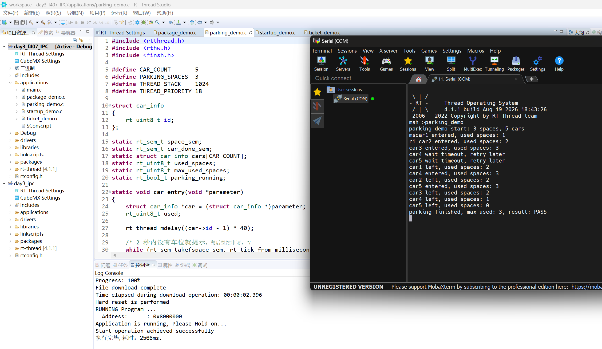
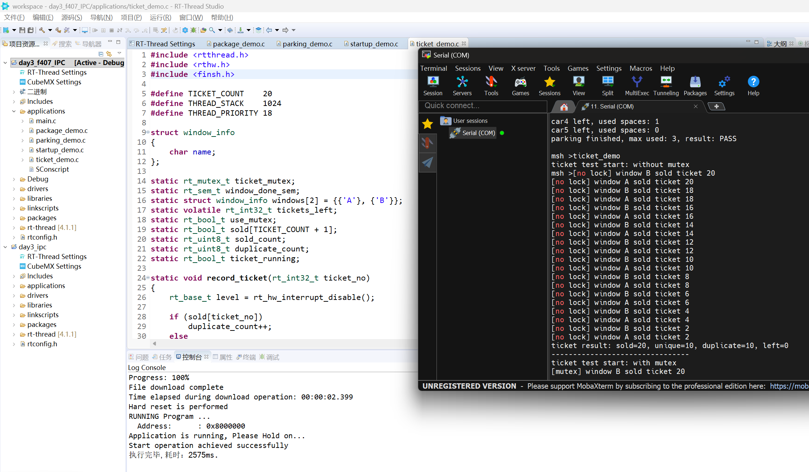
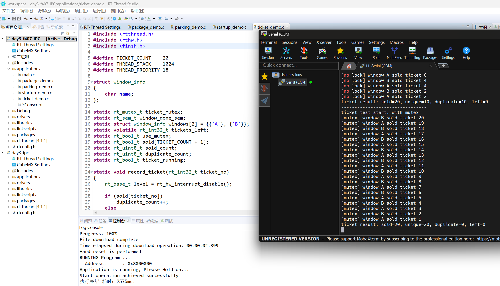
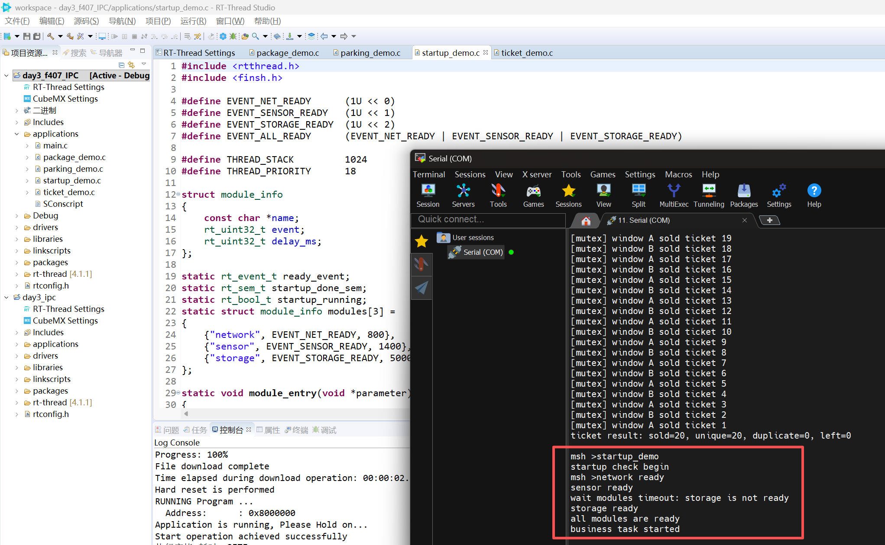
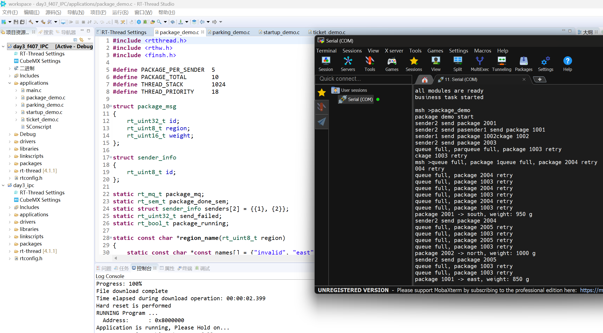
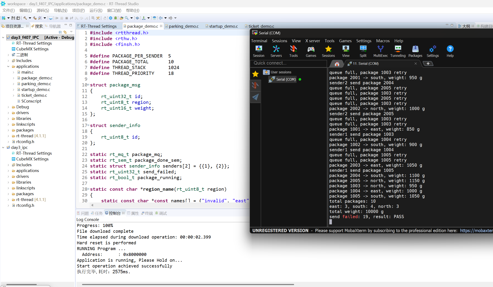
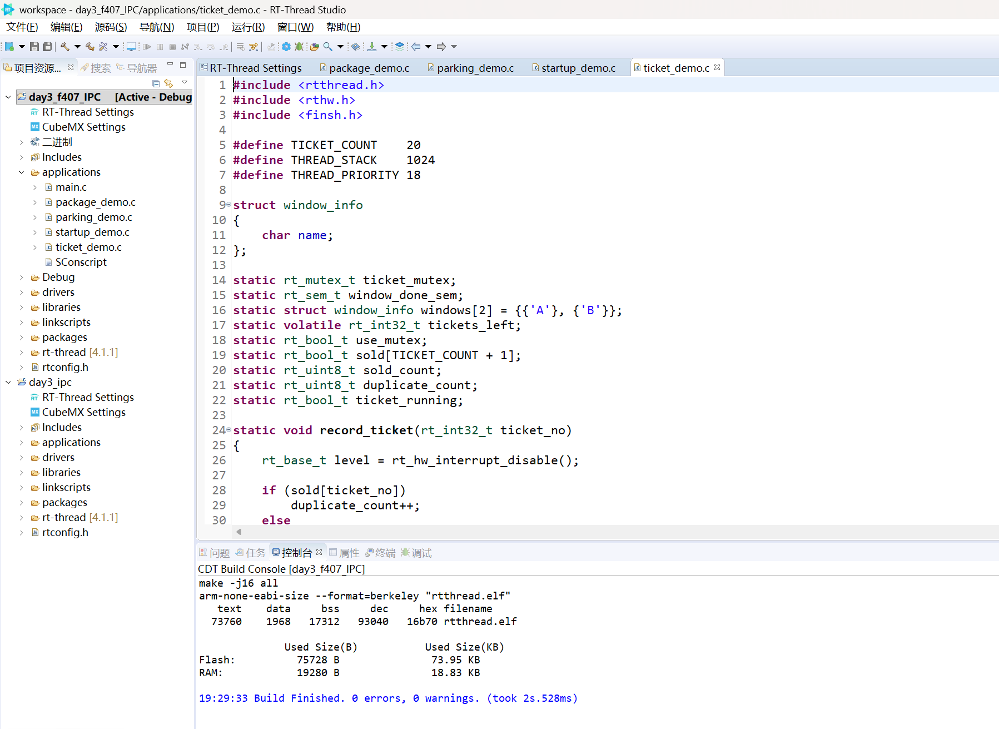

# 【Day3】RT-Thread 线程间同步与通信实验报告

> **实验平台：STM32F407 星火1号（STM32F407ZG）**  
> **操作系统：RT-Thread 4.1.1**  
> **实验日期：2026 年 8 月 19 日**  

## 目录

- [一、实验目的](#一实验目的)
- [二、实验环境](#二实验环境)
- [三、IPC 理论总结](#三ipc-理论总结)
  - [3.1 信号量](#31-信号量)
  - [3.2 互斥量](#32-互斥量)
  - [3.3 事件集](#33-事件集)
  - [3.4 消息队列](#34-消息队列)
  - [3.5 四种 IPC 的区别](#35-四种-ipc-的区别)
- [四、练习一：停车场车位管理](#四练习一停车场车位管理)
- [五、练习二：多窗口售票系统](#五练习二多窗口售票系统)
- [六、练习三：系统启动条件检查](#六练习三系统启动条件检查)
- [七、练习四：快递分拣中心](#七练习四快递分拣中心)
- [八、MSH 命令与资源管理](#八msh-命令与资源管理)
- [九、编译验证与实验结论](#九编译验证与实验结论)

---

## 一、实验目的

本次作业主要练习 RT-Thread 中常用的线程间同步与通信方式，包括信号量、互斥量、事件集和消息队列。实验目标如下：

1. 使用计数信号量管理多个相同的有限资源。
2. 理解多个线程同时访问共享变量时产生的竞态问题。
3. 使用互斥量保护完整的共享资源操作。
4. 使用事件集等待多个初始化条件全部完成。
5. 使用消息队列在线程之间传递结构体数据。
6. 学会通过 MSH 命令启动实验，并在实验结束后释放资源。

---

## 二、实验环境

| 项目 | 配置 |
| --- | --- |
| 开发板 | STM32F407 星火1号 |
| MCU | STM32F407ZG，Cortex-M4 |
| RTOS | RT-Thread 4.1.1 |
| 工程目录 | `code/day3_f407_IPC` |
| 系统节拍 | `RT_TICK_PER_SECOND = 1000`，1 tick = 1 ms |
| 串口 | UART1，115200 bit/s |
| 编译器 | GNU Tools for ARM Embedded Processors 5.4.1 |
| 主要配置 | 已开启信号量、互斥量、事件集、消息队列、动态堆和 MSH |

新增源码如下：

```text
applications/
├── main.c
├── parking_demo.c
├── ticket_demo.c
├── startup_demo.c
├── package_demo.c
└── SConscript
```

`main.c` 不再周期打印 Hello 日志，四个练习全部通过 MSH 命令单独启动。

---

## 三、IPC 理论总结

### 3.1 信号量

信号量可以理解为一个由内核维护的计数值。线程调用 `rt_sem_take()` 获取信号量，调用 `rt_sem_release()` 释放信号量。

- 初始值为 0 或 1 时，常用于线程同步。
- 初始值大于 1 时，可用于管理多个相同资源。
- 当计数为 0 时，申请资源的线程可以阻塞等待，也可以设置超时时间。

本次停车场有 3 个车位，因此使用初值为 3 的计数信号量。完成信号量则用于通知协调线程“某个工作线程已经结束”。

### 3.2 互斥量

互斥量用于保护共享资源。同一时刻只能有一个线程持有互斥量，其他线程必须等待。

互斥量和二值信号量看起来相似，但互斥量有所有者概念，并支持优先级继承，更适合保护共享数据。典型使用顺序如下：

```c
rt_mutex_take(ticket_mutex, RT_WAITING_FOREVER);
/* 检查、修改和使用共享数据 */
rt_mutex_release(ticket_mutex);
```

本次售票实验中，剩余票数、售出票号记录和打印结果属于同一个完整操作，因此应放在同一个互斥区中。

### 3.3 事件集

事件集内部保存多个事件位，一个事件对象可以同时表示多个条件。线程可以选择：

- `RT_EVENT_FLAG_OR`：任意一个事件到达即可唤醒。
- `RT_EVENT_FLAG_AND`：所有指定事件都到达后才唤醒。
- `RT_EVENT_FLAG_CLEAR`：接收后清除已经收到的事件位。

本次用 3 个事件位分别表示网络、传感器和存储模块就绪。业务线程使用 AND 模式等待，只有 3 个事件全部出现后才能继续运行。

### 3.4 消息队列

信号量、互斥量和事件集主要传递“状态”，消息队列还可以传递实际数据。发送线程把一条消息复制到队列，接收线程再从队列中取出，因此两个线程不需要同时运行。

本次消息是一整个快递结构体：

```c
struct package_msg
{
    rt_uint32_t id;
    rt_uint8_t region;
    rt_uint16_t weight;
};
```

队列容量只有 5 条，而两个发送线程一共发送 10 条消息。当队列已满时，`rt_mq_send()` 返回失败，发送线程记录失败次数，延时后重发同一条消息。

### 3.5 四种 IPC 的区别

| IPC | 主要作用 | 本次应用 |
| --- | --- | --- |
| 计数信号量 | 记录可用资源数量 | 管理 3 个停车位 |
| 互斥量 | 保护共享资源，避免并发修改 | 保护剩余票数和售票记录 |
| 事件集 | 用多个事件位组合多个条件 | 等待 3 个模块全部就绪 |
| 消息队列 | 在线程间传递带内容的消息 | 传递快递编号、区域和重量 |

---

## 四、练习一：停车场车位管理

### 4.1 设计思路

程序创建一个初值为 3 的动态信号量 `space_sem`，再创建 5 个车辆线程。每辆车执行以下步骤：

```text
车辆到达
  -> 在 2 秒内申请车位
  -> 申请成功：进入停车场，used_spaces 加 1
  -> 停留一段时间
  -> 离开停车场，used_spaces 减 1
  -> 释放车位信号量
  -> 通知协调线程车辆任务完成
```

前 3 辆车停留 2600 ms，后两辆车在约 2 秒时仍无法获得车位，因此会打印等待超时，再延时 300 ms 重试。这样可以观察到题目要求的超时现象。

`used_spaces` 只是用于显示和检查当前停车数量，修改时使用很短的关中断临界区，避免多个车辆线程同时修改。车位的真正管理由计数信号量完成。

### 4.2 关键代码

```c
while (rt_sem_take(space_sem,
                   rt_tick_from_millisecond(2000)) != RT_EOK)
{
    rt_kprintf("car%u wait timeout, retry later\n", car->id);
    rt_thread_mdelay(300);
}

/* 车辆离开 */
rt_sem_release(space_sem);
```

### 4.3 运行命令与实测结果

```text
msh >parking_demo
```

实测串口现象：

```text
parking demo start: 3 spaces, 5 cars
car1 entered, used spaces: 1
car2 entered, used spaces: 2
car3 entered, used spaces: 3
car4 wait timeout, retry later
car5 wait timeout, retry later
...
parking finished, max used: 3, result: PASS
```



*图 1 停车场计数信号量实验结果*

从实测结果可以看到，前 3 辆车先占满车位，car4 和 car5 等待超时后重试。车辆离开后，等待车辆能够继续进入。最终 5 辆车均完成停车，最大同时停车数为 3，结果为 `PASS`。

### 4.4 思考题：为什么使用计数信号量，而不是互斥量？

因为停车场同时允许 3 辆车进入。计数信号量可以把 3 个车位表示为计数值 3，每进入一辆车计数减 1，每离开一辆车计数加 1。

互斥量表示同一时刻只能有一个线程进入临界区。如果用一个互斥量表示停车场，就会错误地限制为只能停 1 辆车，不能直接表达“有 3 个相同资源”。

---

## 五、练习二：多窗口售票系统

### 5.1 无锁对比实验

两个窗口线程共同访问 `tickets_left`。无锁阶段在读取票数和减少票数之间加入 10 ms 延时：

```c
ticket_no = tickets_left;
rt_thread_mdelay(10);
tickets_left--;
```

例如窗口 A 和窗口 B 都可能先读到 20，然后分别打印自己卖出了 20 号票，从而出现重复票号。这说明单条 C 语句看起来很简单，但“检查是否有票、读取票号、减少余票、记录和打印”组合起来并不是原子操作。

程序使用 `sold[]` 数组记录已经出现的票号，并统计 `sold`、`unique` 和 `duplicate`，方便对比两次实验。

### 5.2 使用互斥量

加锁阶段把完整售票过程放在互斥量内部：

```text
获得互斥量
  -> 检查是否还有票
  -> 读取当前票号
  -> 剩余票数减 1
  -> 记录票号
  -> 打印售票结果
释放互斥量
```

窗口 A 执行这组操作时，窗口 B 无法进入，因此不会读到相同票号。

### 5.3 运行命令与实测结果

```text
msh >ticket_demo
```

该命令先运行无锁实验，再自动运行互斥量实验。无锁阶段的实测结果如下：

```text
ticket test start: without mutex
[no lock] window A sold ticket 20
[no lock] window B sold ticket 20
...
ticket result: sold=20, unique=10, duplicate=10, left=0
```



*图 2 无锁售票实验结果*

两个窗口多次读到同一个票号，最终共执行 20 次售票，但只有 10 个唯一票号，重复票号为 10 个，说明共享数据产生了竞态。

加入互斥量后的实测结果如下：

```text
--------------------------------
ticket test start: with mutex
[mutex] window A sold ticket 20
[mutex] window B sold ticket 19
...
ticket result: sold=20, unique=20, duplicate=0, left=0
```



*图 3 使用互斥量后的售票实验结果*

具体由哪个窗口卖出某张票由线程调度决定。实测中加锁阶段售出 20 张票，20 个票号全部唯一，重复数为 0，余票为 0，说明互斥量保护有效。

### 5.4 思考题：为什么只给 `ticket_count--` 加锁仍不安全？

售票不是只有减 1 这一条语句，而是一个“先检查、再读取、再修改、再记录”的完整过程。如果只给 `ticket_count--` 加锁，可能出现下面的过程：

```text
窗口 A 检查：还有 1 张票
窗口 B 检查：还有 1 张票
窗口 A 加锁并减 1
窗口 B 加锁并再次减 1
```

两个窗口在加锁前都通过了检查，因此仍可能重复售票或把票数减成负数。正确做法是把判断条件和所有相关操作放入同一个互斥区。

---

## 六、练习三：系统启动条件检查

### 6.1 事件位定义

```c
#define EVENT_NET_READY      (1U << 0)
#define EVENT_SENSOR_READY   (1U << 1)
#define EVENT_STORAGE_READY  (1U << 2)
```

网络线程延时 800 ms，传感器线程延时 1400 ms，存储线程延时 5000 ms，然后各自发送对应事件。

业务线程第一次使用 AND 模式等待 3000 ms。此时网络和传感器已经完成，但存储仍未完成，因此第一次等待超时。业务线程读取当前已有事件并打印未就绪模块，然后再次永久等待全部事件。

### 6.2 关键代码

```c
if (rt_event_recv(ready_event, EVENT_ALL_READY,
                  RT_EVENT_FLAG_AND,
                  rt_tick_from_millisecond(3000),
                  &received) != RT_EOK)
{
    /* 打印未完成模块后再次等待 */
    rt_event_recv(ready_event, EVENT_ALL_READY,
                  RT_EVENT_FLAG_AND,
                  RT_WAITING_FOREVER, &received);
}
```

这里没有使用 `RT_EVENT_FLAG_CLEAR`，所以第一次超时后，已经出现的网络和传感器事件仍然保留。存储事件到达后，三个事件位就能同时满足 AND 条件。

### 6.3 运行命令与实测结果

```text
msh >startup_demo
```

实测输出顺序为：

```text
startup check begin
network ready
sensor ready
wait modules timeout: storage is not ready
storage ready
all modules are ready
business task started
```



*图 4 系统启动条件检查实验结果*

实测中网络和传感器先完成初始化，约 3 秒时打印存储未就绪；存储约 5 秒时就绪，随后全部事件条件满足，业务线程正常启动。

### 6.4 思考题：三个信号量和事件集有什么区别？

如果使用三个信号量，业务线程需要依次对网络、传感器和存储信号量各执行一次 `rt_sem_take()`。这种方法也能实现功能，但每个信号量只能表示一个条件，需要创建和管理三个内核对象。

事件集只需要一个对象，三个条件分别放在三个事件位中，还可以直接使用 AND 或 OR 组合等待。它更适合“等待多个状态条件”的场景，也更方便查看当前已经完成了哪些条件。

需要注意，信号量带有计数含义，多次释放可以累积；事件位通常只表示某状态是否发生，不记录同一事件发生了多少次。

---

## 七、练习四：快递分拣中心

### 7.1 设计思路

两个发送线程各产生 5 个包裹：

- 发送线程 1：编号 `1001` 到 `1005`。
- 发送线程 2：编号 `2001` 到 `2005`。

每条消息包含编号、区域和重量，消息队列容量为 5。分拣线程启动后先延时 500 ms，让发送线程有机会把队列装满，以便观察发送失败和重试。

发送失败时不会跳过当前包裹，而是执行：

```text
发送失败次数加 1
  -> 延时 100 ms
  -> 重新发送同一条消息
  -> 发送成功后才产生下一条消息
```

因此，即使队列满过，10 条有效消息最终仍会全部被处理。

两个发送线程完成后，协调线程发送一条 `id = 0` 的结束消息。分拣线程收到结束消息后打印统计结果并退出。

### 7.2 运行命令与实测结果

```text
msh >package_demo
```

实测中先出现队列满和重试信息：

```text
package demo start
sender1 send package 1001
...
queue full, package 2001 retry
package 1001 -> east, weight: 850 g
```



*图 5 消息队列满时发送线程延时重试*

发送线程没有丢弃发送失败的包裹，而是等待后重新发送。分拣结束后的统计结果如下：

```text
total packages: 10
east: 3, south: 4, north: 3
total weight: 10000 g
send failed: 19, result: PASS
```



*图 6 快递分拣完成后的统计结果*

本次运行中 `send failed: 19` 表示消息队列暂满时一共发生了 19 次发送失败并重试，不表示丢失了 19 个包裹。最终仍成功处理 10 个包裹，east、south、north 分别为 3、4、3 个，总重量为 10000 g，结果为 `PASS`。重试次数会受线程调度影响，不要求每次运行都固定为 19。

---

## 八、MSH 命令与资源管理

四个命令如下：

```text
parking_demo
ticket_demo
startup_demo
package_demo
```

每个命令只创建一个协调线程后立即返回，不会长时间占用 MSH。协调线程负责创建 IPC 和工作线程，使用完成信号量等待所有工作线程结束，最后删除 IPC 对象。

每个实验有一个简单的 `running` 标志。实验运行期间再次输入相同命令，会提示 `demo is running`；实验结束并释放资源后，标志恢复为 `RT_FALSE`，此时可以再次执行。

这种写法比官方最小例程多了一步资源回收，但仍保持了比较直接的流程：

```text
MSH 命令
  -> 创建协调线程
  -> 创建 IPC
  -> 创建并启动工作线程
  -> 等待工作线程完成
  -> 删除 IPC
  -> 允许再次执行命令
```

---

## 九、编译验证与实验结论

### 9.1 已完成的验证

使用 RT-Thread Studio 的 ARM GCC 工具链执行全量编译和链接，结果为：

```text
Build Finished. 0 errors, 0 warnings.

Flash: 75728 B (73.95 KB)
RAM:   19280 B (18.83 KB)
```



*图 7 RT-Thread Studio 全量编译结果，0 errors、0 warnings*

构建日志确认以下新增文件均进入编译：

```text
applications/package_demo.c
applications/parking_demo.c
applications/startup_demo.c
applications/ticket_demo.c
```

同时，四个 `MSH_CMD_EXPORT()` 均已进入最终 ELF，说明四条命令已经被注册到 MSH 命令表。

### 9.2 上板验证结果

程序已下载到 STM32F407 开发板，并通过串口依次执行四条 MSH 命令。实测结果如下：

1. `parking_demo`：出现车位等待超时和重试，最大同时停车数为 3，结果为 `PASS`。
2. `ticket_demo`：无锁阶段执行 20 次售票，只得到 10 个唯一票号和 10 个重复票号；加锁阶段 20 个票号全部唯一，重复数为 0，余票为 0。
3. `startup_demo`：约 3 秒时提示存储模块未就绪，存储就绪后全部条件满足，业务线程正常启动。
4. `package_demo`：出现消息队列满和重试，最终处理 10 个包裹，三个区域数量为 3、4、3，总重量为 10000 g，结果为 `PASS`。

串口中个别行会出现 `msh >` 提示符与线程日志交叉，或者两个线程的输出拼接在同一行。这是因为 MSH 命令返回后，多个线程仍在异步运行并同时打印，不影响 IPC 功能和最终统计结果。

### 9.3 实验总结

通过四个练习，我对 RT-Thread IPC 的使用场景有了更直观的理解：信号量适合表示资源数量，互斥量适合保护共享变量，事件集适合组合多个状态条件，消息队列适合在线程间传递具体数据。

售票实验说明，多线程问题不能只看某一条语句是否简单，还要确定哪些操作在逻辑上必须作为一个整体执行。启动检查实验说明事件集可以方便地表达“全部完成”和“任意完成”。快递实验则展示了消息队列满时应检查返回值并进行重试，而不能默认每次发送都会成功。

本次作业最终完成了四个独立 MSH 命令、线程和 IPC 创建检查、实验完成等待及资源释放，并完成了 ARM GCC 编译和开发板串口运行验证。
