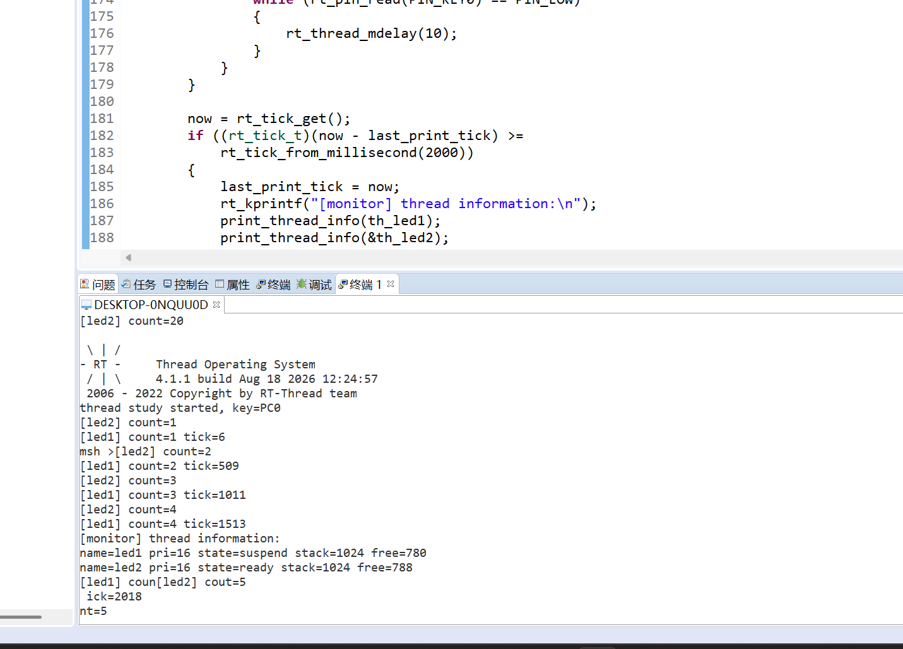
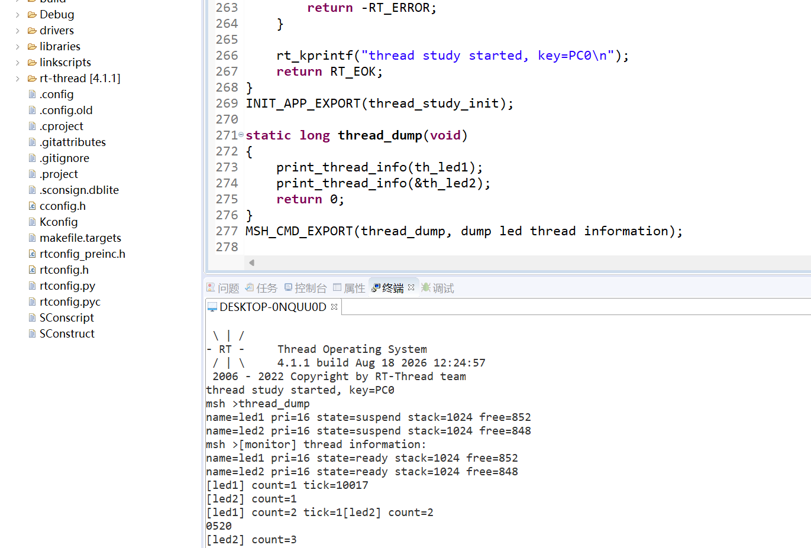
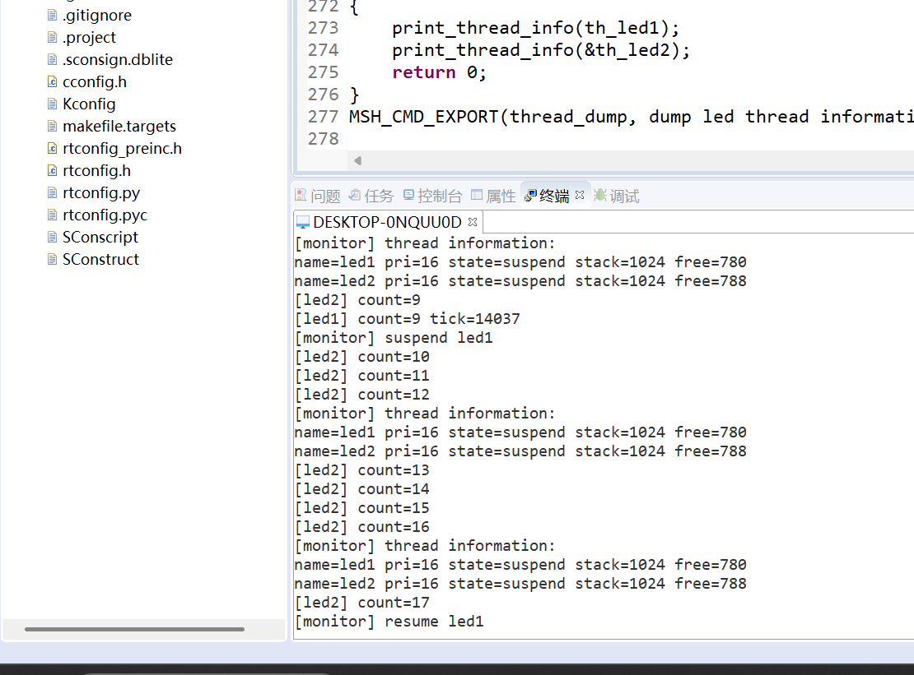
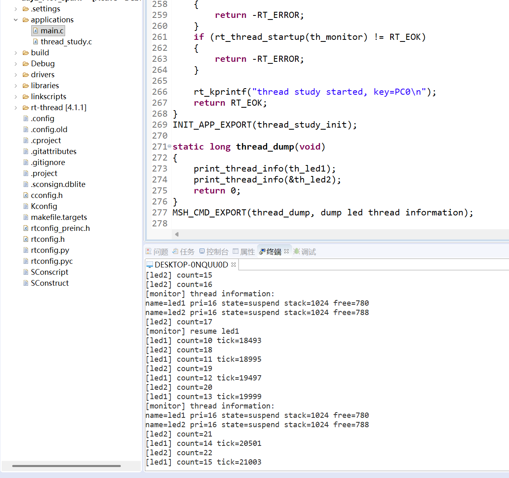
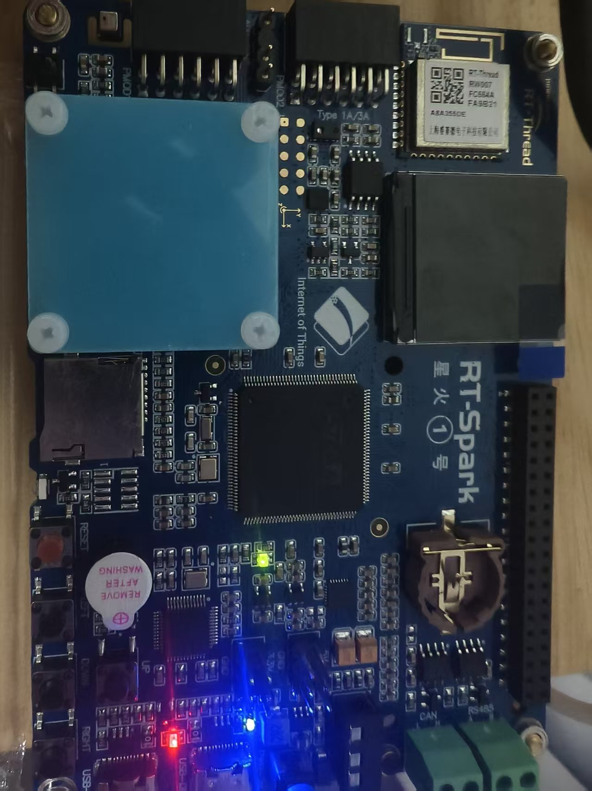
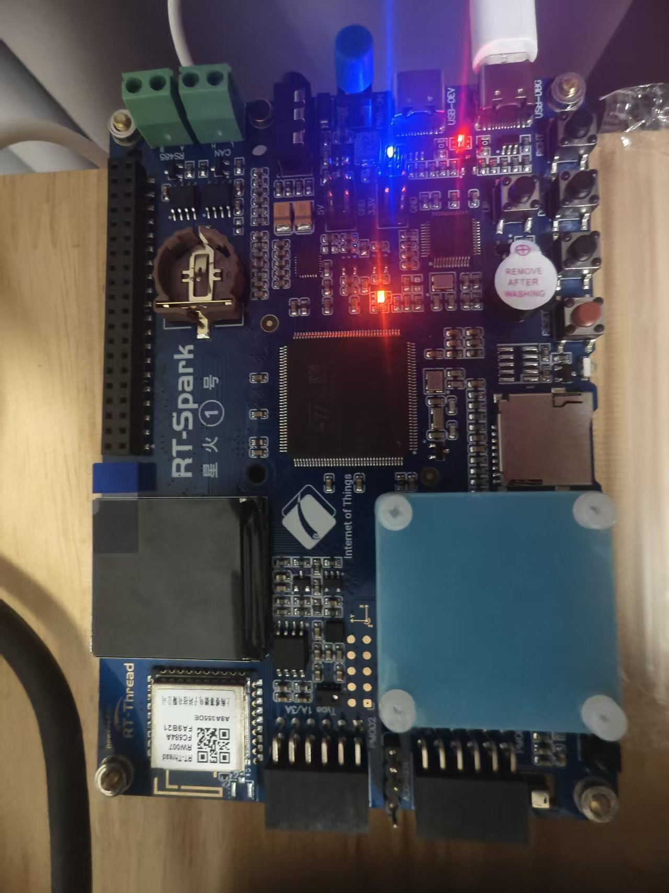

# 【Day2】RT-Thread 启动流程、内核基础与多线程实验报告

> **实验平台：STM32F407 星火1号（stm32f407-rtspark）**  
> **操作系统：RT-Thread 4.1.1**  
> **实验日期：2026 年 8 月 18 日**

---

<a id="toc"></a>

## 目录

- [一、实验概述](#section-1)
- [二、STM32F407 与 RT-Thread 启动流程](#section-2)
- [三、RT-Thread 内核对象与线程模型](#section-3)
- [四、线程状态机与调度机制](#section-4)
- [五、静态线程与动态线程](#section-5)
- [六、多线程实验设计与实现](#section-6)
- [七、实验步骤、现象与结果分析](#section-7)
- [八、问题分析、方案评价与改进方向](#section-8)
- [九、个人总结](#section-9)

---

<a id="section-1"></a>

## 一、实验概述

### 1.1 实验目的

本实验围绕 RT-Thread 的启动、对象管理、线程生命周期和调度机制展开，并在星火1号开发板上完成一个包含动态线程、静态线程、监控线程、二值信号量和 FinSH/MSH 命令的多线程应用。实验目标如下：

1. 理解 STM32F407 从复位入口到 RT-Thread 用户 `main()` 的完整启动路径。
2. 理解 `INIT_BOARD_EXPORT()`、`INIT_APP_EXPORT()` 的链接段注册与运行时遍历机制。
3. 掌握 RT-Thread 线程控制块、五态模型、抢占调度和时间片轮转。
4. 对比 `rt_thread_create()` 与 `rt_thread_init()` 的内存来源、生命周期和释放方式。
5. 通过两个 LED 工作线程验证并发运行，通过按键和全局二值信号量控制红灯线程暂停与恢复。
6. 使用监控输出和 `thread_dump` 命令验证线程状态、优先级及剩余栈空间。

### 1.2 实验环境

| 项目 | 实际配置 |
| --- | --- |
| 开发板 | STM32F407 星火1号（`stm32f407-rtspark`） |
| 内核版本 | RT-Thread 4.1.1 |
| 实验工程 | `code/day2_f407_spark` |
| 主要源码 | `applications/thread_study.c` |
| 用户入口 | `applications/main.c`，未手动调用实验初始化函数 |
| 系统节拍 | `RT_TICK_PER_SECOND = 1000`，即 1 tick = 1 ms |
| 红灯 | `PF12`，低电平点亮 |
| 蓝灯 | `PF11`，低电平点亮 |
| 控制按键 | `PC0`，上拉输入，低电平表示按下 |

本实验按照题目要求，采用导师认可的**全局二值信号量门控方案**控制 `led1`：暂停时由监控线程取走信号量，使 `led1` 在下一次运行前阻塞；恢复时释放信号量，将等待中的 `led1` 唤醒。

[返回目录](#toc)

---

<a id="section-2"></a>

## 二、STM32F407 与 RT-Thread 启动流程

### 2.1 从复位到用户 `main()`

STM32F407 上电或复位后，处理器先从中断向量表取得初始主栈指针 MSP 和 `Reset_Handler` 地址。当前工程使用 GCC 启动文件，其实际顺序是先建立 C 语言运行所需的数据区，再配置系统时钟并进入 RT-Thread 启动入口；其他工具链的入口包装名称可能不同，但建立系统线程并启动调度器的核心过程一致。

```text
上电 / 复位
  -> 从向量表装载 MSP 和 Reset_Handler
  -> Reset_Handler
       -> 设置主栈指针
       -> 从 Flash 复制 .data 到 RAM，并清零 .bss
       -> SystemInit()：建立基础时钟等芯片环境
       -> entry()
  -> rtthread_startup()
       -> rt_hw_interrupt_disable()
       -> rt_hw_board_init()
            -> 时钟、SysTick、堆、串口等板级初始化
            -> rt_components_board_init()（板级自动初始化）
       -> rt_show_version()
       -> rt_system_timer_init()
       -> rt_system_scheduler_init()
       -> rt_application_init()（创建并启动 main 线程）
       -> rt_system_timer_thread_init()
       -> rt_thread_idle_init()
       -> rt_system_scheduler_start()
  -> main_thread_entry()
       -> rt_components_init()（组件及应用自动初始化）
       -> 用户 main()
```

这里最重要的认识是：RT-Thread 中的用户 `main()` 不是复位后直接执行的裸机入口，而是运行在系统创建的 main 线程上下文中。当前工程开启了系统堆，main 线程栈大小由 `RT_MAIN_THREAD_STACK_SIZE` 配置为 `2048 B`。

### 2.2 自动初始化的底层机制

RT-Thread 使用“编译期注册、链接期排序、运行时遍历”的方式组织分散在不同源码文件中的初始化函数。相关宏的核心关系可以概括为：

```c
#define INIT_BOARD_EXPORT(fn)  INIT_EXPORT(fn, "1")
#define INIT_APP_EXPORT(fn)    INIT_EXPORT(fn, "6")
```

`INIT_EXPORT(fn, level)` 会生成一个保存函数指针的静态对象，并通过编译器属性把它放入指定的初始化链接段。链接器按初始化等级组织这些函数指针，并提供段起止符号：

| 阶段 | 等级 | 典型用途 |
| --- | ---: | --- |
| `INIT_BOARD_EXPORT` | 1 | 调度器启动前必须完成的板级硬件初始化 |
| `INIT_PREV_EXPORT` | 2 | 纯软件预初始化 |
| `INIT_DEVICE_EXPORT` | 3 | 设备驱动初始化 |
| `INIT_COMPONENT_EXPORT` | 4 | 文件系统、网络等组件初始化 |
| `INIT_ENV_EXPORT` | 5 | 系统环境准备 |
| `INIT_APP_EXPORT` | 6 | 应用模块和业务线程初始化 |

启动时，`rt_components_board_init()` 遍历板级初始化范围；main 线程中的 `rt_components_init()` 再按顺序遍历后续等级。每次遍历取出函数指针并调用，因此它不是根据函数名搜索，也不依赖 C 语言不存在的反射能力。

本实验通过：

```c
INIT_APP_EXPORT(thread_study_init);
```

把实验初始化函数注册到应用初始化阶段。系统进入 main 线程后会自动初始化 GPIO、信号量并创建三个实验线程，`main.c` 无需也不应再次调用 `thread_study_init()`，从而避免重复创建对象。

[返回目录](#toc)

---

<a id="section-3"></a>

## 三、RT-Thread 内核对象与线程模型

### 3.1 对象容器

RT-Thread 将线程、信号量、互斥量、事件、邮箱、消息队列、定时器等资源抽象为内核对象。对象公共部分保存名称、类型、标志和链表节点；同类型对象被挂入对应的对象容器。这样可以统一完成对象注册、分离、查找和遍历，FinSH 的线程查看功能也能够从线程对象容器取得信息。

动态对象与静态对象使用同一套对象模型，但对象类型中带有静态/动态属性。这个属性使内核在删除对象时能够选择正确的资源处理方式，避免错误释放用户提供的静态内存。

### 3.2 线程控制块关键字段

线程控制块 `struct rt_thread` 是调度器管理线程的核心数据结构，关键成员如下：

| 字段 | 作用 |
| --- | --- |
| `parent` | 基础内核对象，包含线程名称、类型及对象链表节点 |
| `sp` | 已保存的线程栈指针，上下文切换时用于恢复寄存器现场 |
| `entry`、`parameter` | 线程入口函数及其参数 |
| `stack_addr`、`stack_size` | 线程栈起始地址和总大小 |
| `stat` | 当前线程状态；读取基础状态时需要与 `RT_THREAD_STAT_MASK` 相与 |
| `current_priority` | 当前有效优先级，数值越小优先级越高 |
| `init_priority` | 创建线程时设置的初始优先级 |
| `init_tick` | 每轮初始时间片 |
| `remaining_tick` | 当前轮次剩余时间片 |
| `thread_timer` | 用于线程延时和 IPC 超时等待的内置定时器 |
| `cleanup` | 线程退出时执行的清理回调 |

其中，`sp`、`stack_addr` 和 `stack_size` 共同描述线程的独立栈空间；`stat` 和优先级字段决定线程是否进入就绪队列及其调度次序；`init_tick` 与 `remaining_tick` 用于同优先级线程的时间片管理。

[返回目录](#toc)

---

<a id="section-4"></a>

## 四、线程状态机与调度机制

### 4.1 五态模型

```text
                  rt_thread_startup()
       [初始态] ------------------------> [就绪态]
                                              |
                                    调度器选中 |  被抢占 / 时间片用完
                                              v
                                          [运行态]
                                           /    \
          delay / IPC 等待 / suspend      /      \ 入口返回 / delete
                                         v        v
                                     [挂起态]   [关闭态]
                                         |
                  超时 / IPC 到达 / resume|
                                         +------> [就绪态]
```

| 状态 | 宏 | 含义与典型转换 |
| --- | --- | --- |
| 初始态 | `RT_THREAD_INIT` | `rt_thread_create()` 或 `rt_thread_init()` 成功后，尚未启动 |
| 就绪态 | `RT_THREAD_READY` | `rt_thread_startup()` 后等待调度；挂起条件解除后也回到此状态 |
| 运行态 | `RT_THREAD_RUNNING` | 当前被调度器选中并占用 CPU 的线程 |
| 挂起态 | `RT_THREAD_SUSPEND` | 调用延时 API、等待 IPC 或暂停条件未解除，不参与就绪调度 |
| 关闭态 | `RT_THREAD_CLOSE` | 入口函数返回或线程被删除，已退出调度 |

`suspend` 是内核对多种“暂时不可运行”原因的统一表示。本实验中，`led1` 处于 `suspend` 可能是因为 `rt_thread_mdelay(500)`，也可能是因为等待 `led1_sem`；`led2` 显示 `suspend` 通常是正在延时。因此，不能只凭一次状态快照判断线程是否被按键暂停，还要结合控制日志和计数是否继续增长。

### 4.2 抢占式优先级调度

RT-Thread 使用基于优先级的抢占式调度，且优先级数值越小，实际优先级越高。当一个更高优先级线程进入就绪态时，它可以抢占当前低优先级线程。

本实验的 `monitor` 优先级为 10，高于两个 LED 线程的 16。因此按键扫描周期到达或监控线程延时结束后，`monitor` 可以先运行，及时处理按键和状态打印。它处理完毕后调用延时 API 主动阻塞，使两个工作线程继续运行。若高优先级线程长期不阻塞，低优先级线程会被饿死，因此监控线程必须保持短任务并主动让出 CPU。

### 4.3 同优先级时间片轮转

`led1` 和 `led2` 的优先级均为 16、时间片均为 5 ticks。当两个线程同时保持就绪且没有更高优先级线程就绪时，调度器可在它们之间执行同优先级时间片轮转。当前工程 1 tick 为 1 ms，因此 5 ticks 约为 5 ms。

时间片不等同于 LED 翻转周期。两个 LED 线程每轮工作后都会调用 `rt_thread_mdelay(500)`，实际运行节奏主要由 500 ms 周期延时决定；时间片只在同优先级线程持续竞争 CPU 时限制一次连续运行时长。

[返回目录](#toc)

---

<a id="section-5"></a>

## 五、静态线程与动态线程

| 对比项 | 动态线程 `rt_thread_create()` | 静态线程 `rt_thread_init()` |
| --- | --- | --- |
| TCB 与栈来源 | 由系统堆动态分配 | 由用户预先定义并传入 |
| 内存地址 | 运行时确定 | 编译、链接后即可确定 |
| 创建失败风险 | 可能因堆不足或碎片化失败 | 主要取决于静态空间和参数是否合法 |
| 生命周期 | 可按需创建和删除 | 通常与全局/静态存储期一致 |
| 退出后处理 | 动态资源进入回收流程，最终由 idle 线程释放 | 使用 `rt_thread_detach()` 分离，不释放用户提供的内存 |
| 优点 | 灵活、接口简洁、适合按需任务 | 内存可预测、无运行期堆碎片、确定性更强 |
| 典型场景 | 普通业务线程、生命周期动态的功能 | 长期运行任务、安全关键或高可靠系统 |

本实验同时使用两种方式：`led1` 与 `monitor` 动态创建，便于展示堆分配接口；`led2` 使用全局 TCB 和 1024 B 对齐栈，展示静态初始化方式。

```c
static struct rt_thread th_led2;
ALIGN(RT_ALIGN_SIZE)
static rt_uint8_t th_led2_stack[1024];

rt_thread_init(&th_led2, "led2", led2_entry, RT_NULL,
               th_led2_stack, sizeof(th_led2_stack), 16, 5);
```

高可靠场景倾向静态线程，是因为它可以在编译和链接阶段确定内存总量与地址，不依赖运行时堆状态，也不会产生堆碎片。但这不表示动态线程本身不可用：只要合理规划堆、检查创建返回值并管理生命周期，动态创建仍然适合大量普通应用。

[返回目录](#toc)

---

<a id="section-6"></a>

## 六、多线程实验设计与实现

### 6.1 线程参数与职责

源码变量使用 `th_led1`、`th_led2`、`th_monitor` 保存线程句柄或 TCB，注册到内核对象容器中的线程名称分别为 `led1`、`led2`、`monitor`。

| 线程 | 创建方式 | 栈 | 优先级 | 时间片 | 主要职责 |
| --- | --- | ---: | ---: | ---: | --- |
| `led1` | 动态 `rt_thread_create()` | 1024 B | 16 | 5 ticks | 翻转 PF12 红灯，打印 `count` 和系统 tick；受二值信号量门控 |
| `led2` | 静态 `rt_thread_init()` | 1024 B | 16 | 5 ticks | 翻转 PF11 蓝灯并打印 `count` |
| `monitor` | 动态 `rt_thread_create()` | 1024 B | 10 | 5 ticks | 扫描 PC0 按键、控制 `led1`，每 2 s 打印线程状态和栈余量 |

三个线程创建或初始化成功后均通过 `rt_thread_startup()` 加入调度。返回值均被检查，避免创建失败后继续使用无效句柄。

### 6.2 LED 工作线程

`led1` 和 `led2` 启动后先延时 1000 ms，再进入无限循环。每次循环翻转对应 GPIO、递增计数并延时 500 ms。`led1` 额外读取 `rt_tick_get()`，因此可以从串口日志验证其周期：

```c
count++;
rt_kprintf("[led1] count=%u tick=%u\n", count, rt_tick_get());
rt_thread_mdelay(500);
```

在正常运行时，相邻 `led1` 日志的 tick 差值约为 500，和设定的 500 ms 延时一致。由于串口输出和调度存在少量开销，实测差值可能为 502 或 503 ticks，这是正常现象。

### 6.3 二值信号量门控

全局静态信号量 `led1_sem` 的初值为 1，表示 `led1` 默认允许运行：

```c
rt_sem_init(&led1_sem, "ledsem", 1, RT_IPC_FLAG_FIFO);
```

正常情况下，`led1` 在每轮开始时取到信号量后立即归还，再执行 LED 翻转。第一次有效按键触发后，`monitor` 取走信号量但不归还，并把红灯置为熄灭电平；`led1` 到下一轮执行 `rt_sem_take(..., RT_WAITING_FOREVER)` 时进入信号量等待。第二次有效按键触发后，`monitor` 调用 `rt_sem_release()`，等待中的 `led1` 被唤醒并继续计数。

```text
正常：led1 取信号量 -> 立即归还 -> 翻转红灯 -> 延时
暂停：monitor 取走信号量 -> led1 下一轮取不到 -> 阻塞等待
恢复：monitor 释放信号量 -> led1 被唤醒 -> 恢复翻转和计数
```

这种方案使线程只在自己定义好的同步点停下，不会在持有未知资源或执行 GPIO/打印操作的中间位置被强制冻结，状态转换和资源关系更容易分析。

### 6.4 监控线程的双周期设计

监控线程没有直接使用一次 2000 ms 的长延时，因为那样可能漏掉持续时间较短的按键。实际实现把两个时间尺度分离：

- 主循环每 10 ms 扫描一次按键。
- 检测到低电平后延时 20 ms 再确认，实现基本消抖。
- 确认按下后等待按键释放，防止一次按下重复触发。
- 使用 `now - last_print_tick` 独立判断是否达到 2000 ms，仅到期时打印线程信息。

因此，按键响应周期约为 10 ms，而状态输出仍保持约 2 s 一次。该设计同时满足交互响应和周期监控要求。

### 6.5 状态、栈余量与 `thread_dump`

线程状态读取时使用：

```c
thread->stat & RT_THREAD_STAT_MASK
```

以屏蔽状态字段中的附加标志。栈余量统计从 `stack_addr` 开始扫描 RT-Thread 初始化栈时填入的 `'#'` 字节，连续未被覆盖的字节数即为历史上尚未使用的栈空间。它反映的是栈使用高水位，而不是某一瞬间局部变量退出后“恢复”的空间。

```c
while ((free_size < thread->stack_size) &&
       (stack[free_size] == '#'))
{
    free_size++;
}
```

实验还通过 `MSH_CMD_EXPORT()` 导出自定义命令：

```c
MSH_CMD_EXPORT(thread_dump, dump led thread information);
```

在 FinSH/MSH 中输入 `thread_dump`，即可手动查看两个 LED 线程的对象名称、当前优先级、状态、栈总量和剩余栈空间。监控线程也会每 2 s 自动打印同样的信息。

[返回目录](#toc)

---

<a id="section-7"></a>

## 七、实验步骤、现象与结果分析

### 7.1 自动启动与周期运行

**实验步骤：** 编译并下载工程，复位开发板，打开串口终端观察 RT-Thread 启动横幅、模块初始化信息、两个 LED 线程的计数以及监控线程输出。



*图 1：RT-Thread 4.1.1 启动后，`thread study started, key=PC0` 自动出现，两个 LED 线程持续计数，监控线程周期打印状态。*

**现象分析：**

- 日志在用户没有从 `main.c` 手动调用初始化函数的情况下自动出现，说明 `INIT_APP_EXPORT(thread_study_init)` 已生效。
- `led1` 的 tick 依次为 6、509、1011、1513，差值分别约为 503、502、502 ticks，与 500 ms 延时及少量执行开销相符。
- `led1` 和 `led2` 的计数同步增长，证明动态线程和静态线程均已成功进入调度。
- 此次状态快照显示 `led1` 为 `suspend`、`led2` 为 `ready`。前者此时处于周期延时并不代表按键暂停，后者则刚好已就绪等待运行。
- 图中栈余量为 `led1: 780/1024 B`、`led2: 788/1024 B`，对应历史最大使用量约为 244 B 和 236 B，尚有较大余量。

### 7.2 自动初始化与命令导出验证

**实验步骤：** 系统启动后，在 FinSH/MSH 提示符输入 `thread_dump`，同时核对源码中的 `INIT_APP_EXPORT()` 和 `MSH_CMD_EXPORT()` 注册位置。



*图 2：源码注册宏与串口命令结果相互对应，`thread_dump` 能够输出两个 LED 线程的信息。*

**现象分析：**

- `thread_dump` 被 shell 正确识别，说明 `MSH_CMD_EXPORT(thread_dump, ...)` 已将命令注册到 FinSH 符号表。
- 命令显示两个线程优先级均为 16、栈均为 1024 B，与源码参数完全一致。
- 本次重新运行得到的栈余量为 `led1: 852 B`、`led2: 848 B`。它与图 1 的数值不同，说明不同构建或不同运行路径会改变历史最大栈深度；栈评估应以压力场景下观测到的最小余量为准。
- 自动监控输出与手动 `thread_dump` 均可读取线程信息，分别适合持续观察和按需诊断。

### 7.3 按键暂停 `led1`

**实验步骤：** 保持系统运行，第一次有效按下 PC0 按键。观察 `[monitor] suspend led1` 后两个线程的计数变化和状态输出。



*图 3：第一次按键后，`led1` 停止在 count=9，`led2` 从 count=9 持续增长到 count=17。*

**现象分析：**

- `[monitor] suspend led1` 表明监控线程已取走全局二值信号量。
- 在暂停区间内不再出现新的 `led1` 计数，而 `led2` 继续从 9 增长至 17，证明控制只作用于红灯线程，没有阻塞调度器或其他线程。
- 监控快照中 `led1` 保持 `suspend`，此时结合计数停止和控制日志，可以判断它正在等待信号量。
- `led2` 的状态也可能被采样为 `suspend`，原因是它当时正在执行 `rt_thread_mdelay(500)`；其计数持续增长证明它并未被按键暂停。

### 7.4 按键恢复 `led1`

**实验步骤：** 第二次有效按下 PC0 按键，观察 `[monitor] resume led1` 以及后续红灯线程计数和 tick。



*图 4：监控线程释放信号量后，`led1` 从 count=10 继续增长，红灯线程恢复周期运行。*

**现象分析：**

- `[monitor] resume led1` 表明 `rt_sem_release()` 执行成功，等待信号量的 `led1` 被唤醒。
- 恢复后 `led1` 的 count 从 10 连续增长至 15，tick 也继续递增，证明线程重新参与调度。
- `led2` 在整个控制过程中始终继续计数，验证了线程间控制范围的隔离性。
- 恢复后的监控快照仍可能看到 `led1 state=suspend`，这是因为线程恢复执行后又进入正常的 500 ms 延时。判断恢复是否成功应看 `resume` 日志和后续计数，而不能只看单次状态值。

### 7.5 开发板 LED 运行现象

**实验步骤：** 在串口计数持续输出期间观察开发板，记录 PF12 红灯与 PF11 蓝灯的实际点亮状态。由于两个线程独立周期翻转，静态照片只能记录某一时刻，动态运行结论需与连续串口日志共同判断。



*图 5：星火1号开发板实物，红、蓝 LED 在两个工作线程控制下运行。*



*图 6：另一拍摄时刻的开发板状态，用于核对实际硬件连接和 LED 输出。*

**现象分析：** 两张照片确认实验固件运行在星火1号实物上，板载红、蓝 LED 均有点亮记录。结合串口中两个线程持续增长的计数，可判定 PF12 与 PF11 均被周期驱动。单张静态照片不能独立证明“闪烁”，因此本报告不把照片亮灭瞬间作为唯一证据，而是采用“硬件照片 + 连续计数 + tick 周期”的交叉验证方式。

### 7.6 实验结果汇总

| 验证项目 | 证据 | 结论 |
| --- | --- | --- |
| RT-Thread 启动 | 4.1.1 启动横幅与 `msh >` | 系统和 FinSH 正常运行 |
| 自动初始化 | 启动时自动打印 `thread study started` | `INIT_APP_EXPORT()` 生效 |
| 动态线程 | `led1` 计数与 tick 持续增长 | 动态创建并调度成功 |
| 静态线程 | `led2` 计数持续增长 | 静态初始化并调度成功 |
| 调度参数 | `thread_dump` 显示两个 LED 线程优先级 16、栈 1024 B | 与源码一致 |
| 周期监控 | 每约 2 s 输出线程信息 | 独立打印周期正常 |
| 按键暂停 | `suspend led1` 后仅 `led2` 继续计数 | 二值信号量门控成功 |
| 按键恢复 | `resume led1` 后 `led1` 重新计数 | 信号量释放和唤醒成功 |
| 栈余量 | 最低观测值为 780 B 与 788 B | 当前实验路径下余量充足 |

[返回目录](#toc)

---

<a id="section-8"></a>

## 八、问题分析、方案评价与改进方向

### 8.1 容易误判的问题

1. **看到 `suspend` 就认为按键已暂停线程。** `rt_thread_mdelay()` 和等待信号量都会使线程处于挂起态，必须结合控制日志、计数变化和代码等待点判断原因。
2. **把 5 ticks 时间片当成 500 ms LED 周期。** 5 ticks 约为 5 ms，只控制同优先级线程持续竞争 CPU 时的轮转；LED 周期来自显式的 500 ms 延时。
3. **只用静态照片证明闪烁。** 照片只能记录一个瞬间，必须与串口的连续计数和 tick 变化共同验证。
4. **把栈余量当成瞬时空闲栈。** `'#'` 扫描得到的是历史高水位统计。评价栈大小时应在最深调用和最大日志压力下取最小余量，并预留中断嵌套和版本变化的安全空间。

### 8.2 当前方案的优点

- 二值信号量使 `led1` 在明确同步点自主阻塞，线程控制边界清晰。
- `monitor` 优先级较高且每 10 ms 扫描按键，响应及时；其每轮均主动延时，不会长期占用 CPU。
- 10 ms 扫描与 2000 ms 打印解耦，避免为周期监控牺牲短按检测能力。
- 动态与静态线程同时使用，能够直观比较两种内存管理方式。
- 自动监控和手动 `thread_dump` 互补，方便持续观察与现场调试。
- 创建、初始化和启动操作均检查返回值，提高了失败场景下的可诊断性。

### 8.3 局限性与改进方向

- 当前按键采用轮询和阻塞等待松手。若按键被长按，监控线程会停留在等待松手循环，2 s 状态打印可能推迟。后续可以用 GPIO 中断只发送事件，再由线程完成消抖和控制。
- `led1_paused` 表示控制意图，但 `thread_dump` 当前只输出内核状态，不能直接区分“周期延时”和“等待信号量”。可以增加 `control=running/paused` 字段，提高诊断可读性。
- 当前 `thread_dump` 只打印两个 LED 工作线程。若需要完整观察实验对象，可以加入 `monitor` 本身的信息，但打印自己时其状态通常是 `running`，需要在报告中说明采样语义。
- 栈扫描直接遍历 1024 B，适合本实验低频诊断，不适合在高频实时路径中调用。工程化实现可复用内核已有统计命令，并限制监控频率。
- 暂停请求要等 `led1` 运行到下一轮信号量检查点才完全生效，最坏响应时间接近一个 LED 周期。若应用需要更短停止延迟，可使用事件驱动等待或缩短工作分段。

[返回目录](#toc)

---

<a id="section-9"></a>

## 九、个人总结

通过本次实验，我把 RT-Thread 的启动流程、自动初始化、对象模型、线程状态和实际调度现象连接了起来。以前容易把 `main()` 当作系统的最初入口，现在明确了它实际由 main 线程调用；`INIT_APP_EXPORT()` 也不是简单的语法包装，而是链接段注册与运行时遍历机制的应用。

在线程实验中，动态创建的 `led1`、静态初始化的 `led2` 和高优先级 `monitor` 各自承担单一职责。串口计数、tick、状态、栈余量和开发板 LED 现象形成了相互印证的证据链。按要求采用全局二值信号量后，我进一步理解了线程“暂停”在内核中本质上可以表现为等待某个条件，而 `suspend` 状态本身并不能说明具体等待原因。

本实验最终完成了三个线程的创建与启动、红蓝 LED 周期控制、按键暂停与恢复、自动初始化、栈余量统计及 `thread_dump` 命令导出，配置和运行结果均与题目要求一致。

[返回目录](#toc)
