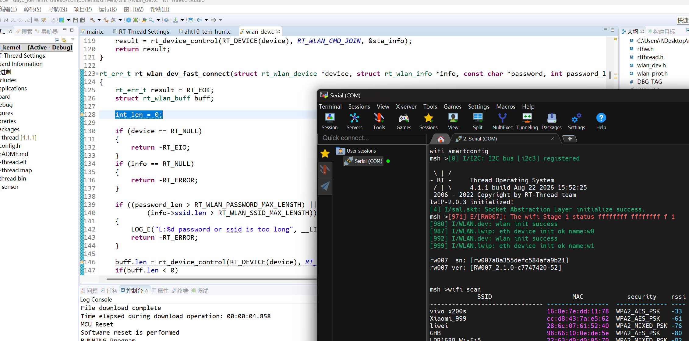
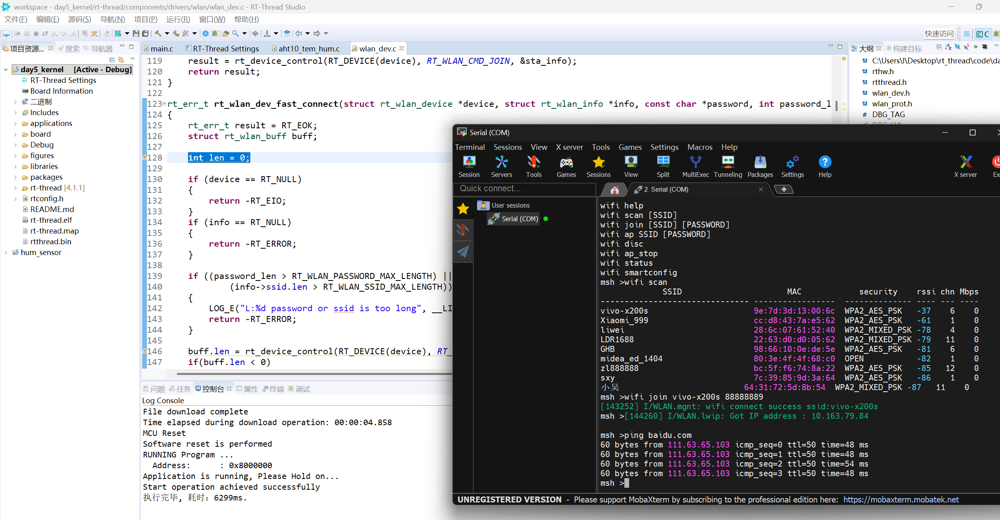
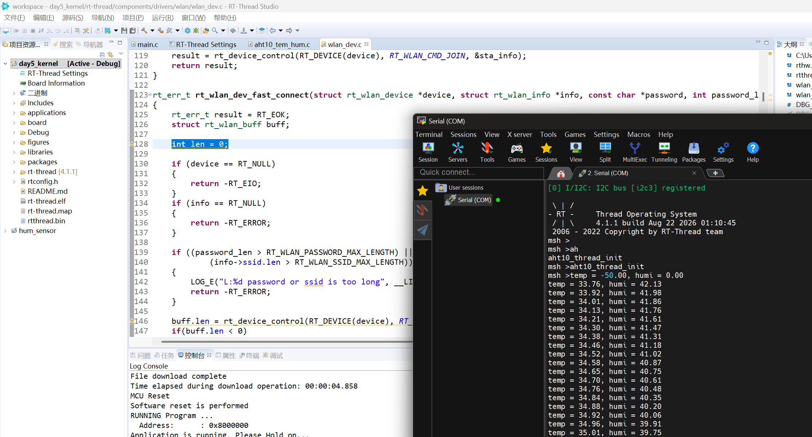
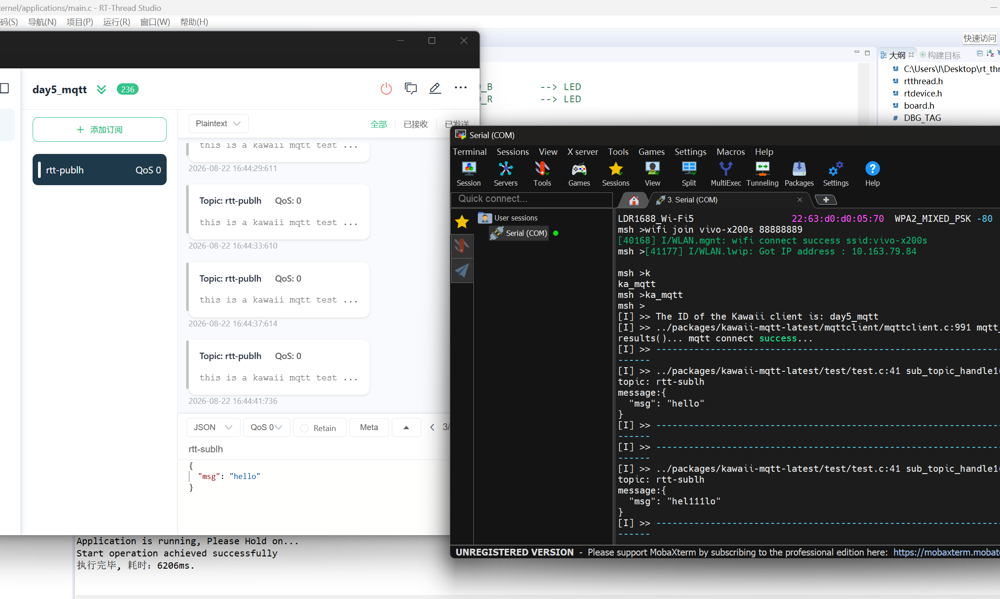
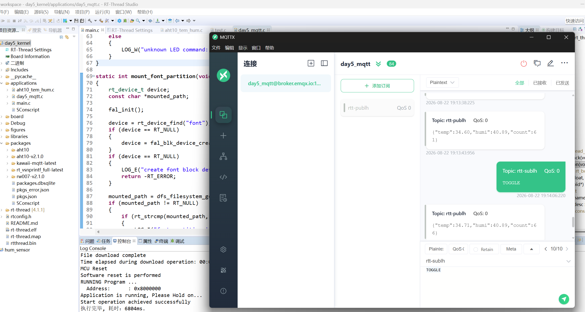
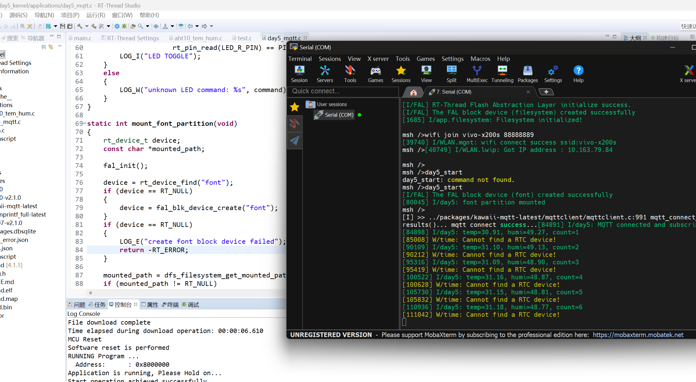
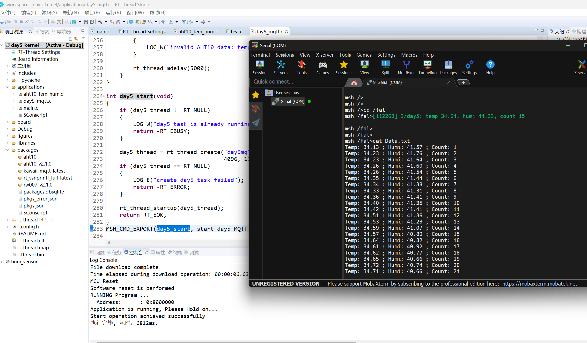
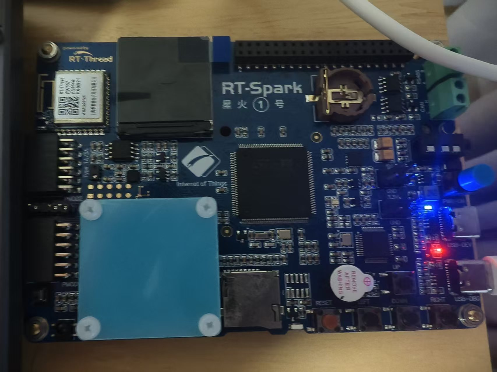
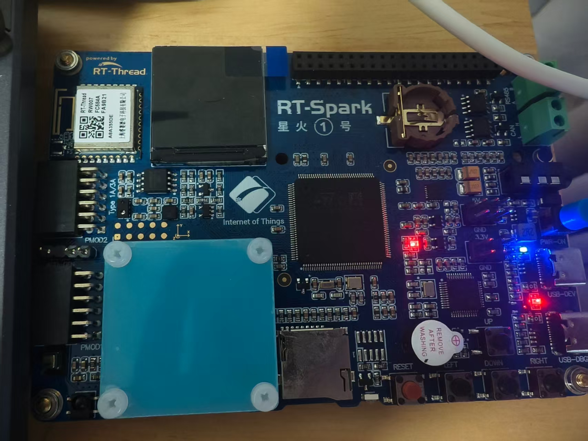
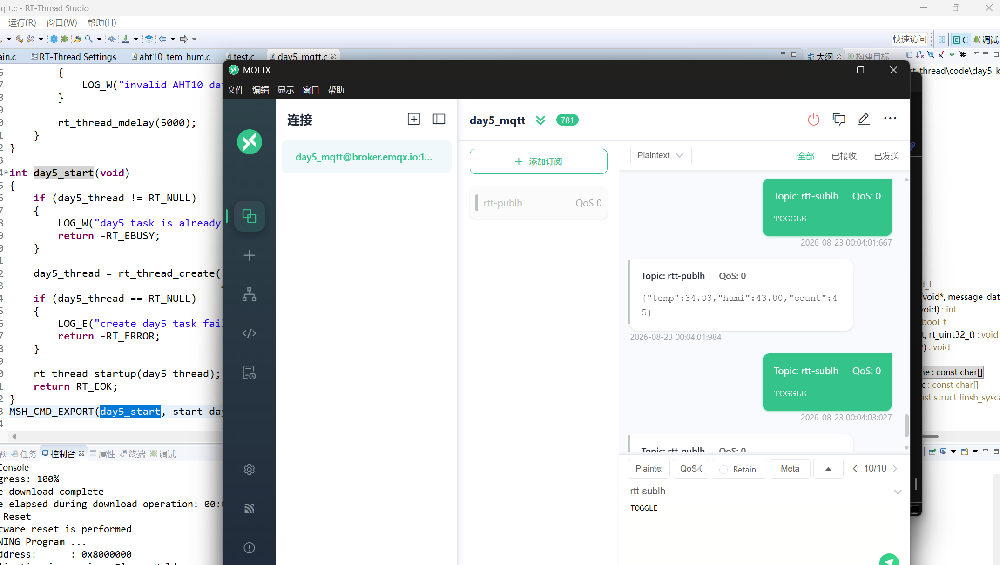

# 【RSOC26】第五天作业：AHT10 温湿度采集、MQTT 通信与文件系统

姓名：刘昊  
日期：2026 年 8 月 22 日至 23 日  
开发板：RT-Spark 星火一号  
操作系统：RT-Thread 4.1.1

## 目录

- [一、任务要求](#一任务要求)
- [二、实现方案](#二实现方案)
- [三、Wi-Fi 联网](#三wi-fi-联网)
- [四、AHT10 温湿度采集](#四aht10-温湿度采集)
- [五、MQTT 上传温湿度](#五mqtt-上传温湿度)
- [六、font 分区挂载与文件保存](#六font-分区挂载与文件保存)
- [七、云端指令控制 LED](#七云端指令控制-led)
- [八、任务启动](#八任务启动)
- [九、验证结果](#九验证结果)
- [十、结论](#十结论)

## 一、任务要求

1. 使用 AHT10 软件包采集温湿度，并上传到 EMQX。
2. 挂载 `font` 分区，在文件系统中保存 `Data.txt`，记录温度、湿度和自上电以来的采集次数。
3. 通过云端 MQTT 指令控制板载 LED 翻转。
4. 熟悉其他 RT-Thread 软件包。

## 二、实现方案

本次作业使用 `applications/day5_mqtt.c` 完成主要功能，线程启动后按以下流程运行：

```text
初始化 LED -> 初始化 FAL 并挂载 font 到 /fal -> 初始化 AHT10
-> 等待 Wi-Fi 获取 IP -> 连接 EMQX -> 订阅控制主题
-> 读取温湿度 -> 保存 /fal/Data.txt -> 发布 MQTT
-> 延时 5 秒后重复执行
```

MQTT 配置如下：

| 项目 | 配置 |
|---|---|
| Broker | `broker.emqx.io` |
| 端口 | `1883` |
| Client ID | `day5_mqtt` |
| 发布主题 | `rtt-publh` |
| 订阅主题 | `rtt-sublh` |
| QoS | `0` |

硬件使用情况：AHT10 挂接在 `i2c3` 总线；红色板载 LED 使用 `PF12`，即 `GET_PIN(F, 12)`。

## 三、Wi-Fi 联网

使用 MSH 命令扫描附近 Wi-Fi，并通过 `wifi join` 连接网络。串口显示连接成功并获得 IP 地址，说明 RW007 无线网络已经正常工作。



图 1 Wi-Fi 扫描及设备启动日志



图 2 Wi-Fi 连接成功，设备获得 IP 地址

## 四、AHT10 温湿度采集

程序通过 `aht10_init("i2c3")` 初始化传感器，每隔 5 秒读取一次温度和湿度，并检查数据范围。只有有效数据才递增计数、保存和上传。

```c
aht10 = aht10_init("i2c3");
temp = aht10_read_temperature(aht10);
humi = aht10_read_humidity(aht10);

if ((temp >= -40.0f) && (temp <= 85.0f) &&
    (humi >= 0.0f) && (humi <= 100.0f))
{
    count++;
    LOG_I("temp=%.2f, humi=%.2f, count=%lu",
          temp, humi, (unsigned long)count);
}
```

串口中可以看到温湿度连续变化，说明 AHT10 初始化、I2C 通信和周期采集均已实现。



图 3 AHT10 周期采集结果

## 五、MQTT 上传温湿度

设备连接 `broker.emqx.io:1883` 后，订阅 `rtt-sublh`，同时将数据以 JSON 格式发布到 `rtt-publh`。

```c
mqtt_set_host(mqtt, "broker.emqx.io");
mqtt_set_port(mqtt, "1883");
mqtt_set_client_id(mqtt, "day5_mqtt");

mqtt_connect(mqtt);
mqtt_subscribe(mqtt, "rtt-sublh", QOS0, mqtt_control_callback);

rt_snprintf(json, sizeof(json),
            "{\"temp\":%.2f,\"humi\":%.2f,\"count\":%lu}",
            temp, humi, (unsigned long)count);

message.qos = QOS0;
message.payload = json;
message.payloadlen = rt_strlen(json);
mqtt_publish(mqtt, "rtt-publh", &message);
```

串口输出 `MQTT connected and subscribed`，MQTTX 中可以看到 `rtt-publh` 主题持续收到温湿度 JSON 数据，`count` 与串口及文件记录一致。



图 4 MQTT 客户端连接成功并开始通信



图 5 MQTTX 接收 `rtt-publh` 主题数据



图 6 MQTTX 中显示的温湿度 JSON 数据

## 六、font 分区挂载与文件保存

程序调用 `fal_init()` 初始化 FAL，创建 `font` 块设备，并使用 DFS 以 Elm 文件系统挂载到 `/fal`。首次挂载失败时先格式化分区，再重新挂载。

```c
fal_init();
device = rt_device_find("font");
if (device == RT_NULL)
{
    device = fal_blk_device_create("font");
}

dfs_mount("font", "/fal", "elm", 0, RT_NULL);
```

温湿度数据使用追加方式写入 `/fal/Data.txt`：

```c
length = rt_snprintf(line, sizeof(line),
                     "Temp: %.2f ; Humi: %.2f ; Count: %lu\n",
                     temp, humi, (unsigned long)count);
fd = open("/fal/Data.txt", O_WRONLY | O_CREAT | O_APPEND, 0);
write(fd, line, length);
close(fd);
```

运行时可以看到 `font partition mounted at /fal`，并可通过 MSH 读取文件：

```text
msh /> cd /fal
msh /fal> cat Data.txt
Temp: 34.13 ; Humi: 41.57 ; Count: 1
Temp: 34.23 ; Humi: 41.76 ; Count: 2
Temp: 34.23 ; Humi: 41.64 ; Count: 3
...
Temp: 34.71 ; Humi: 40.66 ; Count: 21
```



图 7 `font` 分区挂载成功，温湿度数据持续采集


## 七、云端指令控制 LED

MQTT 回调函数接收 `rtt-sublh` 主题消息，支持 `ON`、`OFF` 和 `TOGGLE`。红色 LED 为低电平点亮，因此使用 `PIN_LOW` 点亮、`PIN_HIGH` 熄灭。

```c
if (rt_strcasecmp(command, "TOGGLE") == 0)
{
    rt_pin_write(LED_R_PIN,
                 rt_pin_read(LED_R_PIN) == PIN_LOW ? PIN_HIGH : PIN_LOW);
    LOG_I("LED TOGGLE");
}
```

在 MQTTX 中向 `rtt-sublh` 发布 `TOGGLE`，串口显示 `LED TOGGLE`，板载红色 LED 状态发生翻转。


图 8 通过 MSH 读取 `/fal/Data.txt`

图 9 开发板板载 LED 运行状态



图 10 MQTTX 向 `rtt-sublh` 发布 `TOGGLE` 指令

## 八、任务启动

程序将功能封装为 MSH 命令 `day5_start`，启动命令如下：

```text
msh /> day5_start
```

线程创建时使用 4096 字节栈空间、优先级 17 和时间片 10，并通过全局线程句柄避免任务重复启动。

## 九、验证结果

| 验证项目 | 结果 |
|---|---|
| Wi-Fi 扫描、连接及获取 IP | 成功 |
| AHT10 初始化和 I2C 采集 | 成功，串口持续输出温湿度 |
| FAL `font` 分区创建和挂载 | 成功，挂载点为 `/fal` |
| `Data.txt` 追加保存 | 成功，计数从 1 连续递增 |
| MQTT 连接 EMQX | 成功 |
| `rtt-publh` 发布温湿度 JSON | 成功，MQTTX 可接收 |
| `rtt-sublh` 接收控制命令 | 成功 |
| `TOGGLE` 控制板载红色 LED | 成功 |

## 十、结论

本次作业完成了 AHT10 温湿度采集、Wi-Fi 联网、MQTT 上云、`font` 分区挂载、文件系统数据保存，以及云端 MQTT 指令控制 LED 翻转。通过串口日志、MQTTX 消息和 `Data.txt` 文件内容进行了交叉验证，达到任务要求。
