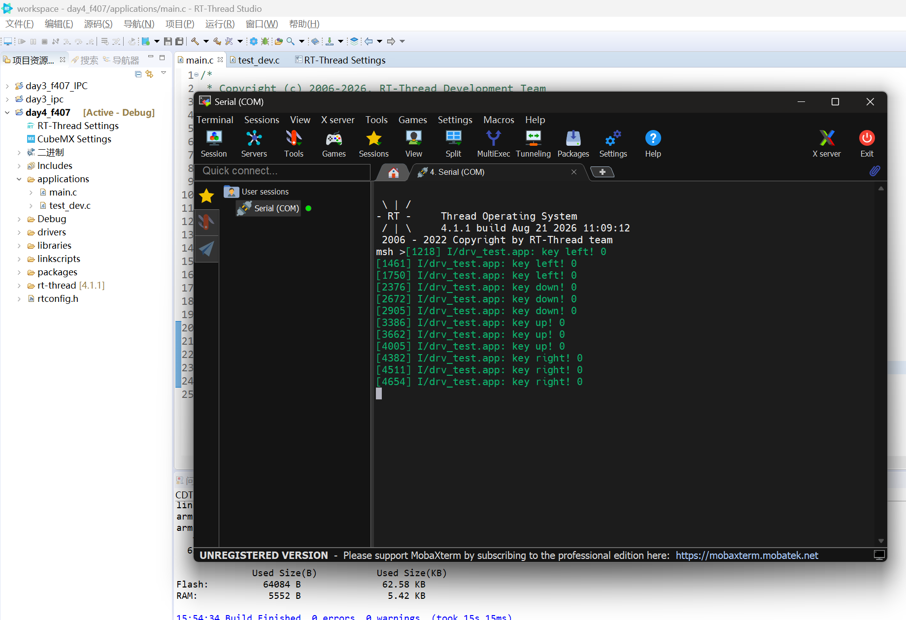
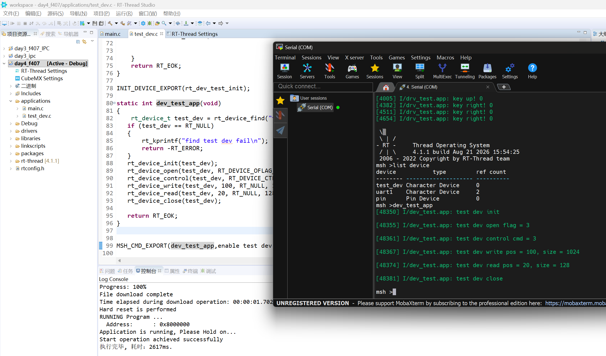

# 【Day4】RT-Thread 外部中断与虚拟设备驱动实验报告

> **实验平台：STM32F407 星火1号（STM32F407ZG）**  
> **操作系统：RT-Thread 4.1.1**  
> **实验日期：2026 年 8 月 21 日**

---

## 一、实验目的

本次作业围绕 RT-Thread 的 PIN 设备中断接口和统一设备模型展开，完成以下两个实验：

1. 配置上、下、左、右四个按键的 GPIO 外部中断，在按键按下时进入中断回调并输出对应按键信息。
2. 设计并注册一个名为 `test_dev` 的虚拟字符设备，实现 RT-Thread 标准设备接口的初始化、打开、关闭、读取、写入和控制回调。
3. 使用 FinSH/MSH 命令调用虚拟设备，通过串口日志验证设备查找和各接口的调用流程。
4. 理解应用层通过统一的 `rt_device_*()` API 访问底层设备驱动的过程。

---

## 二、实验环境

| 项目 | 配置 |
| --- | --- |
| 开发板 | STM32F407 星火1号 |
| MCU | STM32F407ZG，Cortex-M4 |
| RTOS | RT-Thread 4.1.1 |
| 工程 | `day4_f407` |
| 开发工具 | RT-Thread Studio |
| 调试输出 | UART1 串口终端 |
| 主要源码 | [`test_dev.c`](./test_dev.c) |
| 实验截图 | `figure/1.png`、`figure/PixPin_2026-08-21_15-59-07.png` |

---

## 三、实验一：按键 GPIO 外部中断

### 3.1 实验内容

将开发板上的上、下、左、右四个按键配置为上拉输入，并使用下降沿触发外部中断。按键未按下时输入为高电平，按下后输入变为低电平，因此选择 `PIN_IRQ_MODE_FALLING` 作为触发方式。

各按键使用的引脚如下：

| 按键 | GPIO 引脚 | 输入模式 | 中断触发方式 |
| --- | --- | --- | --- |
| 上键 | PC5 | 上拉输入 | 下降沿触发 |
| 下键 | PC1 | 上拉输入 | 下降沿触发 |
| 左键 | PC0 | 上拉输入 | 下降沿触发 |
| 右键 | PC4 | 上拉输入 | 下降沿触发 |

### 3.2 实现流程

按键外部中断的配置流程如下：

```text
使用 GET_PIN() 获得 RT-Thread PIN 编号
        ↓
rt_pin_mode() 配置上拉输入
        ↓
rt_pin_attach_irq() 绑定下降沿中断回调
        ↓
rt_pin_irq_enable() 使能引脚中断
        ↓
按键按下产生下降沿
        ↓
执行对应回调并输出按键名称和当前电平
```

关键接口如下：

```c
rt_pin_mode(key_pin, PIN_MODE_INPUT_PULLUP);
rt_pin_attach_irq(key_pin,
                  PIN_IRQ_MODE_FALLING,
                  key_callback,
                  RT_NULL);
rt_pin_irq_enable(key_pin, PIN_IRQ_ENABLE);
```

中断回调中通过 `rt_pin_read()` 读取按键电平，并使用 ULog 输出按键信息。以左键为例：

```c
static void key_left_callback(void *args)
{
    int value = rt_pin_read(KEY_LEFT);

    LOG_I("key left! %d", value);
}
```

### 3.3 实验现象

依次按下左、下、上、右四个方向按键后，串口输出对应的按键名称，按下时读取到的电平为 `0`。



从截图可以观察到：

- 左键触发后输出 `key left! 0`。
- 下键触发后输出 `key down! 0`。
- 上键触发后输出 `key up! 0`。
- 右键触发后输出 `key right! 0`。
- 四个按键均能进入各自的中断回调，说明 GPIO 输入、中断绑定和中断使能配置正确。

同一次按键动作可能出现多条日志，这是机械按键抖动导致的重复边沿触发。本实验重点验证外部中断功能，因此保留了原始触发现象；实际产品中可增加软件定时消抖，或者在中断中暂时关闭该按键中断并延时确认电平。

### 3.4 中断处理注意事项

中断服务函数应尽量简短，避免在中断上下文执行长时间阻塞操作。本实验的回调只读取按键电平并记录实验日志。复杂业务处理可以通过信号量、事件集或消息队列通知线程完成，从而减少中断占用时间。

---

## 四、实验二：设计虚拟设备驱动框架层 `test_dev`

### 4.1 RT-Thread 统一设备模型

RT-Thread 使用统一设备模型管理不同类型的设备。应用程序不直接调用具体硬件驱动，而是使用 `rt_device_find()`、`rt_device_open()`、`rt_device_read()` 等标准接口。设备框架再根据设备对象中注册的回调函数调用具体驱动。

本实验没有连接实际硬件，而是创建一个 `RT_Device_Class_Char` 类型的虚拟字符设备，用日志展示统一设备接口向驱动回调的分发过程。

```text
MSH 测试命令 dev_test_app
        ↓
RT-Thread 统一设备接口 rt_device_*()
        ↓
设备对象 test_dev
        ↓
dev_test_init/open/control/write/read/close
        ↓
ULog 输出回调参数
```

### 4.2 驱动接口设计

虚拟设备实现了以下六个标准回调：

| 回调函数 | 作用 | 本实验行为 |
| --- | --- | --- |
| `dev_test_init()` | 初始化设备 | 输出初始化日志 |
| `dev_test_open()` | 打开设备 | 输出打开标志 `oflag` |
| `dev_test_close()` | 关闭设备 | 输出关闭日志 |
| `dev_test_read()` | 读取设备 | 输出读取位置和长度 |
| `dev_test_write()` | 写入设备 | 输出写入位置和长度 |
| `dev_test_control()` | 控制设备 | 输出控制命令编号 |

这些回调共同构成了虚拟设备的驱动接口层。当前实验的重点是验证设备框架和回调分发机制，所以读写接口只记录调用参数并返回请求长度，没有实现实际数据存储。

### 4.3 设备创建和注册

设备初始化函数首先动态创建字符设备对象，然后挂接六个驱动回调，最后以 `test_dev` 为名称注册到 RT-Thread 设备管理系统。

```c
static int rt_dev_test_init(void)
{
    rt_device_t test_dev = rt_device_create(RT_Device_Class_Char, 0);

    if (!test_dev)
    {
        LOG_E("test_dev failed");
        return -RT_ERROR;
    }

    test_dev->init = dev_test_init;
    test_dev->open = dev_test_open;
    test_dev->close = dev_test_close;
    test_dev->read = dev_test_read;
    test_dev->write = dev_test_write;
    test_dev->control = dev_test_control;

    if (rt_device_register(test_dev,
                           "test_dev",
                           RT_DEVICE_FLAG_RDWR) != RT_EOK)
    {
        LOG_E("test_dev failed");
        return -RT_ERROR;
    }

    return RT_EOK;
}

INIT_DEVICE_EXPORT(rt_dev_test_init);
```

`INIT_DEVICE_EXPORT()` 将初始化函数注册到 RT-Thread 的设备初始化阶段。系统启动后会自动执行 `rt_dev_test_init()`，不需要在 `main()` 中手动调用。

### 4.4 MSH 测试程序

测试函数先使用设备名称查找设备，然后依次执行初始化、打开、控制、写入、读取和关闭操作：

```c
static int dev_test_app(void)
{
    rt_device_t test_dev = rt_device_find("test_dev");

    if (test_dev == RT_NULL)
    {
        rt_kprintf("find test dev fail\n");
        return -RT_ERROR;
    }

    rt_device_init(test_dev);
    rt_device_open(test_dev, RT_DEVICE_OFLAG_RDWR);
    rt_device_control(test_dev, RT_DEVICE_CTRL_CONFIG, RT_NULL);
    rt_device_write(test_dev, 100, RT_NULL, 1024);
    rt_device_read(test_dev, 20, RT_NULL, 128);
    rt_device_close(test_dev);

    return RT_EOK;
}

MSH_CMD_EXPORT(dev_test_app, enable test dev app);
```

导出完成后，可以在终端中执行：

```text
list device
dev_test_app
```

完整实现单独保存在同目录的 [`test_dev.c`](./test_dev.c) 中，报告只列出以上设备注册与接口调用的关键代码。

### 4.5 运行现象

执行 `list device` 后，设备列表中出现：

```text
test_dev  Character Device  0
```

这说明 `test_dev` 已作为字符设备成功注册。随后执行 `dev_test_app`，得到如下日志：

```text
test dev init
test dev open flag = 3
test dev control cmd = 3
test dev write pos = 100, size = 1024
test dev read pos = 20, size = 128
test dev close
```



日志参数与测试程序一致：

- `open flag = 3` 对应 `RT_DEVICE_OFLAG_RDWR`，表示以可读写方式打开设备。
- `control cmd = 3` 对应 `RT_DEVICE_CTRL_CONFIG`。
- 写操作的位置为 `100`，请求长度为 `1024`。
- 读操作的位置为 `20`，请求长度为 `128`。
- 最后正常进入关闭回调。

因此，实验验证了从应用层标准接口到虚拟驱动回调的完整调用链。

---

## 五、实验结果分析

### 5.1 已完成内容

本次作业完成了以下内容：

1. 完成四方向按键的上拉输入、下降沿中断绑定和中断使能。
2. 验证上、下、左、右四个按键均可触发对应回调并输出低电平状态。
3. 创建 `RT_Device_Class_Char` 类型的虚拟字符设备。
4. 实现并挂接 `init`、`open`、`close`、`read`、`write`、`control` 六个设备回调。
5. 使用 `INIT_DEVICE_EXPORT()` 在设备初始化阶段自动注册驱动。
6. 使用 `list device` 验证设备注册结果。
7. 使用 `dev_test_app` 命令验证统一设备接口的调用顺序和参数传递。

### 5.2 当前实现的边界

`test_dev` 当前是设备框架层和回调机制的演示设备。`read` 和 `write` 回调没有访问实际硬件，也没有在内存中保存数据，只输出位置和长度后返回请求大小。因此本实验能够证明设备接口被正确调用，但不表示已经完成真实的数据读写。

后续如果需要把它扩展为具有实际行为的虚拟设备，可以增加内部缓冲区，实现以下功能：

- `write` 将数据写入内部缓冲区。
- `read` 从内部缓冲区读取数据。
- 检查空指针以及 `pos + size` 越界。
- 为 `control` 定义清空缓冲区、获取容量等自定义命令。
- 对多个线程同时读写的情况增加互斥保护。

---

## 六、实验总结

通过本次实验，掌握了 RT-Thread PIN 设备外部中断的基本配置方法，能够使用统一接口完成 GPIO 模式设置、中断回调绑定和中断使能，并通过串口日志验证四方向按键的中断触发效果。

同时，通过创建 `test_dev` 虚拟字符设备，理解了 RT-Thread 设备驱动框架的分层思想：应用层只使用统一的 `rt_device_*()` 接口，设备框架负责查找设备并分发操作，具体驱动通过标准回调实现自身行为。实验成功完成设备注册、查找、初始化、打开、控制、读写和关闭的完整流程，为后续编写真实 UART、SPI、I2C、传感器等设备驱动打下了基础。
