# RT-Thread 学习笔记：第一天

| 项目 | 内容 |
| --- | --- |
| 学习主题 | RT-Thread 工程创建、基础调试、Markdown 与 Git 入门 |
| RT-Thread 版本 | 4.1.1 |

> 本文记录第一天的实操过程、观察到的现象及问题处理方法。文中的命令和操作步骤均以本次学习环境为例，实际使用时应结合自己的工程路径、芯片型号和仓库地址调整。

## 目录

- [一、当日学习目标](#一当日学习目标)
- [二、任务 1：创建并运行 QEMU A9 工程](#二任务-1创建并运行-qemu-a9-工程)
- [三、任务 2：Markdown 基础语法](#三任务-2markdown-基础语法)
- [四、任务 3：创建 STM32F407ZG 工程并调试](#四任务-3创建-stm32f407zg-工程并调试)
- [五、任务 4：Git 与 Gitee 基本使用](#五任务-4git-与-gitee-基本使用)
- [六、当日总结](#六当日总结)

## 一、当日学习目标

1. 熟悉 RT-Thread Studio 的工程编辑、编译、下载和调试入口。
2. 创建 QEMU A9 示例工程，了解 RT-Thread 工程的基本构成与运行流程。
3. 基于 RT-Thread 4.1.1 创建 STM32F407ZG 工程，观察系统启动信息并完成一次基础调试。
4. 掌握 Markdown 常用排版语法，以及 Git/Gitee 的日常提交与同步流程。

## 二、任务 1：创建并运行 QEMU A9 工程

### 1. 学习内容

QEMU A9 是用于模拟 ARM Cortex-A9 平台的软件仿真环境，不需要连接实体开发板。本任务的目的，是熟悉 RT-Thread Studio 中的工程创建、编辑、编译与运行流程。

在同一天的硬件工程练习中，还学习了 ST-LINK 驱动识别、固件升级入口以及编译、下载和调试按钮的位置。这部分操作适用于后续的 STM32 实体开发板调试，不与 QEMU 仿真工程混用。

### 2. 操作过程

1. 完成 RT-Thread Studio 及相关工具的安装与基础配置。
2. 在 RT-Thread Studio 中新建 QEMU A9 工程。
3. 使用工具栏的编辑、编译与运行功能对工程进行操作。
4. 若工程配置未正确同步，右键单击工程并执行“同步 SCons 配置至项目”，再重新编译。

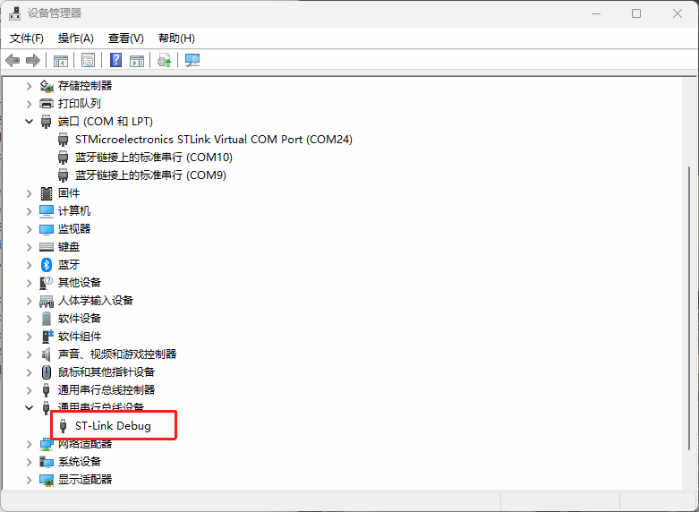

*图 1 开发环境与调试相关工具入口*

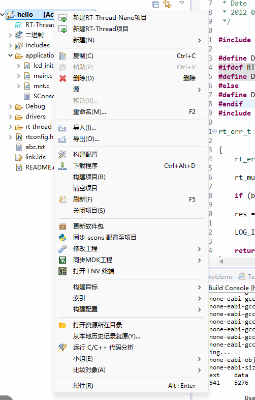

*图 2 工程编辑、编译及 SCons 配置同步位置*

### 3. 结果与记录

已完成可编译工程的导入，工程结构如下图所示。后续使用新建工程时，应优先确认 BSP、工具链和 SCons 配置是否匹配；编译异常时再检查工程同步状态，而不是直接修改源码。

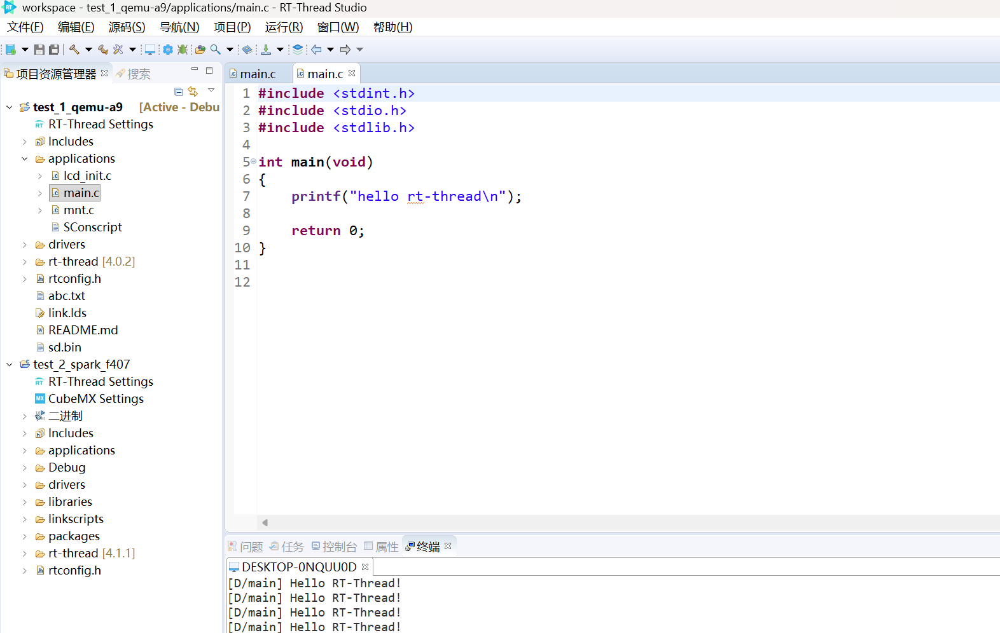

*图 3 已导入的可编译工程*

## 三、任务 2：Markdown 基础语法

### 1. 学习目的

Markdown 是一种轻量级标记语言，适合编写实验记录、项目说明和 README 文档。正式文档应使用合法授权的软件或开源工具进行编辑与预览。

### 2. 常用语法示例

#### 标题

```markdown
# 一级标题
## 二级标题
### 三级标题
```

标题应按层级递进，避免为了调整字体大小而跳级使用标题。

#### 代码块

````markdown
```c
#include <stdio.h>

int main(void)
{
    return 0;
}
```
````

渲染效果：

```c
#include <stdio.h>

int main(void)
{
    return 0;
}
```

#### 表格与强调

```markdown
| 项目 | 内容 |
| --- | --- |
| 示例 | 表格内容 |

`行内代码`
**加粗文字**
```

| 项目 | 内容 |
| --- | --- |
| 示例 | 表格内容 |

`行内代码`用于标注命令、文件名或变量，**加粗文字**用于强调关键结论。

### 3. 学习记录

已练习标题、代码块、表格、行内代码、加粗和图片插入等基础语法。后续编写笔记时，应保持标题层级、图片说明和代码语言标识的一致性。

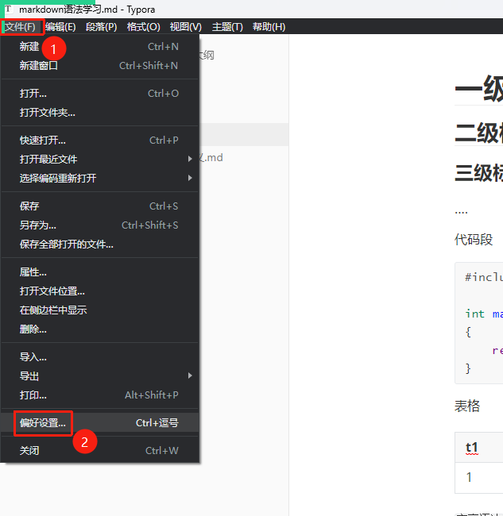

*图 4 Markdown 编辑与预览示例*

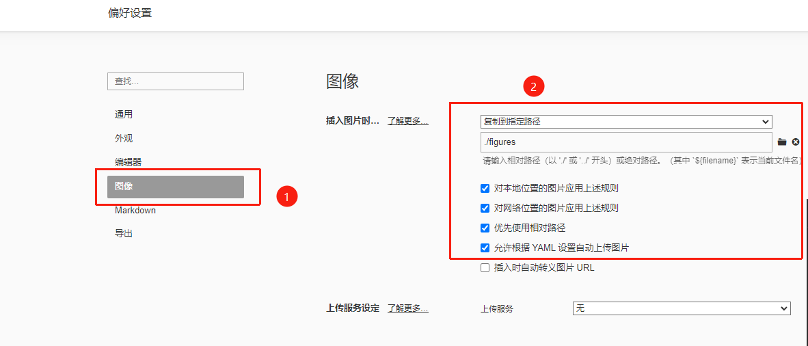

*图 5 Markdown 常用语法练习*

## 四、任务 3：创建 STM32F407ZG 工程并调试

### 1. 工程创建

本任务使用 RT-Thread 4.1.1 创建基于 STM32F407ZG 的工程。创建前需根据开发板实际芯片丝印或原理图确认 MCU 型号，并选择匹配的 BSP。RT-Thread 版本应与课程要求及 BSP 支持情况保持一致。

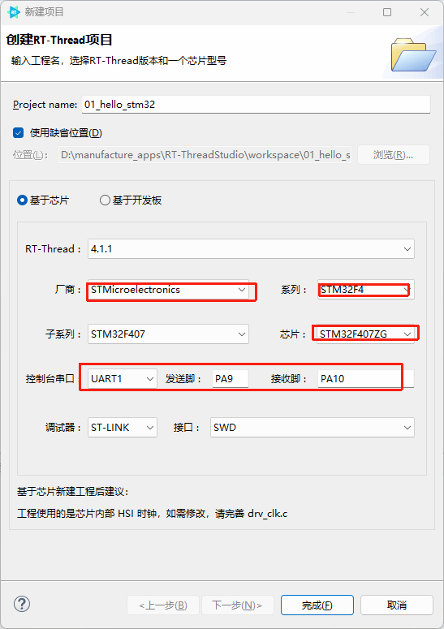

*图 6 根据实际芯片型号选择工程模板*

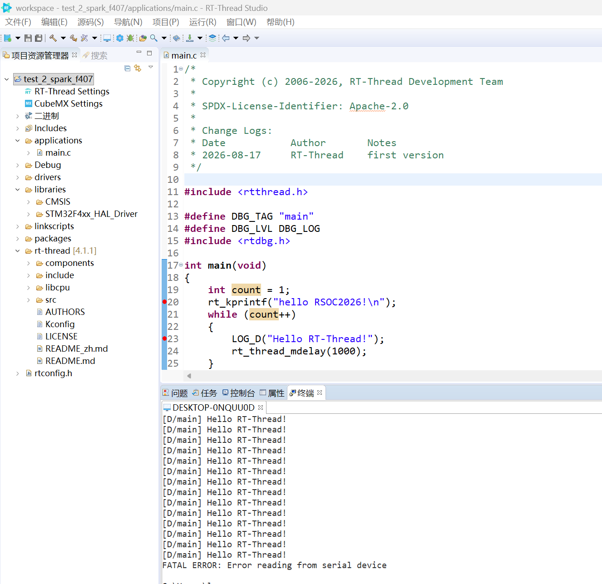

*图 7 创建完成后的 STM32F407ZG 工程*

### 2. RT-Thread 启动与线程调度理解

RT-Thread 系统启动过程中会完成硬件初始化、内核对象初始化和组件初始化等工作，随后启动调度器。线程创建后不会立即执行：

- 使用 `rt_thread_create()` 动态创建线程，或使用 `rt_thread_init()` 初始化静态线程；
- 调用 `rt_thread_startup()` 后，线程进入就绪状态；
- 调用 `rt_system_scheduler_start()` 后，调度器开始根据优先级和时间片调度就绪线程。

系统启动时的版本横幅由 `rt_show_version()` 输出。串口出现如下信息，说明程序已运行至 RT-Thread 的系统启动阶段：

```text
\ | /
- RT -     Thread Operating System
 / | \     4.1.1 build Aug 17 2026 11:02:01
 2006 - 2022 Copyright by RT-Thread team
```

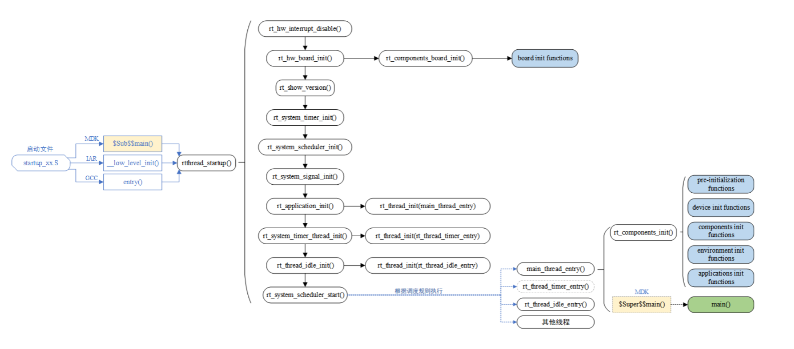

*图 8 串口输出的 RT-Thread 版本信息*

### 3. 程序验证

本次在 `main()` 中加入串口打印和调试日志，验证主线程能够周期运行：

```c
#include <rtthread.h>

#define DBG_TAG "main"
#define DBG_LVL DBG_LOG
#include <rtdbg.h>

int main(void)
{
    int count = 1;

    rt_kprintf("hello RSOC2026!\n");
    while (count++)
    {
        LOG_D("Hello RT-Thread!");
        rt_thread_mdelay(1000);
    }

    return RT_EOK;
}
```

其中，`rt_thread_mdelay(1000)` 使当前线程延时约 1 秒，便于在串口中观察周期性日志输出。

### 4. 调试问题与处理

#### 问题 1：ST-LINK 固件版本过低

**现象：** 单击调试按钮后，IDE 提示检测到 ST-LINK 设备固件版本过低，无法正常进入调试。

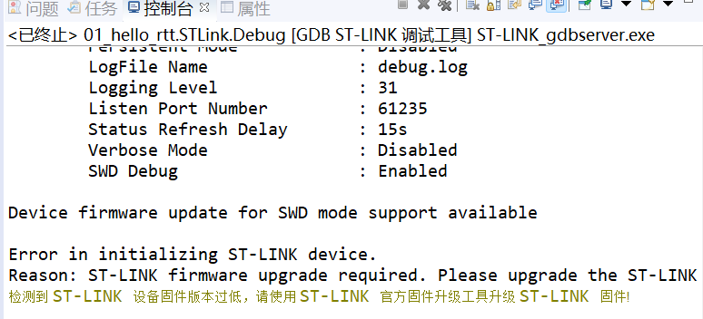

*图 9 ST-LINK 固件版本过低提示*

**处理过程：** 使用 ST 官方固件升级工具更新 ST-LINK 固件，完成后重新连接调试器并再次启动调试。

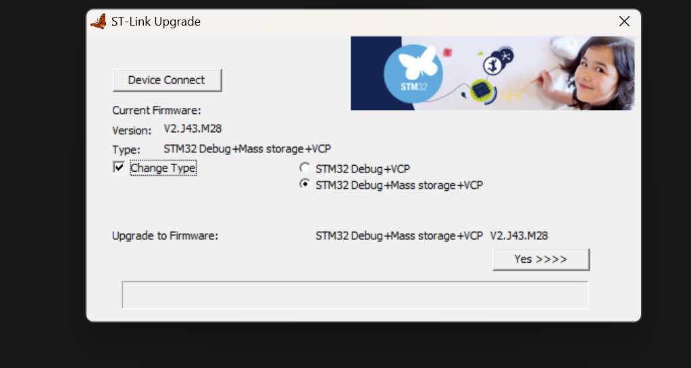

*图 10 ST-LINK 固件升级工具*

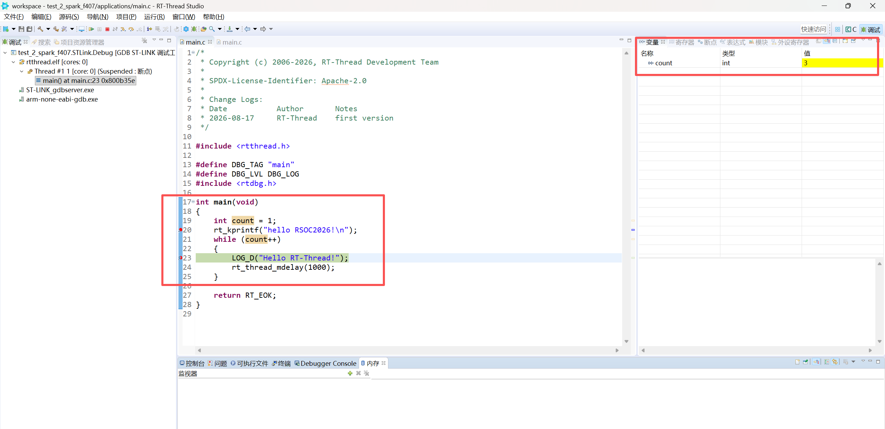

*图 11 固件升级配置示例*

**结果：** 完成升级后，能够进入调试会话。后续遇到调试器无法识别或无法启动调试时，应依次检查 USB 连接、驱动、ST-LINK 固件版本和调试接口配置。

#### 问题 2：结束调试后串口出现 HardFault

**现象：** 一次调试结束后，串口输出寄存器信息，并提示 `hard fault on thread: main`。部分关键信息如下：

```text
hard fault on thread: main
pc: 0x0800b356
lr: 0x08000c01
```

**初步处理：** 对开发板进行断电后重新上电（冷启动），随后系统恢复正常启动。

**分析与结论：** 冷启动后恢复正常只能说明故障具有偶发性，不能据此直接排除代码、栈空间或硬件问题。若问题再次出现，应按以下顺序定位：

1. 根据 `pc`、`lr` 地址结合 `.map` 文件或调试器调用栈定位故障代码位置；
2. 检查 `main` 线程栈余量、局部大数组、空指针和数组越界等常见原因；
3. 核对下载后复位方式、调试器连接状态和供电稳定性；
4. 保留故障串口日志，确认故障是否可稳定复现。

## 五、任务 4：Git 与 Gitee 基本使用

### 1. Git 基本概念

Git 的日常操作围绕四个位置进行：

| 位置 | 作用 | 典型操作 |
| --- | --- | --- |
| 工作区 | 正在编辑的项目文件 | 编辑、`git status` |
| 暂存区 | 准备写入下一次提交的改动 | `git add` |
| 本地仓库 | 保存在本机的提交历史 | `git commit` |
| 远端仓库 | Gitee/GitHub 上的仓库 | `git pull`、`git push` |

```text
工作区 -- git add --> 暂存区 -- git commit --> 本地仓库 -- git push --> 远端仓库
工作区 <-- git pull ----------------------------------------------- 远端仓库
```

### 2. 首次使用配置

首次使用时，需要配置提交者信息：

```bash
git config --global user.name "your_name"
git config --global user.email "your_email@example.com"
git config --global --list
```

建议使用 SSH 密钥连接远端仓库。公钥可以添加到 Gitee/GitHub 的 SSH 公钥设置中，私钥文件（如 `id_rsa`）不得提交或公开。

```bash
ssh-keygen -t rsa -b 4096 -C "your_email@example.com"
cat ~/.ssh/id_rsa.pub
ssh -T git@gitee.com
```

### 3. 上传本地工程

远端为空仓库时，可在项目根目录执行：

```bash
git init
git branch -M master
git add .
git commit -m "feat: 初始化项目"
git remote add origin git@gitee.com:用户名/仓库名.git
git push -u origin master
```

若远端已有工程，优先克隆后再进行修改：

```bash
git clone git@gitee.com:用户名/仓库名.git
cd 仓库名
```

> 远端主分支若为 `main`，应将以上命令中的 `master` 替换为 `main`。可通过 `git branch --show-current` 确认当前分支。

### 4. 日常提交流程

开始工作前先同步远端，修改完成后检查改动再提交：

```bash
git status
git pull origin master

# 修改文件后
git add <文件或目录>
git diff --cached
git commit -m "docs: 完善第一天学习笔记"
git push origin master
```

常用提交类型如下：

| 前缀 | 适用内容 |
| --- | --- |
| `feat:` | 新增功能 |
| `fix:` | 修复问题 |
| `docs:` | 文档或笔记更新 |
| `refactor:` | 不改变功能的代码整理 |

### 5. 常见问题

| 现象 | 原因与处理 |
| --- | --- |
| `fatal: not a git repository` | 当前目录不是 Git 仓库；先进入项目根目录，或对新项目执行 `git init`。 |
| `remote origin already exists` | 已绑定远端地址；用 `git remote -v` 查看，再用 `git remote set-url origin <url>` 修改。 |
| `git push` 被拒绝 | 远端存在本地没有的提交；先 `git pull`，处理冲突后再推送。 |
| 出现 `CONFLICT` | 两处修改了同一位置；手动保留正确内容，删除冲突标记后执行 `git add` 和 `git commit`。 |

处理冲突时，文件中的 `<<<<<<<`、`=======`、`>>>>>>>` 必须全部清除。未明确理解影响前，不使用 `git push -f`，以避免覆盖远端他人的提交。

## 六、当日总结

今天完成了 RT-Thread Studio 基础工程操作、QEMU A9 工程导入、STM32F407ZG 工程创建、ST-LINK 固件升级、系统启动信息观察，以及 Markdown 和 Git 的基础学习。

后续学习中将重点加强以下内容：

1. 结合启动流程继续阅读 RT-Thread 的线程创建、启动和调度相关源码；
2. 学习使用调用栈和 `.map` 文件定位 HardFault，而不是仅依靠重启恢复；
3. 坚持使用 Git 管理每次实验代码和笔记，提交前检查实际改动内容；
4. 按“目标、过程、现象、分析、结论”的结构持续完善学习记录。