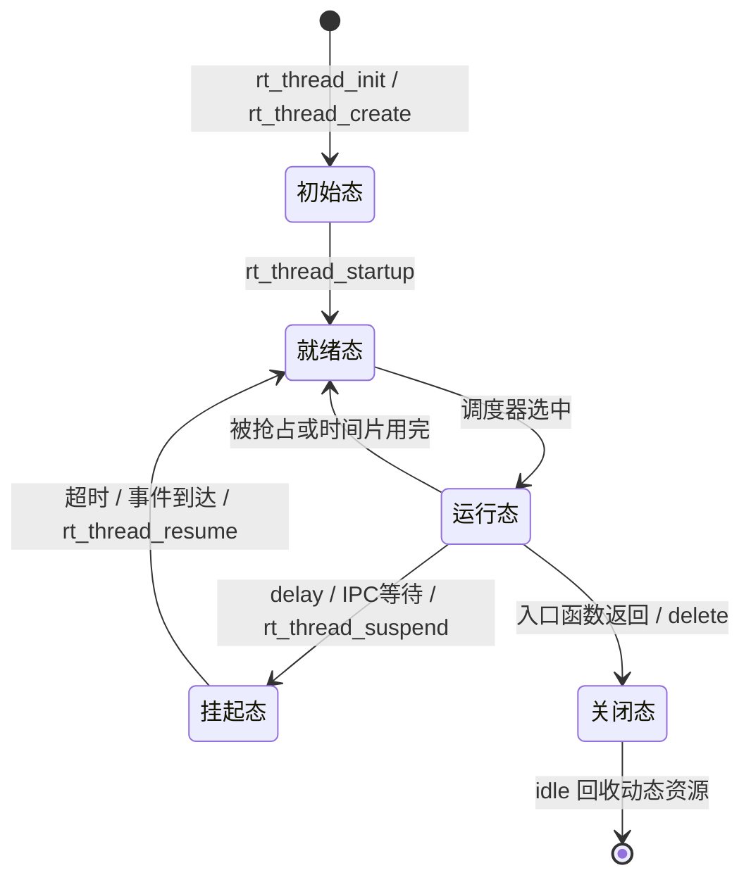
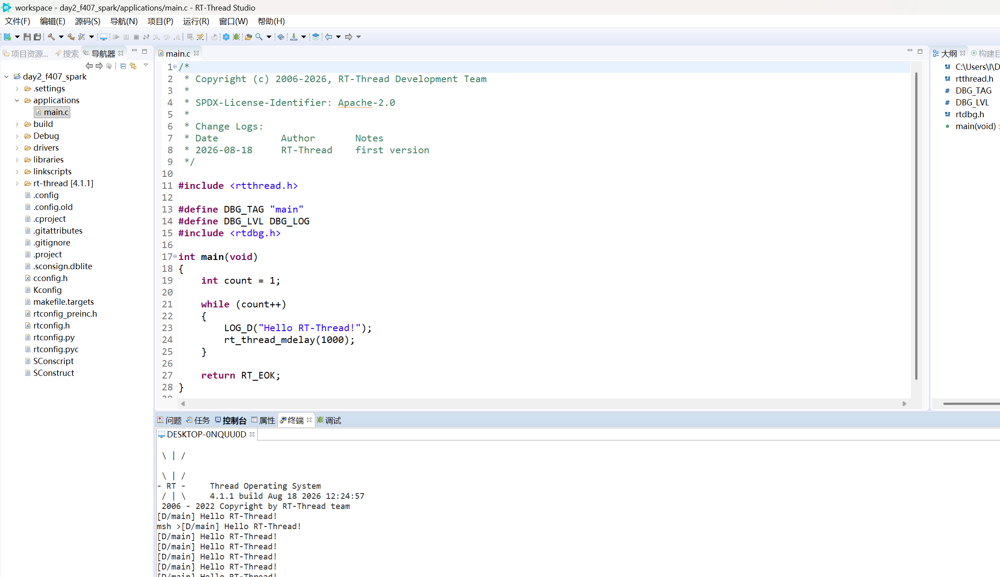
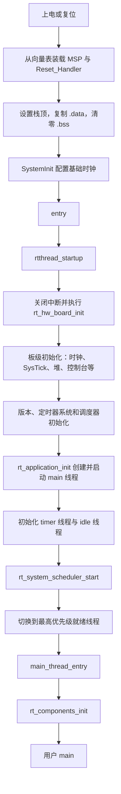
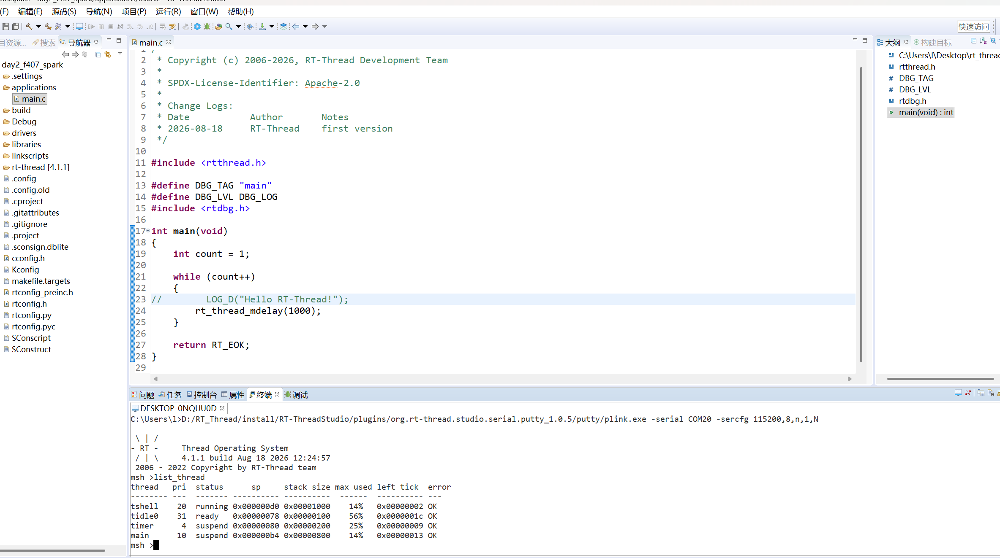

# 2026 RT-Thread 大学生夏令营 Day2 学习笔记

> 课程主题：RT-Thread 线程机制、SCons 构建系统、系统启动流程与多线程实践  
> 目标平台：STM32F407 星火号（`stm32f407-rtspark`）  
> 整理日期：2026-08-18  

本次课程围绕线程调度与生命周期展开，随后讲解 SCons 工程构建，并从启动代码跟踪到用户 `main()`。

## 目录

- [一、课程内容概览](#一课程内容概览)
- [二、线程机制与调度策略](#二线程机制与调度策略)
- [三、系统线程：idle 与 main](#三系统线程idle-与-main)
- [四、线程控制块、对象模型与生命周期](#四线程控制块对象模型与生命周期)
- [五、静态线程与动态线程](#五静态线程与动态线程)
- [六、SCons 构建系统](#六scons-构建系统)
- [七、RT-Thread Studio 与星火号实操](#七rt-thread-studio-与星火号实操)
- [八、STM32F407 到 RT-Thread main 的启动流程](#八stm32f407-到-rt-thread-main-的启动流程)
- [九、线程示例、FinSH 与软件包](#九线程示例finsh-与软件包)
- [十、个人总结](#十个人总结)

## 一、课程内容概览

本次课程主要回答六个相互关联的问题：线程为什么存在、调度器怎样选择线程、系统线程承担什么工作、线程资源从哪里来、工程怎样参与构建，以及系统上电后怎样进入用户程序。理解这些问题后，可以进一步明确多线程 API 背后的内核运行过程。

重点内容包括抢占式调度、时间片轮转、idle 与 main 线程、线程控制块、静态与动态创建、SCons 构建、自动初始化以及 FinSH 命令导出。课后作业将这些知识串联起来，需要在星火号上完成两个 LED 线程、一个监控线程和按键控制。

## 二、线程机制与调度策略

### 2.1 从裸机前后台系统到多线程系统

裸机程序通常采用“中断作为前台、`while (1)` 作为后台”的结构。中断负责接收异步事件，主循环依次执行 ADC、SPI、USB、显示等处理函数。业务规模扩大后，这种结构容易出现以下问题：

- 并发效率低：各业务只能在主循环中依次执行。
- 实时性变差：前面的慢任务会延迟后续任务。
- 可维护性差：功能彼此耦合，局部修改可能影响整个循环。
- 复用性不足：模块边界不清晰，代码难以独立迁移。

RTOS 采用“分而治之”的思路，把复杂系统拆成多个线程。每个线程拥有独立入口函数、栈和调度属性，内核负责决定何时运行哪个线程。线程是 RT-Thread 的基本调度单元。

### 2.2 抢占式优先级调度

RT-Thread 采用基于优先级的抢占式调度：

- 优先级数值越小，线程优先级越高。
- 更高优先级线程一旦进入就绪态，可以抢占当前低优先级线程。
- 线程若不再需要 CPU，应通过延时、等待信号量等方式主动阻塞。
- 高优先级线程若一直运行且不阻塞，低优先级线程将长期得不到运行机会。

这套机制保证紧急任务能够快速响应，但优先级设计不合理也会造成线程饥饿。

### 2.3 同优先级线程的时间片轮转

时间片只对“优先级相同且均处于就绪态”的线程起作用。假设线程 A 和 B 优先级相同，A 的时间片为 10 ticks，B 的时间片为 5 ticks，且没有更高优先级线程就绪，则调度器会让 A 最多连续运行 10 个系统节拍，再让 B 最多连续运行 5 个系统节拍，如此轮转。

时间换算公式为：

```text
1 tick 的时长 = 1000 / RT_TICK_PER_SECOND（毫秒）
```

课堂中以“1 tick 为 10 ms”举例，但该值并不固定，必须以具体工程配置为准。当前星火 F407 工程中：

```c
#define RT_TICK_PER_SECOND 1000
```

因此在这个工程中 `1 tick = 1 ms`，作业要求的时间片 `5 ticks` 对应约 5 ms；`rt_thread_mdelay(2000)` 则由系统换算为约 2000 ms。切换 BSP 后需要重新确认该配置，不能直接套用当前数值。

### 2.4 线程入口函数

线程业务由入口函数实现，函数原型为：

```c
void thread_entry(void *parameter);
```

入口函数通常包含循环、设备操作和适当的阻塞动作。例如 LED 线程每次翻转 LED 后调用 `rt_thread_mdelay()`，既形成可观察的闪烁周期，也让出 CPU。线程入口若执行完毕，线程会退出并进入关闭态；需要持续运行的任务一般使用无限循环。

## 三、系统线程：idle 与 main

### 3.1 空闲线程 idle

idle 是系统创建的最低优先级线程。当没有其他就绪线程时，调度器运行 idle，因此它通常一直保持就绪，且不能被挂起。其主要作用包括：

1. 回收退出线程的资源。动态线程退出后进入关闭态并挂入 `rt_thread_defunct` 僵尸队列，最终由 idle 线程释放相关资源。
2. 执行空闲钩子。低功耗处理、运行状态统计等轻量工作可以接入 idle hook。
3. 配合看门狗设计。系统有足够空闲时间时可在 idle 路径喂狗；若高优先级任务卡死导致 idle 长时间无法运行，看门狗可以触发复位。

系统设计时应为 idle 留出足够的运行机会。不过实际项目不能机械套用某个负载百分比，还要根据实时截止期、峰值负载、低功耗目标和看门狗窗口进行测量。

### 3.2 主线程 main

RT-Thread 中用户看到的 `main()` 运行在线程上下文中。系统创建的 main 线程入口为 `main_thread_entry()`，它先执行组件自动初始化，再调用用户 `main()`。

当前 RT-Thread 4.1.1 工程启用了堆，因此 main 线程由 `rt_thread_create()` 动态创建，栈大小由 `RT_MAIN_THREAD_STACK_SIZE` 决定；当前配置值为 2048 bytes。

## 四、线程控制块、对象模型与生命周期

### 4.1 内核对象模型

RT-Thread 使用统一的内核对象管理机制。线程、信号量、互斥量、定时器等对象都带有基础对象信息，并注册到相应的对象容器中。线程控制块 `struct rt_thread` 在基础对象信息之上增加了栈、状态、优先级、时间片和线程定时器等成员。

这种设计的意义是：

- 用统一方式保存对象名称、类型和对象链表关系。
- 可按对象类型遍历和管理系统资源。
- FinSH 的线程查看命令可以从线程对象容器中取得线程信息。

### 4.2 `struct rt_thread` 关键成员

| 成员 | 作用 |
| --- | --- |
| `name` | 线程对象名称；长度受 `RT_NAME_MAX` 限制 |
| `sp` | 当前保存的线程栈指针，是上下文切换恢复现场的关键入口 |
| `entry` / `parameter` | 线程入口函数及其参数 |
| `stack_addr` / `stack_size` | 栈起始地址和总大小 |
| `stat` | 当前线程状态；读取基础状态时应使用 `stat & RT_THREAD_STAT_MASK` |
| `current_priority` | 当前有效优先级；互斥量优先级继承等机制可能使其不同于初始优先级 |
| `init_tick` | 初始时间片大小 |
| `remaining_tick` | 当前轮次剩余时间片 |
| `thread_timer` | 线程内置定时器，用于延时或超时等待 |
| `cleanup` | 线程退出时的清理回调 |

线程栈用于保存上下文、函数调用现场和局部变量。Cortex-M 通常采用向低地址增长的栈，栈地址与大小必须满足平台对齐要求。当前工程的 `RT_ALIGN_SIZE` 为 4。

### 4.3 五态模型



五种基础状态如下：

| 状态 | 宏 | 说明 |
| --- | --- | --- |
| 初始态 | `RT_THREAD_INIT` | 已创建，但尚未加入就绪队列 |
| 就绪态 | `RT_THREAD_READY` | 等待调度器分配 CPU |
| 运行态 | `RT_THREAD_RUNNING` | 当前正在执行；单核同一时刻只有一个运行线程 |
| 挂起态 | `RT_THREAD_SUSPEND` | 主动延时、等待资源或被显式挂起，不参与调度 |
| 关闭态 | `RT_THREAD_CLOSE` | 已结束，不再参与调度 |

注意：LED 线程调用 `rt_thread_mdelay()` 后，在监控采样时经常显示为挂起态，这是正常的延时等待，不一定表示被按键手动暂停。

## 五、静态线程与动态线程

### 5.1 两种创建方式

| 对比项 | 静态初始化 `rt_thread_init()` | 动态创建 `rt_thread_create()` |
| --- | --- | --- |
| TCB 与栈来源 | 用户预先定义 | 系统堆分配 |
| 资源确定时间 | 编译、链接阶段 | 运行阶段 |
| 失败风险 | 参数或空间配置错误 | 堆不足、碎片化或参数错误 |
| 释放方式 | 用户管理存储期，不能按动态对象方式释放 | 退出后由系统和 idle 回收 |
| 适用场景 | 内存必须确定、长期运行、高可靠系统 | 常规应用、快速开发、按需创建 |

静态线程的控制块和栈通常定义为全局或静态变量，并显式对齐：

```c
static struct rt_thread led2_thread;
ALIGN(RT_ALIGN_SIZE)
static rt_uint8_t led2_stack[1024];
```

动态线程只需指定栈大小，由内核从堆中分配线程控制块和栈。两种方式创建后都处于初始态，必须调用 `rt_thread_startup()` 才会进入就绪队列。

### 5.2 为什么高可靠场景倾向静态分配

静态分配使内存需求在编译、链接阶段即可分析，启动后的地址和总量稳定，不依赖堆当前状态，也不会引入运行期堆碎片。对于有严格认证和确定性要求的系统，常通过编码规范禁止或限制运行期动态申请。

这不等于“动态创建必然不可靠”。普通项目可根据生命周期、内存规模和错误处理能力选择；关键是检查创建返回值，并明确资源释放策略。

## 六、SCons 构建系统

### 6.1 作用与核心文件

SCons 是基于 Python 的构建工具。RT-Thread 借助它组织多层目录、按配置项选择源码、设置工具链参数，并生成 IDE 工程。需要重点关注以下四类文件：

| 文件 | 作用 |
| --- | --- |
| `SConstruct` | 工程顶层构建入口 |
| `SConscript` | 各目录的局部构建描述，通常与源码就近放置 |
| `rtconfig.py` | 工具链、CPU 架构、浮点和优化等编译参数 |
| `rtconfig.h` | Kconfig/menuconfig 生成的全局配置宏 |

### 6.2 常用命令

```bash
scons                       # 编译工程
scons -j4                   # 使用 4 个并行任务编译
scons -c                    # 清理构建产物
scons --target=mdk5         # 生成 Keil MDK5 工程
scons --target=cmake        # 生成 CMake 配置
scons --dist                # 生成相对独立的发布工程
scons --verbose             # 输出详细编译命令，便于排错
```

具体可用 target 取决于当前 RT-Thread 工具版本，应以 `scons --help` 为准。

### 6.3 `SConscript` 常见写法

```python
from building import *

cwd = GetCurrentDir()
src = Glob('*.c')
CPPPATH = [cwd]

group = DefineGroup('Applications', src, depend=[''], CPPPATH=CPPPATH)

Return('group')
```

重点概念：

- `Glob('*.c')` 批量取得源文件。
- `src` 保存参与构建的源文件列表，`src.remove(...)` 可排除文件。
- `CPPPATH` 增加头文件搜索路径；遗漏路径会造成头文件找不到。
- `DefineGroup(name, src, depend, ...)` 将源码注册为构建组。
- `depend` 关联 Kconfig 宏。依赖未启用时，该组不参与构建；空依赖可用于始终编译。
- `CCFLAGS`、`CFLAGS`、`CXXFLAGS` 等参数用于设置不同范围的编译选项。

SCons 会递归执行各级 `SConscript`，因此大型工程可以把构建规则分散到对应模块目录中，减少顶层脚本的维护压力。

### 6.4 Kconfig、menuconfig 与 `rtconfig.h`

Kconfig 描述配置项和菜单关系，menuconfig 或 Studio 图形界面用于选择配置，最终结果写入 `rtconfig.h`。SConscript 再通过 `depend` 判断相应宏是否启用，从而决定某个组件是否参与构建。

Studio 的图形设置适合入门和 BSP 开发；env 命令行更灵活，更适合主线贡献、批处理和可复现构建。

## 七、RT-Thread Studio 与星火号实操

课堂演示的基本操作流程如下：

1. 在 RT-Thread Studio 中创建 STM32F407 工程，并选择与开发板匹配的 BSP/芯片支持包。
2. 开发板连接 USB Debug 接口，在设备管理器中确认调试器和串口被识别。
3. 根据板载调试器实际固件选择 ST-Link 或 J-Link，类型不匹配会导致下载失败。
4. 编译工程，检查零错误后烧录。
5. 打开串口终端，确认波特率与控制台配置一致。
6. 使用 `help` 查看命令、Tab 补全命令，并用 `list_thread`（部分版本也提供 `ps`）观察线程。

链接脚本决定 Flash、RAM 的起始地址和容量；调试启动问题时，应把启动汇编、链接脚本、map 文件和 `rtconfig.h` 放在一起核对。



## 八、STM32F407 到 RT-Thread `main()` 的启动流程

### 8.1 完整调用链

当前 GCC 工程从复位入口到用户 `main()` 的调用关系如下：



要点如下：

- Cortex-M4 从向量表取得初始 MSP 和复位入口。
- `Reset_Handler` 先建立 C 运行环境，再调用 `SystemInit()`，最后跳到 RT-Thread 的 `entry()`。
- `rtthread_startup()` 初始化板级资源、内核定时器、调度器、main/timer/idle 线程，然后启动调度器。
- `main()` 不是调度器启动前直接调用的普通入口，而是由 main 线程的 `main_thread_entry()` 调用。
- 首个实际运行线程由就绪线程优先级决定，不能无条件写成“必然是 timer 线程”。

### 8.2 自动初始化机制

`INIT_BOARD_EXPORT(fn)` 和 `INIT_APP_EXPORT(fn)` 最终都展开为 `INIT_EXPORT(fn, level)`。以 GCC 为例，宏会把函数指针放入带等级的链接段：

```c
#define INIT_BOARD_EXPORT(fn) INIT_EXPORT(fn, "1")
#define INIT_APP_EXPORT(fn)   INIT_EXPORT(fn, "6")
```

初始化等级依次为：

| 等级 | 宏 | 典型用途 |
| --- | --- | --- |
| 1 | `INIT_BOARD_EXPORT` | 调度器启动前所需的板级初始化 |
| 2 | `INIT_PREV_EXPORT` | 纯软件预初始化 |
| 3 | `INIT_DEVICE_EXPORT` | 设备初始化 |
| 4 | `INIT_COMPONENT_EXPORT` | 文件系统、网络等组件 |
| 5 | `INIT_ENV_EXPORT` | 挂载、环境准备 |
| 6 | `INIT_APP_EXPORT` | 应用初始化 |

链接器把同类段按等级排列，并保留起止符号。运行时：

- `rt_components_board_init()` 遍历 board 范围，调用 level 1 函数。
- main 线程中的 `rt_components_init()` 遍历后续范围，按等级调用 level 2 至 level 6 函数。

因此自动初始化不是运行时按函数名“搜索”，也不是依赖反射，而是“编译期注册到链接段，链接期排序，运行期遍历函数指针”。作业使用 `INIT_APP_EXPORT()` 后，测试模块无需在 `main.c` 中硬编码调用。

## 九、线程示例、FinSH 与软件包

线程示例通过 `MSH_CMD_EXPORT()` 将函数注册为 FinSH/MSH 命令。一个线程周期打印，另一个线程打印若干次后退出，可以观察到以下现象：

- 高优先级线程先运行。
- 高优先级线程若没有延时或等待，会连续占用 CPU。
- 线程入口返回后进入关闭态；动态线程资源随后由 idle 回收。
- `list_thread` 可查看线程优先级、状态、栈大小和最大栈使用率。

Studio 软件包管理功能类似组件仓库。添加软件包前需要确认目标芯片、BSP、外设和依赖宏是否兼容。下载失败时还应检查网络源；编译失败时则优先检查硬件依赖和配置项，而不能只归因于网络。



## 十、个人总结

本节课把 RT-Thread 的启动、对象和调度三条线串联起来：启动代码建立运行环境并初始化内核；对象模型保存线程及其他资源；调度器根据状态、优先级和时间片分配 CPU。静态与动态线程的本质区别是资源由谁提供、何时确定以及如何回收，而不是业务逻辑不同。

实践时最需要注意的是：

- 时间单位必须读取目标工程的 `RT_TICK_PER_SECOND`，不能套用其他 BSP 的默认值。
- 线程状态字段需要掩码后解释，延时也会表现为挂起态。
- 栈“剩余量”应按栈填充值统计高水位，不能简单把当前 SP 与栈边界之差当成历史剩余量。
- 自动初始化和 Shell 导出依赖配置宏及链接段，代码写对但配置未启用时，功能仍不会出现。
