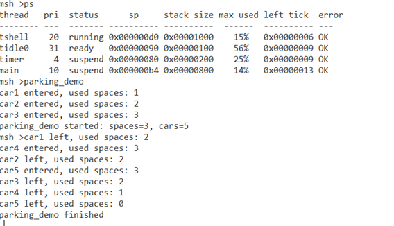
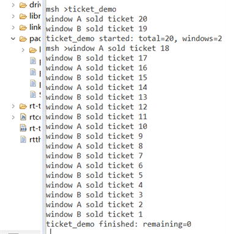
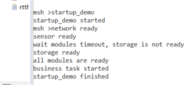
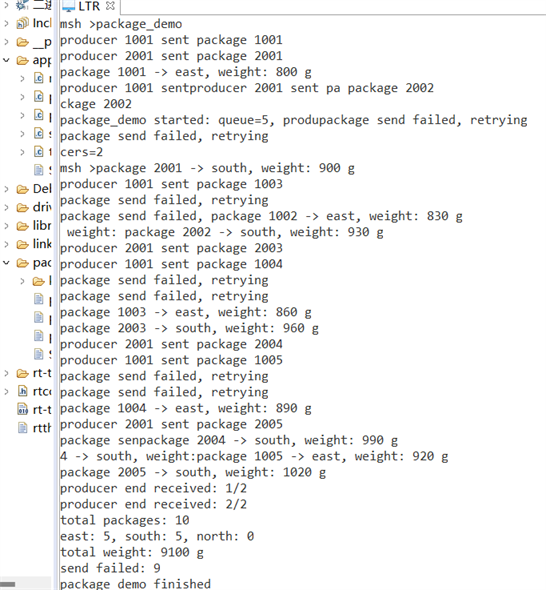
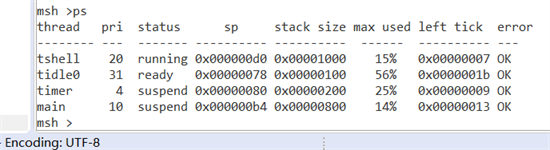

# 第三天作业：线程间同步与通信

## 一、作业目标

本日使用 RT-Thread V4.1.1 的四类 IPC 完成四个独立 MSH 实验：计数信号量、互斥量、事件集和消息队列。每个实验至少创建两个线程，检查 IPC 对象和线程初始化/启动返回值，并在结束后清理静态对象。

邮箱属于课程扩展内容，本次不作为必做实验提交。

## 二、提交源码

```text
parking_demo.c  -> parking_demo
ticket_demo.c   -> ticket_demo
startup_demo.c  -> startup_demo
package_demo.c  -> package_demo
```

工程权威源码位于：

```text
D:\RT-ThreadStudio\workspace\RSOC2026_IPC\applications\
```

本目录中的四个 C 文件是提交副本，保持与工程源码同步；构建产物不提交。

## 三、实验设计

### 1. `parking_demo`

初始化值为 3 的计数信号量表示停车位，创建 5 个车辆线程。车辆以 2 秒 Tick 超时申请车位，获得资源后停留并释放。`parking_used` 由互斥量保护，保证显示的进入数量不会超过 3。

### 2. `ticket_demo`

创建 A、B 两个售票线程，共售 20 张票。互斥量保护“检查余票、分配票号、记录票号、减少余票”的完整事务，而不是只保护减法操作。最终要求剩余票数为 0，且每个票号只出现一次。

### 3. `startup_demo`

网络、传感器和存储线程分别发送三个事件位。业务线程先用 `RT_EVENT_FLAG_AND` 等待 3 秒，存储线程因延时 5 秒而触发一次超时；随后业务线程再次等待全部事件，输出业务启动信息。`startup_ready_mask` 用于解释超时原因，事件集本身只承担同步功能。

### 4. `package_demo`

消息结构包含编号、区域、重量和结束标志。两个生产线程各发送 5 条快递消息，并各发送一条结束消息；分拣线程收到两条结束消息后统计总数、区域数量、总重量和发送失败次数。消息池按 `RT_ALIGN_SIZE` 对齐，队列容量为 5 条消息。

## 四、MSH 操作

固件启动后，在串口 `msh >` 中逐项执行：

```text
help
parking_demo
ticket_demo
startup_demo
package_demo
```

每个命令应单独运行。上一个实验结束并完成对象脱离后再重复执行同一命令，避免同名线程或 IPC 对象残留。当前代码通过运行标志拒绝运行中的重复启动。

## 五、构建修改

`RSOC2026_IPC` 原工程只收集了 `main.c`，因此新增：

```text
applications/SConscript
drivers/SConscript
libraries/SConscript
```

同时补充 `rtconfig.py` 的 Cortex-M4 编译参数、汇编参数、链接脚本和 BIN 后处理命令。`Debug/*` 是自动生成目录，不手工修改。

## 六、验证结果

已完成：四个 Day3 C 文件被 SCons 收集并编译，BSP、HAL、CMSIS、RT-Thread 内核和示例包编译通过，链接成功并生成 `rt-thread.elf`，同时生成 `rtthread.bin`。

已完成：用户在 RT-Thread Studio 中确认最新固件已经通过 ST-Link 下载并启动；串口终端已依次验证 `parking_demo`、`ticket_demo`、`startup_demo` 和 `package_demo`，并在最后使用 `ps` 检查实验线程已经退出。

本节以下内容只记录实际截图中出现的串口证据。构建成功、下载成功、串口命令成功和实体硬件行为属于不同证据层级，不能相互替代。

## 七、源码与运行逻辑对应

### 1. 停车场：计数信号量限制资源数量

源码：[`parking_demo.c`](parking_demo.c)

初始化时使用静态信号量，初始计数为 3；另用互斥量保护 `parking_used`，因为信号量负责限制资源数量，不应该直接读取其内部计数作为业务统计：

~~~
result = rt_sem_init(&parking_spaces, "parksem",
                     PARKING_SPACE_COUNT, RT_IPC_FLAG_FIFO);
result = rt_sem_take(&parking_spaces, PARKING_TIMEOUT_TICKS);
~~~

每辆车最多等待 `2 * RT_TICK_PER_SECOND`。获取成功后先在互斥量保护下增加 `parking_used`，停车延时结束后再减少统计并释放信号量；获取超时则打印等待信息，延时 300 ms 后重试。5 个车辆线程全部调用 `parking_finish()`，最后一个线程负责脱离信号量和互斥量，并输出 `parking_demo finished`。

运行逻辑为：3 个车位先被占满，后续车辆等待；已有车辆离开并释放信号量后，等待车辆获得唤醒机会进入。截图中最大占用数为 3，5 辆车全部离场，最终占用数为 0。

### 2. 售票系统：互斥量保护完整事务

源码：[`ticket_demo.c`](ticket_demo.c)

售票线程持有互斥量时，同时完成检查余票、取得票号、记录票号、减少余票和打印结果，避免两个窗口在检查和修改之间交错：

~~~
rt_mutex_take(&ticket_lock, RT_WAITING_FOREVER);
if (ticket_count <= 0)
{
    rt_mutex_release(&ticket_lock);
    break;
}

ticket_no = ticket_count;
ticket_sold[ticket_no]++;
ticket_count--;
rt_kprintf("window %c sold ticket %d\n", window->name, ticket_no);
rt_mutex_release(&ticket_lock);
~~~

A、B 两个窗口分别运行同一入口函数，共享 `ticket_count` 和 `ticket_sold[]`。票数变为 0 后两个线程退出，完成计数达到预期值的最后一个线程脱离互斥量并输出剩余票数。截图显示票号从 20 到 1，未出现重复号码，最终 `remaining=0`。

### 3. 启动条件：事件集实现 AND 屏障

源码：[`startup_demo.c`](startup_demo.c)

网络、传感器和存储线程分别发送三个事件位，业务线程先进行 3 秒有界等待，再进行永久等待：

~~~
result = rt_event_recv(&startup_event, EVENT_ALL_READY,
                       RT_EVENT_FLAG_AND | RT_EVENT_FLAG_CLEAR,
                       3 * RT_TICK_PER_SECOND, &recved);
~~~

模块延时分别为 700 ms、1400 ms 和 5000 ms，因此业务线程第一次等待会因为存储模块尚未完成而超时。超时后，代码读取受互斥量保护的 `startup_ready_mask`，明确打印未就绪模块；之后再次使用 `RT_EVENT_FLAG_AND` 永久等待全部事件。三个模块都发送事件后，业务线程输出 `all modules are ready` 和 `business task started`。

### 4. 快递分拣：消息队列传递结构化消息

源码：[`package_demo.c`](package_demo.c)

消息结构同时携带编号、区域、重量和结束标志，消息池按照对齐后的单条消息大小分配 5 条容量：

~~~
struct package_msg
{
    rt_uint32_t id;
    rt_uint8_t region;
    rt_uint16_t weight;
    rt_uint8_t end;
};

#define PACKAGE_MSG_SIZE RT_ALIGN(sizeof(struct package_msg), RT_ALIGN_SIZE)
~~~

两个生产者分别生成 `1001~1005` 和 `2001~2005`。消息队列满时，`rt_mq_send()` 返回错误，代码在互斥量保护下增加 `package_send_failed`，打印重试信息并延时 80 ms，直到消息成功发送。每个生产者最后发送一条 `end=1` 的结束消息，分拣线程收到两条结束消息后才输出汇总并退出，因此不会遗漏另一个生产者的消息。

截图中队列容量为 5，出现 `package send failed, retrying` 说明生产速度暂时超过消费速度；重试最终成功，统计结果为 10 条消息、东部 5 条、南部 5 条、北部 0 条、总重量 9100 g。

## 八、串口运行截图相关讲解

### 1. 停车场运行



图中先执行 `ps` 确认系统线程状态，再运行 `parking_demo`。`car1`、`car2`、`car3` 先占满 3 个车位；车辆离场释放信号量后，`car4`、`car5` 依次进入。整个过程的 `used spaces` 没有超过 3，最后输出 `parking_demo finished`。

### 2. 售票运行



图中两个窗口交替取得互斥量，票号从 20 递减到 1，最终输出：

~~~
ticket_demo finished: remaining=0
~~~

`ticket_demo started` 出现在前两条售票日志之后，是线程启动后立即获得调度造成的输出顺序差异，不影响互斥量保护的售票事务。

### 3. 启动条件运行



图中先出现 `network ready` 和 `sensor ready`，3 秒有界等待到期后打印 `storage is not ready`；5 秒延时结束后存储线程发送事件，业务线程收到全部事件并输出 `all modules are ready`、`business task started`，最后实验完成。

### 4. 消息队列运行



图中可以看到两个生产者发送 10 条消息，分拣线程按区域输出消息内容。由于队列容量只有 5，运行中出现 9 次发送失败重试；这不是消息丢失，而是非阻塞 `rt_mq_send()` 在队列满时返回错误后的应用层重试。最终输出：

~~~
producer end received: 2/2
total packages: 10
east: 5, south: 5, north: 0
total weight: 9100 g
send failed: 9
package_demo finished
~~~

### 5. 实验线程清理



最后一次 `ps` 只剩 `tshell`、`tidle0`、`timer` 和 `main` 等系统线程，没有残留 `car`、`window`、`initmod`、`business`、`producer` 或 `sorter`。这说明截图中已运行的实验线程均已退出，并完成了对应静态 IPC 对象的脱离。

## 九、分层验证结论

| 证据层级 | 本次结果 | 结论边界 |
| --- | --- | --- |
| 源码 | 四个提交副本与工程源码同步，分别导出四个 MSH 命令 | 证明实现了对应 IPC 逻辑，不能单独证明板上运行 |
| 构建 | SCons 构建成功，生成 `rt-thread.elf` 和 `rtthread.bin` | 证明编译、链接和固件产物成功 |
| 下载 | RT-Thread Studio 中已确认最新固件下载成功 | 证明固件已写入并启动，不能替代每条串口命令证据 |
| 串口 | 四个 MSH 命令均输出 `finished`，统计值符合设计；最终 `ps` 无实验线程残留 | 证明本次截图中的线程、IPC 和清理路径实际执行 |
| 实体硬件 | 本次材料是串口终端截图 | 未单独证明 LED、按键或其他外设的物理现象 |

## 十、提交资源

本次补充的截图资源位于 `assets/`：

~~~
day3_parking_terminal.png
day3_ticket_terminal.png
day3_startup_terminal.png
day3_package_terminal.png
day3_ps_cleanup.png
~~~

截图均由用户提供的原始终端截图按 80% 比例缩小后保存，Markdown 使用相对路径引用，便于在仓库页面和本地预览中查看。
