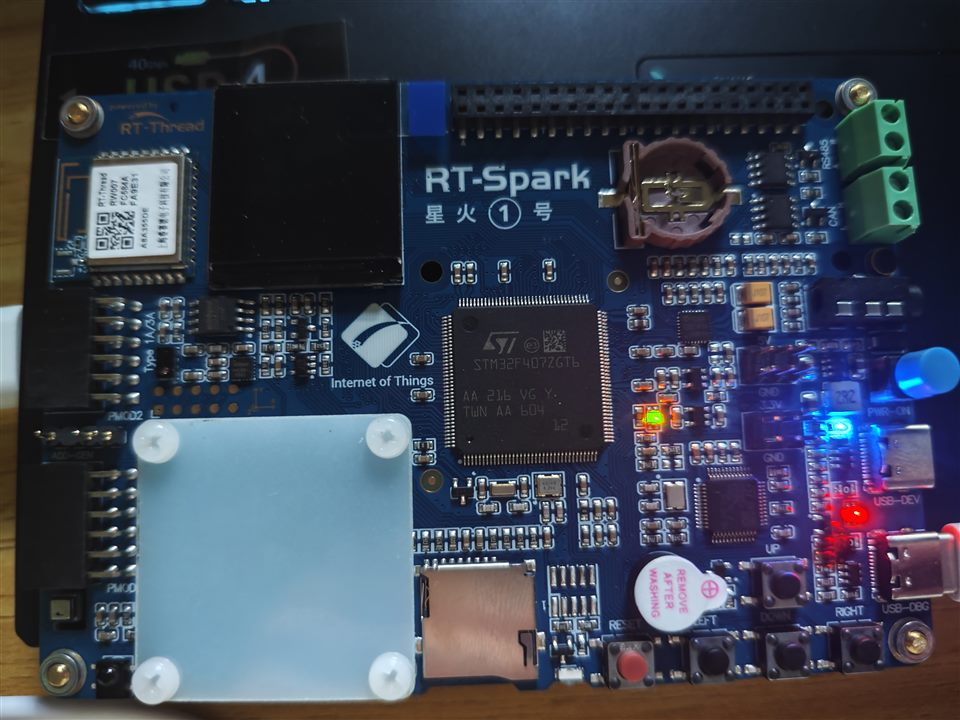
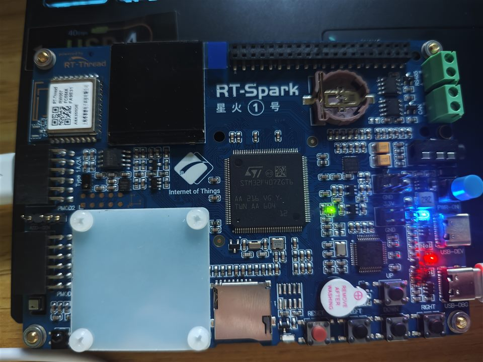
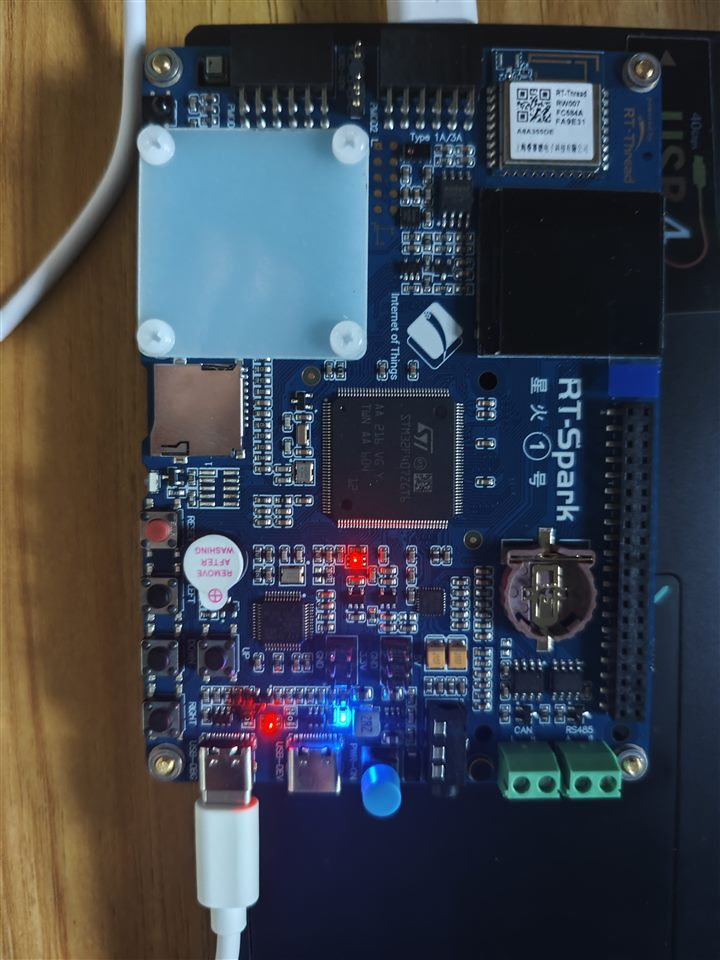
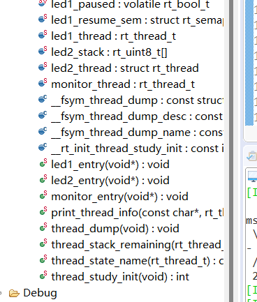
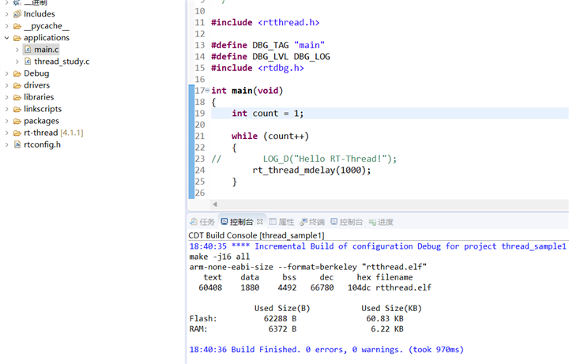
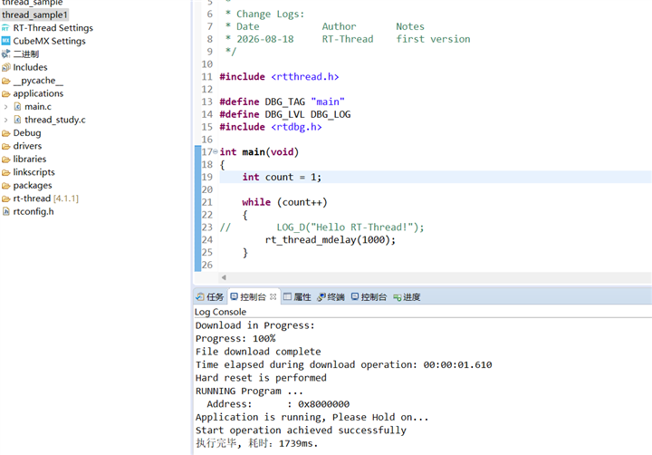
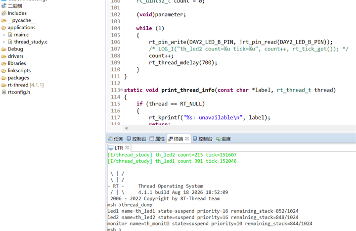
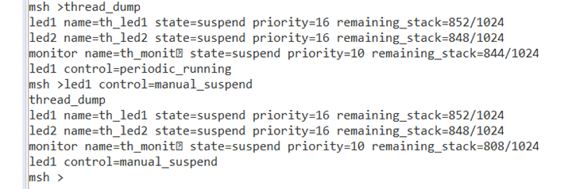

# 第二天作业

## 一、作业目标

在星火 1 号 STM32F407 的 RT-Thread Studio 工程中，实现动态创建和静态创建两种 LED 线程，增加按键监控线程，并用自动初始化与 MSH 命令完成线程状态观察和按键暂停控制。

## 二、实现内容

| 项目 | 实现 |
| --- | --- |
| 动态 LED 线程 | `th_led1` 由 `rt_thread_create()` 创建，栈 1024 B，优先级 16，时间片 5 Tick；周期翻转 PF12。 |
| 静态 LED 线程 | `th_led2` 由 `rt_thread_init()` 初始化，使用静态 TCB 和 1024 B 静态栈，优先级 16，时间片 5 Tick；周期翻转 PF11。 |
| 监控线程 | `th_monitor` 动态创建，栈 1024 B，优先级 10，时间片 5 Tick；以 20 ms 周期扫描 PC0 低电平有效按键。 |
| 自动初始化 | `INIT_APP_EXPORT(thread_study_init)` 初始化 GPIO、信号量并启动三个线程。 |
| MSH 命令 | `MSH_CMD_EXPORT(thread_dump, ...)` 导出 `thread_dump`，显示线程状态、优先级、剩余栈和 LED1 控制标志。 |
| 按键暂停 | 首次有效按键经 20 ms 消抖后设置 `led1_paused`，`th_led1` 等待 `led1_resume_sem`，控制标志输出为 `manual_suspend`。 |

源码使用静态信号量 `led1_resume_sem` 表示恢复事件，未直接调用 `rt_thread_suspend()` 或 `rt_thread_resume()`。暂停前会清理可能残留的信号量令牌，避免旧唤醒事件影响下一次暂停。

## 三、操作步骤

1. 使用 USB 连接星火 1 号的 ST-Link 调试接口并上电。
2. 在设备管理器确认 `STMicroelectronics STLink Virtual COM Port`。本次测试时端口为 COM21；实际端口号应以当前枚举结果为准。
3. 在 RT-Thread Studio 打开 `thread_sample1` 工程，确认 `applications/thread_study.c` 参与构建。
4. 执行构建，确认控制台为零错误和零警告。
5. 使用 ST-Link 下载并启动程序。
6. 打开串口终端，选择当前 ST-Link VCP 端口，等待 RT-Thread 启动横幅和 `msh >` 提示。
7. 输入 `thread_dump`，确认 `th_led1`、`th_led2`、`th_monitor` 的名称、优先级和栈信息，并观察 `led1 control=periodic_running`。
8. 第一次有效按下 KEY0，等待消抖后再次输入 `thread_dump`，确认 `led1 control=manual_suspend`。

本次按键记录在首次人工暂停处截止，不追加第二次按键后的恢复验证或结论。

## 四、实际验证结果

| 验证项目 | 结果 |
| --- | --- |
| 串口枚举 | 已看到 ST-Link 虚拟串口 COM21。 |
| Studio 构建 | 成功，`Build Finished. 0 errors, 0 warnings`；Flash 约 60.83 KB、RAM 约 6.22 KB。 |
| ST-Link 下载 | 成功，控制台显示下载完成、硬件复位和应用开始运行。 |
| 调试会话 | 成功，Studio 中 ST-LINK GDB Server 与 GDB 会话处于运行状态。 |
| 串口启动 | 成功，已看到 RT-Thread 4.1.1 横幅和 `msh >`。 |
| 三个作业线程 | 成功，`thread_dump` 显示 `th_led1`、`th_led2`、`th_monitor`；截图中的剩余栈依次为 852/1024、848/1024、844/1024。 |
| 按键暂停 | 成功，首次有效按键前控制标志为 `periodic_running`，按键后为 `manual_suspend`。 |

日志中的内核 `state=suspend` 也可能由 `rt_thread_mdelay()` 的周期等待产生，不能单独作为人工暂停的证据；本作业以 `led1 control=manual_suspend` 作为首次按键控制成功的判定依据。

## 五、完成演示

### 1. 板卡连接与上电现场

以下实物图显示本次使用的 RT-Spark 星火 1 号开发板、STM32F407 主控、USB 连接和板上电源/状态灯。照片证明板卡已上电、连接现场存在且板上灯光可见；单张照片不能单独证明两个 LED 线程的颜色、周期，或按键暂停的时序，这些功能结论以后的构建、终端和控制状态证据为准。







### 2. 软件和终端验证截图

以下为本次作业的缩略版验证截图，原图已按最大宽度 720 px 缩小后随作业提交。

#### 2.1 ST-Link 虚拟串口

设备管理器显示 `STMicroelectronics STLink Virtual COM Port (COM21)`；当前使用端口应以重新枚举结果为准。



#### 2.2 Studio 构建成功

构建控制台显示 `Build Finished. 0 errors, 0 warnings`，并显示 Flash 约 60.83 KB、RAM 约 6.22 KB。



#### 2.3 ST-Link 下载并启动

下载控制台显示 `File download complete`、硬件复位和应用运行成功。



#### 2.4 启动横幅与三个线程

串口终端显示 RT-Thread 4.1.1 启动信息及 `thread_dump` 结果，`th_led1`、`th_led2` 和 `th_monitor` 均已创建。



#### 2.5 首次按键后的人工暂停

首次有效按键后，`thread_dump` 的控制标志由 `periodic_running` 变为 `manual_suspend`。按键验证在此处截止。



## 六、提交内容

```text
2026/第4组/李庭荣/
├── 笔记/
│   └── 第二天笔记.md
└── 作业/
    ├── 第二天作业.md
    ├── thread_study.c
    └── assets/
        ├── day2_com21_enumeration.png
        ├── day2_build_success.png
        ├── day2_download_success.png
        ├── day2_terminal_startup_and_threads.png
        ├── day2_led1_manual_suspend.png
        ├── day2_board_powered_green.jpg
        ├── day2_board_powered_green_alt.jpg
        └── day2_board_usb_overview.jpg
```

本次提交学习笔记、作业说明、实际测试源码及缩略版验证图片；不提交构建产物、个人环境文件、密钥或无关工程文件。
