# 【RSOC26】AHT10 + MQTT + font 分区文件系统

## 一、作业目标

1. 使用 AHT10 软件包采集温湿度，并通过 MQTT 上传到 EMQX。
2. 梳理文件系统启动流程，将 `font` 分区挂载到 `/fal`。
3. 将温湿度和采集次数同步追加写入 `/fal/Data.txt`。
4. 通过云端 MQTT 指令 `toggle` 实现开发板 LED 翻转。
5. 熟悉 WiFi、MQTT、AHT10、FAL、DFS 和文件系统相关命令。

## 二、工程与实现概览

### 1. 工程位置

```text
D:\RT-ThreadStudio\workspace\01_KERNEL_1
```

### 2. 应用文件

```text
applications\aht10_explam.c
applications\aht10_app.h
applications\mqtt_app.c
applications\SConscript
```

### 3. 板级文件

```text
libraries\Board_Drivers\spi_flash_init.c
libraries\Board_Drivers\drv_filesystem.c
libraries\Board_Drivers\fal\fal_cfg.h
```

`applications/SConscript` 使用 `Glob('*.c')` 收集应用源文件。AHT10 通过 `i2c3` 读取，MQTT 周期线程默认每 2000 ms 采集并发布一次；每次发布时，同时向 `/fal/Data.txt` 追加一条记录。

本次实现的两条数据链路如下：

```text
AHT10(i2c3)
  -> aht10_read_current()
  -> mqtt_publish_aht10_once()
  -> broker.emqx.io:1883 / rtt/20260821/test
  -> /fal/Data.txt
```

```text
电脑端发布 toggle
  -> MQTT 回调 mqtt_message_callback()
  -> 判断 payload == "toggle"
  -> 翻转 GET_PIN(F, 12)
  -> LED_R 状态变化
```

### 4. 数据格式

MQTT 消息格式：

```json
{"Temp":29.97,"Humi":82.40,"Count":1}
```

文件记录格式：

```text
Temp: 29.97 ; Humi: 82.40 ; Count: 1
```

## 三、关键问题及处理

1. RW007 和 W25Q64 共用 SPI2，RW007 的 CS 为 PF10，W25Q64 的 CS 为 PB12。Flash 探测前主动将 PF10 拉高，避免 RW007 占用 SPI 总线。
2. RT-Thread 4.1.1 中 `fal_init()` 成功时返回分区数量，不是固定的 `RT_EOK`。`drv_filesystem.c` 改为只判断负值错误，随后创建 `font` 分区块设备并挂载到 `/fal`。
3. MQTT 下行控制只匹配纯文本 `toggle`。发送 `toggle` 会翻转 LED；发送 `{"msg":"toggle"}` 虽然能收到，但不会进入 LED 翻转分支。

## 四、启动流程与实际操作

### 1. 文件系统启动流程

```text
系统启动
  -> FAL 初始化
  -> 识别 W25Q64 和 font 分区
  -> 创建 font 块设备
  -> ELM FAT 文件系统挂载到 /fal
  -> 应用打开 /fal/Data.txt
  -> 追加写入温湿度记录
```

### 2. 串口操作顺序

```text
1. 下载根目录 rt-thread.elf，确认校验成功并复位。
2. 执行 list_device，确认出现 font、W25Q64、spi20、i2c3。
3. 首次使用 font 分区时执行：mkfs -t elm font
4. 复位后执行 mount，确认显示 elm font /fal。
5. 执行 wifi join LTR，按提示输入 WiFi 密码，再执行 ifconfig。
6. 执行 mqtt_start，确认连接 broker 并订阅主题。
7. 执行 mqtt_aht10，确认单次采集和发布。
8. 执行 mqtt_aht10_start 2000，等待 Count 增长。
9. 执行 mqtt_aht10_stop，停止周期采集。
10. 执行 ls /fal 和 cat /fal/Data.txt，确认文件存在并读出记录。
11. MQTTX 向主题发布纯文本 toggle。
12. 串口执行 pin read PF12，对比指令前后的 LED 引脚状态。
```

### 3. MQTTX 参数

```text
Broker: broker.emqx.io
Port: 1883
Topic: rtt/20260821/test
Format: Plaintext
Payload: toggle
QoS: 0
```

## 五、实测结果与现象

### 1. 文件系统挂载与 Data.txt

首次使用 `font` 分区时执行 `mkfs -t elm font`，复位后执行 `mount`。启动日志显示：

```text
The FAL block device (font) created successfully
elm    font    /fal
```

运行 AHT10 周期任务后，每次温湿度发布同步追加到 `/fal/Data.txt`。`ls /fal` 能看到 `Data.txt`，`cat /fal/Data.txt` 能读出记录，`Count` 从上电后的第 1 次采集开始递增。

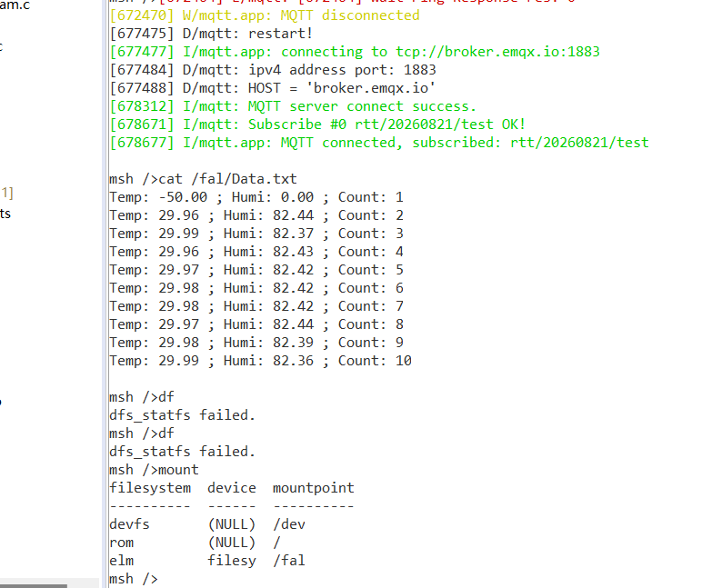

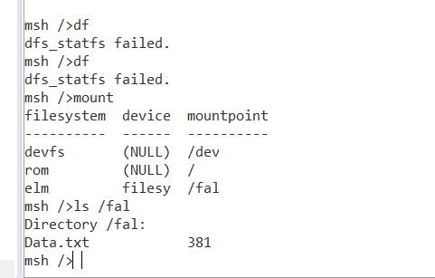

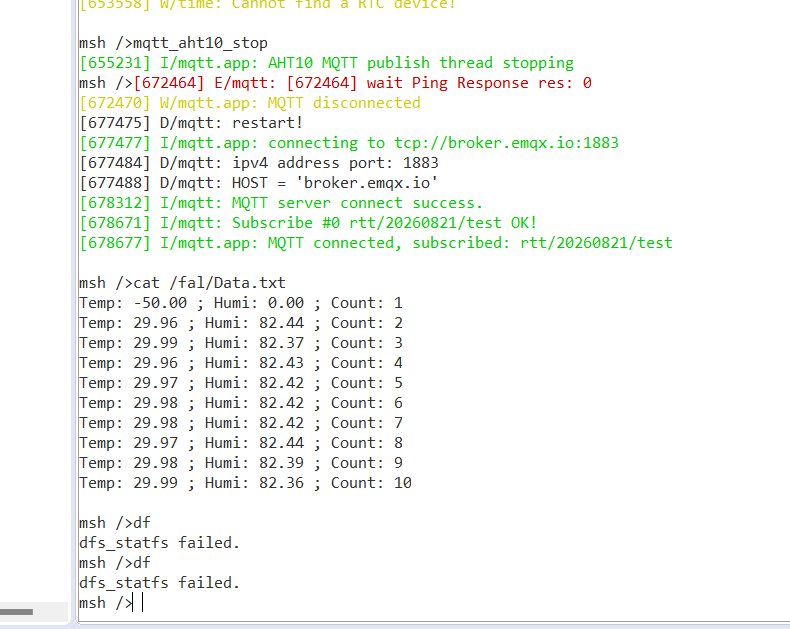

### 2. WiFi 连接

执行 `wifi join LTR` 后，`ifconfig` 显示 `w0` 为 `UP LINK_UP INTERNET_UP`，目标板获得 IP `192.168.127.103`。`ping broker.emqx.io` 能解析到 `35.172.255.228`；ICMP 超时不作为 MQTT 连接失败的判断依据。

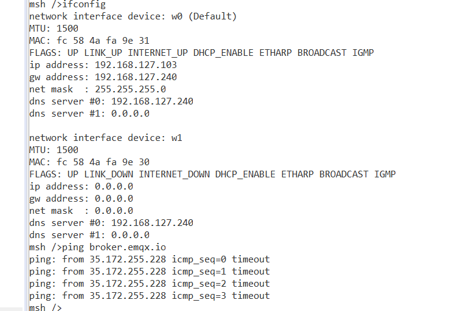

### 3. AHT10 采集与 MQTT 上云

`mqtt_start` 成功连接 `broker.emqx.io:1883`，并订阅 `rtt/20260821/test`。执行 `mqtt_aht10` 可以完成单次采集和发布，执行 `mqtt_aht10_start 2000` 后每 2 秒发布一次，样本计数从 `Count:1` 增长到 `Count:10`。

初始化阶段出现过 `-50.00 / 0.00`，属于驱动准备阶段的缺省值；后续稳定读数约为 `29.97 C / 82.4%`，以稳定读数作为传感器验证依据。运行中出现过 Ping 超时，Paho 随后自动重连成功。

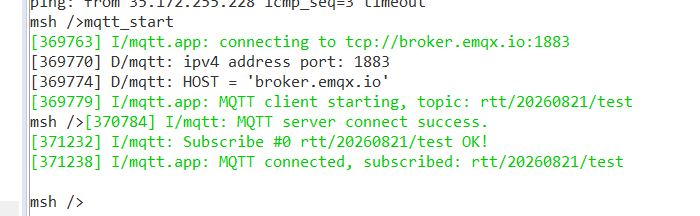

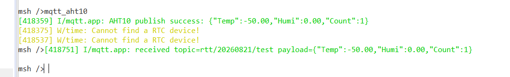

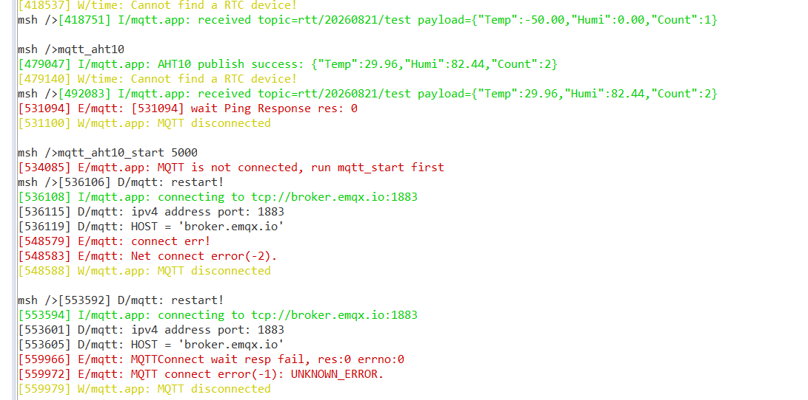

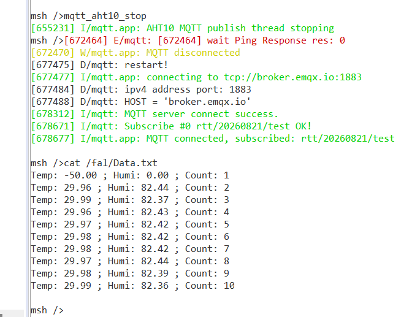

### 4. 云端 MQTT 指令控制 LED

在 MQTTX 中选择 `Plaintext`，主题填写 `rtt/20260821/test`，消息只填写 `toggle`，点击发送。右侧绿色消息表示发布成功，左侧白色消息表示订阅回显。

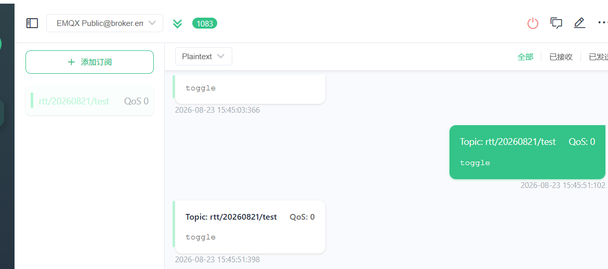

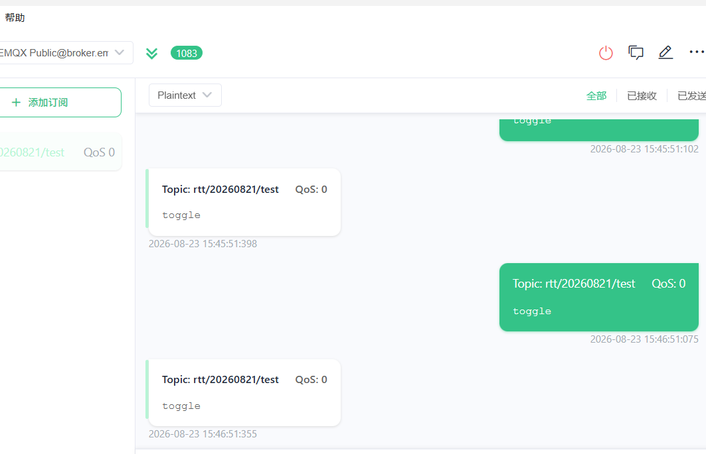

开发板串口先执行 `pin read PF12` 读取 LED 初始状态；收到 `toggle` 后，MQTT 回调打印 `MQTT command toggle: LED_R changed`，随后 PF12 状态由 `off` 变为 `on`，说明云端指令已经进入 LED 翻转逻辑。

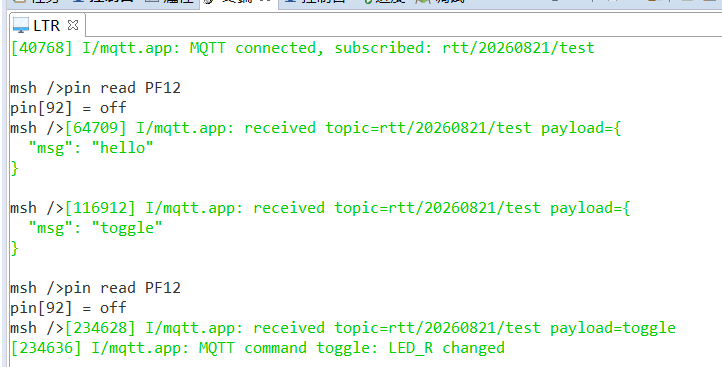

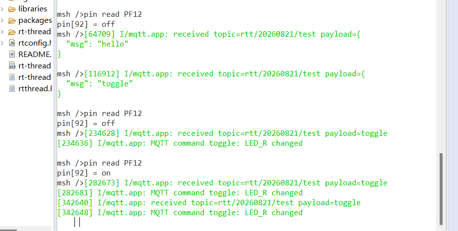

以下两张实物图对应 MQTTX 下发 `toggle` 前后的开发板状态。可以观察到板载指示灯状态发生变化，与串口中 PF12 从 `off` 变为 `on` 的结果相互印证。

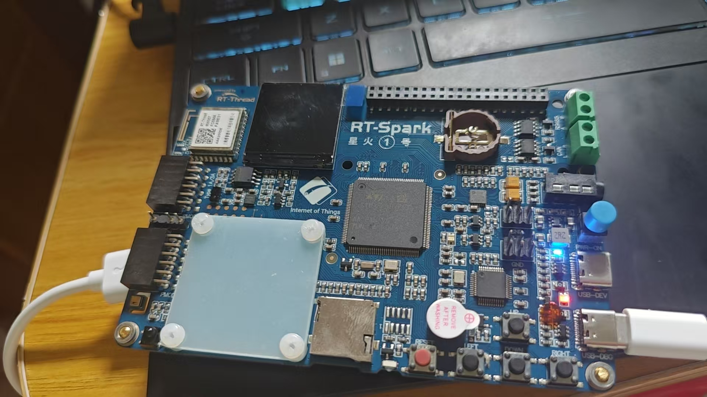

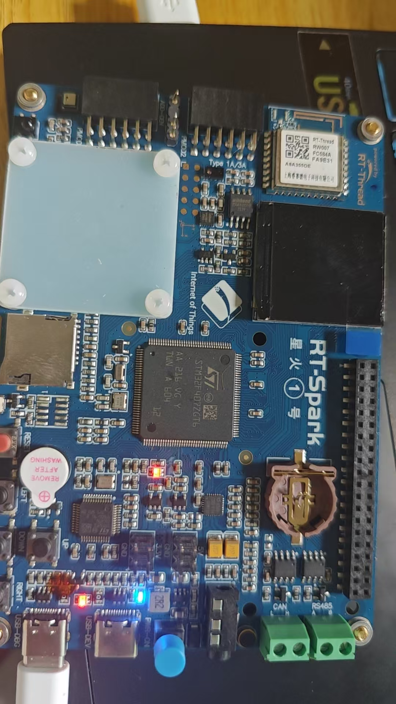

## 六、完整实现链路图

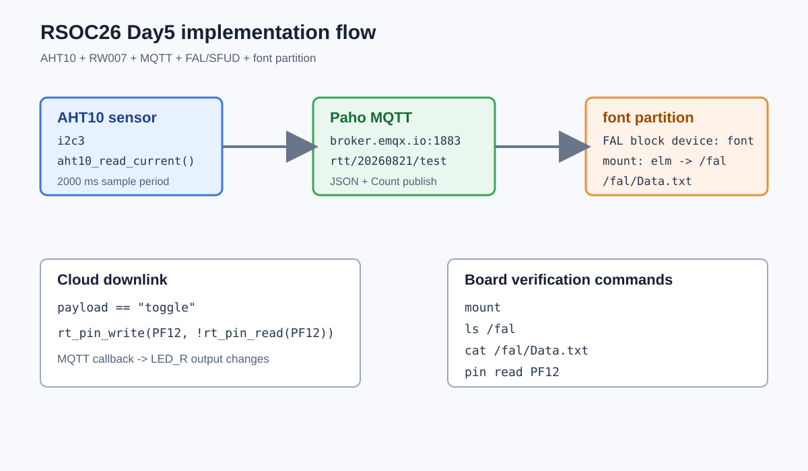

下图汇总了本次 COM21 实测的 WiFi、MQTT、`font/Data.txt` 和 `toggle` 结果。

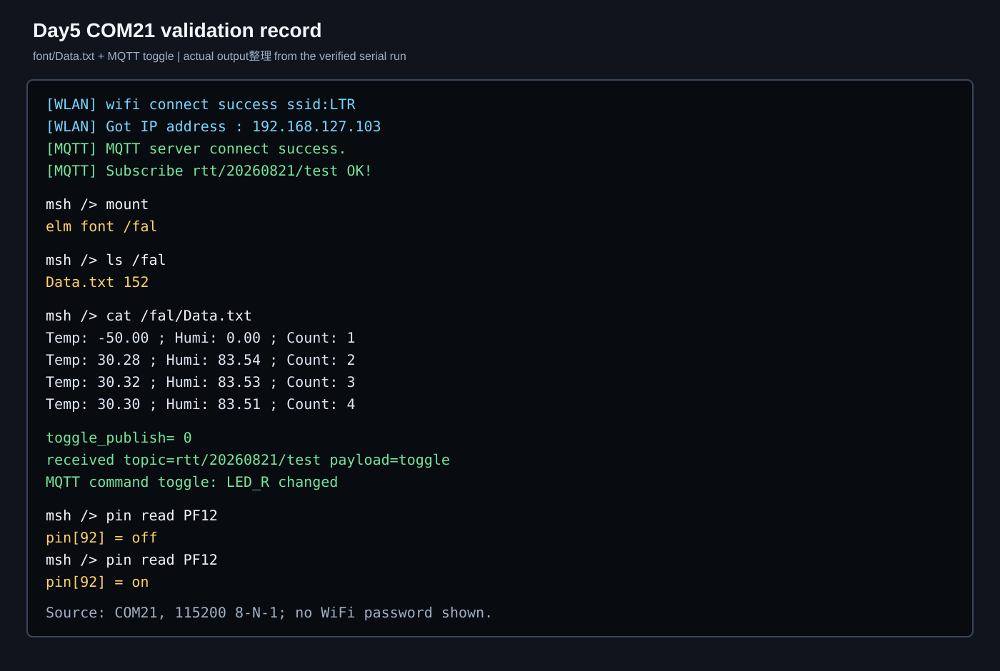

## 七、证据边界

| 证据 | 能证明的内容 | 不能单独证明的内容 |
| --- | --- | --- |
| 构建产物 | 源码进入构建并生成 ELF/BIN | 已下载和硬件运行 |
| ST-LINK 输出 | ELF 写入、校验和复位成功 | MQTT 云端收发 |
| WiFi/IP 输出 | 板端联网并获得地址 | MQTT 长连接永久稳定 |
| MQTT 日志 | Broker 连接、订阅和发布 | ICMP 必须成功 |
| AHT10 连续读数 | 传感器读数路径工作 | 首次缺省值有效 |
| `mount`、`ls`、`cat` | `font` 分区挂载、文件存在和 MQTT 数据读回 | `df` 空间统计接口仍可能返回失败 |

## 八、结论

本次完成了 AHT10 温湿度采集、MQTT 上云、云端 `toggle` 翻转 PF12 LED、`font` 分区挂载，以及 `font/Data.txt` 追加写入和读回。作业中的操作步骤、图片和现象说明已经按功能流程排列。
