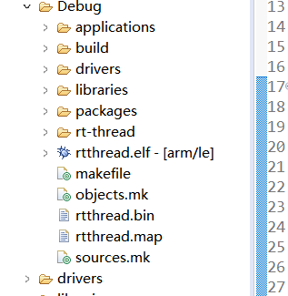
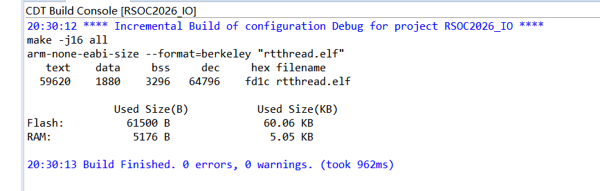
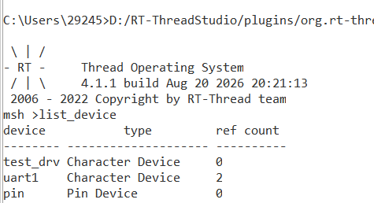
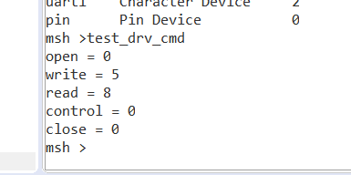

# 第四天作业：虚拟字符设备 test_dev

## 一、作业目标

1. 整理 IO 设备驱动框架课程内容。
2. 分析 PIN 设备从应用 API 到 BSP 的对接过程。
3. 设计并注册一个虚拟字符设备，使用 MSH 命令验证设备生命周期。

## 二、PIN 设备调用链

~~~
应用层 rt_pin_mode/read/write/attach_irq
  -> IO 管理层
  -> PIN 框架层
  -> rt_device_pin_ops
  -> BSP PIN 驱动
  -> STM32 HAL/寄存器
~~~

应用层不直接依赖厂商 HAL。PIN 框架通过统一的 ops 指针转发操作，BSP 层负责端口映射、GPIO 模式、读写和中断注册。这样可以把芯片差异限制在底层适配层。

## 三、test_dev 设计

工程源码：

~~~
D:\RT-ThreadStudio\workspace\RSOC2026_IO\applications\test_dev.c
~~~

设备名称为 test_drv，类型为 RT_Device_Class_Char，注册标志为 RT_DEVICE_FLAG_RDWR。初始化过程如下：

1. rt_device_create() 创建设备对象。
2. 绑定 init、open、close、read、write、control 回调。
3. rt_device_register() 注册设备。
4. INIT_BOARD_EXPORT() 加入自动初始化。

当前回调是虚拟实现：init/open/close/control 返回 RT_EOK，read/write 返回传入的长度，不访问真实硬件或数据缓存。

## 四、终端测试

系统启动进入 msh > 后执行：

~~~
list_device
test_drv_cmd
~~~

根据当前代码推导的预期结果：

~~~
open = 0
write = 5
read = 8
control = 0
close = 0
~~~

这些数值已经在目标板串口中实测得到。test_drv_cmd 中 tx_buf 为 hello，长度为 5；rx_buf 的请求长度为 8；当前虚拟回调分别原样返回 write/read 的传入长度，因此输出与代码路径一致。

## 五、验证记录

### 1. 工程收集和构建

- Debug/applications/subdir.mk 已包含 ../applications/test_dev.c 和 ./applications/test_dev.o。
- CDT Build Console 显示 make -j6 all 完成，rtthread.elf 的 text/data/bss/dec 为 59620/1880/3296/64796。
- 构建结果显示 Flash 使用 61500 B，RAM 使用 5176 B。
- 构建结束信息为 Build Finished. 0 errors, 0 warnings.。
- 工程目录中已生成 Debug/rtthread.elf 和 Debug/rtthread.bin。

### 2. 设备注册和 MSH 验证

启动后的 list_device 输出包含：

~~~text
test_drv Character Device 0
uart1    Character Device 2
pin      Pin Device       0
~~~

test_drv 能出现在设备列表，说明 rt_device_register() 已把虚拟设备加入 IO 管理链表。其引用计数为 0，符合设备刚启动、尚未被命令打开的状态。

执行 test_drv_cmd 后，串口输出为：

~~~text
open = 0
write = 5
read = 8
control = 0
close = 0
~~~

这条输出对应以下代码路径：

- rt_device_find("test_drv") 找到注册设备；
- rt_device_open() 调用 drv_test_open()，返回 0；
- rt_device_write(..., sizeof(tx_buf) - 1) 传入 5，调用 drv_test_write() 后返回 5；
- rt_device_read(..., sizeof(rx_buf)) 传入 8，调用 drv_test_read() 后返回 8；
- rt_device_control(..., 0, RT_NULL) 调用 drv_test_control()，返回 0；
- rt_device_close() 调用 drv_test_close()，返回 0。

命令结束后设备已经关闭，因此 list_device 中的 test_drv 引用计数仍可回到 0。

### 3. 证据边界

| 层级 | 证据 | 结论 |
| --- | --- | --- |
| 源码/收集 | test_dev.c 与 Debug/applications/subdir.mk | 应用源文件已进入工程 |
| 编译/链接 | CDT 控制台 0 errors、0 warnings | 当前工程完整构建成功 |
| 固件产物 | rtthread.elf、rtthread.bin | ELF/BIN 已生成 |
| 串口运行 | list_device 和 test_drv_cmd | 设备注册及生命周期调用已在目标板运行 |
| 实体外设 | 当前驱动无真实硬件操作 | 不适用，不能宣称 GPIO/I2C/SPI 硬件功能 |

## 六、CubeMX 与 RT-Thread Studio 联调外设方案

### 1. 工具分工

CubeMX 负责 MCU 的时钟、GPIO 复用、I2C 外设参数和 MSP 初始化；RT-Thread Studio 负责 RT-Thread 组件开关、BSP 驱动源文件收集、编译链接、下载和串口运行验证。CubeMX 生成代码后，必须确认它确实进入 Studio 的 SConscript/工程资源，不能把生成文件存在当作已经联调。

### 2. 硬件 I2C 配置步骤

以 STM32F407 为例，实际总线和引脚必须以当天星火一号板卡资料为准：

1. CubeMX 选择 STM32F407ZGTx，配置系统时钟和调试接口。
2. 开启 I2C1、I2C2 或 I2C3，检查 SCL/SDA 的 Alternate Function 和开漏配置。
3. 检查外部上拉电阻。I2C 高电平由上拉产生，不能用普通推挽输出代替。
4. 将速度先设为 100 kHz，配置 7 位地址模式；稳定后再根据器件手册提高速度。
5. 保存 `.ioc`，生成 `MX_I2Cx_Init()`、`HAL_I2C_MspInit()` 等初始化代码。
6. 在 RT-Thread Studio 中开启 `RT_USING_I2C` 和对应 BSP 硬件 I2C 驱动，确认 `HAL_I2C_MODULE_ENABLED`、HAL I2C 源文件和 BSP `master_xfer` 均已进入工程。
7. 刷新工程并检查 `SConscript`、`subdir.mk`，避免只添加头文件而遗漏 C 源文件。
8. 构建、下载、打开串口，先执行 `list_device`，确认 `i2cX` 总线注册后再执行读写。

当前 `RSOC2026_IO` 的 `rtconfig.h` 只开启了 `RT_USING_PIN`，尚未开启 I2C；因此本节是后续联调方案，不把它写成 `test_dev` 已完成的硬件 I2C 证据。

### 3. 星火一号软件 I2C 配置

星火一号 SDK 的 `rtconfig.h` 已开启：

~~~c
#define RT_USING_I2C
#define RT_USING_I2C_BITOPS
~~~

其 Kconfig 以软件模拟方式提供总线配置：

| 配置项 | SCL | SDA | 用途说明 |
| --- | --- | --- | --- |
| `BSP_USING_I2C1` | PB8，24 | PB9，25 | 软件 I2C1 |
| `BSP_USING_I2C2` | PF1，81 | PF0，80 | AP3216C、ICM20608、ES8388 等板载器件 |
| `BSP_USING_I2C3` | PE0，64 | PE1，65 | AHT21 板载器件 |

软件 I2C 的 BSP 文件 `drv_soft_i2c.c` 将这些引脚设置为开漏输出，通过 `rt_pin_read/write()` 读取或驱动 SCL/SDA，再由 `i2c-bit-ops.c` 产生 I2C 时序。该路径不调用 STM32 I2C 外设寄存器，但仍然依赖 PIN 框架、GPIO HAL 和外部上拉。

## 七、以 I2C 为例的驱动链路

### 1. 硬件 I2C 链路

~~~
应用层 rt_i2c_transfer()
  -> i2c_core.c
  -> bus->ops->master_xfer()
  -> BSP 硬件 I2C 驱动
  -> HAL_I2C_Master_Transmit/Receive 或寄存器
  -> SCL/SDA 物理总线
  -> I2C 从设备
~~~

应用调用 `rt_i2c_bus_device_find()` 获取总线，再用 `struct rt_i2c_msg` 描述一次或多次事务。I2C 核心通过总线互斥锁保护传输，最终调用 BSP 提供的 `master_xfer`。硬件驱动负责把统一 message 转换成 HAL 或寄存器操作。

### 2. 软件 I2C 链路

~~~
应用层 rt_i2c_transfer()
  -> i2c-bit-ops.c
  -> set_sda/set_scl/get_sda/get_scl
  -> rt_pin_write/read()
  -> PIN ops
  -> STM32 GPIO HAL
  -> SCL/SDA 物理总线
~~~

硬件 I2C 和软件 I2C 的上层 API 可以保持一致，变化集中在总线驱动的 `master_xfer` 实现。这个差异体现了 RT-Thread 设备框架通过 ops 隔离硬件实现的作用。

### 3. I2C 消息结构

RT-Thread 4.1.1 中 `struct rt_i2c_msg` 主要字段为：

| 字段 | 含义 |
| --- | --- |
| `addr` | 从设备 7 位地址，不要在应用层提前左移 |
| `flags` | `RT_I2C_WR`、`RT_I2C_RD` 等读写和停止控制标志 |
| `len` | 当前 message 的数据长度 |
| `buf` | 发送或接收缓冲区 |

寄存器读通常需要两个 message：第一个写寄存器地址，第二个读寄存器数据，中间由驱动产生重复起始条件。

### 4. 单字节写与寄存器读示例

下面代码为作业示例，`i2c1`、`0x68` 和寄存器地址必须替换为实际硬件参数；它不代表当前 `test_dev` 工程已完成运行验证。

~~~c
#include <rtthread.h>
#include <rtdevice.h>

#define I2C_BUS_NAME "i2c1"
#define I2C_DEV_ADDR 0x68

static int i2c_reg_write(rt_uint8_t reg, rt_uint8_t value)
{
    struct rt_i2c_bus_device *bus;
    struct rt_i2c_msg msg;
    rt_uint8_t data[2] = {reg, value};

    bus = rt_i2c_bus_device_find(I2C_BUS_NAME);
    if (bus == RT_NULL)
        return -RT_ERROR;

    msg.addr = I2C_DEV_ADDR;
    msg.flags = RT_I2C_WR;
    msg.len = sizeof(data);
    msg.buf = data;

    return (rt_i2c_transfer(bus, &msg, 1) == 1) ? RT_EOK : -RT_EIO;
}

static int i2c_reg_read(rt_uint8_t reg, rt_uint8_t *value)
{
    struct rt_i2c_bus_device *bus;
    struct rt_i2c_msg msgs[2];

    if (value == RT_NULL)
        return -RT_EINVAL;

    bus = rt_i2c_bus_device_find(I2C_BUS_NAME);
    if (bus == RT_NULL)
        return -RT_ERROR;

    msgs[0].addr = I2C_DEV_ADDR;
    msgs[0].flags = RT_I2C_WR;
    msgs[0].len = 1;
    msgs[0].buf = &reg;

    msgs[1].addr = I2C_DEV_ADDR;
    msgs[1].flags = RT_I2C_RD;
    msgs[1].len = 1;
    msgs[1].buf = value;

    return (rt_i2c_transfer(bus, msgs, 2) == 2) ? RT_EOK : -RT_EIO;
}
~~~

### 5. 具体验证清单

| 阶段 | 操作 | 证据 |
| --- | --- | --- |
| CubeMX | 查看 `.ioc` 中 MCU、I2C 实例、SCL/SDA、速度和时钟 | 配置截图或 `.ioc` 文件 |
| 工程收集 | 检查 Studio 工程树、SConscript、`subdir.mk` | 生成文件和驱动均在编译列表 |
| 构建 | Build Project | 0 errors、0 warnings、ELF/BIN |
| 设备注册 | 下载后执行 `list_device` | 出现 `i2cX` 总线设备 |
| 协议传输 | 执行单字节写、寄存器读、多字节读 | 返回 message 数和数据日志 |
| 电气层 | 逻辑分析仪查看 START、地址、ACK、STOP | SCL/SDA 波形 |
| 器件层 | 读取芯片 ID 或固定寄存器并重复验证 | 稳定一致的 ID/数据 |

不能用“CubeMX 生成成功”证明设备通信成功，也不能用“Studio 编译成功”证明下载和物理 I2C 波形正常。

## 八、硬件 I2C 与软件 I2C 对比

| 项目 | 硬件 I2C | 软件 I2C |
| --- | --- | --- |
| 实现方式 | MCU I2C 外设、状态机、寄存器 | GPIO bit-bang 产生起始、数据和应答 |
| RT-Thread 对接 | BSP 提供 `master_xfer`，通常调用 HAL I2C | `rt_i2c_bit_add_bus`、`rt_i2c_bit_ops` 和 PIN API |
| 引脚 | 受 Alternate Function 和 I2C 实例限制 | 引脚更灵活，但必须开漏和外部上拉 |
| CPU 占用 | 较低，可使用中断或 DMA | 较高，延时和每个时序位都占用 CPU |
| 速度 | 通常更高、更稳定 | 受 GPIO 操作、延时和线程调度影响 |
| 优点 | 适合量产、高速、多设备场景 | 适合旧 BSP、低速器件和没有硬件 I2C 的引脚 |
| 风险 | HAL、时钟、复用、IRQ/DMA 配置复杂 | 无上拉、推挽拉高、延时不准、线程抢占、总线锁死 |

### 选择原则

- 目标芯片和 BSP 已有稳定硬件 I2C 驱动时，优先硬件 I2C。
- 芯片支持包较旧、硬件 I2C 适配缺失或引脚没有合适复用时，可先使用软件 I2C。
- 软件 I2C 不是“无需配置”：仍需配置 GPIO、开漏、上拉、时序延时、总线解锁和线程互斥。
- 两种实现都应通过同一套 `rt_i2c_bus_device` 和 `rt_i2c_msg` 上层接口，避免把硬件差异写入器件驱动。

## 九、I2C 排错顺序

1. `list_device` 没有 `i2cX`：检查 `RT_USING_I2C`、`BSP_USING_I2CX`、I2C SConscript 和 BSP 初始化导出。
2. 总线存在但返回 0：检查 7 位地址、`flags`、message 数量和 `master_xfer` 返回值。
3. 一直 NACK：检查器件供电、地址脚、SDA/SCL 接线、上拉和复位状态。
4. SCL 被拉低：检查器件是否卡在半帧，必要时输出 9 个时钟尝试释放总线。
5. 没有波形：检查 GPIO 时钟、引脚复用、开漏配置、驱动是否编译和读写函数是否执行。
6. 有波形但数据错误：降到 100 kHz，逐字节检查 ACK、寄存器地址和读写时序。
