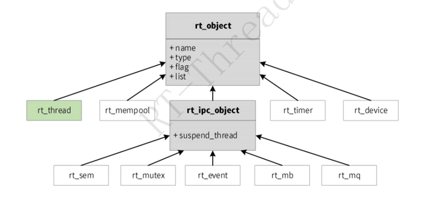

# 第三天笔记：RT-Thread 内核 IPC

日期：2026-08-19

## 一、课程主线

IPC（Inter-Process Communication）用于线程之间的同步与通信。Day3 重点理解：资源不可用时线程如何阻塞，资源就绪后如何恢复；同步对象和通信对象的区别；永久等待、非阻塞尝试、超时等待、紧急发送和对象销毁的行为。

| 类型 | 对象 | 主要用途 |
| --- | --- | --- |
| 线程同步 | 信号量 | 事件通知、资源计数 |
| 线程同步 | 互斥量 | 保护临界区和共享资源 |
| 线程同步 | 事件集 | 表达一个或多个同步条件 |
| 线程通信 | 邮箱 | 传递固定宽度的值或指针 |
| 线程通信 | 消息队列 | 传递固定长度的结构化消息 |



该图用于理解线程、定时器和 IPC 对象都属于 RT-Thread 内核对象体系，不是某个 IPC 命令已经运行的证据。

## 二、临界区与阻塞模型

临界区是访问共享资源的一段代码，同一时刻只能由一个执行流进入。共享变量、设备寄存器、环形缓冲区和串口输出状态都可能成为临界资源。锁的范围应覆盖完整事务，例如“检查条件、修改状态、记录结果”；持锁期间不应进行长时间延时或永久等待。

| 等待方式 | 资源不可用时的行为 | 适用场景 |
| --- | --- | --- |
| 永久阻塞 | 线程挂起，直到资源可用 | 必须等待的工作线程 |
| 非阻塞尝试 | 立即返回成功或失败 | 状态探测、不能等待的路径 |
| 超时等待 | 等待指定 Tick，超时返回 | 需要有界响应时间的任务 |

```text
调用 take/recv
    -> 资源不可用
    -> 当前线程进入挂起态
    -> 调度器运行其他就绪线程
    -> 资源到达或等待超时
    -> 当前线程重新进入就绪队列
```

`state=suspend` 只能说明线程当前没有参与调度，不能单独说明它是在延时、等待 IPC，还是被显式挂起。

## 三、信号量

信号量通过计数值表示可用令牌数量，没有线程所有权，适合线程同步和资源计数，不适合代替互斥量保护复杂临界区。二值信号量通常表示事件未到达或已到达；计数信号量表示多个同类资源。

```text
初始值为 0
    -> rt_sem_take() 没有令牌
    -> 当前线程阻塞
    -> 其他线程 rt_sem_release()
    -> 等待线程被唤醒并获取令牌
```

主要 API：

```c
rt_sem_t rt_sem_create(const char *name, rt_uint32_t value, rt_uint8_t flag);
rt_err_t rt_sem_delete(rt_sem_t sem);
rt_err_t rt_sem_init(rt_sem_t sem, const char *name,
                     rt_uint32_t value, rt_uint8_t flag);
rt_err_t rt_sem_detach(rt_sem_t sem);
rt_err_t rt_sem_take(rt_sem_t sem, rt_int32_t timeout);
rt_err_t rt_sem_trytake(rt_sem_t sem);
rt_err_t rt_sem_release(rt_sem_t sem);
```

`RT_WAITING_FOREVER` 表示永久等待；`rt_sem_trytake()` 或超时参数为 0 表示非阻塞尝试。静态对象使用 `init -> detach`，动态对象使用 `create -> delete`。

```c
static struct rt_semaphore sem;

rt_sem_init(&sem, "sem", 0, RT_IPC_FLAG_FIFO);
if (rt_sem_take(&sem, RT_WAITING_FOREVER) == RT_EOK)
{
    rt_kprintf("event received\\n");
}
rt_sem_release(&sem);
rt_sem_detach(&sem);
```

信号量释放不要求释放者就是获取者，这一点与互斥量不同。信号量内部计数不能直接当作业务统计变量使用。

## 四、互斥量

互斥量是带所有权的锁，主要用于保护临界区。成功获取互斥量的线程成为持有者，通常只有持有者才能释放。RT-Thread 的互斥量记录持有者和持有次数，支持同一线程递归获取，并通过优先级继承降低优先级翻转的影响。

| 对比项 | 信号量 | 互斥量 |
| --- | --- | --- |
| 所有权 | 无 | 有 |
| 主要用途 | 同步、资源计数 | 临界区保护 |
| 释放限制 | 不依赖获取者身份 | 通常由持有者释放 |
| 优先级继承 | 无互斥所有权语义 | 支持 |

优先级翻转过程是：低优先级线程持锁，高优先级线程等待，中优先级线程持续抢占低优先级线程。互斥量会临时提升锁持有者的优先级，但不能替代合理的锁粒度、锁顺序和有界临界区设计。

主要 API：

```c
rt_mutex_t rt_mutex_create(const char *name, rt_uint8_t flag);
rt_err_t rt_mutex_delete(rt_mutex_t mutex);
rt_err_t rt_mutex_init(rt_mutex_t mutex, const char *name, rt_uint8_t flag);
rt_err_t rt_mutex_detach(rt_mutex_t mutex);
rt_err_t rt_mutex_take(rt_mutex_t mutex, rt_int32_t timeout);
rt_err_t rt_mutex_trytake(rt_mutex_t mutex);
rt_err_t rt_mutex_release(rt_mutex_t mutex);
```

```c
static struct rt_mutex lock;
static rt_int32_t value;

rt_mutex_init(&lock, "lock", RT_IPC_FLAG_PRIO);
if (rt_mutex_take(&lock, RT_WAITING_FOREVER) == RT_EOK)
{
    value++;
    rt_mutex_release(&lock);
}
rt_mutex_detach(&lock);
```

“检查条件、修改数据、记录结果”应放在同一个临界区中。只给某一条赋值语句加锁，仍可能在检查和修改之间产生竞态。

## 五、事件集

事件集只表达同步条件，不携带业务数据。当前 RT-Thread 使用 32 位事件集合，每一位表示一个独立事件。事件位是状态，不是消息队列；重复发送同一位不会按次数排队。

```c
#define EVENT_NET_READY      (1u << 0)
#define EVENT_SENSOR_READY   (1u << 1)
#define EVENT_STORAGE_READY  (1u << 2)
```

| 选项 | 含义 |
| --- | --- |
| `RT_EVENT_FLAG_OR` | 指定事件中任意一位满足即可返回 |
| `RT_EVENT_FLAG_AND` | 指定的所有事件位都满足后才返回 |
| `RT_EVENT_FLAG_CLEAR` | 成功接收后清除匹配的事件位 |

主要 API：

```c
rt_event_t rt_event_create(const char *name, rt_uint8_t flag);
rt_err_t rt_event_delete(rt_event_t event);
rt_err_t rt_event_init(rt_event_t event, const char *name, rt_uint8_t flag);
rt_err_t rt_event_detach(rt_event_t event);
rt_err_t rt_event_send(rt_event_t event, rt_uint32_t set);
rt_err_t rt_event_recv(rt_event_t event, rt_uint32_t set,
                       rt_uint8_t option, rt_int32_t timeout,
                       rt_uint32_t *recved);
```

```c
static struct rt_event event;
rt_uint32_t recved;

rt_event_init(&event, "event", RT_IPC_FLAG_FIFO);
rt_event_send(&event, EVENT_NET_READY);
rt_event_recv(&event,
              EVENT_NET_READY | EVENT_SENSOR_READY,
              RT_EVENT_FLAG_AND | RT_EVENT_FLAG_CLEAR,
              RT_WAITING_FOREVER, &recved);
rt_event_detach(&event);
```

事件集只负责同步条件，不负责保存模块名称、数据内容或事件发生次数。超时后若要说明未完成条件，应由应用层维护状态掩码并设置同步边界。

## 六、邮箱

邮箱是轻量的线程通信对象，每个槽位保存一个 `rt_ubase_t` 宽度的值。在 32 位 MCU 上通常为 4 字节，可以传递整数或指针。通过指针传递结构体时，指向的对象必须在接收线程使用期间保持有效。

主要 API：

```c
rt_mailbox_t rt_mb_create(const char *name, rt_size_t size, rt_uint8_t flag);
rt_err_t rt_mb_delete(rt_mailbox_t mb);
rt_err_t rt_mb_init(rt_mailbox_t mb, const char *name,
                    void *msg_pool, rt_size_t size, rt_uint8_t flag);
rt_err_t rt_mb_detach(rt_mailbox_t mb);
rt_err_t rt_mb_send(rt_mailbox_t mb, rt_ubase_t value);
rt_err_t rt_mb_send_wait(rt_mailbox_t mb, rt_ubase_t value, rt_int32_t timeout);
rt_err_t rt_mb_urgent(rt_mailbox_t mb, rt_ubase_t value);
rt_err_t rt_mb_recv(rt_mailbox_t mb, rt_ubase_t *value, rt_int32_t timeout);
```

```c
static struct rt_mailbox mailbox;
static rt_ubase_t pool[4];
rt_ubase_t value;

rt_mb_init(&mailbox, "mail", pool, 4, RT_IPC_FLAG_FIFO);
rt_mb_send(&mailbox, 0x1234);
rt_mb_recv(&mailbox, &value, RT_WAITING_FOREVER);
rt_mb_detach(&mailbox);
```

普通发送在邮箱满时立即返回；`rt_mb_send_wait()` 可以等待空位；`rt_mb_urgent()` 将邮件插入队首。带等待的接口不能在中断上下文中使用。不能发送线程栈上即将失效的临时对象地址。

## 七、消息队列

消息队列用于传递固定最大长度的消息。发送时复制消息内容，接收时复制到接收缓冲区，适合传递结构体、串口帧和传感器数据。消息池必须容纳指定数量的、按 `RT_ALIGN_SIZE` 对齐后的消息块。

主要 API：

```c
rt_mq_t rt_mq_create(const char *name, rt_size_t msg_size,
                     rt_size_t max_msgs, rt_uint8_t flag);
rt_err_t rt_mq_delete(rt_mq_t mq);
rt_err_t rt_mq_init(rt_mq_t mq, const char *name, void *msgpool,
                    rt_size_t msg_size, rt_size_t pool_size, rt_uint8_t flag);
rt_err_t rt_mq_detach(rt_mq_t mq);
rt_err_t rt_mq_send(rt_mq_t mq, const void *buffer, rt_size_t size);
rt_err_t rt_mq_send_wait(rt_mq_t mq, const void *buffer,
                         rt_size_t size, rt_int32_t timeout);
rt_err_t rt_mq_urgent(rt_mq_t mq, const void *buffer, rt_size_t size);
rt_err_t rt_mq_recv(rt_mq_t mq, void *buffer,
                    rt_size_t size, rt_int32_t timeout);
```

```c
struct sensor_msg
{
    rt_uint32_t id;
    rt_uint16_t value;
};

#define MSG_SIZE RT_ALIGN(sizeof(struct sensor_msg), RT_ALIGN_SIZE)
static struct rt_messagequeue queue;
static rt_uint8_t pool[MSG_SIZE * 5];
struct sensor_msg tx = {1001, 250};
struct sensor_msg rx;

rt_mq_init(&queue, "sensorq", pool, MSG_SIZE,
           sizeof(pool), RT_IPC_FLAG_FIFO);
rt_mq_send(&queue, &tx, sizeof(tx));
rt_mq_recv(&queue, &rx, sizeof(rx), RT_WAITING_FOREVER);
rt_mq_detach(&queue);
```

`rt_mq_send()` 在队列满时立即返回错误；`rt_mq_send_wait()` 可以在限定时间内等待空间；`rt_mq_urgent()` 将消息插入队首。生产者必须检查发送结果。

## 八、五类 IPC 的区别

| 对象 | 是否携带业务数据 | 是否有所有权 | 典型等待条件 | 典型应用 |
| --- | --- | --- | --- | --- |
| 信号量 | 否 | 否 | 令牌数量大于 0 | 事件通知、资源计数 |
| 互斥量 | 否 | 有 | 锁未被其他线程持有 | 共享资源保护 |
| 事件集 | 否 | 否 | OR 或 AND 条件满足 | 多条件同步 |
| 邮箱 | 一个值或指针 | 否 | 邮箱中存在邮件 | 轻量通知、指针传递 |
| 消息队列 | 固定长度数据 | 否 | 队列中存在消息 | 生产者消费者、结构体传递 |

选择原则：通知或限制资源数量使用信号量；保护共享数据一致性使用互斥量；等待多个条件使用事件集；传递一个值或指针使用邮箱；复制结构化数据使用消息队列。

## 九、动态与静态对象生命周期

```text
动态对象：create -> 使用 -> delete
静态对象：init   -> 使用 -> detach
```

动态对象由系统堆分配控制块和相关内存，适合数量或生命周期在运行时确定的场景，但必须处理内存不足和删除时的等待线程唤醒问题。

静态对象由应用提供控制块和缓冲区，边界更明确。执行 `detach` 或 `delete` 前，必须确保没有线程继续等待或访问对象。动态对象不能使用 `detach`，静态对象不能使用 `delete`。

## 十、RT-Thread 工程中的 IPC

本地工程：

```text
D:\RT-ThreadStudio\workspace\RSOC2026_IPC
```

`rtconfig.h` 已启用：

```text
RT_USING_SEMAPHORE
RT_USING_MUTEX
RT_USING_EVENT
RT_USING_MAILBOX
RT_USING_MESSAGEQUEUE
RT_USING_MSH
FINSH_USING_MSH
```

工程中的 `kernel_samples-latest` 提供信号量、互斥量、事件集、邮箱、邮箱紧急发送和消息队列示例，并通过 MSH 导出对应命令。重复运行示例前，应确认上一次示例已经结束并完成对象清理，避免固定名称对象残留。

## 十一、验证边界

| 证据层级 | 可以说明什么 | 不能替代什么 |
| --- | --- | --- |
| 配置 | IPC 相关宏已启用 | 不能证明对象已经运行 |
| 源码 | API 调用和对象关系存在 | 不能证明固件已下载 |
| 构建 | 源码已编译、链接产物已生成 | 不能证明串口输出 |
| 下载 | 固件已写入并复位启动 | 不能证明每个命令已执行 |
| 串口 | MSH 回显、线程日志和 IPC 输出 | 不能单独证明实体硬件现象 |
| 硬件 | 可重复的板卡现象 | 不能替代源码和串口证据 |

当前本地工程已完成 IPC 源码收集、编译、链接以及 `rt-thread.elf` 和 `rtthread.bin` 生成；下载、串口命令和实体运行需要单独记录，不能由构建结果推断。

## 十二、官方资料与工程源码

- [RT-Thread IPC：信号量](https://www.rt-thread.org/document/site/#/rt-thread-version/rt-thread-standard/programming-manual/ipc1/ipc1?id=%e4%bf%a1%e5%8f%b7%e9%87%8f)
- [RT-Thread IPC：互斥量](https://www.rt-thread.org/document/site/#/rt-thread-version/rt-thread-standard/programming-manual/ipc1/ipc1?id=%e4%ba%92%e6%96%a5%e9%87%8f)
- [RT-Thread IPC：事件集](https://www.rt-thread.org/document/site/#/rt-thread-version/rt-thread-standard/programming-manual/ipc1/ipc1?id=%e4%ba%8b%e4%bb%b6%e9%9b%86)
- [RT-Thread IPC：邮箱和消息队列](https://www.rt-thread.org/document/site/#/rt-thread-version/rt-thread-standard/programming-manual/ipc2/ipc2)

本地对应源码：

```text
D:\RT-ThreadStudio\workspace\RSOC2026_IPC\rt-thread\include\rtthread.h
D:\RT-ThreadStudio\workspace\RSOC2026_IPC\rt-thread\src\ipc.c
D:\RT-ThreadStudio\workspace\RSOC2026_IPC\packages\kernel_samples-latest\zh\
```
